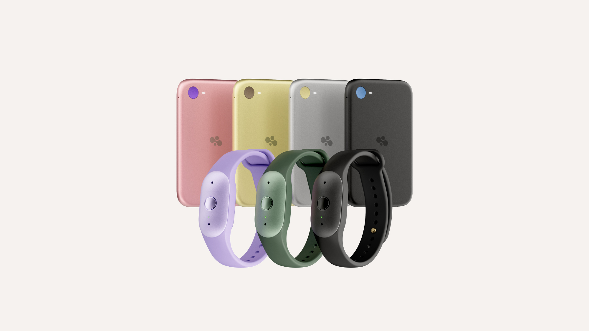

# 아마존 Bee, 녹음은 지워도 받아쓴 글은 남는다

_무료 이용자에게 남는 기록은 14일치이고, 월 11.99달러를 내면 기한이 풀린다. 그 기록은 지메일·알렉사로도 흘러간다_

## Executive Summary

> [!callout]
> 이 글은 아마존이 10월 15일 내놓은 AI 기기 두 대를 데이터가 어디에 쌓이는지의 관점에서 읽는다. 손목이나 옷에 차는 Bee Frontier가 74.99달러, 폰 뒤에 자석으로 붙는 신용카드 크기 Bee Eclipse가 99.99달러부터다. 2025년 아마존이 신생 기업 Bee를 인수한 뒤 처음 내놓은 제품이다.

> 두 기기가 앞세운 약속은 원본 음성을 남기지 않는다는 것이다. 마이크가 들은 소리는 실시간으로 처리된 다음 곧바로 삭제되고 따로 저장되지 않는다고 아마존은 적었다. 그런데 삭제 대상이 아닌 것이 따로 있다. 받아쓴 대화 녹취록과 요약이다. 그중 녹취록은 기기가 만들어 쥐고 있는 키로 암호화된 채 남는다는 것이 아마존의 설명이다. 무료로 받는 기록은 14일치이고, 월 11.99달러짜리 Bee Pro를 쓰면 그 기한이 풀린다.

> 여기까지는 아마존 발표문과 테크크런치 보도에 적힌 사실이다. 4절 뒤쪽과 5절에서 요금표와 연동 목록을 "값이 매겨진 쪽은 텍스트"라는 신호로 읽는 대목은 이 글의 해석이다.

### 주요 수치

네 칸을 뽑았다. 앞의 둘은 기기를 사는 데 드는 값, 뒤의 둘은 그 기기가 만든 텍스트에 매겨진 값과 그 텍스트가 닿는 범위다.

출처: [아마존 공식 발표](https://www.aboutamazon.com/news/devices/amazon-personal-ai-bee-frontier-bee-eclipse), [테크크런치 보도(2026년 10월 15일)](https://techcrunch.com/2026/10/15/amazons-bee-launches-two-new-personal-ai-devices-starting-at-75).

<!-- stat-card -->
**74.99달러** — Bee Frontier 값 — 손목과 옷에 다는 웨어러블. 테크크런치가 나란히 놓은 Pocket AI(129달러), Plaud Note(159달러, Pro 모델 189달러) 어느 쪽보다도 싸다

<!-- stat-card -->
**21일 이상** — Bee Eclipse 배터리 — 폰 뒤에 붙는 신용카드 크기 기기로 99.99달러부터다. 손목에 차는 Frontier는 최대 7일이라, 한 번 붙여 두고 잊어도 되는 쪽은 Eclipse다

<!-- stat-card -->
**14일** — 무료 이용자에게 남는 기록 — 요금을 내지 않으면 받아쓴 기록과 요약이 14일치만 쌓인다. 월 11.99달러짜리 Bee Pro가 푸는 것이 이 기한이다

<!-- stat-card -->
**연동 7곳** — 아마존이 이름을 든 연결 대상 — 지메일, 구글 캘린더, 아웃룩, 애플 헬스킷, 휴대폰 사진, Alexa+, 아마존닷컴. 음성이 지워진 뒤에도 받아쓴 글은 이 통로로 오간다

## 손목의 Bee Frontier, 폰 뒤의 Bee Eclipse

아마존은 2025년에 AI 웨어러블 신생 기업 Bee를 사들였다. 10월 15일에 공개한 Bee Frontier와 Bee Eclipse는 그 인수 뒤 처음 나온 제품이다. 둘 다 하는 일은 같다. 하루 동안 주변에서 오간 말을 듣고, 그것을 요약과 할 일 목록으로 바꿔 사용자에게 돌려준다. 다른 것은 몸에 붙는 자리다.

*▲ Bee Frontier(손목 밴드, 라벤더·세이지·오닉스)와 Bee Eclipse(휴대폰 부착형, 핑크·골드·실버·블랙) | 출처: [아마존 공식 발표](https://www.aboutamazon.com/news/devices/amazon-personal-ai-bee-frontier-bee-eclipse)*

Bee Frontier는 손목에 차거나 옷에 다는 74.99달러짜리 기기다. 오닉스, 라벤더, 세이지 세 가지 색으로 나왔고 IP67 등급의 방수를 갖췄다. 배터리는 최대 7일 가고 USB-C로 충전한다. 마이크는 두 개를 달아 잡음을 걸러 내며, 겉에 있는 것은 버튼 하나와 작동 상태를 알리는 LED뿐이다. 지금 바로 살 수 있다.

Bee Eclipse는 휴대폰 뒤에 자석으로 붙이는 신용카드 크기 부착물이고 99.99달러부터다. 실버, 미드나이트, 허니, 블러시 네 가지 색이 준비돼 있다. 배터리가 21일 이상 가는 것이 Frontier와 가장 크게 갈리는 지점이다. 출시 시점은 아직 공개되지 않았다.

값과 착용 자리와 배터리 셋만 놓고 보면 두 기기의 쓰임새가 갈린다. 손목에 차고 매주 충전하는 쪽이 Frontier, 폰 뒤에 한 번 붙여 두고 세 주를 잊어도 되는 쪽이 Eclipse다. 아래 표는 아마존이 공개한 사양 가운데 이 선택에 걸리는 항목만 추렸다.

| 항목 | Bee Frontier | Bee Eclipse |
| --- | --- | --- |
| 값 | 74.99달러 | 99.99달러부터 |
| 착용 | 손목에 차거나 옷에 단다 | 휴대폰 뒤에 자석으로 붙인다 |
| 배터리 | 최대 7일, USB-C 충전 | 21일 이상 |
| 색 | 오닉스, 라벤더, 세이지 | 실버, 미드나이트, 허니, 블러시 |
| 판매 | 지금 구매 가능 | 출시 예정 |

값을 보면 어느 자리를 노렸는지가 드러난다. 테크크런치가 같은 자리에 놓고 견준 제품은 Pocket AI 129달러, Plaud Note 159달러(Pro 모델 189달러)다. 아마존은 그 아래를 끊고 들어왔다. 하루 종일 켜 두는 기기를 살 때 망설이게 하는 값의 문턱을 먼저 낮춘 셈이다.

## 지운다고 말할 때 지우는 것

항상 듣는 기기를 팔려면 듣고 난 뒤에 무엇을 하는지부터 설명해야 한다. 아마존이 이번 발표에서 전면에 세운 이름은 "Bee Private Compute"다. 대화를 안전하고 격리된 처리 환경 안에서 다루며, 아마존을 포함해 그 누구도 사용자의 데이터에 접근할 수 없다는 것이 회사의 설명이다.

이 구조에서 원본 음성이 받는 처분은 분명하다. 마이크가 들은 소리는 실시간으로 인사이트로 바뀐 뒤 곧바로 삭제된다. 원본 음성은 저장되지 않는다고 아마존은 못 박았다. 통화를 녹음하려 하면 상대방에게 동의를 구하라는 안내가 화면에 뜨고, 기기에는 전원 버튼 하나와 작동 여부를 알리는 LED가 달려 있다. 켜져 있는지 아닌지를 몸 밖에서 알아볼 수 있게 한 설계다.

여기까지만 읽으면 프라이버시 문제가 닫힌 것처럼 보인다. 녹음이 남지 않으면 유출될 음성도 없다. 실제로 이 문장이 이번 발표의 홍보 문구 노릇을 하고 있고, 경쟁 제품과 다른 점을 꼽을 때도 맨 앞에 선다. 다만 이 약속의 주어는 끝까지 "원본 음성"이다. 그 문장은 음성이 아닌 것에 대해서는 아무 말도 하지 않는다.

## 남는 것은 받아쓴 글이다

같은 발표문에 보관되는 것의 목록도 적혀 있다. 대화 녹취록과 요약이다. 그런데 암호화를 말하는 문장이 걸린 대상은 그중 하나뿐이다. 아마존은 오직 기기만 만들고 통제하는 키로 녹취록이 암호화되며, 사용자가 의도적으로 공유하지 않는 한 아마존 직원을 포함해 누구도 그 파일에 접근할 수 없다고 적었다. 요약을 두고는 같은 문장을 적지 않았다. 지우는 쪽은 둘 다 열어 뒀다. 녹취록과 요약을 언제든 지울 수 있다는 안내가 함께 붙어 있다.

"언제든 지울 수 있다"는 안내가 거꾸로 알려 주는 사실이 있다. 지울 것이 있다는 뜻이다. 음성 쪽에는 이런 안내가 붙지 않는다. 이미 없기 때문이다. 삭제 버튼이 필요한 데이터와 필요 없는 데이터 사이에 원본과 파생물의 경계가 그어져 있다.

한 번 들은 말이 기기 안에서 어떻게 갈라지는지를 단계로 끊어 보면 두 갈래가 보인다. 한쪽은 삭제에서 끝나고 다른 쪽은 거기서부터 시작한다.
