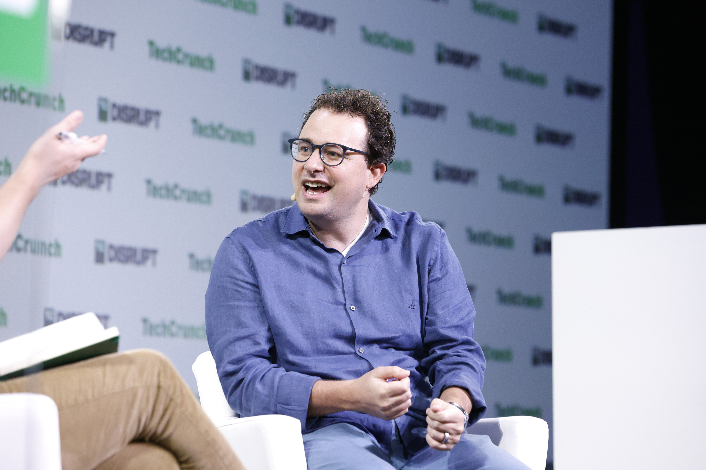

# METR은 앤트로픽 안을 보는데, 보고서엔 왜 다 못 적을까?

_앤트로픽이 비영리 평가기관 METR의 연구원 여섯 명에게 사내 시스템을 열었다. 다만 고객 데이터와 모델 구조는 가려 달라고 요구할 수 있다_

## Executive Summary

> [!callout]
> 10월 15일 앤트로픽이 비영리 평가기관 METR의 직원 여섯 명을 사내에 들였다. 회사 하드웨어와 사무공간을 주고, 내부 도구와 시스템 접근은 자사 위험 평가팀이 가진 것과 대략 비슷한 수준으로 열었다. 앤트로픽은 METR이 내놓을 위험 수준과 사고와 관행에 대한 분석의 게재를 막을 수 없다고 못 박았다. 이 글은 그 선언 옆에 함께 적힌 단서를 본다. 회사는 어떤 정보에 가림을 요구할 수 있는가.

> 앤트로픽은 고객 데이터와 변호사 비밀유지 대상과 모델 구조 정보를 가림 범주로 들었다. 그런데 이 셋 앞에는 "예를 들어"가 붙어 있고, 게재를 다루는 문장에서도 "위와 같은 미리 정해진 범주"라고만 부른다. 세 범주가 전부인지, 합의서에 적힌 목록의 일부인지는 공개된 글에서 확인되지 않는다. METR은 가림이 정당했는지를 공개적으로 말할 수 있지만, 가려진 내용 자체는 밝히지 않는 조건이 붙는다.

> 3절까지는 앤트로픽 발표문과 보도에 있는 것을 따라간다. 4절에서 이 구조를 데이터를 외부에 여는 모든 협약의 문제로 옮겨 읽는 대목은 이 글의 해석이다.

### 주요 수치

출처: 앤트로픽 발표 [An update on independent evaluators](https://www.anthropic.com/news/an-update-on-independent-evaluators)(2026-10-15)와 [TechCrunch](https://techcrunch.com/2026/10/15/anthropic-is-letting-metr-researchers-look-under-the-hood-with-employee-level-access/) 보도.

<!-- stat-card -->
**여섯 명** — 사내에 들어온 METR 직원 — 회사 하드웨어와 사무공간을 받는다. 내부 도구 접근은 앤트로픽 위험 평가팀과 대략 비슷한 수준이다

<!-- stat-card -->
**거부권 없음** — 게재에 대한 앤트로픽의 권한 — 위험 수준과 사고와 관행을 다룬 분석의 게재를 막을 수 없다. 대신 정해진 범주의 가림을 요구한다

<!-- stat-card -->
**예시 셋** — 발표문이 든 가림 범주 — 고객 데이터·변호사 비밀유지 대상·모델 구조. "예를 들어"가 앞에 붙어 전체 목록인지는 확인되지 않는다

<!-- stat-card -->
**2단계와 비슷** — 3단계 METR의 게재 권한 — 등급을 가르는 기준은 접근 수준이다. 승인 없이 게재하는 권한은 2단계 평가자에게도 이미 있다

## 여섯 명이 직원처럼 회사 안을 들여다본다

METR은 프런티어 모델이 혼자 얼마나 오래, 얼마나 복잡한 일을 해내는지를 재 온 미국의 비영리 평가기관이다. 모델을 만드는 회사로부터 돈을 받지 않는다는 원칙을 내걸고 있고, 대신 평가에 필요한 모델 접근권은 각 회사에서 받아 왔다. 이번 발표로 METR이 받은 것은 모델 접근권이 아니라 회사 자체에 대한 접근권이다.

둘 사이가 이번에 처음 이어진 것도 아니다. 앤트로픽은 지난 1년 동안 METR과 함께 자사 위험 보고서를 여러 차례 검토해 왔다고 밝혔다. 완성된 보고서를 바깥에서 받아 읽던 관계가 안에서 시스템을 들여다보는 관계로 바뀌었다. 상대는 그대로고, 그 상대가 서 있는 자리가 달라졌다.

앤트로픽은 METR 직원 여섯 명을 사내에 들였다고 적었다. 회사 하드웨어와 사무공간, 그리고 내부 도구와 시스템 접근권을 받는다. 발표문은 그 수준을 자사 위험 평가팀이 접근하는 것과 대략 비슷하다고 표현했다. 정보 공유도 권한 설정만의 문제가 아니다. 앤트로픽은 자사 직원들에게, 모델이 사람의 의도에서 벗어나는 위험을 함께 다루는 동료에게 하듯 이들에게도 정보를 공유하라고 권한다.

게재 쪽이 이번 발표에서 가장 크게 읽힌 대목이다. METR은 앤트로픽의 위험 수준과 사고와 관행에 대한 자신의 분석을 게재하고, 앤트로픽은 그 게재에 거부권을 행사할 수 없다. 평가 보고서를 피평가 기업이 먼저 읽고 내보낼지 말지 정하던 구조에서 한 칸 물러난 것은 분명하다.

앤트로픽이 밝힌 이유는 간극이다. 평가자가 프런티어 AI 기업의 시스템에 대해 아는 것과 그 기업 자신이 아는 것 사이의 격차를 좁히겠다는 것이다. 9월에 액센츄어를 첫 상주 평가자로 내세울 때 앤트로픽은 상주 평가자가 무엇에 접근해야 하고 무엇을 어떻게 보고해야 하는지에 대한 표준이 아직 없다고 스스로 적었다. 그 공백에 처음으로 구체적인 숫자와 조건이 붙은 것이 이번 합의다. 9월 발표를 둘러싼 비용과 독립성 논란은 [AI 회사가 자기를 검사할 사람을 안에 들이고 비용도 낸다](/blog/anthropic-accenture-embedded-evaluator-independence/ko/)에 정리해 두었다.

*▲ 다리오 아모데이. 그가 이끄는 회사가 이번에 내려놓은 것은 게재 거부권이고, 가릴 수 있는 범주는 그대로 남겨 두었다 | Source: [Wikimedia Commons (TechCrunch, CC BY 2.0)](https://commons.wikimedia.org/wiki/File:Dario_Amodei_at_TechCrunch_Disrupt_2023_04.jpg)*

## 가릴 수 있는 칸은 예시로 적혀 있다

거부권을 내려놓는다는 문장 바로 옆에 단서가 함께 있다. 앤트로픽은 게재를 막을 수는 없지만, 정보가 미리 정해진 범주에 들어가면 그 부분을 가려 달라고 요구할 수 있다. 범주로는 세 가지를 들었다. 고객에 관한 데이터, 변호사 비밀유지 대상 정보, 그리고 모델 구조에 관한 정보다.

여기서 낱말 하나를 그냥 지나치기 어렵다. 발표문은 이 셋을 나열하면서 앞에 "예를 들어"를 붙였고, 게재 조항에서도 "위와 같은 미리 정해진 범주"라고 부른다. 세 범주를 전부라고 적은 문장은 공개된 글 어디에도 없다. 명확히 규정된 소수의 범주라는 표현이 있을 뿐이고, 그 규정이 적힌 문서는 합의서 쪽에 있다. 독자는 지금 그 목록의 예시까지만 확인할 수 있다.

세 범주 가운데 앞의 둘은 평가와 다투지 않는다. 고객 데이터는 제3자의 권리이고, 변호사 비밀유지 대상은 어느 회사의 어떤 감사에서도 가려지는 영역이다. 문제는 세 번째다. 모델이 왜 그렇게 행동하는지를 설명하려면 구조를 짚게 되는 경우가 많다. 위험 평가는 모델이 무엇을 했는지에서 끝나지 않고 그 행동이 어디서 비롯됐는지로 넘어가는 일이라, 결론은 공개되더라도 그 결론을 떠받치는 설명의 일부가 가려질 수 있다. 가림의 범위가 좁을수록 보고서는 검증 가능한 문서에 가까워지고, 넓을수록 결론만 남은 문서에 가까워진다.

같은 글의 다른 줄이 이 자리를 더 눈에 띄게 만든다. 앤트로픽은 평가자가 갖춰야 할 조건으로 전문성과 독립성과 접근과 게재의 자유 네 가지를 꼽았는데, 그중 접근 항목은 최신 모델을 써 보는 것만으로는 모자라고 그 모델이 어떻게 훈련됐는지와 자사 안전장치가 어떻게 작동하는지까지 볼 수 있어야 한다고 말한다. 훈련 과정과 안전장치는 평가자에게 필요한 것으로 적혀 있고, 구조는 회사가 가려 달라고 요구할 수 있는 쪽에 적혀 있다. 두 줄은 같은 문서 안에 나란히 있다.
