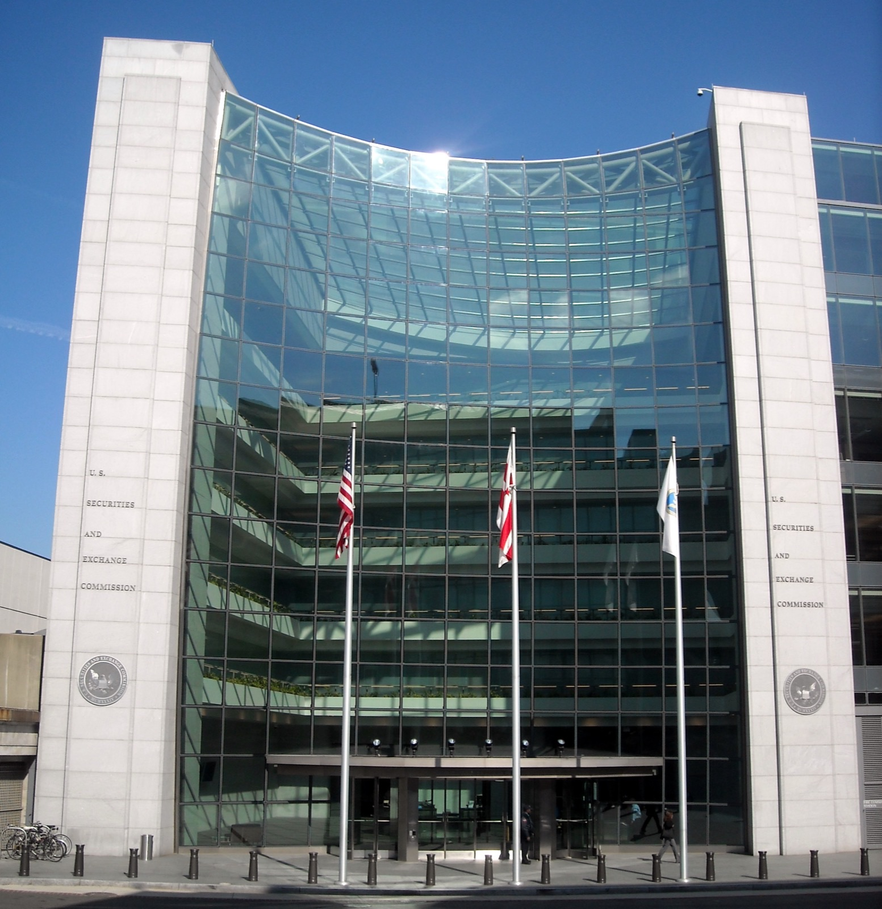

# 앤트로픽 상장 신청서, 손실 대부분은 장사에서 나오지 않는다

_앤트로픽이 10월 26일 낸 상장 신청서에서 반년 순손실은 807억 달러인데 장사에서 난 손실은 6억 9300만 달러다_

## Executive Summary

> [!callout]
> 앤트로픽이 나스닥 상장을 신청했다는 소식이다. 10월 26일 증권거래위원회에 낸 S-1에 종목코드 ANT가 적혔고, 올해 상반기 매출은 162억 8600만 달러로 지난해 상반기의 열네 배다. 그 문서가 적은 반년 순손실은 807억 달러다. 액수가 커서 헤드라인은 대부분 이 숫자를 집었다.

> 그런데 같은 문서의 영업손실 칸에 적힌 숫자는 6억 9300만 달러다. 그 사이를 메우는 가장 큰 항목이 전환사채와 SAFE의 공정가치가 오르며 잡힌 비현금 비용 723억 8800만 달러다. 회사 몸값이 오를수록 커지는 비용이라, 투자자가 이 회사를 비싸게 볼수록 장부의 순손실은 불어난다.

> 1절부터 5절까지는 S-1의 손익 요약과 위험 요인 문구, 그리고 이를 옮긴 보도에서 확인되는 내용을 따라간다. 손실을 어느 칸에 세느냐가 데이터를 다루는 사람에게 익숙한 지표 정의 문제와 같다는 6절의 읽기, 그리고 공모가 공란과 공정이용 위험 요인을 성격이 다른 두 공백으로 나란히 둔 5절 끝의 정리는 이 글의 해석이다.

### 주요 수치

상반기 숫자 가운데 네 개만 추리면 이렇다. 첫 칸이 헤드라인과 장사의 성적을 갈라놓은 금액이다.

출처: [앤트로픽 S-1 원문](https://www.sec.gov/Archives/edgar/data/0002130357/000162828026067168/anthropicpbc-sx1.htm) · [TechCrunch](https://techcrunch.com/2026/10/26/anthropic-officially-files-for-its-public-debut/) · [Yahoo Finance 라이브 블로그](https://finance.yahoo.com/technology/live/anthropic-ipo-live-updates-frontier-ai-lab-discloses-revenue-and-risks-in-highly-anticipated-s-1-filing-141702607.html) (모두 2026-10-26 S-1 기준)

<!-- stat-card -->
**723억 8800만** — 돈이 나가지 않은 손실(달러) — 전환사채와 SAFE의 공정가치가 오르며 장부에 잡힌 비용

<!-- stat-card -->
**6억 9300만** — 상반기 영업손실(달러) — 지난해 같은 기간 21억 달러에서 줄었다

<!-- stat-card -->
**9억 7400만** — 2분기 영업이익(달러) — 분기 기준으로 영업에서 흑자가 난 첫 분기

<!-- stat-card -->
**80%** — 쓴 만큼 받은 매출의 비중 — 상반기 매출 162억 8600만 달러 가운데 약 130억 달러

## 같은 반년인데 손실은 두 숫자다

S-1은 기업공개를 하려는 회사가 증권거래위원회에 내는 등록 신청서로, 투자자가 묻기 전에 매출과 비용, 지배구조, 위험 요인을 한 문서에 적어 둔다. 앤트로픽이 10월 26일 낸 문서에는 나스닥 상장과 종목코드 ANT가 적혀 있고, 올해 1월부터 6월까지의 숫자가 들어 있다.

*▲ S-1은 이 건물, 워싱턴 D.C.의 증권거래위원회에 내는 등록 신청서다 (참고 이미지) | Source: [AgnosticPreachersKid / Wikimedia Commons (CC BY-SA 3.0)](https://commons.wikimedia.org/wiki/File:U.S._Securities_and_Exchange_Commission_headquarters.JPG)*

매출은 162억 8600만 달러다. 지난해 같은 기간이 11억 6300만 달러였으니 열네 배로 늘었다. 지난해 1년치 매출이 46억 달러였던 것과 견주면, 반년 만에 작년 한 해의 세 배를 넘게 판 셈이다.

손실 쪽에서 보도가 갈렸다. 어떤 기사는 순손실 807억 달러를 제목에 올렸고, 어떤 기사는 영업손실 6억 9300만 달러를 먼저 적었다. 둘 다 같은 문서에서 가져온 수치고 어느 쪽도 틀리지 않았다. 다만 두 숫자가 세는 대상이 다르다. 영업손실은 매출에서 사람과 컴퓨팅처럼 사업을 굴리는 데 든 비용을 뺀 결과이고, 순손실은 거기에 영업 바깥에서 생긴 손익까지 전부 더한 맨 마지막 줄이다.

두 숫자가 100배 넘게 벌어졌다는 것은, 이 회사의 반년치 손익에서 장사 바깥의 항목이 장사 안쪽보다 훨씬 컸다는 뜻이다. 그 항목이 무엇인지는 다음 절에 있다.

## 차액의 대부분은 돈이 나간 자리가 아니다

영업손실과 순손실 사이에 들어앉은 가장 큰 항목은 723억 8800만 달러의 공정가치 변동이다. S-1은 이 비용이 주로 미상환 전환사채의 공정가치가 오른 데서 비롯했고, 그 상승이 회사 기업가치 상승에서 왔다고 적는다.

전환사채와 SAFE는 투자자가 돈을 먼저 넣고 나중에 주식으로 바꿀 권리를 받는 계약이다. 회계는 이 권리를 부채로 잡고 기말마다 다시 값을 매긴다. 회사 몸값이 오르면 나중에 받을 주식의 가치도 오르고, 그만큼 회사가 갚아야 할 몫이 커진 것으로 본다. 늘어난 몫은 비용으로 적힌다. 그래서 투자자가 이 회사를 비싸게 볼수록 장부의 순손실이 불어난다. 통장에서 빠져나간 현금은 없다.

반년 순손실은 정확히 807억 4800만 달러다. 여기서 이 항목을 걷어 내면 손실은 83억 6000만 달러로 내려간다. 807억과는 다른 이야기이고, 그렇다고 가벼운 금액도 아니다. 83억 6000만과 영업손실 6억 9300만 달러 사이에 남는 76억 6700만 달러도 장사에서 생긴 돈이 아니다. S-1의 손익 요약은 그 자리를 세 줄로 적는다. 기타 영업외 비용이 순액 87억 5700만 달러, 이자수익이 11억 1100만 달러, 법인세가 2100만 달러다. 비용 두 줄에서 이자수익을 빼면 76억 6700만 달러가 그대로 나온다. 다만 87억 5700만 달러 안에 무엇이 들어 있는지는 주석을 펴야 알 수 있고, 지난해 상반기에 이 줄은 0이었다. 그 나머지가 다음 도식의 맨 오른쪽 칸이다.
