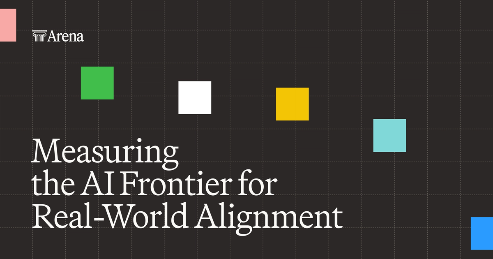

# Arena Runs the AI Model Leaderboard. Who Is Casting the Votes?

_Arena raised $200 million at a $3.1 billion valuation, and the votes its users have cast comparing two AI models now number 62 million_

## Executive Summary

> [!callout]
> This article reads the $200 million investment Arena, the company behind an AI model leaderboard, received on 8 October 2026, together with the question of what that money was priced on. Lightspeed Venture Partners and Khosla Ventures led the round, and the company was valued at $3.1 billion. It was $1.7 billion this January, so the figure has nearly doubled in ten months.

> Then there is what this company holds. Not a model, not a chip. It is the record of users placing two model answers side by side and picking the better one. Arena sells analytics built from that record to model labs and enterprises, and it lifted annualized revenue from $30 million this January to $100 million by June. Here the ledger that files human labeling under costs gets turned around.

> The facts and figures carried in this article come from TechCrunch reporting, from the announcement Arena published itself, from coverage of the Llama 4 episode, from the paper "The Leaderboard Illusion", and from the official response Arena gave that paper. The move in sections 4 and 5 toward who votes and what neutrality rests on belongs to no party in the story. It is this article's reading.

*▲ The official image Arena posted alongside its 8 October 2026 Series B announcement | Source: [Arena Blog](https://arena.ai/blog/series-b)*

### Key numbers

Four numbers. The first two are the size of the money. The third is the asset that money sits on, and the fourth is what made that asset worth paying for.

Sources: [TechCrunch (8 October 2026)](https://techcrunch.com/2026/10/08/popular-ai-leaderboard-arena-nearly-doubles-valuation-to-3-1b-valuation-in-10-months/), [Arena announcement (October 2026)](https://arena.ai/blog/series-b), [The Register (8 April 2025)](https://www.theregister.com/2025/04/08/meta_llama4_cheating/).

<!-- stat-card -->
**$3.1B** — Valuation put on Arena — Nearly double the $1.7 billion of this January, ten months on

<!-- stat-card -->
**$100M** — Annualized revenue as of June — It stood at $30 million this January

<!-- stat-card -->
**62 million** — Comparison votes on record — Text, image, code and the rest combined; cumulative sessions stand at 350 million

<!-- stat-card -->
**32nd** — Where the public Llama 4 Maverick landed — A different model from the submission that had taken 2nd on the same leaderboard

## A Leaderboard Company That Nearly Doubled in Ten Months

Arena runs the leaderboard people look at when they pick an AI model. Ask a question and two answers appear side by side with the model names hidden, and the user picks the one they prefer. Those picks accumulate into a ranking. The service began in 2023 as a UC Berkeley research project called Chatbot Arena, and on 28 January this year it dropped the "LM" from its name and became Arena. It is no longer a place where only language models compete, the company explained.

On 8 October the company said it had raised $200 million in a Series B. Lightspeed Venture Partners and Khosla Ventures led the round, and Salesforce Ventures, 01 Advisors, Dell Technologies Capital and Endeavor Catalyst came in alongside them. Existing investors a16z and Felicis stayed. The valuation set in that round was $3.1 billion.

The pace is hard to miss. When the company raised $100 million in a seed round in May 2025, the valuation was $600 million. On 6 January this year a Series A took in $150 million from Felicis and UC Investments and put the figure at $1.7 billion, and that January number rose to $3.1 billion in ten months. The diagram below lays that trajectory out in one line.
