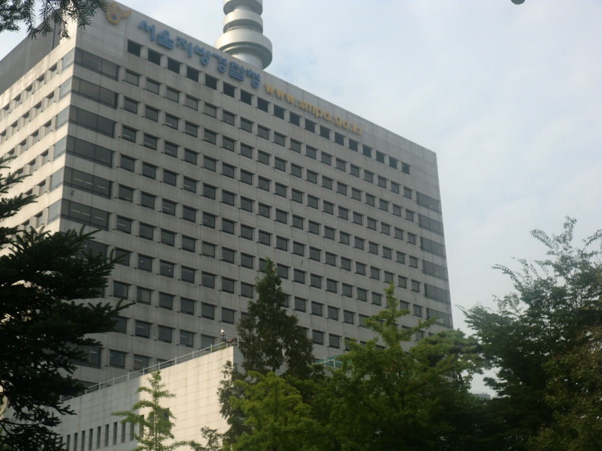

# AI 해킹 도구 아르텍스, 공격의 문턱을 실력에서 도구로 옮긴다

_서울경찰청 발표 — IT 비전공 30대가 이 도구로 40여 일 만에 업체 60곳을 뚫었고, 중국 국가 연계 조직도 썼다_

## Executive Summary

> [!callout]
> 서울경찰청이 생성형 AI 침투 도구를 쓴 해킹·공갈 일당 일곱 명을 검거했다는 소식이다. 이들이 쓴 도구는 아르텍스(ARTEX)로, 목표 주소와 목적만 알려 주면 정찰부터 취약점 확인과 자료 유출까지 사람이 거의 손대지 않고 스스로 해내도록 만들어진 공개 프로그램이다. 경찰은 생성형 AI를 악용한 대규모 해킹으로 국내에서 피의자를 검거한 첫 사례라고 밝혔다. 이 글은 그 도구가 무엇이고, 같은 도구가 어떤 사람들의 손에 함께 들려 있는지를 본다.

> 눈에 띄는 것은 총책의 이력이다. IT를 전공하지 않았고 블로그와 영상으로 해킹을 독학했다. 그런데도 8월 말에 아르텍스를 손에 쥔 뒤로는 40여 일 만에 업체 60곳이 더 뚫렸다. 그 앞 열두 달 동안 뚫은 곳은 30여 곳이다. 같은 사람, 같은 목적, 표적을 고르는 방식도 같은데 속도만 열 배 넘게 뛰었다. 그리고 바로 그 도구가 중국 국가 연계 조직의 공격에서도, 국내 금융사 일곱 곳을 노린 공격 서버에서도 함께 발견됐다.

> 5절까지는 경찰 발표와 보안업체 분석, 그리고 공개된 수치에서 바로 계산되는 값을 따라간다. 이 사건을 데이터를 다루는 쪽의 질문으로 옮긴 6절은 이 글의 해석이다.

### 주요 수치

출처: [ZDNet 코리아](https://zdnet.co.kr/view/?no=20261027074733)·[전자신문](https://www.etnews.com/20261026000369)(서울경찰청 발표), [숭실대 AI안전성연구센터 재현 실험](https://zdnet.co.kr/view/?no=20261006095704), [CSOonline](https://www.csoonline.com/article/4239028/china-linked-hackers-used-agentic-ai-in-attack-on-2250-microsoft-365-tenants.html)(마이크로소프트 위협 인텔리전스 분석). 기간당 속도 환산은 공개된 수치에서 페블러스가 계산했다.

<!-- stat-card -->
**6분** — 아르텍스가 취약점을 찾아 입증하는 데 걸린 시간 — 숭실대 재현 실험이다. 받은 명령은 목표와 목적 한 줄뿐이었고 가상 고객 기록 100건을 인증 없이 전부 열었다

<!-- stat-card -->
**60곳** — 아르텍스를 쓴 40여 일 동안 뚫린 업체 — 그 앞 열두 달 동안 뚫린 곳은 30여 곳이다. 피해 업체의 3분의 2가 전체 기간의 10분의 1에 몰렸다

<!-- stat-card -->
**15곳** — 피해 90여 곳 가운데 경찰에 신고한 업체 — 나머지 75곳의 유출은 경찰이 수사에 들어간 뒤에야 드러났다

<!-- stat-card -->
**2,250곳** — 같은 도구로 공격받은 마이크로소프트 365 조직 — 중국 국가 연계 조직의 소행이다. 분당 2,900회 로그인을 시도했고 세 시간 안에 관리자급 권한을 쥔 사례가 있다

## 820만 건을 털고 받아 낸 돈은 30만원이다

서울경찰청 사이버수사과는 10월 26일, 국내 업체 90여 곳을 해킹해 받아 낸 자료로 돈을 요구한 일당 일곱 명을 검거했다고 밝혔다. 총책인 32세 남성은 구속돼 검찰에 넘어갔고 공범 여섯 명은 불구속 송치됐다. 수사는 올해 6월 피해 업체 한 곳이 낸 진정서에서 시작됐다.

*▲ 이번 검거를 발표한 서울경찰청 청사 | 출처: [Wikimedia Commons](https://commons.wikimedia.org/wiki/File:Seoul_Metropolitan_Police_Agency.JPG) (CC BY-SA 3.0)*

범행은 2025년 9월부터 올해 10월 초까지 약 열세 달 이어졌다. 그동안 빠져나간 개인정보와 내부 자료가 약 820만 건이다. 업종을 보면 생활권 전체가 고르게 걸려 있다.

업체 수와 건수는 따로 논다. 보험판매업체는 세 곳뿐인데 건수로는 322만 건으로 전체의 40%에 가깝고, 골프장은 스물한 곳이 뚫리고도 120만 건이다. 한 곳을 열었을 때 나오는 양이 업종마다 크게 다르니, 뚫린 업체 수만으로는 피해 규모가 가늠되지 않는다.

| 업종 | 업체 수 | 탈취 건수 |
| --- | --- | --- |
| 보험판매업체 | 3곳 | 322만 건 |
| 상조회사 | 3곳 | 143만 건 |
| 골프장 | 21곳 | 120만 건 |
| 학원 | 12곳 | 99만 건 |
| 병원 | 5곳 | 22만 건 |
| 대학교 | 4곳 | 2만 건 |
| 그 밖 | 42곳 | 112만 건 |

출처: [ZDNet 코리아](https://zdnet.co.kr/view/?no=20261027074733)가 전한 서울경찰청 발표. 업체 수를 더하면 90곳, 건수를 더하면 820만 건이다.

빠져나간 것이 이름과 연락처만은 아니다. 주민등록번호와 주소가 함께 있었고, 병원에서는 진료와 상담 내역이, 학원에서는 미성년자 정보가, 제2금융권에서는 사내 게시판 자료가 나갔다. 어느 한 건도 다시 거둘 수 없는 종류다.

표적을 고르는 방식도 기록돼 있다. 포털에서 검색 결과 위쪽에 뜨는 업체 중에서 합의금을 낼 능력이 있어 보이는 곳을 골랐다. 그렇게 고른 38곳에 모두 3억6000만원을 요구했는데 실제로 돈을 보낸 곳은 영세업체 한 곳, 30만원이 전부였다. 820만 건을 들고도 받아 낸 돈은 요구액의 0.1%에 못 미친다. 이 사건의 피해는 돈이 아니라 기록 쪽에 쌓였다.

총책의 이력이 이 사건을 보통의 해킹 사건과 가른다. IT를 전공하지 않았고 블로그와 영상을 보며 해킹을 익혔다. 2019년부터 2022년까지 보안업체에서 모의해킹 업무를 맡은 적은 있지만, 혼자서 전국 90여 곳의 전산망을 여는 수준의 숙련자는 아니었다. 경찰이 발표에서 짚은 문장이 그 지점이다. 전문 해커 조직이 아니어도 AI의 도움을 받으면 대규모 해킹이 가능해졌다는 것이다.

## 달라진 것은 도구뿐이다

총책은 처음부터 AI를 쓴 것이 아니다. 열세 달 가운데 앞쪽 열두 달은 기존의 취약점 탐지 도구로 한 곳씩 공략했다. 8월 말에 아르텍스와 코딩 도구를 본격적으로 붙이면서 방식이 바뀌었다.

두 구간을 같은 잣대로 재 보면 차이가 선명하다. 앞 구간은 350일 남짓 동안 30여 곳이니 한 곳에 평균 열이틀쯤 걸린 셈이다. 뒤 구간은 40여 일에 60곳이니 하루에 한 곳이 넘는다. 열 배가 넘게 빨라졌다. 다만 경찰 발표의 90여 곳·60여 곳·열세 달이 모두 어림수라서, 이 배수는 정확한 통계가 아니라 방향을 보여 주는 환산으로 읽어야 한다. 어느 쪽 어림을 넣어도 한 자릿수로는 내려가지 않는다는 것이 이 계산에서 확실한 부분이다.
