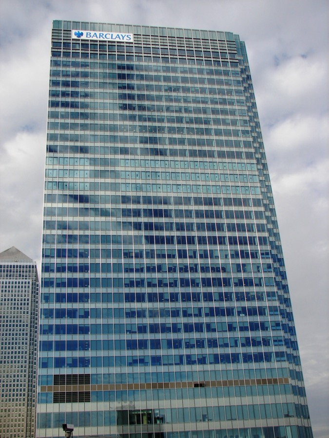

# 바클레이스가 AI로 줄인다는 일자리, 어디서 먼저 사라질까?

_실적 발표에서 밝힌 감원 5,000명 중 60%가 개발자를 포함한 지원 부서이고, AI에 붙은 숫자는 도입 규모뿐이다_

## Executive Summary

> [!callout]
> 이 글은 영국 은행 바클레이스가 2026년 10월 22일 3분기 실적과 함께 내놓은 감원 계획을 읽는다. 전체 인력의 약 5%인 5,000명을 줄이고, 그 가운데 약 60%가 소프트웨어 개발자를 포함한 지원 부서에서 나온다. 이 글이 보는 것은 감원 규모가 아니라, 이 감원을 'AI 때문'이라고 부를 때 회사가 근거로 내놓을 수 있는 숫자가 무엇인가다.

> 그 발표에서 두 경영진의 말이 갈렸다. 최고재무책임자 애나 크로스는 AI가 직원 생산성을 높이면서 개발자가 줄어든다고 말했고, 최고경영자 C.S. 벤카타크리슈난은 AI를 "케이크 위의 장식이지 케이크 자체는 아니다"라고 부르며 지금까지의 효율 개선은 낡은 플랫폼을 새로 깔고 시스템을 합치고 일하는 절차를 줄인 덕이라고 봤다. 그런데 회사가 수치로 공개한 AI 관련 자료는 연말까지 개발자의 50%에게 코딩 도구를 적용하겠다는 식의 도입 규모다. 같은 업무를 앞뒤로 견준 값이 실적 발표에 몇 개 올라오기는 했다. 그중 AI 덕으로 돌린 값은 하나도 없었다.

> 1절부터 3절까지는 발표와 공개 자료에 적힌 내용을 따라가고, 이를 데이터 품질을 검증하는 현장에 겹쳐 읽는 4절은 이 글의 해석이다.

*▲ C.S. 벤카타크리슈난 바클레이스 최고경영자. "AI는 케이크 위의 장식"이라고 말한 인물이다 | Source: [World Economic Forum via Wikimedia Commons](https://commons.wikimedia.org/wiki/File:C._S._Venkatakrishnan_(born_1966)_at_World_Economic_Forum_Annual_Meeting_2025.png) (CC BY 3.0)*

### 주요 수치

앞의 두 수치는 줄어드는 자리의 크기와 위치이고, 뒤의 두 수치는 회사가 그 자리에 AI를 들이며 공개한 목표와 치른 비용이다.

출처: 바클레이스 2026년 3분기 실적 발표(10월 22일), [앤트로픽 발표](https://www.anthropic.com/news/barclays-scales-claude)(10월 1일)

<!-- stat-card -->
**5,000명** — 올해 감원 규모 — 전체 인력의 약 5%다. 상반기에 1,000명을 줄였고 연말까지 4,000명이 남았다

<!-- stat-card -->
**60%** — 지원 부서가 차지하는 몫 — 감원 조치 기준으로 3,000명 남짓이다. 개발자가 이 안에 들어가지만 전부가 개발자는 아니다

<!-- stat-card -->
**50%** — 연말까지 코딩 도구 적용 목표 — 개발자 인구의 절반이다. 공개된 AI 숫자는 이런 도입 목표 쪽에 몰려 있다

<!-- stat-card -->
**6억 파운드** — 올해 구조조정 비용 — 1~9월에 3억 700만 파운드를 썼고 연말까지 3억 파운드가 더 든다. 당초 예상의 두 배다

## 감원 5,000명은 어느 부서에서 나오나

발표는 실적 호조 속에서 나왔다. 3분기 세전이익은 23억 파운드로 전년 같은 기간보다 12% 늘었고, 주식 거래 부문 수익이 47% 뛰었다. 채권·외환 쪽이 19% 줄어 벤카타크리슈난 최고경영자가 직접 아쉬움을 표한 대목은 있었지만, 회사 전체로 보면 돈이 모자라서 사람을 줄이는 분기는 아니었다. 같은 날 5억 파운드 규모의 자사주 매입도 함께 발표했다.

*▲ 런던 커나리 워프, 바클레이스 세계 본사 원처칠플레이스 | Source: [Wikimedia Commons](https://commons.wikimedia.org/wiki/File:Barclays_Bank_PLC_world_headquarters.JPG) (Public Domain)*

줄어드는 자리의 위치는 비교적 또렷하게 공개됐다. 애나 크로스 최고재무책임자는 감원의 약 60%가 개발자를 포함한 지원 부서와 관련돼 있다고 설명했다. 회사가 말한 것은 '지원 부서가 60%'이지 '개발자가 60%'가 아니다. 개발자는 그 묶음 안에 든 한 직군이고, 몇 명인지는 발표에 적혀 있지 않다.

실적 설명회에서 크로스가 쓴 문장은 이랬다. "이 조치에는 약 5,000명의 정규직 감축이 따른다. 그룹 조치의 약 60%가 지원 부서와 관련되며, AI가 우리 직원들을 더 생산적으로 만들면서 개발자가 줄어드는 것도 여기 포함된다." 60%가 걸린 자리는 인원이 아니라 조치다. 보도는 이를 5,000명의 60%, 곧 3,000명 남짓으로 옮겼고 이 글도 같은 어림을 따르지만, 회사가 인원 기준으로 60%를 못 박지는 않았다.

발표와 실적 자료에 숫자로 적힌 항목을 한자리에 모으면 이렇다.

| 항목 | 발표에 적힌 값 |
| --- | --- |
| 올해 감원 규모 | 5,000명 (전체 인력의 약 5%) |
| 상반기에 이미 줄인 인원 | 약 1,000명 |
| 연말까지 남은 감원 | 약 4,000명 |
| 지원 부서가 차지하는 몫 | 약 60% (개발자 포함) |
| 올해 구조조정 비용 | 1~9월 3억 700만 파운드, 연말까지 약 3억 파운드 추가 |
| 2027년 한 해 효율화 절감 기대치 | 11억 파운드 이상 |
| 3분기 세전이익 | 23억 파운드 (전년 대비 12% 증가) |

표를 세로로 훑으면 한 가지가 눈에 띈다. 몇 명을 줄이는지, 그 일에 얼마가 드는지, 그래서 얼마를 아끼려 하는지는 모두 숫자로 적혀 있다. 반면 그 감원 가운데 몇 명분이 AI가 떠맡은 일에서 나왔는지를 적은 칸은 없다. 공시 자료가 그런 칸을 요구하지 않으니 당연한 일이기도 하다.

그래서 인과는 숫자가 아니라 말로 설명됐고, 설명하는 사람에 따라 무게가 달랐다. 크로스 최고재무책임자는 3·4분기의 변화가 "조직 단순화와, AI에서 우리가 보기 시작한 일부 영향" 양쪽에 걸쳐 있다고 말했다. 벤카타크리슈난 최고경영자는 더 조심스러웠다. AI를 대규모로 쓰겠다면서도 "AI는 케이크 위의 장식이지 케이크 자체는 아니다"라고 덧붙였고, 지금까지의 효율 개선을 이끈 것은 플랫폼 현대화와 시스템 통합, 업무 절차 단순화라고 설명했다.

장식이라는 비유에는 근거가 있었다. 같은 설명회에서 두 사람이 든 개선 사례에는 전후를 비교한 숫자가 실제로 붙어 있었다. 모기지 중개 플랫폼에서는 신청 처리 시간이 45분에서 15분 아래로 줄었고, 중개사 만족도 점수가 마이너스 51에서 플러스 70으로 올랐다. 고객이 쓰는 기술이 나아지면서 지난 1년 콜센터 통화량이 10% 줄었고, 지점 운영 모델을 바꾼 결과 지점당 인원도 같은 기간 10% 남짓 줄었다.

네 숫자의 첫 번째 공통점은 앞뒤를 견줄 수 있다는 것이고, 두 번째 공통점은 귀속이다. 모기지 쪽은 기술 투자, 콜센터는 고객 대면 기술, 지점은 운영 모델 변경으로 설명됐다. 넷 중 어느 것도 AI의 성과로 제시되지 않았다. 최고경영자가 인프라가 먼저라고 덧붙인 것도 그래서다. 회사가 기록을 안 남기는 조직이어서 AI 칸이 빈 것이 아니라는 뜻이기도 하다.

> [!callout]
> 같은 발표에서 최고재무책임자는 감원의 원인으로 AI를 지목했고 최고경영자는 AI의 몫을 낮춰 잡았다. 둘 다 거짓말을 한 것은 아니다. 발표에는 앞뒤를 견준 수치도 있었다. 다만 숫자가 붙은 개선은 모두 AI가 아닌 쪽에 귀속됐고, AI를 원인으로 든 자리에는 비교할 숫자가 따라붙지 않았다.

## 바클레이스 보고서에도 같은 직군이 있었다

감원 발표 한 달 전인 2026년 9월 22일, 바클레이스 리서치는 AI가 노동에 미치는 영향을 분석한 보고서를 냈다. 보도에 따르면 이름은 'AI 자동화·증폭 프레임워크'(3A Framework)다. 직업을 통째로 다루는 대신 스킬을 분석 단위로 삼은 것이 특징으로, 미국 노동부 데이터베이스의 교차 직업 스킬 104개를 830여 개 직업에 대응시켜 인지 AI와 물리 AI의 노출도를 따로 매겼다.

보고서가 앞세운 메시지는 오히려 진정 쪽이었다. 핵심 업무 스킬 가운데 AI가 높은 수준으로 대체할 수 있는 비중은 20% 정도에 그치고, 대규모 대체 서사는 과장됐다는 것이다. 대신 사람의 일을 거들어 생산성을 올리는 '증폭' 효과가 훨씬 넓게 퍼져 있다고 봤다.

다만 같은 보고서가 노출도의 분포도 그렸다. 인지 AI 고노출 직군은 컴퓨터·엔지니어링·과학 쪽에 몰려 있고, 물리 AI 고노출 직군은 건설·제조·설치·보수 쪽에 몰려 있다는 결과였다. 한 달 뒤 회사가 밝힌 감원 조치의 60%가 걸린 곳은 앞쪽 묶음, 즉 개발자를 포함한 지원 부서였다.

바클레이스는 이 보고서가 감원 결정에 쓰였다고 밝힌 적이 없고, 두 사안을 연결한 설명도 내놓지 않았다. 이 글도 보고서가 감원을 지시했다고 말하지 않는다. 보고서 원문은 외부에 열려 있지 않아 이 글이 옮긴 내용은 보도에 기댄 것이다. 그럼에도 한 회사가 한 달 간격으로 "대체는 과장됐다"는 분석과 "그 분석이 고노출로 꼽은 범주에서 자리를 줄인다"는 발표를 함께 내놓았다는 사실은 그대로 남는다.

두 문서는 동시에 참일 수 있다. 대체 가능한 스킬이 전체의 20%여도 그 20%가 특정 직군에 몰려 있으면 그 직군의 인원은 줄어든다. 둘 중 어느 문서도 "AI가 이 일을 대신했다"를 측정값으로 보여 주지는 않는다. 하나는 노출도 추정이고, 다른 하나는 감원 계획이다. 그 사이를 잇는 관찰 기록이 공개된 적은 없다.

## 회사가 AI에 붙인 숫자는 도입 규모다

바클레이스가 AI 관련 수치를 가장 자세히 내놓은 곳은 감원 발표가 아니라 그 3주 전이었다. 2026년 10월 1일 앤트로픽이 바클레이스와의 협업 확대를 발표하면서 사내 적용 현황과 계획을 숫자로 적었다. 공개된 값은 셋이다.

| 공개된 숫자 | 이 숫자가 말하는 것 |
| --- | --- |
| 연말까지 개발자의 50%에 코딩 도구 Claude Code 적용, 2027년에는 대다수 엔지니어로 확대 | 앞으로 얼마나 쓰기로 했는가 |
| 사내 지식 도우미를 영국 직원 16,000명 이상이 사용, 2025년 이후 누적 검색 100만 건 이상 | 몇 명이 몇 번 썼는가 |
| 글로벌마켓 부문에서 하루 약 12만 건의 고객 이메일을 분류·보강·전달 | 얼마나 많이 처리했는가 |

셋은 모두 쓰임의 크기를 재는 값이다. 몇 명이 쓰는지, 몇 건이 지나갔는지, 앞으로 몇 퍼센트까지 늘릴 것인지. 반대로 같은 일을 사람이 하던 때와 비교한 값, 그러니까 한 건을 처리하는 데 걸리던 시간이 얼마나 줄었는지, 오류와 되돌림은 얼마나 달라졌는지, AI를 쓰지 않는 팀과 견주면 어떤지는 발표문 어디에도 없다. 계약 규모와 절감액도 마찬가지다.
