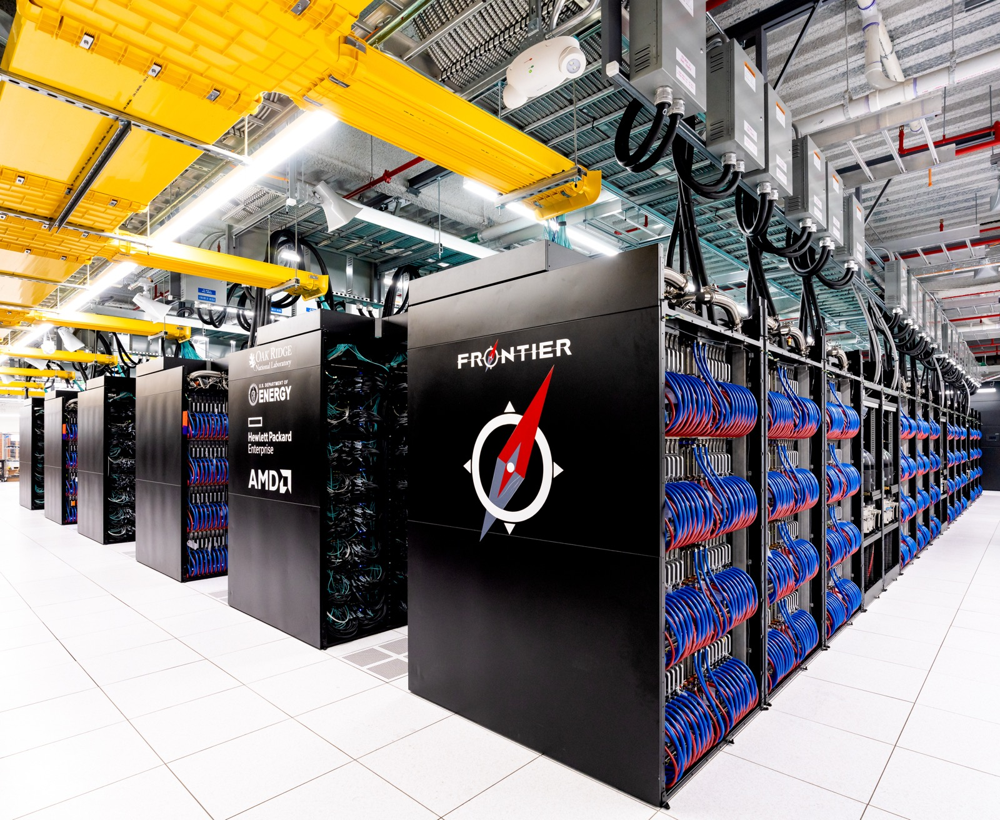

# 바이오허브, AI가 읽을 세포 데이터 도서관을 처음부터 짓는다

_바이오허브가 미국 정부·AI 기업과 함께 18억 달러를 모아, 세포 반응을 예측하는 AI가 배울 데이터를 한 규격으로 정리한다_

## Executive Summary

> [!callout]
> 이 글은 2026년 10월 7일 바이오허브가 미국 에너지부, 국립보건원, 구글 딥마인드, 메타, 아이소모픽랩스와 함께 발표한 18억 달러 규모의 생물 데이터 사업을 읽는다. 새 모델을 내놓는 발표가 아니다. 약물이나 돌연변이 같은 자극에 세포가 어떻게 반응할지 컴퓨터로 미리 보는 '가상 세포'를 만들려는데 그것을 학습시킬 데이터가 아직 모자란다는 것이, 이 돈이 모인 이유다.

> 금액을 쪼개면 18억 달러 가운데 이날 처음 공개된 약정은 8억 달러다. 에너지부가 5년간 5억 달러 이상을 내고 세 회사가 합쳐 3억 달러를 낸다. 나머지 10억 달러는 바이오허브가 지난 4월에 이미 약속한 5억 달러와, 국립보건원이 그동안 5억 달러 넘는 연방 예산으로 만들어 둔 데이터의 접근권이다. 그리고 발표문이 바이오허브의 몫으로 적은 동사는 데이터를 만든다가 아니라 표준화한다였다.

> 본문에 옮긴 금액과 인용과 일정은 바이오허브 발표문, 미국 에너지부 과학국 보도자료, 로이터 10월 7일 기사에서 가져왔다. 새로 공개된 약정과 다시 합산된 몫을 갈라 세는 2절, 4월과 10월 발표문의 낱말 차이를 역할 재정의로 읽는 3절, 그리고 상업 파트너의 선접근 기간을 표준화에 치른 값으로 읽는 5절은 어느 당사자의 설명도 아니라 이 글의 해석이다.

### 주요 수치

출처: [바이오허브 발표문(2026-10-07)](https://biohub.org/news/virtual-biology-initiative-expansion/), [로이터(2026-10-07)](https://www.ksl.com/article/news/business/usgovernment-google-join-zuckerberg-backed-biohub-in-18-billion-push-for-ai-biology-data/51633409).

<!-- stat-card -->
**8억 달러** — 10월 7일에 처음 공개된 약정 — 에너지부 5억 달러 이상에 세 회사 3억 달러를 더한 값이다

<!-- stat-card -->
**수조 개** — 예측 모델에 필요할 세포 수 — 지금 있는 데이터는 수억 개 규모라고 바이오허브 과학 책임자가 말했다

<!-- stat-card -->
**1년** — 첫 데이터셋이 나오기까지 — 작동하는 예측 모델은 5년 뒤를 목표로 잡았다

<!-- stat-card -->
**0회** — 4월 출범문의 'AI-ready'·'standardize' — 10월 발표문은 첫 두 문단 안에서 두 낱말을 다 쓴다

## 10월 7일, 정부 두 기관과 기업 세 곳이 합류했다

바이오허브는 마크 저커버그와 프리실라 챈 부부가 세운 비영리 연구기관이다. 이곳이 2026년 10월 7일에 낸 발표문에 적힌 18억 달러의 내용물은 현금만이 아니다. 자금과 데이터와 연산과 새 측정 기술을 모두 합쳐 18억 달러이고, 발표문은 그것을 "AI가 바로 학습할 수 있는 생물 데이터를 만드는 일에 지금까지 나온 가장 큰 규모의 조율된 약정"이라고 적었다.

목표는 가상 세포다. 국립보건원 부원장 니콜 클라인스트로이어가 발표문에 남긴 문장이 그 목표를 가장 짧게 설명한다. "자원과 전문성을 합치면, 어떤 세포가 개입에 어떻게 반응할지 예측할 만큼 충분한 생물학적 복잡성을 갖춘 보편 세포 모델의 개발을 앞당길 수 있다." 신약 후보를 실험실에 넣기 전에 화면에서 먼저 돌려 보는 일이 가능해진다는 뜻이다.

에너지부는 돈에 설비를 얹는다. 에너지부 과학국이 같은 날 낸 보도자료는 5년간 5억 달러 이상을 세포 기초 연구에 넣겠다고 적으면서, 함께 내놓을 자산으로 엑사스케일 슈퍼컴퓨터 클러스터, 유전체 주석을 다루는 합동유전체연구소, 미생물·분자 연구를 맡는 환경분자과학연구소, X선과 중성자 산란 설비, 극저온전자현미경, 그리고 스스로 실험을 돌리는 자율 실험실 사업을 열거했다. 이 보도자료는 이번 협력이 트럼프 대통령의 '제네시스 미션' 행정명령을 이행하는 일이라고도 밝혔다. 에너지부 과학담당 차관 다리오 길은 "에너지부 국립연구소의 역량과 전문성을 자선 쪽과 과학계의 지도력에 합쳐 개방적이고 데이터 중심적인 과학의 새 기준을 세우고 있다"고 말했다.

*▲ 에너지부가 세포 데이터 처리에 함께 대는 엑사스케일 슈퍼컴퓨터 설비의 예 — 오크리지국립연구소 프론티어 | Source: [Oak Ridge National Laboratory / Wikimedia Commons (CC BY 2.0)](https://commons.wikimedia.org/wiki/File:Frontier_Supercomputer_(2).jpg)*

이 사업 자체는 10월에 시작된 것이 아니다. 바이오허브가 '버추얼 바이올로지 이니셔티브'라는 이름으로 5억 달러를 걸고 출범시킨 날이 2026년 4월 29일이다. 그때 함께 이름을 올린 곳은 앨런연구소, 아크연구소, 브로드연구소, 웰컴 생어연구소, 휴먼 셀 아틀라스, 휴먼 프로테인 아틀라스, 빌리언 셀스 프로젝트, 르네상스 필랜스로피였고 엔비디아가 기술 파트너로 들어갔다. 반년 뒤 여기에 정부 두 기관과 기업 세 곳이 붙으면서 합산 규모가 18억 달러가 됐다.

## 18억 달러 가운데 이날 처음 나온 약정은 8억이다

발표문에 적힌 네 몫을 더하면 18억 달러가 정확히 맞아떨어진다. 다만 네 몫은 성격이 서로 다르다. 어떤 것은 이날 처음 나온 약정이고, 어떤 것은 이미 쓴 예산을 다시 센 것이다.

| 주체 | 금액 | 성격 |
| --- | --- | --- |
| 미국 에너지부 | 5억 달러 이상 | 10월 7일 처음 공개. 5년간 실험실 측정과 모델링, 연산에 투입 |
| 구글 딥마인드·메타·아이소모픽랩스 | 3억 달러 | 10월 7일 처음 공개. 세 회사 합산 투자 |
| 바이오허브 | 5억 달러 | 4월 29일 출범 때 이미 약속한 자금. 4억 달러는 자체 측정 기술, 1억 달러는 외부 연구 지원 |
| 미국 국립보건원 | 5억 달러 이상 | 새 현금이 아니라, 과거 연방 예산으로 구축된 데이터셋·저장소·지식베이스의 조율과 제공 |

▲ 네 몫의 성격 구분 | 금액과 설명은 [바이오허브 발표문](https://biohub.org/news/virtual-biology-initiative-expansion/)과 [에너지부 과학국 보도자료](https://www.energy.gov/science/articles/doe-nih-and-biohub-partner-build-foundational-data-predictive-biological-super)에서 가져왔다. 성격 열의 구분은 이 글의 정리다.

국립보건원 몫의 문장이 특히 분명하다. 발표문은 국립보건원이 "5억 달러를 넘는 과거 연방 투자로 개발된 데이터셋과 저장소, 지식베이스의 제공을 조율한다"고 적었다. 수표를 새로 끊는다는 말이 아니라, 이미 국민 세금으로 만들어 둔 창고의 열쇠를 내놓는다는 말이다. 바이오허브 몫 5억 달러 역시 반년 전 출범 때 발표된 숫자가 누적 합계에 다시 들어온 것이다.
