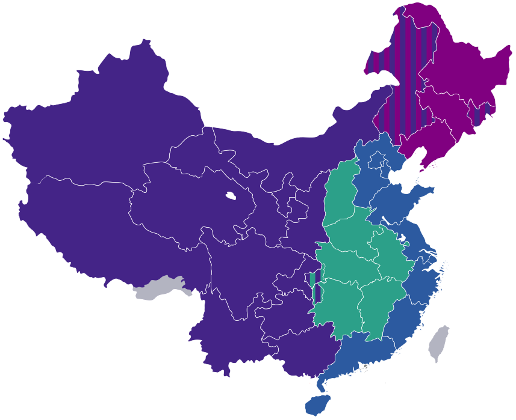

# China State Council Sends Data Labeling Inland

_An 18-point opinion from the State Council General Office, published October 23, hands the eastern provinces the core AI industries and the central and western provinces data labeling_

## Executive Summary

> [!callout]
> This article reads a single opinion released by China's State Council General Office on October 23 as a document about the data supply chain rather than as employment policy. The first of its eighteen points, arranged under six headings, places the core AI industries in the eastern provinces and sends data labeling and smart device manufacturing to the central and western provinces. The work of making training data has been named as an item in a country's industrial layout. The seven cities assigned to build data labeling bases had already been chosen in May 2024. This document adds a division of labor: the two regions are set on different layers of the same industry.

> The seventh point of the same document calls for an employment risk assessment to be attached to AI projects, and it splits the target across two sentences. Where market entry is licensed, the assessment runs alongside the project review. For everything else, it is to be carried out according to actual conditions. Data labeling is not a business that needs a license to open. The very work this document sends inland sits, in that same document, on the side where no moment is named for the assessment to attach.

> Sections 1 through 3 follow the wording of the document, together with the list of base cities and the occupational standard issued earlier by the National Data Administration and the Ministry of Human Resources and Social Security, and an industry report from CAICT. Section 4, which turns this layout into a question for the buyer of data, is this article's reading and is not in the document.

*▲ Xinhuamen, the gate of the Zhongnanhai compound. The State Council General Office that issued this opinion sits inside it | Source: [Prcmise, Wikimedia Commons (CC BY-SA 4.0)](https://commons.wikimedia.org/wiki/File:Xinhuamen_Beijing.jpg)*

### Key numbers

These three separate what the document created from what was already in place.

Source: [full text of the State Council General Office opinion, as carried by Science and Technology Daily](https://www.stdaily.com/web/2026-10/23/content_601752.html) · [National Occupational Skill Standard for AI Trainers (2021 edition)](https://www.lnmtc.com/uploadfile/ueditor/file/202507/1753775500da7bb4.pdf)

<!-- stat-card -->
**March 2020** — When AI trainer became a listed new occupation — Data labeler went in underneath it at the same time. This document did not coin the name

<!-- stat-card -->
**Five grades** — Skill levels in the national occupational standard for AI trainers — Set in 2021. Data collection, processing and labeling are written as work for the bottom two grades

<!-- stat-card -->
**Two columns** — How the employment risk assessment is divided — Licensed areas get it alongside review, everything else according to actual conditions. Labeling falls in the second column

## Data Labeling Written Onto an Industrial Map

The document is titled "Opinions on Adapting to the Development of Artificial Intelligence Technology and Promoting the Building of an Employment-Friendly Development Model." The State Council General Office addressed it to the governments of every province, autonomous region and directly administered municipality, and to every ministry under the State Council. Its file number is Guo Ban Fa [2026] No. 29, it was signed on October 16, and it was published on October 23. The Korean coverage dated October 24 was working from that published version. Eighteen points are spread across six headings: strengthening the job-creating effect of artificial intelligence, building an employment-friendly path for AI upgrading, raising workers' digital literacy and employability, using AI to improve employment policy services, completing the systems that protect workers' rights and social security, and completing the monitoring, early warning and response system for employment risk.

For anyone reading from the data side, the point that matters is the very first one. Point (1), "Expanding the Employment Space of Artificial Intelligence in Emerging Fields," reads as follows. Deepen the implementation of the "AI Plus" initiative; encourage the eastern regions to lay out the core AI industries; and guide the central and western regions to take on upstream and downstream industries such as data labeling and smart terminal manufacturing, in line with local conditions.

One sentence holds two regions and two kinds of work. What the east is given is the core industry; what the central and western regions receive is the upstream and downstream. The verb rendered here as "take on" is _chengjie_ (承接) in the original, and in Chinese industrial policy writing it usually means receiving a production process that is moving in from somewhere else. A verb that used to describe factory relocation has been attached to data labeling.

The "AI Plus" initiative named at the head of that quotation refers to a separate, higher-level plan. The State Council published the "Opinions on Deepening the Implementation of the 'AI Plus' Initiative" on August 26, 2025, setting staged targets for 2027, 2030 and 2035 across six fields: science and technology, industry, consumption, public well-being, governance, and international cooperation. This employment opinion borrows that plan's name and adds one sentence that splits the map.

Documents that place data labeling in particular regions are not new. On May 24, 2024, the National Data Administration announced at the Seventh Digital China Summit the seven cities that would carry the task of building data labeling bases: Chengdu in Sichuan, Shenyang in Liaoning, Hefei in Anhui, Changsha in Hunan, Haikou in Hainan, Baoding in Hebei, and Datong in Shanxi. Four of them — Chengdu, Hefei, Changsha and Datong — lie in the central and western regions. The stated criteria for choosing the cities included industrial foundation, strengths in human resources and digital-economy potential, alongside coordinated regional development. That December the National Development and Reform Commission, the National Data Administration, the Ministry of Finance and the Ministry of Human Resources and Social Security issued "Implementation Opinions on Promoting the High-Quality Development of the Data Labeling Industry," which set a target of more than 20% compound annual growth for the industry through 2027.

*▲ China's four economic regions (east, central, northeast, west). This opinion's east/central-west division of labor sits on top of that framework | Source: [Quintucket, Wikimedia Commons (CC0)](https://commons.wikimedia.org/wiki/File:China_Economic_Sector.svg)*

So the thing this document writes down for the first time is not the regional placement of labeling. Two things are new. A division of labor that hands the east and the central and western regions different layers now sits inside a single sentence, and that sentence appears in an employment document rather than an industrial development one. The December 2024 implementation opinions never use the phrase "central and western."

Because the placement came first, so did the tallies. The "Research Report on the Development of the Data Labeling Industry (2025)," published by CAICT in August 2025, reports what the seven bases have accumulated so far. The same report adds that as of the first half of 2025 these bases had built 524 datasets serving 163 large models.

Source: [National Data Administration, list of cities building data labeling bases](https://www.nda.gov.cn/sjj/ywpd/szkjyjcss/0830/20240830171441268976385_pc.html) · [CAICT and China Telecom AI, Research Report on the Development of the Data Labeling Industry (2025)](http://www.caict.ac.cn/english/research/whitepapers/202509/P020250924573446494952.pdf)

<!-- stat-card -->
**58,000** — Labeling workers across the seven bases — A tally presented at the on-site base meeting held in Chengdu in March 2025

<!-- stat-card -->
**17,282TB** — Volume of labeling the seven bases have built up — The report puts that at roughly six times the digital holdings of the National Library of China

<!-- stat-card -->
**8.3bn yuan** — Related industry output the seven bases pulled in — The same tally says 223 labeling companies were attracted or grown there

On the buyer's ledger, where labeling gets done is still the client's own choice. The buyer weighs which vendor is cheaper, which country handles the language, which team can hold the quality bar. This document asks the same question in the language of administration. Which region will receive this work?

## Two Columns Inside One Clause

The document is not only about making jobs. Point (6), "Easing the Employment-Displacement Effects of AI Application," gives instructions on both the order and the pace of adoption. Apply AI first where labor is short or the environment is hazardous; in labor-intensive industries, exercise prudence over the scope, intensity and rhythm of application so that the shock to workers is kept as small as possible. Companies are encouraged to explore an unemployment buffer period, to notify affected workers in advance during large-scale rollouts, and to provide support for transition and redeployment. The words "encourage" and "explore" are right there in the text. None of it is an obligation.

Point (7), "Establishing an Employment Risk Assessment Mechanism for AI Application," is the most concrete device in the document. The clause runs to two sentences. The first says that for AI application projects in market-entry fields that could cause a relatively large employment shock, an employment risk assessment shall be conducted at the same time as the project review, with the relevant departments arranging transition and redeployment support. The second says that for AI application projects in other fields, an employment risk assessment shall be conducted according to actual conditions.

A market-entry field is one where opening a business requires permission and review from a government department. Robotaxi services, which cannot operate without a license, belong there. The first sentence works because a place to hang the assessment already exists. There is a procedure, there is a department conducting it, and there is a moment at which it happens. The employment risk assessment rides on top of all three.
