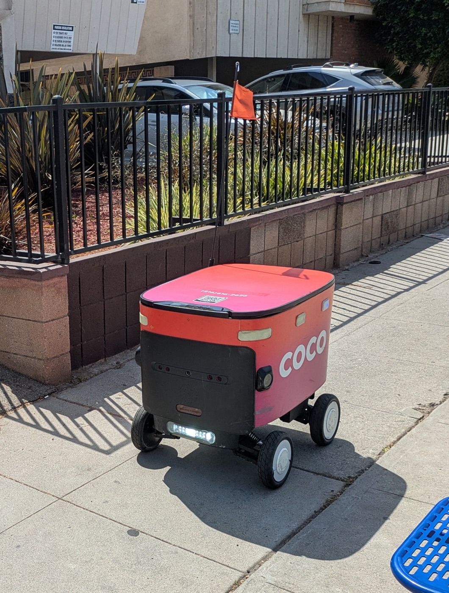
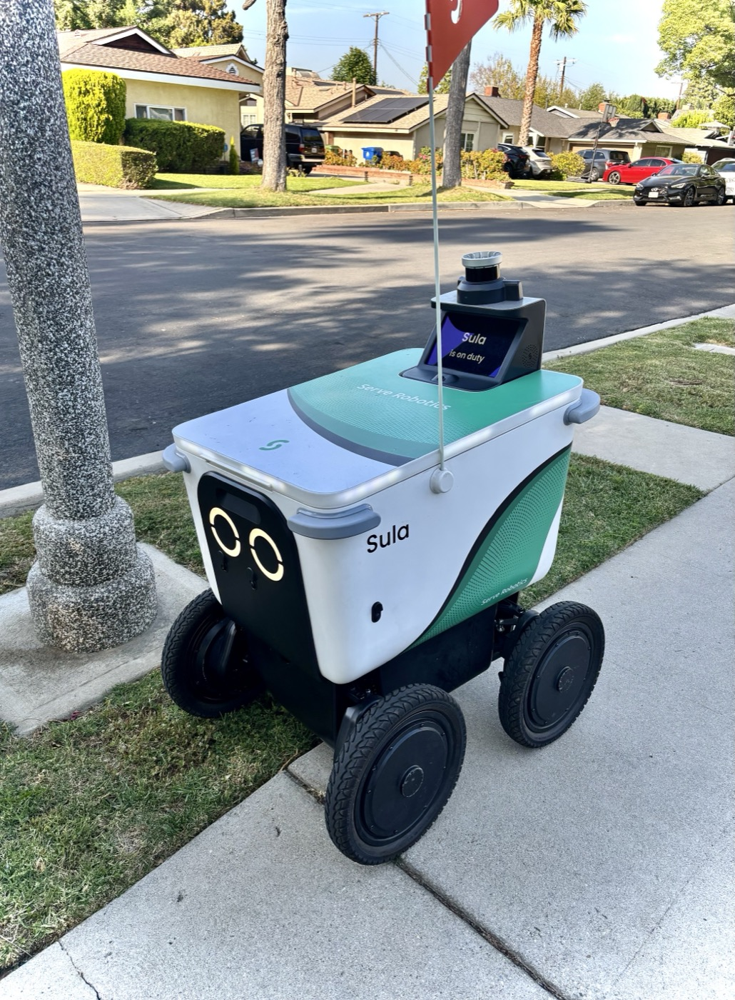

# 코코 로보틱스 배달 로봇, 지나가는 사람은 동의할 자리가 없다

_시카고 주민 두 명이 집단소송을 냈다. 배달 로봇이 길에서 마주친 사람들의 얼굴과 손까지 측정해 보관했다는 주장이다._

## Executive Summary

> [!callout]
> 이 글은 시카고 주민 두 명이 2026년 10월 9일 쿡 카운티 법원에 낸 집단소송 두 건을 읽는다. 한 건은 코코 로보틱스를, 다른 한 건은 서브 로보틱스를 겨눈다. 두 회사 모두 보도를 달리는 배달 로봇을 운영한다. 소장은 로봇이 주문한 것을 꺼내러 나온 사람의 얼굴과 손을 카메라로 담고 라이다 센서로 그 기하를 측정했으며, 그렇게 쌓은 데이터를 AI 학습에 쓰고 제3자와 공유했다고 주장한다.

> 주장의 범위가 고객에서 끝나지 않는다는 점에서 이 사건은 앞선 얼굴 데이터 소송들과 다르다. 두 소장은 로봇이 시카고 보도에서 마주친 다른 사람들의 얼굴과 손, 몸까지 스캔한다고 적는다. 근거로 든 일리노이 생체정보보호법은 수집하기 전에 서면으로 알리고 서면 동의를 받으라고 요구하는데, 보도를 지나가는 사람과는 그 동의를 주고받을 통로 자체가 없다. 두 회사의 반박은 갈린다. 코코는 시카고에서 라이다를 쓴 적이 없다며 사실을 부인하고, 서브는 센서는 쓰지만 개인을 식별하지 않는다며 목적을 부인한다.

> 여기까지가 소장과 보도에 적힌 사실이다. 4절 뒷부분과 5절에서 주행 데이터의 재사용 쪽으로 질문을 돌리는 대목은 어느 당사자의 주장도 법원의 판단도 아니라 이 글의 해석이다.

### 주요 수치

앞의 하나는 법이 위반 한 건에 매기는 값이고, 뒤의 셋은 소송이 들어오기 전부터 시카고에 쌓여 온 분위기다.

출처: [블록클럽시카고](https://blockclubchicago.org/2026/10/16/delivery-robots-accused-of-scanning-customers-faces-sharing-biometric-data/), [시카고 선타임스](https://chicago.suntimes.com/news/2026/10/16/lawsuits-accuse-chicago-delivery-robot-companies-of-collecting-biometric-data), [CBS 시카고](https://www.cbsnews.com/chicago/news/coco-serve-delivery-robots-lawsuit-biometrics-privacy-violations/) 보도와 일리노이 생체정보보호법(740 ILCS 14) 조문.

<!-- stat-card -->
**5,000달러** — 고의·중과실 위반 1건당 배상액 — 과실로 인한 위반은 1,000달러이고, 실제 손해가 그보다 크면 큰 쪽을 따른다

<!-- stat-card -->
**4,600명 이상** — '보도 로봇 반대' 청원 서명 — 블록클럽시카고가 지난달 기준으로 적은 수는 4,500명 이상이었다

<!-- stat-card -->
**83%** — 로봇 배달 확대에 반대한 주민 비율 — 로건 스퀘어 일대를 포함하는 1지구 시의원 선거구 설문이다

<!-- stat-card -->
**2027년 5월** — 시카고 배달 로봇 시범 운영 종료 예정 — 시의회가 그전에 중단하거나 기간을 늘릴 수 있다

## 배달 로봇 두 회사가 하루 사이에 피고가 됐다

2026년 10월 9일 쿡 카운티 법원에 집단소송 두 건이 접수됐다. 니어 노스 사이드에 사는 미첼 브레이딩어가 코코 로보틱스를, 링컨 파크에 사는 배리 샤인이 서브 로보틱스를 상대로 냈다. 별개의 사건이고 피고도 다르지만 주장의 뼈대가 거의 같아서 한 묶음으로 보도됐다.

두 사람이 로봇을 만난 경위는 평범하다. 브레이딩어는 2025년 9월 29일 도어대시로 식료품을 한 번 시켰고 코코 로봇이 왔다. 샤인은 우버이츠로 세 번 주문했고 그때마다 서브 로봇이 왔는데, 가장 최근이 2026년 10월 4일이다. 두 사람 다 로봇 배달을 고른 적이 없다. 배달 앱이 알아서 로봇을 붙였고, 주문한 것을 받으려면 로봇 앞으로 걸어가 뚜껑을 여는 수밖에 없었다.

*▲ 코코 로보틱스의 배달 로봇. 주문한 사람이 로봇 앞으로 다가와 윗뚜껑을 열고 내용물을 꺼내는 방식이다 | Source: [Wikimedia Commons (Mx. Granger, CC0)](https://commons.wikimedia.org/wiki/File:Coco_delivery_robot_1.jpg)*

청구의 근거는 2008년에 만들어진 일리노이 생체정보보호법이다. 얼굴이나 손의 기하를 스캔해 생체 식별자를 모으는 회사는 수집 사실과 목적, 보관 기간을 서면으로 알리고 본인의 서면 동의를 받아야 한다. 보관과 공유 방식도 규제 대상이다. 배상액은 과실로 인한 위반에 1건당 1,000달러, 고의나 중과실에는 1건당 5,000달러다. 이 법으로 메타가 6억 5,000만 달러를 내놓은 전례가 있어 미국 기업 쪽에서는 이름만으로도 긴장하는 법이다.

## 소장이 적은 것은 고객에서 멈추지 않는다

소장이 묘사하는 장면은 구체적이다. 사람이 로봇 앞으로 다가와 뚜껑을 열고 주문한 것을 꺼내는 몇 초 동안, 카메라가 그 사람의 얼굴과 머리와 손을 담고 라이다 센서가 그 기하를 3차원으로 측정했다는 것이다. 브레이딩어의 소장에는 그때 원격 조작자가 배달 영상을 실시간으로 보고 있었다는 주장도 들어 있다.

라이다는 적외선 레이저를 쏘고 돌아오는 시간을 재서 물체까지의 거리를 알아내는 센서다. 자율주행 쪽에서 오래 쓴 장치이고, 보도를 달리는 로봇에게는 연석과 사람과 전봇대를 구분하는 눈 노릇을 한다. 결과물은 사진이 아니라 수십만 개의 거리 측정값, 곧 점군이다. 사람 얼굴 앞에서 이 센서가 돌면 그 점군에는 이목구비 사이의 입체적 간격이 그대로 담긴다. 소장이 겨누는 것이 바로 그 간격이다.

*▲ 서브 로보틱스의 배달 로봇. 상단 원통형 모듈에 카메라와 라이다 등 주행용 센서가 모여 있다 | Source: [Wikimedia Commons (The Squirrel Game, CC BY 4.0)](https://commons.wikimedia.org/wiki/File:Serve_Robotics_Food_Delivery_Robot.jpg)*

수집했다는 주장 다음에는 그 데이터를 어디에 썼다는 대목이 온다. 코코를 상대로 한 소장에 따르면 회사는 로봇이 수집한 데이터를 AI 학습을 위해 오픈AI와 공유한다. 서브 쪽 소장은 회사가 영상과 라이다 데이터를 제3자에게 라이선스해 그들이 자기 모델을 학습시키도록 했다고 적는다. 한쪽은 넘겼다고 하고 다른 쪽은 빌려줬다고 하지만, 주행하면서 모은 데이터가 주행과 무관한 곳으로 흘렀다는 점에서는 같다.

> [!callout]
> 앞선 얼굴 데이터 소송들에는 없던 문장이 소장에 하나 더 있다. 시카고 선타임스가 옮긴 주장은 이렇다. 로봇은 시카고 보도에서 마주친 다른 사람들의 얼굴과 손과 몸도 스캔한다. 주문을 넣은 사람도, 문 앞에 나온 사람도 아닌, 그냥 그 길을 걷던 사람들이다.

## 같은 법에 서로 다른 방어

두 회사가 같은 날 나란히 소장을 받았는데, 내놓은 대답은 성격이 다르다. 코코는 사실을 부인했다. 회사를 대변한 칼 핸슨은 "이 소송은 우리 기술을 근본적으로 오해하고 있으며, 우리는 시카고에서 생체정보를 수집한 적이 없다"고 했고, 라이다에 관해서는 시카고에서 그 센서를 쓴 적 자체가 없다고 덧붙였다. 회사가 공유한다는 데이터는 익명의 주행 정보뿐이며, 구체적으로는 시각장애인과 저시력자를 위한 내비게이션 앱 블라인드스퀘어에 실시간 보도 위험 정보를 넘기는 협력이라고 설명했다. 배달이 시작되고 끝나는 구간의 영상은 그 협력에서 빠진다고도 했다.

서브는 목적을 부인했다. 로봇의 카메라와 센서는 시카고 보도를 안전하게 달리기 위한 것이고, 그 데이터를 개인을 식별하는 데 쓰지 않으며, 시스템 자체가 개인을 식별하거나 생체정보 프로필을 만들도록 설계되지 않았다는 입장이다. 소장에는 대응하겠다고 밝혔다.

두 대답의 차이가 이후 공방의 모양을 바꾼다. 코코 쪽 다툼은 사실 확인으로 간다. 시카고에서 돌린 로봇에 라이다가 달려 있었는지 아닌지는 기기 사양과 운행 기록으로 판가름 날 문제다. 서브 쪽 다툼은 그렇지 않다. 센서가 있었다는 것도, 데이터를 모았다는 것도 다투지 않으니, 남는 질문은 하나다. 주행하려고 찍은 점군을 생체 식별자로 볼 수 있는가.

이 질문에 미리 답해 둔 판례는 많지 않다. 다만 출발점은 조문 안에 적혀 있다. 일리노이 생체정보보호법은 무엇이 생체 식별자인지를 열거하면서, 무엇이 거기 들어가지 않는지도 같은 자리에 적어 두었다. 필적과 서명, 사진, 인구통계 정보, 문신 묘사, 그리고 키나 몸무게나 머리색 같은 신체 묘사는 생체 식별자가 아니다. 그래서 일리노이 법원들이 얼굴 데이터 사건에서 그어 온 선은 비교적 또렷하다. 사진을 갖고 있는 것 자체는 법 바깥에 있고, 그 사진을 알고리즘에 돌려 개인을 알아볼 수 있는 기하 데이터를 얻는 일은 법 안에 있다. 선은 데이터를 쥐고 있느냐가 아니라 그 데이터가 사람을 가려내느냐에 그어져 있다.

2024년 6월 일리노이 북부 연방지방법원이 X Corp을 상대로 한 집단소송을 기각한 사건은 그 선이 어디까지 내려가는지 보여 준다. 원고는 자신이 올린 사진을 회사가 유해물 탐지 소프트웨어에 돌렸으니 얼굴 기하를 스캔한 것이라고 주장했다. 법원이 짚은 것은 두 가지다. 그 소프트웨어가 이미지에서 해시값을 뽑아냈다는 사실만으로 얼굴 기하까지 스캔했다고 볼 수는 없다는 것이 하나고, 그렇게 나온 값이 사진 속 사람을 가려낸다는 주장이 소장에 없다는 것이 다른 하나다. 센서나 소프트웨어가 사람 앞에서 무언가를 계산해 냈다는 사실과, 그 계산 결과가 그 사람을 식별한다는 사실은 따로 증명돼야 한다는 뜻이다. 서브를 둘러싼 공방은 결국 이 자리에서 벌어질 가능성이 높다.

## 동의를 받을 상대가 고객 명단에 없다

서면 동의라는 요건은 상대가 특정될 때만 작동한다. 상대가 누구인지 알고, 그 사람에게 문서를 보여 줄 수 있고, 그 사람이 서명하거나 동의 버튼을 누를 자리가 있어야 성립한다. 화면을 사이에 두고 벌어지는 일에서는 이 조건이 대체로 갖춰져 있다. 계정이 있고, 약관이 있고, 가입 절차가 있다.

보도 위에서는 그 조건이 층층이 무너진다. 소장이 그리는 장면을 세 층으로 갈라 보면 각 층마다 동의 통로가 다르게 남아 있다.
