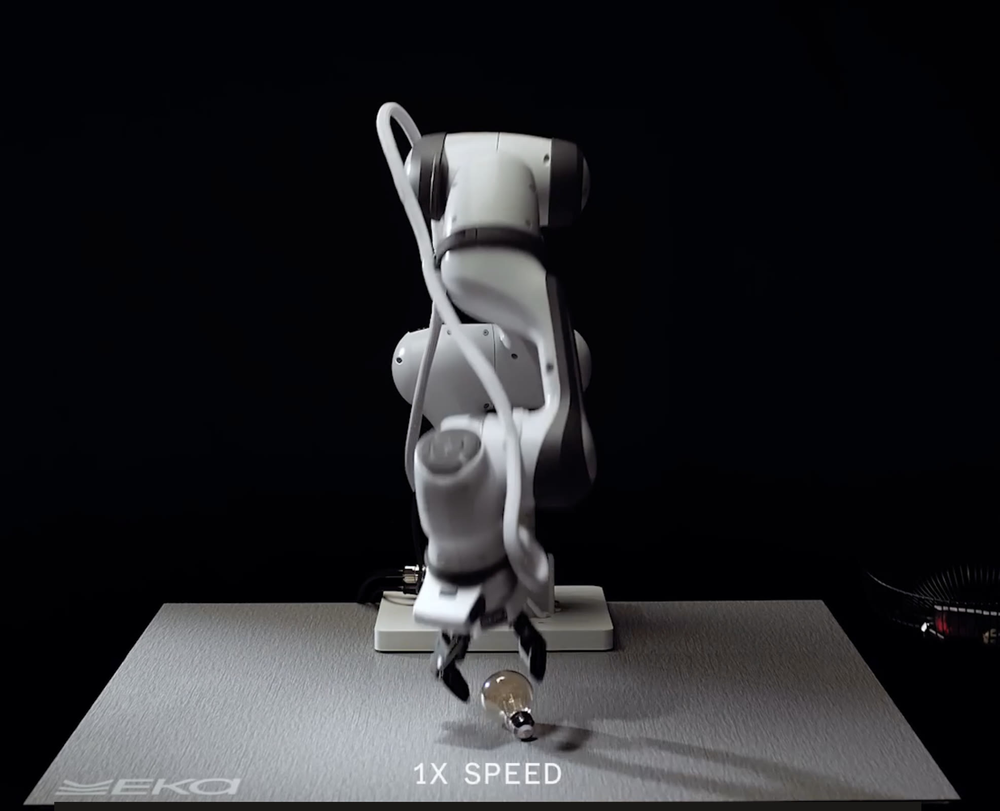
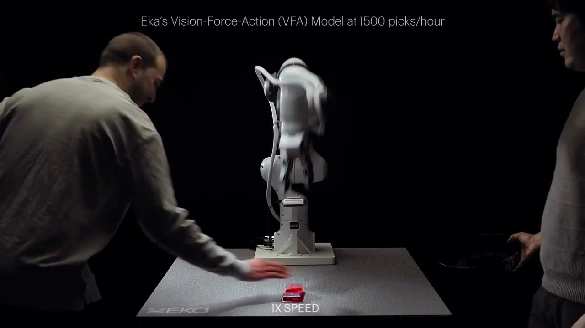

# Can Eka Robotics

_a16z puts the 1,500 picks an hour in laboratory picking tasks, and the 20 million gripper cycles a factory line expects are still a target_

## Executive Summary

> [!callout]
> This article asks how much qualification belongs around the robot-hand results that the American robotics startup Eka Robotics published on October 20, 2026. The company raised a $150 million Series A co-led by a16z and F-Prime, at a post-money valuation of $1.45 billion. Its founders are the MIT professor Pulkit Agrawal and Tuomas Haarnoja, formerly a researcher at Google DeepMind.

> The quoting piled onto one number: the robot picks 1,500 objects an hour. The human baseline is about 600 an hour, so two and a half times as fast. Yet the company, the press and the investor each describe that one number differently. Only the investor, a16z, said which task the figure came from. Its post ties the 1,500 to picking tasks run in a laboratory, and leaves holding that speed across a full shift as the next test.

> Sections 1 through 5 follow facts recorded in the company announcement, in press coverage and in the investor's public post. Section 6, which asks what this structure puts to anyone gathering data for physical AI, is this article's interpretation.

### Key Numbers

The first two are the performance the company put forward. The last two are the conditions that apply when that performance moves into a factory.

Source: [Eka Robotics announcement](https://ekarobotics.com/blog/eka-robotics-raises-150m-to-build-superhuman-intelligence-for-the-physical-world) · [TechCrunch](https://techcrunch.com/2026/10/20/eka-is-worth-1-45-billion-thanks-to-a-physical-ai-model-that-has-experts-raving/) · [a16z](https://a16z.com/announcement/investing-in-eka-robotics/) (October 20, 2026)

<!-- stat-card -->
**1,500 : 600** — Picks per hour — The robot first, the human baseline second. a16z places the figure in laboratory picking tasks

<!-- stat-card -->
**Over 95%** — Pick success rate — On objects weighing up to 1 kg. The company adds that objects outside the training distribution were picked without retraining

<!-- stat-card -->
**5M → 20M** — Gripper duty cycles — The current rating first, the bar set by standard industrial arms second. The second one is still a target

<!-- stat-card -->
**Under $1,000** — Gripper hardware cost — Building a hand that reads force at this price is the number that matters on the adoption side

## Where the 1,500 Picks per Hour Comes From

Eka Robotics builds the part at the end of a robot arm, the hand that grips, inserts and turns things, together with the model that drives it. The Series A announced on October 20 came to $150 million and was co-led by a16z and F-Prime. Obvious Ventures and E14 Fund, which led the seed round, followed on, and MFV Partners, Bison Ventures, Glasswing Ventures, Samsung Next and several unnamed Fortune 500 companies came in as new investors. The post-money valuation is $1.45 billion.

The figure that spread with the announcement is 1,500 picks per hour. "Our robots can pick a wide variety of objects outside the training distribution at a superhuman speed of 1,500 operations per hour, roughly two and a half times the human baseline of about 600 operations per hour," the company blog says. TechCrunch attached a weight condition to the same number, reporting that the robot handles about 1,500 objects weighing up to 1 kg in an hour and picks them up reliably more than 95% of the time.

The party that recorded the conditions most precisely turns out to be the investor. The investment post a16z published the same day carries the name of the task alongside the figure. "Eka reports up to 1,500 picks per hour in laboratory induction and bin-picking tasks, two and a half times faster than humans." Induction is the warehouse job of picking items one by one and placing them onto a sorting system, and bin picking is the job of pulling items one at a time out of a jumbled container. Both are repetitive picking tasks, and both differ in character from assembly or wiring work, where parts have to be inserted and fastened.

A wider range appears where that post introduces what the system can do. It writes that "the underlying system has demonstrated manipulation across fragile objects, slippery industrial parts and contact-rich insertion tasks." The 1,500 figure, though, is attached only to those two picking tasks. The range presented as capability and the range the number vouches for are not the same.

The same post also sets down what industrial automation is actually graded on. "Industrial automation has a brutally simple scoreboard: units per hour, error rates, uptime and cost per unit." Then it adds: "Sustaining that performance through full production shifts is the next test." Coming in a piece where an investor introduces its own portfolio company, that sentence carries real weight. The 1,500 is a current best mark, and what a factory asks for is that mark repeated at the same level for eight hours straight.

*▲ Eka's robot arm picking up a light bulb at real-world (1X) speed | Source: [TechCrunch](https://techcrunch.com/2026/10/20/eka-is-worth-1-45-billion-thanks-to-a-physical-ai-model-that-has-experts-raving/)*

## Gripping Happens in the Fingertips, Not the Eyes

The model the company is building is called VFA, after the initials of vision, force and action. The term heard most often in robotics over the past few years has been VLA, where the middle letter stands for language, so that a person gives an instruction in words and the model looks and moves. Eka swapped that middle slot for force.

The reason Agrawal gave TechCrunch is intuitive. "Vision tells you roughly where the object is, what the pose is, but the actual grabbing, the actual searching is happening through forces." Think of a person finding keys in a pocket with their eyes closed. From the moment the fingertips touch something, force takes over and finishes the job.

What co-founder Haarnoja said shows where that choice starts from. "Most of the field has been focusing on the planning," he said, "so they approach from the top: high-level intelligence, pushing that down towards the physical. Whereas we think about it from the bottom up." The bottom here is force and contact. TechCrunch also brought in Rodney Brooks, a long-standing critic of the direction generative robot models have taken, noting that the argument has been made that such models will fail without some attempt to represent force and touch.

Reading force requires a hand built to read it in the first place. The other number Eka released is a gripper hardware cost of less than $1,000. Building a force-sensitive hand expensively was always possible. That it has come down to this price range matters to a factory as much as the performance does.

*▲ Eka's hand gripping a lit candle in a setting where vision alone offers little to go on | Source: [Eka Robotics announcement](https://ekarobotics.com/blog/eka-robotics-raises-150m-to-build-superhuman-intelligence-for-the-physical-world)*

## If Nobody Copies Human Demonstrations, Who Makes the Data

The part of this announcement that holds the eye longer than any number is a single line of declaration in the company blog. "The pathway to making general-purpose robots performant is not by mimicking human data, but by mastering physics." The mainstream of robot learning has long run the other way. Footage is collected of people driving a robot by teleoperation or doing the work themselves, and the model is taught to follow those trajectories.

What Eka chose instead is reinforcement learning inside a physics simulation. The company explains it this way: "In simulation, we can generate thousands of hours of robot experience in minutes, varying objects, environments, and physical conditions." The a16z post says a little more about what varies in there. "Virtual robots can practice millions of variations in object position, friction and contact before a policy ever reaches physical hardware. They can experience failure modes humans rarely demonstrate and learn how to recover from them."

That last clause is the heart of it. Human demonstration data contains only the motions a person actually performed. The instant an object starts slipping out of a hand, or the path taken to regrip after a bad grasp, are situations a worker has no reason to perform repeatedly, so they rarely pile up in the stack. A simulation can create those stretches on purpose. The a16z post compresses the difference into one line, writing that "robot experience can increasingly scale with compute rather than human labor."

The same post does not hide the weak link in the approach either. Simulation is not reality, and as it puts it, "Contact dynamics are notoriously difficult to model." It goes on to write that "Closing this sim-to-real gap has been one of robotics' hardest problems." Saying that a physics engine makes the data does not mean the data comes free. It means that how closely, and in what respects, the engine was made to resemble the world becomes a condition on the performance itself.

> [!callout]
> Two sentences of a different character sit side by side in that a16z post. One says the amount of experience a robot gathers is set by how much compute you can spend, not by how many hours people put in. The other says nobody has settled how far the world built that way matches the real one. The first asks how much data can be made; the second asks what that data is faithful to. The figures Eka has published so far answer only the first question.

## The Laboratory Scorecard and the Shift Scorecard

Researchers who have seen the robot in person responded warmly. Kris Hauser of the University of Illinois said it "was able to adapt to a large number of different objects without retraining," and added that in the way it kept retrying after a failed first attempt there was a "humanness, creepy humanness." Another robotics researcher at a frontier lab, who asked not to be named, told TechCrunch that watching the robot move felt like the moment five to ten years ago when legged robots first began to walk steadily.

*▲ A live lab demo of the VFA model with researchers looking on | Source: [Eka Robotics announcement](https://ekarobotics.com/blog/eka-robotics-raises-150m-to-build-superhuman-intelligence-for-the-physical-world)*

What the same Hauser named as the biggest task ahead was not speed. "What's going to be a big challenge is when they work with integrators on real assembly lines, and it needs to run without breaking for an entire year," he said. A factory scorecard has no column for a personal best. It has a column for time not spent stopped.

That gap sits inside the numbers the company released as well. By Agrawal's account, Eka's gripper hardware is currently rated for 5 million duty cycles, and the ultimate goal is the 20 million cycle bar set by standard industrial arms. Today's figure stands at a quarter of that bar. The company is still in undisclosed pilots. The pilot setup TechCrunch carried is pick-and-place work with several industrial customers, plus work that handles wiring. Wire manipulation falls on the other side of the line drawn in section 1, away from the picking tasks, and no numbers for that work have been published yet.

The investor's expectation runs further ahead. Raghu Raghuram of a16z, who co-led the round, told TechCrunch: "They are already exceeding superhuman performance for certain tasks, and so we think over the next few months there will be superhuman performance in many dexterous manipulation tasks." So there are three things worth holding apart in this news. That the robot is fast on laboratory tasks. That it adapts to unseen objects without retraining. And that this performance will hold up through a factory shift. The first two were watched by several people with their own eyes, and the third is a place the company and the investor both file under what comes next. The closing passage of the company announcement points at the same spot, stating that "Our focus is on transforming these capabilities into sustained, reliable performance in real operations."

## Samsung Next Joined the Same Round

The reason to read this round from Korea sits in the investor list. Samsung Next is among the new investors Eka disclosed. It is the investment arm of Samsung Electronics. The amount was not disclosed.

In Korea, The Tracker reported this participation as a strategic investment by Samsung Electronics, in a story it carried alone, and added that Eka is running a dexterous hand project, an end effector for a robot arm, built on Rainbow Robotics hardware. That passage appears neither in Eka's official announcement nor in the TechCrunch article. Since it comes from a single Korean outlet, it is better held as something that was reported than read as settled fact.

If the report holds, the picture looks like this. Samsung Electronics exercised a call option to become the largest shareholder of Rainbow Robotics, and Rainbow Robotics develops finished robots along with core components such as actuators and dexterous hands. Through Samsung Next it has entered the same technical territory once more. That is a portfolio holding the hand hardware alongside the intelligence that moves it.

## Why Pebblous Is Watching This

Discussion around physical AI usually starts from the model. What makes this announcement interesting lies on the side of the raw material instead. Whether you gather human demonstrations and have a model copy them, or let a physics engine produce the experience, is in the end a question of what gets collected and what quality gets measured against. Change the way data is made and the quality metrics change with it.

With demonstration data made by people, the axes of quality were provenance, consent and label consistency. Who recorded it, under what rights it may be used, whether the same motion carries the same label. When a simulation makes the data, the axis shifts toward distribution. Does the range of friction, weight and pose that was practiced cover the range on the actual line, and how far does the success rate fall in the stretches it does not cover? The reason a laboratory score does not carry over intact to the floor usually lives in that gap.

So the question a factory should ask sits one step behind how many per hour. What data proves that a score holds through a full shift? Answering it takes more than a count of items picked. It takes the type of each failed pick and the condition of the object at the time, the time taken to retry and succeed, and the way the success rate moves as duty cycles accumulate. Without that record, anyone evaluating adoption has no way to hold a vendor's best mark against the conditions on their own line.

Pebblous works on getting data into a state AI can use directly, and this record structure is what we look at alongside it every time. A performance figure becomes a comparable value only once the conditions it came from are written down, and a failure becomes material for improvement only once it is recorded. What makes Eka's announcement interesting is not the size of the number but the fact that the investor wrote the name of the task beside it. A number with its conditions attached can be verified, and a number with its conditions erased cannot.

<!-- stat-card -->
**Editor's Note** — This article is not an attempt to talk down Eka's results. The assessments of researchers who watched the robot up close were clear, and putting force at the center of the model is a choice worth examining on its own terms. The qualifications attached here, though, are for the most part ones the company and the investor wrote down themselves. Carrying across the caveats already present in an announcement, rather than deleting them, is the first piece of verification a reader can do.

Thanks for reading this far. The figures and quotations here were checked directly against the Eka Robotics announcement, the a16z investment post and the TechCrunch article, and the passage carried by a single Korean outlet is marked as such. If you are weighing a robot deployment on your own floor, we would be glad to hear which records you would need to see before you felt comfortable.

**Pebblous Data Communication Team**  
October 22, 2026

## References

### Primary Sources

- 1.Eka Robotics. (2026). "[Eka Robotics Raises $150M to Build Superhuman Intelligence for the Physical World](https://ekarobotics.com/blog/eka-robotics-raises-150m-to-build-superhuman-intelligence-for-the-physical-world)." Eka Robotics Blog.
- 2.a16z. (2026). "[Investing in Eka Robotics](https://a16z.com/announcement/investing-in-eka-robotics/)." a16z.

### Press Coverage

- 3.Fernholz, T. (2026). "[Eka is worth $1.45 billion thanks to a physical AI model that has experts raving](https://techcrunch.com/2026/10/20/eka-is-worth-1-45-billion-thanks-to-a-physical-ai-model-that-has-experts-raving/)." TechCrunch.
- 4.AI Matters. (2026). "[물건 집는 로봇 AI 개발사 에카, 1,985억 원 투자 유치](https://aimatters.co.kr/news-report/56242/)." (Korean-language coverage.)
- 5.The Tracker. (2026). "[[단독]삼성전자, 美 로봇 스타트업 'EKA로보틱스' 전략적 투자](https://thetracker.co.kr/View.aspx?No=4272277)." Korean-exclusive report on Samsung Next's strategic investment and the Rainbow Robotics-based dexterous hand project.
