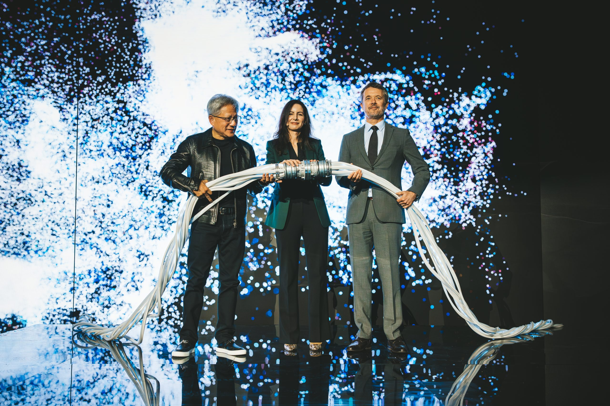

# EU RAISE Asks Companies to Stock Europe

_Google, NVIDIA, Elsevier and four others pledged compute, models, datasets and software licenses in Dublin, and the Commission reviews the initiative every year_

## Executive Summary

> [!callout]
> This article reads the RAISE pledging initiative the European Commission opened in Dublin on October 15, 2026. RAISE is a virtual research institute meant to pool the AI compute, models and data that European researchers use and open them in one place. What was added this time is a list of promises, written by companies and foundations offering up resources of their own.

> Seven organizations pledged first. Google is giving up to 200 European researchers direct access to Google DeepMind's frontier models together with $3 million in cloud credits, and the Novo Nordisk Foundation intends to open the computational capacity of Gefion, an AI-dedicated supercomputer. The categories the Commission names as eligible contributions cover not only compute and models but datasets and software licenses as well. And the whole thing is reviewed once a year.

> Sections 1 through 4 follow what the Commission's own guidance and press release say, alongside the announcements the pledging organizations issued separately that same week. Section 5, which treats a research data access right now resting on this kind of pledge as a reproducibility question, is this article's interpretation.

### Key Numbers

The first two measure what companies put on the table this time. The last two measure the public money those contributions landed on, and how often the pledges themselves come up for review.

Source: [European Commission RAISE pledging page](https://research-and-innovation.ec.europa.eu/strategy/strategy-research-and-innovation/our-digital-future/european-ai-science-strategy/raise-resource-ai-science-europe/raise-pledging-initiative-ai-science-enablers_en) · [Commission press release IP/26/2175](https://ec.europa.eu/commission/presscorner/detail/en/ip_26_2175) · [RAISE funding page](https://research-and-innovation.ec.europa.eu/strategy/strategy-research-and-innovation/our-digital-future/european-ai-science-strategy/raise-resource-ai-science-europe_en) (October 15, 2026)

<!-- stat-card -->
**$3 million** — Cloud credits pledged by Google — Google's own post puts the recipients at up to 200 European researchers. Access to DeepMind frontier models travels with it

<!-- stat-card -->
**1,000** — Datasets Frontiers will curate — AI-powered curation of Horizon Europe datasets. With 100 grants alongside it, more than €1.6 million in services

<!-- stat-card -->
**€107 million** — Public money dedicated to the RAISE pilot — The Horizon Europe 2026–2027 work programme share. €33 million from 2025 came before it, and a separate €600 million is set aside for compute access

<!-- stat-card -->
**One year** — Review cycle for the pledges — One of the two continuity sentences in the press release. No pledge term and no exit procedure are set down in the published documents

## The Seven Pledges Set Out in Dublin

The European AI in Science Summit ran in Dublin on October 15, 2026, organized jointly by the Commission and Ireland as the Presidency of the Council of the European Union. There the Commission launched the RAISE pledging initiative, and seven companies and foundations went down as its first pledging organizations. A page run by the Commission's Directorate-General for Research and Innovation gives each of them a paragraph on what they are offering.

What is on offer differs in kind from one organization to the next. Some open compute. Some release models. One publisher gives access to material and software licenses it had been holding. The same word, pledge, covers all of them, yet what a researcher actually ends up holding is not the same thing twice.

*▲ The computational capacity behind the Novo Nordisk Foundation's pledge: Gefion, an AI-dedicated supercomputer | Source: [Novo Nordisk Foundation](https://novonordiskfonden.dk/en/news/denmarks-first-ai-supercomputer-is-now-operational/)*

| Pledging organization | What it is offering |
| --- | --- |
| Google | $3 million of Google Cloud credits and tokens for European researchers, plus direct access to Google DeepMind's frontier scientific models |
| Novo Nordisk Foundation | Computational capacity of Gefion, an AI-dedicated supercomputer, offered on secure and sovereign infrastructure |
| NVIDIA | Openly available scientific AI software and models, practical training, technical expertise, and pathways to compute and research support. Among the stated aims of this pledge, the Commission page lists helping researchers adopt reproducible AI workflows |
| Elsevier | Complimentary LeapSpace licenses and a Europe-wide LeapSpace Challenge, funded research collaborations for PhD and postdoctoral researchers, ClinicalKey AI licenses for the health sector, Complete Anatomy licenses, and access to the scientific content and data Elsevier has built up |
| Frontiers | AI-powered curation for 1,000 Horizon Europe datasets and 100 FAIR² Data Publication Grants, together more than €1.6 million in services, free to researchers. Early access to Frontiers Data, and the FAIR² open specification for institutions and repositories to adopt |
| Mistral | Open-weight models, API credits, Vibe seats for researchers, PhD internships, part-time research roles and university collaborations |
| Sanofi | Building a European ecosystem for AI-driven healthcare innovation through Future4Care |

The table carries over what the Commission's [RAISE pledging page](https://research-and-innovation.ec.europa.eu/strategy/strategy-research-and-innovation/our-digital-future/european-ai-science-strategy/raise-resource-ai-science-europe/raise-pledging-initiative-ai-science-enablers_en) states. For some of these pledges the Commission attaches no monetary figure.

The Commission page is not the whole record. Three of the pledging organizations issued announcements of their own, and those carry numbers the Commission left out. Google fixes the reach of its pledge at up to 200 top European scientific researchers, and names AlphaFold 3, AlphaGenome and WeatherNext among the tools it is opening. Elsevier counts its complimentary licenses as 1,000 for each of four products, 4,000 in total, and puts its own annual outlay at an estimated €1 million in in-kind support and funding. NVIDIA takes as its starting point the more than 250 open models, 250 open datasets and over 1,400 open source software projects it has already released.

One item sits outside the list. According to the Commission's press release, Mistral AI and CERN launched a new partnership as part of the initiative, to develop what is set to become the largest foundation model in physics. CERN tells the same story a little differently. What the two signed is a statement of intent to establish a long-term strategic partnership, the Large Physics Model they want to build is to be trained on billions of simulated proton-proton collisions at the Large Hadron Collider, and the name RAISE appears nowhere in CERN's announcement. Where the credits and licenses on the pledge list lend a resource out, this one has a research institution and a model company agreeing to build something together.

## If the Public Money Is Already There, What Are the Pledges For?

RAISE is short for Resource for AI Science in Europe. It is the centerpiece of the European Strategy for AI in Science the Commission issued in October 2025, and rather than putting up a new building it was designed as a virtual research institute linking infrastructure that already exists across Europe. The Commission's stated aim is to pool compute, data, talent and research funding and open them to European researchers.

This design is presented as the instrument that delivers the CERN for AI that Ursula von der Leyen promised during her re-election campaign in July 2024. It is not a facility gathered on one site, though. Europe chose instead to connect existing infrastructure wherever it sits, with thematic networks of excellence and a central secretariat tying them together.

*▲ The original behind the "CERN for AI" that RAISE claims to deliver — the real CERN is a single-site facility, which is exactly what RAISE's distributed design is not | Source: [Wikimedia Commons](https://commons.wikimedia.org/wiki/File:Inside_the_CERN_LHC_tunnel.jpg)*

Public money is already attached. By the Commission's own guidance, €33 million was allocated under the Horizon Europe 2025 work programme and €107 million under the 2026–2027 work programme. The pilot launched earlier, in Copenhagen on November 3 and 4, 2025. So the Dublin announcement is not public budget swapped out for corporate money. It is a layer of private in-kind contribution laid over a public program that was already running.

That is also how the Commission frames it. The press release defines the purpose as mobilizing private-sector and philanthropic support "beyond what public funding alone can provide". The RAISE funding guidance states that at its start the initiative is funded exclusively via Horizon Europe. On the public side, a separate €600 million is committed to widening research compute, which the Commission plans to spend on securing dedicated access to AI gigafactories for European researchers and startups. The corporate pledges do not stand in for that money. They stand beside it.

The trouble is that the two layers are not alike. Public funding is written into a work programme that states how much is committed and which years it runs through. The pledges carry no such schedule. Each organization decides for itself what it offers and how much, and whether that offer carries into the next year is settled when the next review comes round.
