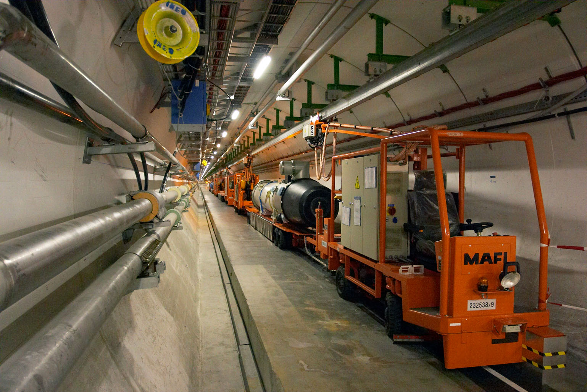

# 유럽연합 RAISE, 구글·엔비디아가 과학자에게 AI를 내준다

_구글·엔비디아 등 일곱 곳이 유럽 연구자에게 연산·모델·데이터를 내놓기로 했고, 그 약속은 해마다 다시 검토한다_

## Executive Summary

> [!callout]
> 이 글은 유럽연합 집행위원회가 2026년 10월 15일 더블린에서 시작한 RAISE 약정 사업을 읽는다. RAISE는 유럽 연구자가 쓸 AI 연산과 모델, 데이터를 한곳에 모아 주겠다는 가상 연구소다. 이번에 더해진 것은 기업과 재단이 자기 자원을 내놓겠다고 적어 낸 약속 목록이다.

> 첫 약정자는 일곱 곳이다. 구글은 유럽 연구자 최대 200명에게 딥마인드 프런티어 모델 직접 접근과 클라우드 크레딧 300만 달러어치를 함께 주겠다고 했고, 노보노디스크재단은 AI 전용 슈퍼컴퓨터 제피온의 연산 능력을 열기로 했다. 집행위가 약정이 될 수 있다고 적어 둔 범주에는 연산과 모델만이 아니라 데이터셋과 소프트웨어 라이선스도 들어 있다. 그리고 이 약속은 해마다 다시 검토한다.

> 1절부터 4절까지는 집행위 공식 안내와 보도자료, 그리고 약정자들이 같은 주에 따로 낸 발표문에 적힌 내용을 따라간다. 연구용 데이터 접근권이 이렇게 갱신되는 약속 위에 올라앉았다는 점을 재현성 문제로 읽는 5절은 이 글의 해석이다.

### 주요 수치

앞의 둘은 기업이 이번에 내놓은 자원의 크기를, 뒤의 둘은 그것이 올라앉은 공적 자금의 크기와 그 약속을 다시 따져 보는 주기를 말한다.

출처: [유럽집행위원회 RAISE 약정 안내](https://research-and-innovation.ec.europa.eu/strategy/strategy-research-and-innovation/our-digital-future/european-ai-science-strategy/raise-resource-ai-science-europe/raise-pledging-initiative-ai-science-enablers_en) · [집행위 보도자료 IP/26/2175](https://ec.europa.eu/commission/presscorner/detail/en/ip_26_2175) · [RAISE 자금 안내](https://research-and-innovation.ec.europa.eu/strategy/strategy-research-and-innovation/our-digital-future/european-ai-science-strategy/raise-resource-ai-science-europe_en) (2026년 10월 15일)

<!-- stat-card -->
**300만 달러** — 구글이 내놓은 클라우드 크레딧 — 구글 자사 발표가 밝힌 대상은 유럽 연구자 최대 200명이다. 딥마인드 프런티어 모델 접근이 함께 간다

<!-- stat-card -->
**1,000건** — 프론티어스가 손질하기로 한 데이터셋 — 호라이즌 유럽 데이터셋을 AI로 큐레이션. 보조금 100건과 합쳐 160만 유로어치 서비스

<!-- stat-card -->
**1억 700만 유로** — RAISE 파일럿 전용 공적 자금 — 호라이즌 유럽 2026~2027년 작업 프로그램 몫. 2025년 몫 3,300만 유로가 앞에 있고, 연산 접근에 쓸 6억 유로가 따로 있다

<!-- stat-card -->
**1년** — 약정 재검토 주기 — 보도자료가 지속성을 다룬 두 문장 가운데 하나다. 약정 기간이나 중단 절차는 공개된 문서에 적혀 있지 않다

## 더블린에서 적어 낸 일곱 곳의 약속

2026년 10월 15일 더블린에서 유럽 과학 속 AI 정상회의(European AI in Science Summit)가 열렸다. 집행위원회와 유럽연합 이사회 의장국인 아일랜드가 함께 연 자리다. 이 회의에서 집행위는 RAISE 약정 사업을 시작한다고 밝혔고, 기업과 재단 일곱 곳이 첫 약정자로 이름을 올렸다. 집행위 연구혁신총국이 운영하는 안내 페이지에 각자 무엇을 내놓는지가 한 줄씩 적혀 있다.

약속의 내용은 기관마다 다르다. 연산을 여는 곳이 있고, 모델을 푸는 곳이 있고, 출판사가 쥐고 있던 자료와 소프트웨어 라이선스를 쓰게 해 주는 곳이 있다. 같은 약정이라는 이름 아래 묶였지만 연구자가 실제로 손에 쥐는 것은 제각각이다.

*▲ 노보노디스크재단이 RAISE에 내놓기로 한 연산 능력의 실체, AI 전용 슈퍼컴퓨터 제피온 | Source: [Novo Nordisk Foundation](https://novonordiskfonden.dk/en/news/denmarks-first-ai-supercomputer-is-now-operational/)*

| 약정자 | 내놓기로 한 것 |
| --- | --- |
| 구글 | 유럽 연구자가 쓸 구글 클라우드 크레딧과 토큰 300만 달러어치, 구글 딥마인드의 프런티어 과학 모델 접근 |
| 노보노디스크재단 | AI 전용 슈퍼컴퓨터 제피온(Gefion)의 연산 능력, 안전하고 주권적인 인프라 위에서 제공 |
| 엔비디아 | 공개된 과학용 AI 소프트웨어와 모델, 실습 교육, 기술 전문성, 연산과 연구 지원으로 이어지는 통로. 집행위가 이 약정의 목표로 든 것에는 재현 가능한 AI 워크플로 채택이 함께 들어 있다 |
| 엘스비어 | LeapSpace 라이선스 무상 제공과 유럽 전역 경진 대회, 박사·박사후 연구자 공동연구 지원, 의료 분야 ClinicalKey AI 라이선스, Complete Anatomy 라이선스, 엘스비어가 쌓아 둔 과학 콘텐츠와 데이터 접근 |
| 프론티어스 | 호라이즌 유럽 데이터셋 1,000건 AI 큐레이션과 FAIR² 데이터 출판 보조금 100건, 합쳐 160만 유로가 넘는 서비스를 무상으로. Frontiers Data 우선 접근과, 기관·저장소가 가져다 쓸 FAIR² 공개 규격 |
| 미스트랄 | 오픈웨이트 모델과 API 크레딧, 연구자용 좌석, 박사과정 인턴십과 파트타임 연구직, 대학 협력 |
| 사노피 | Future4Care를 통해 AI 기반 의료 혁신을 위한 유럽 생태계 구축 |

표는 집행위 [RAISE 약정 안내 페이지](https://research-and-innovation.ec.europa.eu/strategy/strategy-research-and-innovation/our-digital-future/european-ai-science-strategy/raise-resource-ai-science-europe/raise-pledging-initiative-ai-science-enablers_en)에 적힌 내용을 옮긴 것이다. 집행위가 금액을 밝히지 않은 약정도 있다.

집행위 페이지에 적힌 것이 전부는 아니다. 약정자 가운데 셋은 자기 발표문을 따로 냈고, 거기에는 집행위가 옮기지 않은 숫자가 있다. 구글은 이 약정의 대상을 유럽 연구자 최대 200명으로 못 박고, 열어 주는 모델로 알파폴드3과 알파지놈, 웨더넥스트 같은 이름을 들었다. 엘스비어는 무상 라이선스를 네 제품에 1,000개씩 모두 4,000개로 세고, 한 해에 100만 유로어치쯤의 현물과 자금을 들이겠다고 밝혔다. 엔비디아는 이미 공개해 둔 모델 250여 종과 데이터셋 250여 종, 오픈소스 프로젝트 1,400여 개를 약정의 출발점으로 들었다.

목록 밖에서 따로 발표된 건도 하나 있다. 집행위 발표문에 따르면 미스트랄과 유럽입자물리연구소(CERN)가 이 사업의 일부로 새 협력을 시작했고, 물리학 분야에서 가장 큰 기반 모델이 될 것을 함께 만들기로 했다. CERN 쪽 발표문은 같은 건을 조금 다르게 전한다. 둘이 서명한 것은 장기 협력을 맺겠다는 의향서이고, 만들려는 거대 물리 모델은 대형강입자충돌기에서 모의로 생성한 양성자 충돌 수십억 건으로 학습시킬 계획이며, CERN 발표문에는 RAISE라는 이름이 한 번도 나오지 않는다. 약정 목록에 적힌 크레딧과 라이선스가 자원을 빌려주는 쪽이라면, 이 건은 연구 기관과 모델 회사가 결과물을 같이 만들어 보자는 쪽이다.

## 공적 자금이 이미 있는데 왜 기업 약속까지 필요한가

RAISE는 Resource for AI Science in Europe을 줄인 이름이다. 2025년 10월 집행위가 발표한 유럽 AI 과학 전략의 중심 사업이고, 건물을 새로 한 채 짓는 대신 유럽 곳곳에 이미 있는 인프라를 잇는 가상 연구소로 설계됐다. 집행위는 연산과 데이터, 인재, 연구 자금을 한데 모아 유럽 연구자에게 열어 주겠다는 구상이다.

이 설계는 2024년 7월 우르줄라 폰데어라이엔 집행위원장이 재선 운동에서 약속한 'AI를 위한 CERN'을 구현하는 장치로 설명된다. 다만 CERN처럼 한자리에 모인 시설은 아니다. 유럽 전역에 흩어진 채로 기존 인프라를 연결하는 쪽을 택했고, 분야별 수월성 네트워크를 두고 중앙 사무국이 그 사이를 잇게 설계했다.

*▲ RAISE가 구현한다는 'AI를 위한 CERN'의 원형 — 실제 CERN은 한자리에 모인 시설이라 RAISE의 분산형 설계와 대비된다 | Source: [Wikimedia Commons](https://commons.wikimedia.org/wiki/File:Inside_the_CERN_LHC_tunnel.jpg)*

공적 자금도 이미 붙어 있다. 집행위 안내에 따르면 호라이즌 유럽 2025년 작업 프로그램에 3,300만 유로, 2026~2027년 작업 프로그램에 1억 700만 유로가 배정됐다. 파일럿은 2025년 11월 3일과 4일 코펜하겐에서 먼저 출범했다. 그러니 이번 더블린 발표는 공적 예산을 기업 돈으로 갈아 끼운 것이 아니라, 이미 굴러가던 공공 사업 위에 민간의 현물 기여를 한 층 얹은 것이다.

집행위가 내세운 이유도 그쪽이다. 보도자료는 이 사업의 목적을 '공적 자금만으로 댈 수 있는 것을 넘어서' 민간과 자선 기관의 지원을 끌어오는 일로 규정한다. RAISE 자금 안내를 보면 파일럿이 출발할 때 자금은 호라이즌 유럽에서만 나왔다. 공적 자금 쪽에는 연구용 연산을 넓히는 데 쓸 6억 유로가 따로 걸려 있고, 집행위는 이 돈으로 유럽 연구자와 스타트업에게 AI 기가팩토리 전용 접근권을 확보할 계획이다. 기업 약정은 그 돈을 대신하는 것이 아니라 그 옆에 선다.

문제는 두 층의 성격이 다르다는 데 있다. 아래층인 공적 자금은 몇 해에 얼마인지가 작업 프로그램에 박혀 있다. 위층인 기업 약정에는 그런 것이 없다. 무엇을 얼마나 내놓는지는 기관이 스스로 정하고, 그 약속을 다음 해에도 이어 갈지는 그때 다시 본다.
