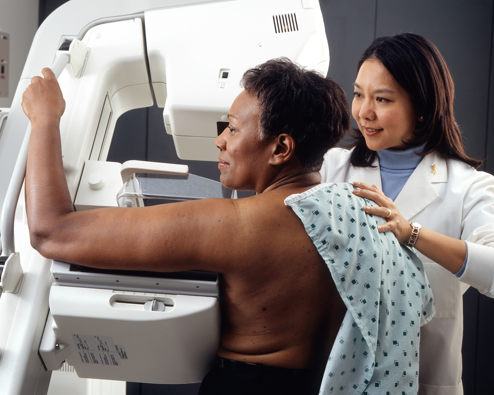

# AI That Reads Patient Scans Still Cannot Skip Review

_The U.S. FDA refused to exempt image-reading AI from premarket review. The petition gave the agency no way to check the monitoring plan a company writes for itself._

## Executive Summary

> [!callout]
> The U.S. Food and Drug Administration published a final order in the Federal Register on September 17 (91 FR 58817). It is the statutory form of a decision already made: a letter dated April 1 had turned down a petition asking that software which flags suspicious findings on X-rays and CT scans, and moves urgent patients up the queue, be allowed to market without premarket review. The petition came from a regulatory law firm acting for the imaging AI company Harrison.ai. This article looks at what FDA rested the refusal on, and whether that reasoning carries over to AI organizations outside medical devices.

> What failed was not the willingness to monitor. The petition asked that a manufacturer be allowed to assess the risk of its own device and set a post-market plan proportionate to that risk, and what FDA pointed at was the absence of any mechanism, anywhere in the petition, for the agency to evaluate the plans that would come out of it. More than 45 comments were filed and a majority opposed. This remains a ruling on one company's petition rather than a door closed on the idea that monitoring can stand in for review, and the closing paragraph of the same order leaves that room open.

> Sections 1 through 3 follow what the order and the April 1 response letter put on the page. The comparison in the back half of Section 4, which sets the ruling beside Korea's change control plan regime, is not in either document and is this article's own work.

### Key Numbers

Sources: [FDA final order (91 FR 58817)](https://www.federalregister.gov/documents/2026/09/17/2026-19074/medical-devices-exemption-from-premarket-notification-radiology-computer-aided-detection-andor), [FDA CDRH response letter of April 1, 16 pages](https://www.regulations.gov/document/FDA-2025-P-5560-0072), and counts from FDA's AI-enabled device list.

<!-- stat-card -->
**180 days** — Silence and the petition wins — The statute deems a petition granted if FDA does not respond inside that window. The denial letter went out on day 161

<!-- stat-card -->
**All of them** — 510(k)s put on hold under one code — Every submission cleared under that CAD product code over several years went on hold at least once, in each case for reasons that included performance testing gaps

<!-- stat-card -->
**255+** — Radiology AI cleared during 2025 — A floor, counted off FDA's AI-enabled device list. Had the exemption been granted, much of that volume could have reached the market without a new review

<!-- stat-card -->
**76%** — Radiology's share of AI devices — 1,230 of the 1,614 authorized through June 2026. Imaging is the default route onto the market for AI in medicine

## A Petition Nobody Answers Is Granted by Default

There is a clause in U.S. device law that rarely gets quoted. When someone petitions to exempt a class II device from premarket notification, FDA has 180 days from receipt to respond, and if it does not respond in time the petition shall be deemed granted. Regulatory silence becomes approval. Put this case on that clock and the margin was not large. The petition arrived on October 22, 2025; the denial letter is dated April 1, 2026. Day 161.

*▲ The agency that sent the denial letter on day 161 of this petition — FDA headquarters (Building 1), White Oak campus, Silver Spring, Maryland | Source: [Wikimedia Commons (U.S. FDA, public domain)](https://commons.wikimedia.org/wiki/File:FDA_Bldg_1_-_Exterior_With_Circle_(5161374950).jpg)*

A second procedure runs alongside it. FDA must publish notice of the petition in the Federal Register, take 60 days of public comment, and then issue its final determination as an order within 120 days of that notice. The notice ran on December 29, 2025 (90 FR 60730) and comments closed on February 27, 2026. That is why a September 17 order spends its pages restating a decision made in April. It is not a fresh judgment but the statutory close. Read the document type wrong and the order is easy to mistake for one that codified an exemption, yet the last sentence of its summary reads: "FDA denied the petition in a response issued to the petitioner on April 1, 2026."

Four device types were in scope. Diagnostic software that characterizes lesions suspicious for cancer (§ 892.2060), the medical image analyzer (§ 892.2070), triage and notification software that moves urgent cases up the worklist (§ 892.2080), and software that both detects and diagnoses (§ 892.2090). All four require a 510(k) today, and a finding from FDA that the device is substantially equivalent to one already legally marketed, before they can be sold. The petition proposed releasing all four from that obligation, on conditions.

The conditions ran like this. The manufacturer must already hold a 510(k) clearance: one under the same classification regulation for triage software, and for the other three, one under any of those three regulations. The manufacturer must also implement "a robust post-market plan, transparency, and training measures." Existing special controls, quality systems, establishment registration and device listing obligations would all stay in force. In short, one past clearance plus a plan the company writes for itself, traded against review of everything that comes next in the same family.

The transparency and training measures came with specifics attached. The manufacturer had to give users a way to export retrievable AI results, put a link to the current electronic instructions for use inside the device interface, and ship only to facilities that run a device-specific training program. The reason the petition gave was an innovation gap. Manufacturers clear narrow indications in the United States, tied to a particular modality and a tightly defined reading task, and end up marketing a fraction of what the product can do, while the same product covers a wider range of findings in Europe, the United Kingdom and Asia. The petition also framed the route as standing alongside the existing 510(k) rather than replacing it.

The territory at stake was not narrow. Counting off FDA's AI-enabled device list, more than 255 radiology AI devices cleared a 510(k) in 2025 alone, and of the 1,614 AI-enabled medical devices authorized through June 2026, 1,230 of them, or 76%, sit in radiology. Imaging is the default route onto the market for medical AI, and the petition proposed to redraw that route. This was never an argument about one company's product.

More than 45 comments arrived and a majority opposed. Those against cited product quality and patient safety, the rapidly evolving nature of AI, and the fact that post-market surveillance effectiveness for these products is not well established. Those in favor echoed the petition. The American College of Radiology took a third position and attached conditions instead of opposing outright. In a comment filed on February 26, 2026, the college asked FDA to narrow which manufacturers and devices could qualify, to confirm the clinical credentials of end users, to strengthen device transparency before and after market entry, to increase FDA's direct visibility into compliance by exempted devices and companies, to keep participation in third-party registries that monitor AI performance, and to review the exemption pathway itself on a regular schedule. Four of those six ask the same thing: let someone outside look in.

## A Past Clearance Does Not Vouch for the Next Device

The test FDA applies to exemptions was settled back in 1998. The device must have no significant history of false or misleading claims or of risks tied to its inherent characteristics; the characteristics necessary for safe and effective performance must be well established; changes that could affect safety and effectiveness must either be readily detectable by users through visual examination or routine testing before causing harm, or not materially increase the risk of injury; and changes must not be likely to shift the device's classification. Four factors. What the September 17 order records is the verdict across all four: the information presented in the petition does not demonstrate that premarket notification is not necessary to assure safety and effectiveness.

The denial letter runs 16 pages, and it goes after the petition's opening premise. What does a past clearance actually vouch for?

"Holding a 510(k) clearance may not reflect that a manufacturer is proficient in, or even has experience with, the processes used in the development of the cleared device, let alone in processes that would necessarily be appropriate for all future devices of the subject types."

What a 510(k) judges is substantial equivalence, meaning whether the device under review is substantially the same as one already legally marketed. FDA's point was about how far that judgment reaches. Meeting the standard for one specific device against one specific predicate does not automatically yield the conclusion that the processes followed during its development will suit any future device under the same regulation. Nor that the manufacturer is proficient in those processes, nor that it would follow the same ones next time. The petitioner, FDA wrote, provided no evidence to support such a conclusion.

There is a second reason. Nothing guarantees that the company holding the clearance built the device. It may have purchased the product from the entity that ran the development, or leaned on third parties, and it might not use the same third parties next time. That is where the sentence quoted above appears. The name on the clearance and the process that made the device can come apart.

Because that could read as abstract, the letter opens its own file. Among all 510(k)s cleared under a particular CAD product code over a period of several years, all were placed on hold, and in each case for reasons that included deficiencies relating to performance testing methodology or performance results. In many of those cases the manufacturer already held a prior CAD authorization. Companies with a clearance behind them were still getting stopped on the evidence of performance. The very condition the petition proposed as the threshold for exemption is, in FDA's records, a condition that failed to screen out performance problems.

The second premise to fail was the bundling of device types. The petition wanted a single clearance under any of the three regulations to carry over to the rest, and FDA held that detection, diagnosis and triage cannot be treated interchangeably. The methods that evaluate a device performing a detection task are not the methods that evaluate a device assigning a diagnostic score to a finding the user has already picked out. The letter also spells out why experience developing AI for one indication does not travel easily to another: the interdisciplinary expertise needed to understand the clinical workflow, expected benefits and patient risks differs; the data collection protocols used to curate a dataset that is representative and appropriately sized for the indication differ; and the methods used to determine an appropriate reference standard differ. All three are about making data.

The second of the four factors caught on the same problem. The petition argued that CAD devices had been on the U.S. market for more than 20 years and that FDA's two 2012 guidance documents had not substantially changed since, so the characteristics necessary for safe and effective performance must be well established. FDA answered that both guidances cover detection devices only and put diagnosis and triage software outside their scope. It added that for this device type there are no vertical consensus or performance standards to support consistent testing and evaluation. Being sold for a long time is not the same as agreement on what to measure and how.

## Where Screening Breaks the Premise That the Doctor Catches It

The third factor was where this petition was won or lost. It asks whether a change in the device surfaces in the field before harm reaches a patient. The petition claimed it already met that bar: changes in CAD devices that could affect safety and effectiveness "are readily detected by users, licensed radiologists, through visual examination of the images that accompany the use of CAD, or routine testing." A human sits in the reading chair, so a machine that drifts gets caught on the spot.

FDA quoted that sentence and disagreed with it. For an individual patient, agreement between a reader's interpretation, the CAD output and the "true" disease state may not be routinely available or known before the output leads to a misdiagnosis, which raises the risk of injury or ineffective treatment. The sharpest case the letter reaches for is breast screening. For screening mammograms, cancer is not routinely diagnosed from the imaging data alone and a biopsy is often necessary under the standard of care, so a physician cannot definitively distinguish a true positive from a false positive without putting that patient through a biopsy. FDA then looked ahead to devices not yet built. As indications widen toward findings that even trained readers could not be expected to confirm visually, or toward situations where there is no time to confirm, the room a user has to notice a change shrinks further.

*▲ The case the letter reaches for — screening mammography, where imaging alone cannot confirm a positive until a biopsy comes back | Source: [National Cancer Institute / Wikimedia Commons (public domain)](https://commons.wikimedia.org/wiki/File:Woman_receives_mammogram.jpg)*

This matters because it separates having a human watching from being able to check the machine. The watcher is there and the answer key is not. The answer key arrives days later as a biopsy result, or never arrives at all. A deployed model can settle quietly downward and nothing in the room lights up. That is not this article's reading; the letter says it directly. Agreement between the device and the "true" disease state is not routinely captured by these devices, and there are no standard mechanisms for feedback that link a final diagnosis or ground truth determination back to the interpreting radiologist or the device output. Without a robust monitoring program in place, FDA wrote, users may be challenged to know whether device performance has changed, or in the word the letter puts in quotation marks, "drifted." The same shape shows up outside radiology: how performance shifts on patients a model never trained on is what [revalidating a lung cancer AI on outside institutional data](/blog/multimodal-lung-cancer-ai-validation-gap/en/) ran into as well.

Whether an absence of records counts as evidence of safety came up in the same letter. The petition argued that AI use and clearance counts had climbed sharply without a matching rise in reports to FDA's adverse event database, which supported a safe use profile. FDA replied that reported adverse event metrics may not serve as an adequate indicator of safety and effectiveness for these devices. A false positive or false negative output alone may not be an adverse event; the contribution of the device to a downstream adverse event may not be readily apparent when that event occurs; and the event might occur multiple steps downstream from the image interpretation. FDA added that its own premarket review, and its discussions with sponsors during that review, may play a role in holding the number of recalls and adverse events down.

Some of the public comments reported what users had seen. One flagged radiology AI products promoted overseas with hundreds of claimed indications across multiple organ systems, of which only a limited subset appeared to have undergone rigorous analytical and clinical validation in routine practice. The same comment listed inconsistent sensitivity and specificity across patient populations, performance degradation on scans acquired using protocols different from those used during development, and a lack of transparent, indication-specific validation documentation available to end users. The broad indications the petition said U.S. rules kept off the market were, where they are in broad use, being reported back in that shape.

That left post-market monitoring as the petition's last line of defense. Under it, the manufacturer would assess the risk of a given device and set a post-market plan proportionate to that risk. The purpose written into that plan was not vague: regular assessment of generalizability and device performance in the intended patient population in real-world use. What it replaced was FDA review and clearance, with the manufacturer deciding what action was necessary to mitigate the device's risks. Such an approach, FDA wrote, would flip the standard under section 510(m)(2) on its head. And the observation attached to that is the center of this case. The proposal included no mechanism for FDA to evaluate individualized plans. What was missing was not what to measure but who reads the plan and rules it sufficient.

> [!callout]
> [Fact] FDA did not object that the plan was thin. It objected that the structure in the petition left no place for FDA to judge whether the plan was robust. [Interpretation] Self-governance and outside verification are not competing options. A verification point has to be pinned somewhere before self-governance means anything inside a regulatory system.

Drawn out as a sequence, the two proposals separate cleanly. They call for the same work and disagree on when the regulator looks.
