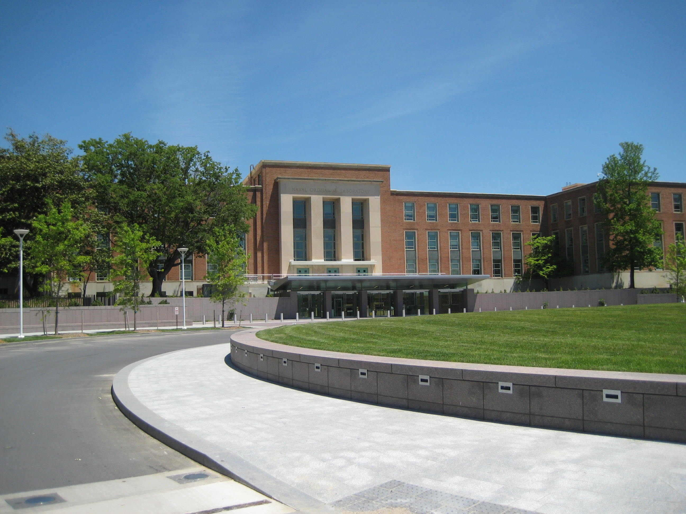
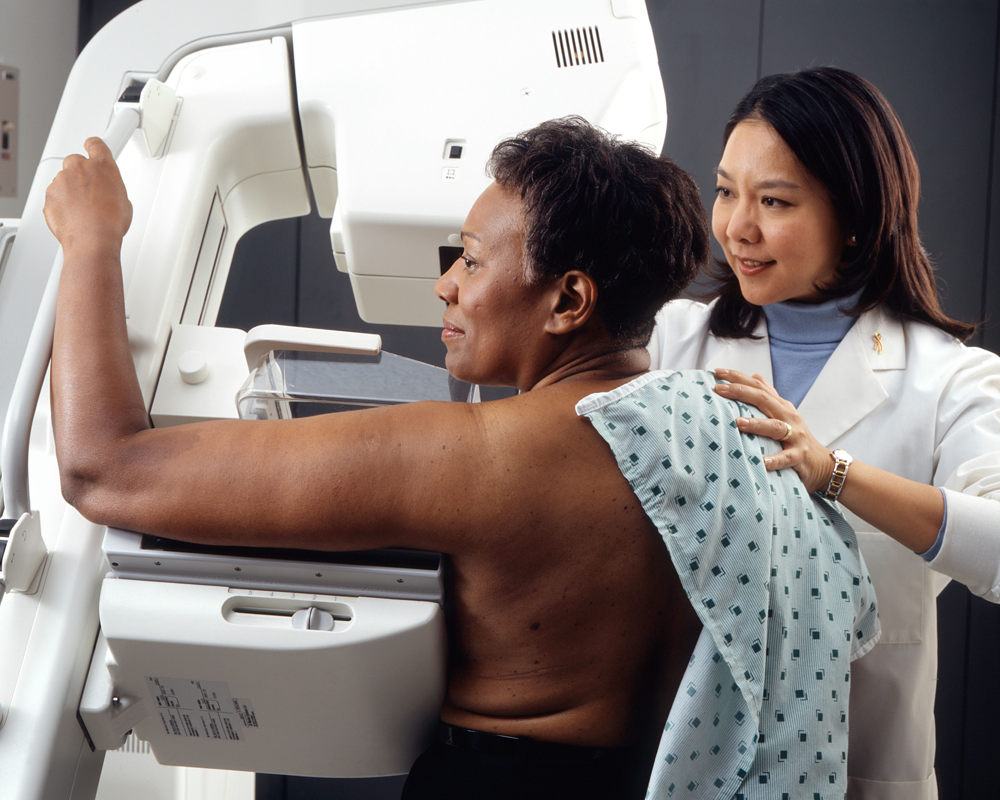

# 환자 영상 읽는 AI는 아직 심사를 건너뛸 수 없다

_미국 FDA가 영상 판독 AI의 심사 면제 요청을 기각했다. 회사가 세운 관리 계획을 규제기관이 확인할 방법이 없다는 이유다._

## Executive Summary

> [!callout]
> 미국 식품의약국이 9월 17일 연방관보에 최종 명령 하나를 실었다(91 FR 58817). 엑스선이나 CT 영상에서 의심 병변을 짚어 주고 급한 환자를 먼저 올려 주는 소프트웨어가 있다. 그런 소프트웨어를 시판 전 심사 없이 내놓게 해 달라는 청원을 FDA는 4월 1일자 서한으로 이미 기각했고, 이 명령은 그 사실을 법이 정한 형식으로 확정한다. 청원을 낸 쪽은 영상 AI 기업 해리슨에이아이를 대리한 법률 자문사였다. 이 글은 FDA가 무엇을 근거로 거절했는지, 그리고 그 근거가 의료기기 바깥의 AI 조직에도 그대로 옮겨지는지를 본다.

> 걸린 것은 사후 관리를 하겠다는 의지가 아니었다. 청원은 제조사가 자기 기기의 위험을 스스로 평가하고 그 위험에 걸맞은 시판 후 관리 계획을 스스로 정하게 해 달라고 했다. FDA의 지적은 그다음이다. 회사가 그렇게 정한 개별 계획이 충분한지를 FDA가 판단할 장치는 청원 어디에도 없었다. 접수된 의견은 45건이 넘었고 다수가 반대였다. 다만 이것은 한 회사의 청원에 대한 판단이지, 사후 관리로 사전 심사를 대신하는 방식 전체를 닫아 둔 결정은 아니다. 같은 명령문의 마지막 문단이 그 여지를 남긴다.

> 1절부터 3절까지는 명령문과 4월 1일 답변 서한에 적힌 것을 따라간다. 4절 후반에서 식약처의 변경관리 계획서 제도와 맞대 보는 대목은 두 문서에 없는 이 글의 작업이다.

### 주요 수치

출처: [FDA 최종 명령(91 FR 58817)](https://www.federalregister.gov/documents/2026/09/17/2026-19074/medical-devices-exemption-from-premarket-notification-radiology-computer-aided-detection-andor), [FDA CDRH의 4월 1일 답변 서한 원문(16쪽)](https://www.regulations.gov/document/FDA-2025-P-5560-0072), FDA AI 기기 목록 집계.

<!-- stat-card -->
**180일** — 침묵하면 청원이 통과되는 기한 — 법은 FDA가 이 기한 안에 답하지 않으면 청원을 인용한 것으로 본다. FDA는 161일째에 기각 서한을 보냈다

<!-- stat-card -->
**예외 없이** — 한 제품코드에서 보류된 510(k) — 그 코드로 수년간 통과한 신고가 모두 한 번씩 보류됐고, 보류 사유에 성능 시험 방법이나 결과의 미비가 들어 있었다

<!-- stat-card -->
**255건 이상** — 2025년 한 해 통과한 방사선 AI — FDA의 AI 기기 목록으로 센 최소치다. 면제가 인정됐다면 상당수가 신규 심사 없이 시장에 나올 수 있었다

<!-- stat-card -->
**76%** — AI 기기 중 방사선의 몫 — 2026년 6월까지 누적 1,614건 가운데 1,230건. 방사선은 AI 의료기기 허가의 기본 통로다

## 답이 없으면 청원은 저절로 통과된다

미국 의료기기법에는 눈에 잘 안 띄는 조항이 하나 있다. 2등급 기기의 시판 전 신고 면제를 누군가 청원하면 FDA는 접수일로부터 180일 안에 답해야 하고, 그 안에 답하지 않으면 청원은 인용된 것으로 본다. 규제기관의 침묵이 승인이 되는 구조다. 이 사건의 날짜를 그 시계에 얹으면 여유가 많지 않았다. 청원 접수는 2025년 10월 22일, 기각 서한은 2026년 4월 1일. 161일째다.

*▲ 이 청원에 161일째 되던 날 기각 답변을 보낸 곳이다 — FDA 본부(1동), 메릴랜드주 실버스프링 화이트오크 캠퍼스 | Source: [Wikimedia Commons (U.S. FDA, public domain)](https://commons.wikimedia.org/wiki/File:FDA_Bldg_1_-_Exterior_With_Circle_(5161374950).jpg)*

그 사이에 법이 요구하는 절차가 또 있다. FDA는 청원을 받으면 연방관보에 공고하고 60일 의견수렴을 거쳐야 하며, 공고일로부터 120일 안에 최종 판단을 명령 형식으로 다시 발행해야 한다. 공고는 2025년 12월 29일(90 FR 60730), 의견 접수 마감은 2026년 2월 27일이었다. 9월 17일 명령문이 4월에 이미 내린 결정을 다시 적고 있는 이유가 여기 있다. 새 판단이 아니라 법정 형식의 마무리다. 문서 성격을 잘못 읽으면 이 명령을 면제를 성문화한 문서로 오해하기 쉬운데, 명령문 요약의 마지막 문장은 "FDA는 2026년 4월 1일 청원자에게 보낸 응답에서 청원을 기각했다"로 끝난다.

청원이 겨눈 기기는 넷이다. 암이 의심되는 병변을 판독해 주는 진단 보조 소프트웨어(§892.2060), 의료 영상 분석기(§892.2070), 급한 환자를 먼저 올려 주는 분류·알림 소프트웨어(§892.2080), 검출과 진단을 함께 하는 소프트웨어(§892.2090). 모두 지금은 시판 전에 510(k) 신고를 내고 FDA로부터 기존 기기와 실질적으로 동등하다는 판단을 받아야 팔 수 있다. 청원은 이 넷을 조건부로 그 의무에서 빼 달라고 했다.

조건은 이랬다. 제조사가 전에 510(k) 허가를 받은 적이 있을 것. 분류·알림 소프트웨어는 같은 분류 규정 안에서 한 건, 나머지 셋은 그 세 분류 가운데 어디서든 한 건이면 된다. 그리고 제조사가 "강건한 시판 후 계획과 투명성, 훈련 조치"를 시행할 것. 기존의 특별통제와 품질시스템, 시설 등록과 기기 목록 의무는 그대로 유지한다는 단서도 붙었다. 요약하면 과거 허가 한 건과 스스로 세운 관리 계획을 묶어, 앞으로 나올 같은 계열 제품의 심사를 면해 달라는 요청이다.

투명성과 훈련 조치라는 말에도 구체적인 항목이 붙어 있었다. AI가 낸 결과를 사용자가 내보낼 수 있게 할 것, 현행 사용설명서의 전자 문서로 가는 링크를 기기 화면 안에 둘 것, 기기별 사용 교육 프로그램을 운영하는 시설에만 공급할 것. 청원이 든 이유는 혁신 격차였다. 제조사들이 미국에서는 특정 촬영 방식과 좁게 정의된 판독 과제로만 허가를 받아 제품이 가진 기능의 일부만 내놓게 되는데, 유럽과 영국과 아시아에서는 같은 제품이 더 넓은 소견을 다룬다는 것이다. 청원은 이 경로가 기존 510(k)를 없애는 것이 아니라 선택지로 나란히 서는 것이라고도 적었다.

FDA가 이 요청을 받아들였다면 바뀌었을 범위는 좁지 않다. FDA의 AI 기기 목록을 세면 2025년 한 해에만 방사선 AI 기기 255건 이상이 510(k)를 통과했고, 2026년 6월까지 누적된 AI 의료기기 1,614건 가운데 1,230건, 76%가 방사선 분야다. 영상의학은 AI 의료기기가 시장에 나오는 기본 통로이고, 청원은 그 통로의 설계를 바꾸는 요청이었다. 한 회사의 제품 하나에 관한 다툼이 아니었다는 뜻이다.

의견은 45건 넘게 들어왔고 다수가 반대였다. 반대 쪽이 든 사유는 제품 품질과 환자 안전, AI가 빠르게 바뀐다는 점, 그리고 이 제품군에서 시판 후 감시가 실제로 작동한다는 근거가 아직 확립돼 있지 않다는 우려였다. 찬성 쪽은 청원의 논거를 되풀이했다. 미국방사선의학회는 전면 반대 대신 조건을 걸었다. 2026년 2월 26일 낸 의견에서 학회는 면제 대상 제조사와 기기의 범위를 좁힐 것, 최종 사용자의 임상 자격을 확인할 것, 시판 전후의 기기 투명성을 높일 것, 면제 기기와 회사의 준수 여부에 대한 FDA의 직접 가시성을 키울 것, AI 성능을 감시하는 제3자 레지스트리에 계속 참여하게 할 것, 그리고 이 면제 경로 자체를 정기적으로 재검토할 것을 요구했다. 여섯 항목 가운데 넷이 "바깥에서 들여다볼 수 있게 하라"는 같은 말이다.

## 이미 받은 허가는 다음 기기를 보증하지 않는다

FDA가 면제 여부를 판단하는 기준은 1998년에 이미 정해져 있다. 기기에 허위·오도 주장이나 고유 위험의 이력이 유의미하게 없을 것, 안전과 유효성에 필요한 특성이 잘 확립돼 있을 것, 안전과 유효성에 영향을 줄 수 있는 변경이 위해가 생기기 전에 사용자의 육안 검사나 일상적 시험으로 쉽게 감지되거나 위험을 실질적으로 늘리지 않을 것, 그리고 변경이 기기의 등급 자체를 바꾸지 않을 것. 네 항목이다. 9월 17일 명령문이 적은 결론은 이 네 항목에 대한 총평이다. 청원이 제시한 정보는 시판 전 신고가 안전과 유효성을 확보하는 데 필요하지 않다는 것을 입증하지 못한다는 것이다.

기각 서한은 16쪽이었고, 청원의 첫 번째 전제부터 파고들었다. 과거에 허가를 받았다는 사실이 무엇을 보증하느냐는 물음이다.

"510(k) 허가를 보유하고 있다는 사실은, 그 제조사가 해당 기기의 개발에 쓰인 공정에 숙련돼 있다거나 그 공정을 경험해 봤다는 것조차 보여 주지 못할 수 있다. 하물며 해당 유형의 미래 기기 전부에 반드시 적절할 공정에 대해서는 더 그렇다."

510(k) 제도가 판단하는 것은 실질적 동등성이다. 지금 심사받는 이 기기가 이미 시장에 있는 저 기기와 실질적으로 같은가를 본다. FDA가 지적한 것은 그 판단의 사정거리다. 특정 기기 한 대를 특정 선행 기기와 견줘 이 기준을 충족했다고 해서, 그 개발 과정에서 따른 공정이 같은 규정 아래 앞으로 나올 어떤 기기에도 적절하리라는 결론이 자동으로 따라오지는 않는다. 제조사가 그 공정에 숙련돼 있으리라는 결론도, 앞으로도 같은 공정을 따르리라는 결론도 마찬가지다. 청원자는 그런 결론을 뒷받침할 증거를 내지 않았다고 FDA는 적었다.

이유는 하나 더 있다. 허가를 보유한 회사가 그 기기를 직접 개발했다는 보장도 없다는 것이다. 개발을 마친 다른 주체에게서 기기를 사들였을 수도 있고, 제3자의 손을 빌렸을 수도 있으며, 다음 기기에서도 같은 제3자를 쓴다는 법이 없다. 방금 인용한 문장이 나온 자리가 여기다. 허가증에 적힌 이름과 그 기기를 만든 공정 사이가 비어 있을 수 있다는 지적이다.

추상적인 반박으로 들릴 수 있어서, 서한은 자기가 가진 기록을 하나 꺼낸다. 특정 CAD 제품코드로 수년에 걸쳐 허가된 510(k)를 전부 보니 모두 한 번씩 보류를 거쳤고, 보류 사유에는 예외 없이 성능 시험 방법이나 성능 결과의 미비가 들어 있었다. 그 제조사들 가운데 상당수는 이미 CAD 허가 이력을 갖고 있었다. 과거 허가가 있는 회사들이 그 뒤에 낸 신고에서도 성능을 증명하는 대목에서 걸렸다는 뜻이다. 청원이 면제의 문턱으로 삼자고 한 바로 그 조건이, FDA의 기록 안에서는 성능 문제를 걸러 내지 못한 조건이었다.

두 번째로 걸린 전제는 기기 유형들을 하나로 묶은 것이다. 청원은 세 분류 가운데 어디서든 허가 한 건이면 나머지에도 적용해 달라고 했지만, FDA는 검출과 진단과 분류를 서로 바꿔 놓을 수 없다고 못 박았다. 어떤 병변을 찾아내는 기기가 있고, 사용자가 이미 지목해 둔 소견에 진단 점수를 매기는 기기가 있다. 둘을 평가하는 방법은 같지 않다. 한 적응증에서 쌓은 AI 개발 경험이 다른 적응증으로 쉽게 옮겨 가지 않는 이유도 함께 적혔다. 임상 흐름과 기대 이익과 환자 위험을 이해하는 데 필요한 학제 간 전문성이 다르고, 그 적응증에 대표성 있고 크기가 적절한 데이터셋을 모으는 수집 규약이 다르고, 무엇을 정답으로 삼을지 정하는 기준 설정 방법이 다르다. 셋 다 데이터를 만드는 일에 관한 이야기다.

네 항목 가운데 둘째도 같은 자리에서 걸렸다. 청원은 CAD 기기가 미국 시장에 20년 넘게 있었고 FDA가 2012년에 낸 지침 두 건이 그 뒤로 크게 바뀌지 않았으니, 안전하고 유효한 성능에 필요한 특성이 잘 확립된 것이라고 했다. FDA의 답은 그 두 지침이 검출 소프트웨어만 다루고 진단·분류 소프트웨어는 범위 밖이라는 것이었다. 그리고 이 기기 유형에는 시험과 평가를 일관되게 받쳐 줄 분야별 합의 표준도 성능 표준도 없다고 적었다. 오래 팔렸다는 사실만으로는 무엇을 어떻게 재는지에 합의가 섰다고 말할 수 없다.

## 의사가 곧바로 알아챈다는 전제가 무너지는 자리

면제의 네 항목 가운데 셋째가 이 청원의 승부처였다. 기기가 달라졌을 때 그 사실이 환자에게 해가 닿기 전에 현장에서 드러나느냐는 조건이다. 청원은 자신들이 이 조건을 이미 충족한다고 주장했다. 안전과 유효성에 영향을 줄 수 있는 CAD 기기의 변경은 사용자인 면허 방사선과 의사가 CAD와 함께 보는 영상을 육안으로 검사하거나 일상적 시험을 통해 쉽게 감지한다는 것이다. 사람이 최종 판독자로 앉아 있으니 기계가 달라져도 현장에서 걸러진다는 논리다.

FDA는 이 문장을 그대로 인용한 뒤 반박했다. 개별 환자 한 명을 놓고 보면 판독자의 해석과 CAD의 출력과 실제 질병 상태 사이의 일치 여부는, CAD의 출력이 오진으로 이어지기 전에 일상적으로 확보되거나 알려져 있지 않을 수 있다. 그러면 상해나 효과 없는 치료의 위험이 올라간다. 가장 선명한 사례로 서한이 든 것은 유방암 선별검사다. 선별 촬영에서는 영상 자료만으로 암 진단이 내려지지 않고 표준 진료상 생검이 필요한 경우가 많다. 의사는 그 환자에게 생검을 시행하지 않는 한 기기의 출력이 진짜 양성인지 거짓 양성인지 확정해서 가를 수 없다. FDA는 앞으로 나올 기기까지 내다봤다. 훈련받은 판독의도 눈으로 확인하기 어려운 소견을 다루거나 확인할 시간이 없는 상황에 쓰이도록 적응증이 넓어지면, 사용자가 변화를 알아챌 여지는 더 줄어든다.

*▲ 서한이 든 사례 — 선별 촬영만으로는 암 진단이 나오지 않아, 생검 전까지 기기 출력의 진위를 가릴 수 없는 경우 | Source: [National Cancer Institute / Wikimedia Commons (public domain)](https://commons.wikimedia.org/wiki/File:Woman_receives_mammogram.jpg)*

이 대목이 중요하다. 사람이 감시자로 붙어 있다고 해서 그 사람이 오류를 확인할 수 있는 것은 아니기 때문이다. 감시자는 있는데 정답지가 그 자리에 없다. 정답지가 며칠 뒤 생검 결과로 오거나, 아예 오지 않는다. 배포된 AI의 성능이 조용히 내려앉아도 그 자리에서는 아무 신호가 뜨지 않는다는 뜻이다. 이것은 이 글의 해석이 아니라 서한이 직접 적은 문장이기도 하다. 기기 출력과 실제 질병 상태가 맞았는지를 이 기기들은 일상적으로 기록하지 않으며, 최종 진단이나 정답 판정을 판독의의 해석이나 기기 출력에 이어 붙이는 표준 방식도 없다고 서한은 적었다. 그래서 강건한 감시 프로그램이 없으면 사용자는 기기 성능이 달라졌는지, 서한이 따옴표를 쳐서 쓴 낱말로는 표류했는지를 알기 어렵다. 같은 구조는 영상의학 바깥에도 있다. 학습에 쓰지 않은 환자군에서 성능이 어떻게 달라지는지는 [폐암 AI를 외부 기관 자료로 다시 검증한 연구](/blog/multimodal-lung-cancer-ai-validation-gap/ko/)에서도 같은 모양으로 나타났다.

기록이 없다는 사실을 안전의 증거로 쓸 수 있느냐는 물음도 같은 서한에 있다. 청원은 AI 사용과 허가 건수가 크게 늘었는데도 FDA의 유해사례 데이터베이스에 보고가 그만큼 늘지 않았으니 안전한 사용 양상이 뒷받침된다고 했다. FDA는 그 지표가 이 기기들의 안전성과 유효성을 가늠하는 잣대로는 모자란다고 답했다. 위양성이나 위음성 출력 하나는 그 자체로 유해사례가 아니고, 기기가 어떤 사고에 얼마나 기여했는지는 사고가 난 시점에 드러나지 않을 수 있으며, 그 사고는 영상 판독에서 여러 단계 아래에서 일어날 수 있다. 보고가 적은 데에는 시판 전 심사와 그 과정의 논의가 한몫했을 수 있다는 단서도 붙었다.

공개 의견 가운데는 현장에서 본 것을 적은 것도 있었다. 해외에서 수백 가지 적응증을 내걸고 팔리는 방사선 AI 제품 가운데 실제 진료에서 엄밀한 분석·임상 검증을 거친 소견은 일부에 그친다는 지적, 환자군에 따라 민감도와 특이도가 들쭉날쭉하다는 지적, 개발 때와 다른 촬영 규약으로 얻은 영상에서 성능이 떨어진다는 지적이 함께 올라왔다. 적응증별 검증 문서를 사용자가 볼 수 없다는 말도 있었다. 청원이 미국에서 못 쓴다고 지목한 넓은 적응증이, 넓게 쓰이는 곳에서는 이런 모양으로 보고됐다.

그래서 이 청원의 마지막 방어선은 시판 후 관리였다. 청원은 제조사가 주어진 기기의 위험을 스스로 평가하고, 그 위험에 비례하는 시판 후 계획을 스스로 정하게 해 달라고 요청했다. 청원이 그 계획에 적어 둔 목적 자체는 모호하지 않았다. 실제 사용 환경에서 의도한 환자군을 상대로 일반화 가능성과 기기 성능을 정기적으로 평가한다는 것이었다. FDA의 심사와 허가를 받는 대신 제조사가 위험 완화에 필요한 조치를 스스로 결정하는 구조다. 기준을 뒤집은 것이라고 FDA는 표현했다. 그리고 거기에 붙인 지적이 이 사건의 핵심이다. 청원에는 그렇게 개별화된 계획을 FDA가 평가할 장치가 없었다. 비어 있던 자리는 무엇을 볼지가 아니라 누가 그 계획을 읽고 충분하다고 판단하느냐였다.

> [!callout]
> [사실] FDA가 문제 삼은 것은 계획의 부실이 아니라, 그 계획이 강건한지를 FDA가 판단할 자리가 청원 구조 안에 마련돼 있지 않다는 점이었다. [해석] 자율 관리와 외부 검증은 대립하는 선택지가 아니다. 검증 지점이 어딘가에 박혀 있어야 자율 관리라는 말이 제도 안에서 뜻을 갖는다.

두 제안을 순서로 그려 놓으면 차이가 한눈에 들어온다. 무엇을 하느냐가 아니라 규제기관이 언제 들여다보느냐가 다르다.
