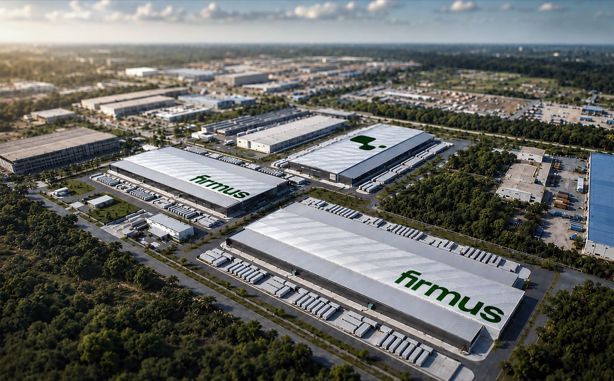

# Firmus Pulls Its IPO With Two Data Centers Running, Five Planned

_Firmus tried to list at a valuation of A$44 billion and called the offer off. Operating capacity is 46MW; capacity still in development is 865MW_

## Executive Summary

> [!callout]
> This article reads the withdrawal of the AI data center company Firmus from the Australian Securities Exchange on October 9, 2026, together with the question of what the valuation on the table was counting. Nvidia holds 7.2% of the company, and had the listing gone ahead it would have been the biggest float on the Australian market since Telstra in 1997.

> The snag sat in one place. What Firmus runs and draws power through today comes to 46MW, while the A$44 billion valuation leaned on the more than 900MW of capacity the company has under contract with customers. Closing that distance takes five more sites, built within the next 24 months. That gap is what investors weighed this time. Advisers looked at cutting the price per share from A$11 to A$8.25, and the offer was called off anyway.

> The facts and figures carried here come from ABC News reporting, Forbes Australia reporting, Guardian reporting, and the announcement Firmus issued itself. The point Section 3 makes about currency conversion, and the move Section 4 makes toward data work, belong to this article rather than to any party in the story.

### Key figures

Four numbers. The first two are the money riding on this offer, and the last two are what that money was leaning on.

Source: [ABC News (2026-10-09)](https://www.abc.net.au/news/2026-10-09/firmus-float-gets-pulled-following-lacklustre-investor-demand/107246230), [Forbes Australia](https://www.forbes.com.au/news/investing/firmus-44-billion-ipo-collapse-explained/), [Firmus announcement](https://firmus.co/newsroom/firmus-surpasses-900-mw-contracted-capacity-adds-openai-as-anchor-customer-and-expands-into-malaysia).

<!-- stat-card -->
**A$44 billion** — Valuation the offer aimed at — A$11 a share was to raise about A$7 billion

<!-- stat-card -->
**6 times** — Forecast debt over forecast operating earnings — US$30 billion of debt against US$5 billion of operating earnings, both 2028 forecasts

<!-- stat-card -->
**46MW** — Operating capacity today — Capacity in development is 865MW, more than eighteen times as much

<!-- stat-card -->
**2 sites / 5 sites** — Running / in development — The five in development are targeted to go live within 24 months

## The Offer Stopped Two Weeks Before the Listing Date

Firmus builds the data centers used for AI training and rents out the compute inside them. It is rooted in Australia and Singapore and is extending into Indonesia and Malaysia, and Nvidia holds 7.2% of it. The large compute build in Australia carries the name Project Southgate.

The company was due to list on the Australian Securities Exchange on October 23. At A$11 a share it would have raised about A$7 billion and opened with a market value of A$44 billion, and on that path it would have been the biggest new listing on the Australian market since Telstra in 1997. The offer was abandoned on October 9, two weeks before the listing date.

*▲ The ASX Exchange Centre in Sydney — the exchange Firmus was due to list on | Source: [Wikimedia Commons](https://commons.wikimedia.org/wiki/File:Sydney_Exchange_Centre_Entrance.jpg)*

The way it came apart is written into the price. Demand fell short, advisers looked at cutting the price to A$8.25 a share, and on the Guardian's account a figure as low as A$5.50 was discussed. The board said that proceeding on these terms would not reflect the company's capability and long-term growth prospects, cited market volatility, and said it would look to private markets for funding instead.

What investors said pointed less at the price than at what the price had been put on. John Pearce, chief investment officer at the Australian pension fund UniSuper, told the ABC, "The ASX needs new stories and this could have been one if it was correctly priced." Jun Bei Liu, co-founder of the fund manager Ten Cap, put it as "Confidence evaporated," and added that the valuation had been too high from the start, close to three times what the company was worth at a private raise a few months earlier.

Price was not the whole of Pearce's worry. In the same interview, Pearce called the company at its current valuation "priced to perfection. So much has to go right to justify the valuation," and added, "We're quite concerned that Firmus will have to keep coming back to the market for a lot more debt and more equity to fund its expansion plans." Building out all five of the promised sites takes money that has not been raised yet. Some felt there was not enough detailed information in the IPO prospectus, according to the ABC.

One analysis reached for something to measure the valuation against. Lochlan Holloway, senior market strategist at Morningstar, gave the ABC a comparison: the company was being given a similar valuation to Woolworths, the grocery chain Australians shop at. Holloway went on: "The economics look good now and the growth is very fast now, but what that looks like again in five or 10 years is the big question mark." Philip Wool of Reliance Investment Research said Firmus "ran into a wall of AI anxiety right at the time that they had planned to list."

## Two Sites Running, Five Still to Build

The announcement Firmus put out gives the whole picture. The company holds seven AI factories across four countries. The two operating today are in Australia and Singapore, and the remaining five are in development, targeted to go live within the next 24 months. The same announcement said contracted capacity across customers had passed 900MW.

*▲ Rendering of the Firmus AI Factory campus in Batam, Indonesia — one of the five sites still in development | Source: [Firmus Newsroom](https://firmus.co/newsroom/firmus-to-build-170-000-gpu-ai-factor-y-campus-with-nvidia-for-global-ai-natives)*

Laid side by side, those two sentences leave a gap. 900MW is a number written on contracts, not a number for sites with power flowing through them. Forbes Australia, working from the offer documents, broke it down as 46MW operating, 865MW in development, and 3.2GW once planned capacity and growth rights are added in. The 46MW running today is a little over a twentieth of the 900MW under contract.
