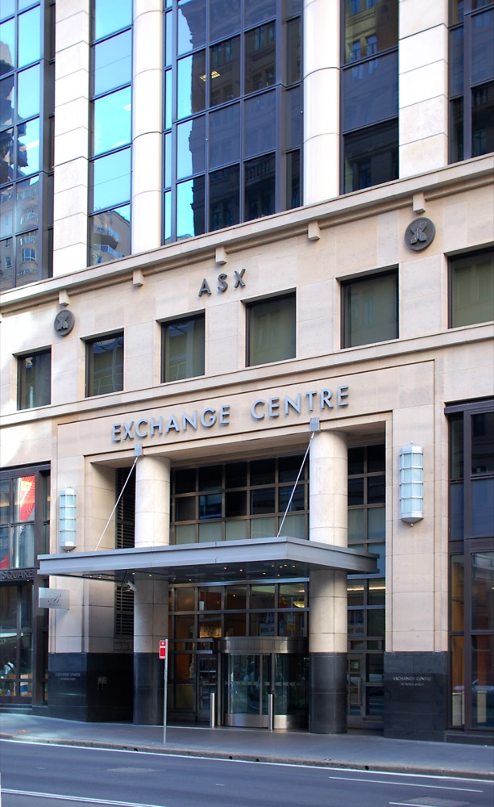

# AI 데이터센터 Firmus 상장 철회, 지은 곳은 두 곳뿐

_Firmus는 440억 호주달러 몸값으로 상장하려다 접었다. 돌아가는 설비는 46MW, 앞으로 지을 설비는 865MW다_

## Executive Summary

> [!callout]
> 이 글은 AI 데이터센터 기업 Firmus가 2026년 10월 9일 호주 증시 상장을 철회한 일을, 그 회사에 매겨지려던 몸값이 무엇을 세어 나온 숫자였는지와 함께 읽는다. 엔비디아가 지분 7.2%를 들고 있는 회사이고, 성사됐다면 1997년 텔스트라 이후 호주 증시 최대급 공모가 될 뻔했다.

> 걸린 자리는 한 군데였다. Firmus가 지금 돌려 전기를 쓰고 있는 설비는 46MW인데, 440억 호주달러라는 몸값이 기대고 있던 것은 고객과 계약해 둔 900MW 넘는 용량이었다. 둘 사이의 차이는 앞으로 24개월 안에 다섯 곳을 더 지어야 메워진다. 투자자가 이번에 따진 것이 바로 그 간격이다. 주당 가격을 11호주달러에서 8.25호주달러까지 낮추는 안을 검토했지만 공모 자체를 접었다.

> 이 글이 옮긴 사실과 수치는 ABC 뉴스 보도, 포브스 호주판 보도, 가디언 보도, Firmus가 직접 낸 발표문에서 가져왔다. 3절에서 통화 환산을 두고 짚는 대목과 4절에서 데이터 쪽으로 논의를 옮기는 판단은 어느 당사자의 주장도 아니라 이 글의 해석이다.

### 주요 수치

네 숫자를 뽑았다. 앞의 둘은 이번 공모에 걸려 있던 돈이고, 뒤의 둘은 그 돈이 기대고 있던 설비다.

출처: [ABC News(2026-10-09)](https://www.abc.net.au/news/2026-10-09/firmus-float-gets-pulled-following-lacklustre-investor-demand/107246230), [Forbes Australia](https://www.forbes.com.au/news/investing/firmus-44-billion-ipo-collapse-explained/), [Firmus 발표문](https://firmus.co/newsroom/firmus-surpasses-900-mw-contracted-capacity-adds-openai-as-anchor-customer-and-expands-into-malaysia).

<!-- stat-card -->
**440억 호주달러** — 공모가 노린 몸값 — 주당 11호주달러로 약 70억 호주달러를 모을 계획이었다

<!-- stat-card -->
**6배** — 예상 부채 대 예상 영업이익 — 2028년 기준 부채 300억 미국달러, 영업이익 50억 미국달러로 둘 다 전망치다

<!-- stat-card -->
**46MW** — 지금 돌아가는 설비 — 개발 단계에 있는 설비는 865MW로 열여덟 배가 넘는다

<!-- stat-card -->
**2곳 / 5곳** — 가동 중 시설 / 개발 중 시설 — 개발 중인 다섯 곳은 앞으로 24개월 안에 가동하는 것이 목표다

## 상장 예정일 두 주 전에 멈춘 공모

Firmus는 AI 학습에 쓰는 데이터센터를 짓고 그 연산을 빌려 주는 회사다. 호주와 싱가포르에 뿌리를 두고 인도네시아와 말레이시아로 넓혀 가는 중이며, 엔비디아가 지분 7.2%를 들고 있다. 호주에서 짓는 대규모 연산 설비에는 Project Southgate라는 이름이 붙어 있다.

이 회사는 10월 23일 호주증권거래소에 상장할 예정이었다. 주당 11호주달러에 약 70억 호주달러를 모아 시가총액 440억 호주달러로 출발하는 그림이었고, 그대로 됐다면 1997년 텔스트라 이후 호주 증시에서 가장 큰 신규 상장이 될 뻔했다. 공모를 접은 날은 상장 예정일을 두 주 앞둔 10월 9일이다.

*▲ 호주증권거래소(ASX) 익스체인지 센터, 시드니 — Firmus가 상장하려던 거래소다 | Source: [Wikimedia Commons](https://commons.wikimedia.org/wiki/File:Sydney_Exchange_Centre_Entrance.jpg)*

무너진 과정은 가격에 그대로 남아 있다. 수요가 모자라자 자문사들이 주당 가격을 8.25호주달러로 낮추는 안을 검토했고, 가디언 보도로는 그보다 더 내린 5.50호주달러까지 거론됐다. 회사 이사회는 지금 조건으로 공모를 진행하면 회사의 역량과 장기 성장 전망이 제대로 반영되지 않는다며 시장 변동성을 이유로 들었고, 앞으로는 비공개 시장에서 자금을 구하겠다고 밝혔다.

투자자 쪽 반응은 가격이 아니라 그 가격이 무엇에 매겨졌는지를 가리켰다. 호주 연기금 유니슈퍼의 최고투자책임자 존 피어스는 ABC에 "호주 증시에는 새 이야기가 필요한데, 가격만 제대로 매겨졌다면 이번 건이 그중 하나가 될 수 있었다"고 말했다. 운용사 텐캡의 공동창업자 준 베이 리우는 "자신감이 증발했다"고 표현하면서, 이 회사 몸값이 애초에 너무 높았고 몇 달 전 비공개로 돈을 모을 때 매겼던 값의 거의 세 배였다고 짚었다.

피어스가 걱정한 것은 가격만이 아니었다. 그는 지금 매겨진 값이 완벽을 전제로 한 가격이라 그 값을 정당화하려면 너무 많은 일이 맞아떨어져야 한다고 ABC에 말했다. 이어 Firmus가 확장 계획에 돈을 대려면 빚과 지분을 더 구하러 시장에 거듭 돌아와야 할 것 같아 우려된다고 덧붙였다. 짓겠다고 한 다섯 곳을 다 지으려면 돈이 더 들어가야 한다는 뜻이다. ABC는 투자설명서에 충분히 상세한 정보가 없었다고 느낀 쪽도 있었다고 썼다.

몸값을 견줄 대상을 든 분석도 나왔다. 모닝스타의 수석 시장 전략가 로클런 홀러웨이는 Firmus에 매겨지려던 값이 울워스에 맞먹는 수준이었다고 ABC에 말했다. 호주 사람들이 장을 보러 가는 그 대형 소매 기업이다. 그러면서 그는 지금은 경제성이 좋아 보이고 성장도 매우 빠른데 5년, 10년 뒤에 그게 어떤 모습일지가 가장 큰 물음표라고 했다. 릴라이언스 인베스트먼트 리서치의 필립 울은 Firmus가 상장하려던 바로 그때 AI를 둘러싼 불안의 벽에 부딪혔다고 봤다.

## 지은 곳 둘, 짓겠다는 곳 다섯

Firmus가 직접 낸 발표문은 전체 그림을 이렇게 적는다. 네 나라에 걸쳐 AI 팩토리 일곱 곳을 두고 있는데, 오늘 돌아가는 것은 호주와 싱가포르의 두 곳이고 나머지 다섯 곳은 개발 단계이며 앞으로 24개월 안에 가동을 목표로 한다. 같은 발표문은 고객과 계약해 둔 용량이 900MW를 넘어섰다고 밝혔다.

*▲ Firmus가 인도네시아 바탐에 짓고 있는 AI 팩토리 캠퍼스 조감도 — 개발 단계인 다섯 곳 가운데 하나다 | Source: [Firmus Newsroom](https://firmus.co/newsroom/firmus-to-build-170-000-gpu-ai-factor-y-campus-with-nvidia-for-global-ai-natives)*

이 두 문장을 나란히 놓으면 간격이 보인다. 900MW는 계약서에 적힌 숫자이지 지금 전기가 흐르는 설비의 숫자가 아니다. 공모 자료를 본 포브스 호주판은 그 내역을 가동 46MW, 개발 중 865MW, 그리고 계획과 성장 권리까지 더하면 3.2GW로 나눠 적었다. 지금 돌아가는 46MW는 계약된 900MW의 스무 분의 일 남짓이다.
