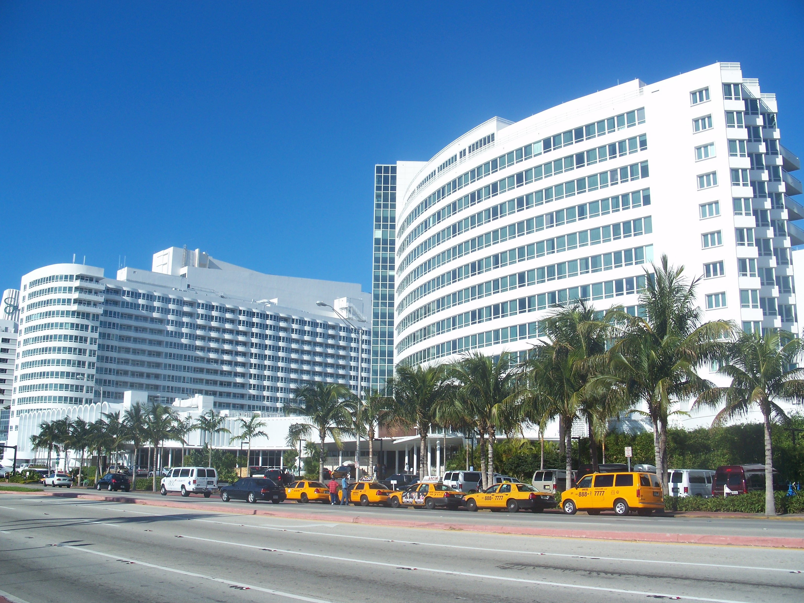

# 폰테인블로 소송, 챗봇에 쓴 말이 

_10월 19일 미국 플로리다 법원 명예훼손 소송에서 원고가 피고의 AI 챗봇 대화를 손해배상 증거로 내라고 요구했다_

## Executive Summary

> [!callout]
> 검색창에 친 말이 어딘가에 남는다는 것은 이제 상식이다. 챗봇에 쓴 말은 아직 그렇게 여겨지지 않는다. 혼잣말에 가깝고 상담에 가깝고, 무엇보다 남이 볼 것을 생각하지 않고 쓴다. 미국 법원들은 올해 들어 그 느낌과 반대 방향으로 선을 긋고 있다. 이 글은 10월 19일 전해진 폰테인블로 소송의 증거 제출 요구와, 그보다 3주 앞서 네바다 연방지방법원이 내놓은 정반대로 보이는 결정을 나란히 놓고 본다.

> 폰테인블로 호텔 측은 명예훼손으로 진 피고에게서 받아낼 배상액을 다투는 단계에서, 피고가 AI 챗봇과 주고받은 프롬프트와 대화를 내놓으라고 요구했다. 그 기록이 "피고의 정신 상태를 문자로 축약한 것"이라는 주장을 근거로 들었다. 플로리다 주법은 피고가 해할 의도를 가지고 행동했다고 인정되면 징벌적 손해배상의 상한을 없애기 때문에, 피고가 당시 무슨 생각이었는지가 곧 돈의 크기가 된다. 법원은 이 요구에 아직 답하지 않았다.

> 4절까지는 공개된 결정문과 보도에 적힌 사실을 따라간다. 챗봇을 업무에 들인 회사의 눈으로 읽는 5절은 이 글의 해석이다.

### 주요 수치

네 숫자는 서로 다른 사건에서 나왔다. 앞의 둘은 법원이 챗봇 기록을 꺼내게 만드는 힘이 어디서 오는지를 가리키고, 뒤의 둘은 그 힘이 한 번 멈춘 자리와 아직 한 번도 멈추지 않은 자리를 나란히 놓는다.

출처: [Volokh Conspiracy](https://reason.com/volokh/2026/10/19/the-ai-data-will-provide-an-unrivaled-view-into-the-mind-of-a-defendant/)(2026년 10월 19일), [eDiscovery Today](https://ediscoverytoday.com/2026/10/12/contrary-to-law-to-order-the-production-of-the-entirety-of-experts-chatgpt-history-log-court-rules-ediscovery-case-law/)(2026년 10월 12일), [BSF Perspectives](https://perspectives.bsfllp.com/post/102mmli/are-ai-chatbot-prompts-discoverable-courts-say-yes).

<!-- stat-card -->
**상한 없음** — 해할 의도가 인정될 때의 징벌적 손해배상 — 플로리다 주법 768.73조 (1)(c) — 원고가 챗봇 대화를 노리는 이유다

<!-- stat-card -->
**2천만 건** — 법원이 제출을 명령한 챗GPT 대화 수 — 뉴욕 남부연방지방법원, 1월 — 이름을 지운 이용자 대화다

<!-- stat-card -->
**약 40쪽** — 전부 내라는 명령이 뒤집힌 전문가의 챗GPT 기록 — 네바다 연방지방법원, 9월 29일 — 질문은 보호, 인용 자료는 공개로 갈랐다

<!-- stat-card -->
**0건** — 사생활을 이유로 제출을 막아낸 사례 — BSF 정리 기준 — 지금까지 받아들여진 예가 없다

## 호텔 로비의 말다툼이 챗봇 기록 요구로 번졌다

시작은 2024년 12월 마이애미비치의 폰테인블로 호텔 로비였다. 투숙객 한 명과 랍비 슈물리 보타크(Shmuley Boteach) 사이에 가자 전쟁을 둘러싼 언쟁이 붙었다. 보타크는 스스로를 "America's Rabbi"라 부르는 인물로 소셜미디어 팔로워가 120만 명이다. 그는 이후 몇 주 동안 호텔과 직원들이 반유대주의를 묵인했다며 공개적으로 비난했고, 호텔 소유 법인은 명예훼손과 업무방해로 그를 플로리다 남부연방지방법원에 제소했다. 사건 번호는 1:25-cv-20251이다.

*▲ 마이애미비치 폰테인블로 호텔 외관 — 2024년 12월 로비 언쟁이 벌어진 곳이다 | Source: [Wikimedia Commons (Ebyabe, CC BY-SA 3.0)](https://commons.wikimedia.org/wiki/File:Miami_Beach_FL_Fontainebleau01.jpg)*

소송은 피고에게 나쁜 쪽으로 흘렀다. 2025년 9월 담당 판사가 피고의 소 각하 신청을 받아들이지 않아 재판이 계속됐고, 2026년 2월에는 치안판사가 제재를 내렸다. 피고의 답변서와 항변을 삭제하고, 피고가 낸 반소를 다시 제기할 수 없도록 각하하고, 책임 자체는 원고 승소로 확정하는 내용이다. 그래서 2027년 2월로 잡힌 재판에 남은 쟁점은 하나뿐이다. 호텔이 얼마를 받느냐.

그 액수를 다투는 단계에서 원고가 요구한 것이 피고의 AI 챗봇 대화 기록이다. 원고 측 서면은 프롬프트와 대화가 "피고의 정신 상태를 문자로 축약한 것"이라고 적었다. 사람의 속마음을 이보다 잘 보여 주는 자료가 없다는 주장이다. 10월 19일 이 요구를 전한 Volokh Conspiracy의 글 제목이 그 문장을 그대로 옮겼다.

피고 측은 범위가 지나치게 넓다고 맞섰다. 미국 민사소송에는 재판에 들어가기 전에 양쪽이 서로 가진 자료를 내놓게 하는 증거개시 절차가 있고, 여기에는 언제까지 요구할 수 있는지 기한이 걸려 있다. 그 일반 기한을 이미 넘긴 뒤에 손해배상을 명목으로 AI와 주고받은 모든 것을 요구한다는 반박이다. 어느 쪽 말이 맞는지는 아직 정해지지 않았다. 법원은 이 요구를 받아들이지도 기각하지도 않았고, 받아들인다면 어디까지인지도 정하지 않았다. 지금 확정된 사실은 요구가 제기됐다는 것뿐이다.

## 피고에게 해할 의도가 인정되면 배상액에 상한이 없다

원고가 왜 하필 마음을 증명하려 드는지는 배상 제도의 구조를 보면 풀린다. 미국의 손해배상은 두 갈래다. 실제로 입은 손해를 메우는 보상적 손해배상이 있고, 그와 별도로 피고를 벌주고 같은 일을 막으려는 징벌적 손해배상이 있다. 뒤쪽은 액수가 뛸 수 있어서 주마다 상한을 둔다. 플로리다도 그렇다.

그 상한에 예외 조항이 하나 있다. 플로리다 주법 768.73조 (1)(c)는 피고가 해할 특정 의도를 가지고 행동했다고 인정되는 경우 상한을 적용하지 않는다. 피고가 그저 경솔했던 것이 아니라 상대를 해치려고 작정했다는 점이 증명되면 액수의 천장이 사라진다는 뜻이다. 원고가 비난이 이어지던 당시 피고의 머릿속을 파고드는 이유가 여기에 있다. 이 소송에서 피고의 의도는 윤리 문제가 아니라 금액 문제다.

원고가 든 근거는 주법 조항만이 아니다. 징벌적 배상을 다룰 때 피고의 심리 상태를 따져 온 연방대법원과 제11연방항소법원의 판례도 원용했다고 밝혔다. 다만 어느 사건을 말하는지까지는 적지 않았고, 요구를 전한 기사에도 사건명은 나오지 않는다.

여기서 챗봇 기록이 특별한 자리를 차지한다. 소셜미디어 게시물은 청중을 향해 쓴 글이라 꾸밈이 섞인다. 반면 챗봇에는 결과를 얻으려고 쓴다. 무엇을 하고 싶은지, 어떻게 하면 되는지를 그대로 적어야 쓸 만한 답이 돌아오기 때문이다. 원고가 노리는 것은 공개 발언과 비공개 질문 사이의 그 틈이다.

> [!callout]
> 법정에서 다투기 가장 어려운 것이 피고의 속마음이다. 겉으로 드러난 행동에서 거꾸로 추정하는 수밖에 없었고, 그래서 의도 요건은 원고에게 늘 높은 벽이었다. 원고는 챗봇 기록에서 그 벽을 돌아갈 길을 봤다.

## 3주 앞서 네바다 법원은 전문가의 질문을 보호했다

같은 가을에 정반대로 읽히는 결정이 하나 나왔다. 라스베이거스 경찰국을 상대로 한 비야누에바 사건(Villanueva v. Las Vegas Metropolitan Police Department, 2:24-cv-00125)에서, 피고 측 전문가 증인 톰 멜턴이 보고서를 쓰면서 챗GPT를 사용하고도 그 사실을 밝히지 않은 것이 드러났다. 치안판사는 그의 챗GPT 기록 전체를 내놓으라고 명령했다. 분량은 약 40쪽이었다.

*▲ 라스베이거스 로이드 D. 조지 연방청사 — 비야누에바 사건을 심리한 네바다 연방지방법원이 있는 곳이다 | Source: [Wikimedia Commons (U.S. DOJ, Public Domain)](https://commons.wikimedia.org/wiki/File:Lasvegascourthouse.jpg)*

9월 29일 앤 트라움 판사가 그 명령을 뒤집었다. 전부 내놓으라는 부분이 명백한 오류이거나 법에 어긋난다는 판단이다. 대신 기록을 둘로 갈랐다. AI가 만들어 준 판례 요약처럼 전문가가 의견을 세우며 참고한 사실과 자료는 공개 대상이다. 상대방이 그 근거를 검증할 수 있어야 하고, 특히 AI가 지어낸 인용이 섞여 있는지 확인할 필요가 있기 때문이다. 반면 전문가 본인이 던진 질문과 프롬프트는 보호 대상으로 봤다.

가른 근거는 그 질문들이 무엇을 드러내는가였다. 전문가가 무엇을 먼저 물었고 무엇을 거듭 확인했는지에는 이 소송을 어떻게 보고 있는지, 어디가 약하다고 느끼는지가 묻어난다. 법원은 그것을 소송에 관한 정신적 인상과 이론으로 보고, 전문가 보고서의 초안을 보호하는 연방민사소송규칙 26조 (b)(4)(B)의 취지를 AI 대화에도 적용했다. 증인신문 준비 자료가 보호받는 것과 같은 이치다.

이 결정의 범위는 좁게 읽어야 한다. 소송을 위해 고용된 전문가 증인의 작업 과정에 관한 판단이고, 당사자 본인이 챗봇에 쓴 말 전체를 보호한다는 뜻이 아니다. 하급 판사의 명령을 상급 판사가 손본 사건이라는 점도 함께 봐야 한다. 같은 법원 안에서도 어디까지 내놓게 할지 의견이 갈렸다는 기록이다.

## 두 결정은 같은 선의 양쪽에 서 있다

한쪽은 챗봇 대화를 내놓으라 하고 한쪽은 내놓지 말라 했으니 모순처럼 보인다. 두 사건이 묻는 질문을 비교하면 겹치지 않는다. 폰테인블로 소송에서 쟁점은 피고가 무슨 생각으로 그 글들을 올렸느냐다. 의도 자체가 법률 요건이라 그 사람이 당시 쓴 말은 그대로 증거가 된다. 비야누에바 사건에서 쟁점은 경찰의 행위이지 전문가의 사고 과정이 아니다. 전문가가 어떤 경로로 결론에 이르렀는지를 캐는 일은 상대편 소송 준비를 들여다보는 것에 가깝다. 그 영역은 AI가 등장하기 전부터 보호받아 왔다.

지금까지 법원들이 그어 온 선을 한 문장으로 줄이면 이렇게 된다. 그 기록으로 누구의 마음을 증명하려는가. 당사자 본인의 마음이면 증거 쪽이고, 소송을 준비하는 쪽의 작업 과정이면 보호 쪽이다. 무엇을 물었는지가 아니라 그 질문이 누구의 어떤 생각을 보여 주는지가 가른다.

<!-- stat-card -->
**증거 쪽 — 당사자의 마음** — 그 사람이 무슨 생각이었는지가 쟁점일 때. 고의·악의·동기가 요건인 사건에서 본인이 챗봇에 쓴 말은 이메일이나 메신저와 같은 자리에 놓인다.

<!-- stat-card -->
**보호 쪽 — 준비하는 쪽의 과정** — 변호사나 전문가가 소송을 준비하며 무엇을 물었는지. 질문 순서와 반복에 전략이 드러나므로 작업물로 다뤄진다. 다만 그 답을 근거로 삼아 제출하면 그만큼 보호가 풀린다.

이 선은 갑자기 그어지지 않았다. 올해 들어 미국 법원들은 챗봇 기록을 다루는 결정을 잇따라 내놨고, 방향은 한쪽으로 모였다. 1월 뉴욕 남부연방지방법원은 저작권 소송에서 이름을 지운 챗GPT 대화 2천만 건을 내놓으라고 명령했다. 이용자가 스스로 플랫폼에 넘긴 기록이라 몰래 엿들은 통신과는 다르다는 판단이었다. 2월 같은 법원의 헤프너 사건에서는 AI는 변호사가 아니라며 변호사와 의뢰인 사이의 비밀특권을 인정하지 않았다. 서비스 약관상 대화가 수집된다는 사실 자체가 비밀을 기대할 근거를 무너뜨린다고 봤다.

3월에는 그 기록이 실제로 판결문에 박힌 사례가 나왔다. 델라웨어 형평법원의 포티스 어드바이저스 대 크래프톤 사건이다. 크래프톤은 2021년 서브노티카 개발사를 인수하면서 선불 5억 달러에 최대 2억 5,000만 달러의 추가 지급을 약속했는데, 그 지급을 피할 방법을 대표가 챗GPT에 물은 대화가 판결문에 그대로 인용됐다. 자문진이 법적 근거가 희박하다고 경고한 뒤에도 상의가 이어졌고, 챗봇이 계약 취소는 어렵다고 답하자 불만을 적은 대목까지 남았다. 일부 로그는 삭제했다고 본인이 인정했지만 사내 메신저로 공유된 사본이 살아남았다.

서로 다른 법원이 다른 쟁점으로 내린 결정들인데도, 날짜 순으로 놓으면 한 해 사이에 챗봇 기록의 자리가 어디로 옮겨 갔는지가 드러난다. 1월에는 플랫폼에 쌓인 대화가 통째로 호출됐고, 3월에는 그 대화가 판결문 본문으로 들어왔다.
