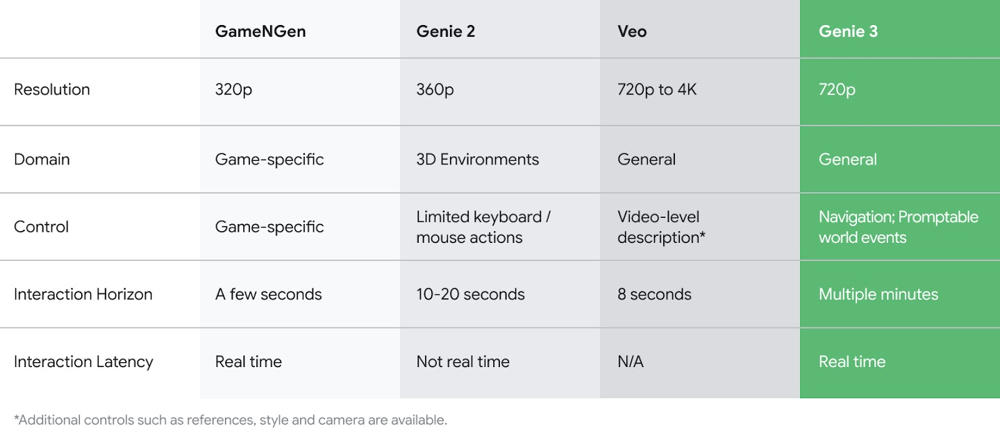

# Genie 4가 지어낸 세계, 로봇은 거기서 배워도 될까?

_딥마인드가 10월 27일 공개한 Genie 4는 소리까지 지어내지만, 복잡한 물리와 긴 장면의 일관성은 아직 숙제로 남았다_

## Executive Summary

> [!callout]
> 구글 딥마인드가 장면과 소리를 한꺼번에 만들어 내는 세계 생성 모델을 내놨다는 소식이다. 10월 27일 연구 프리뷰로 공개한 Genie 4는 말로 장면을 띄우면 그 장면에 어울리는 주변음과 음악, 그리고 입력에 반응하는 대화까지 실시간으로 만들어 낸다. 딥마인드는 이것을 소리를 자체적으로 생성하는 자사의 첫 실시간 월드 모델이라고 불렀다.

> 같은 발표에 로보틱스 시연이 함께 실렸다. Gemini 4 Argon이 아프트로닉의 휴머노이드 아폴로가 체커를 두는 일을 단계로 쪼개면, Genie 4가 그 단계를 실시간으로 시뮬레이션한다. 그런데 딥마인드는 바로 그 글에서 복잡한 물리 상호작용과 장기 일관성이 아직 연구 중인 영역이라고도 적었다. 로봇을 가르치는 데 쓰겠다는 용도와, 물리가 아직 안 맞는다는 자백이 한 페이지 안에 나란히 있다.

> 1절부터 4절까지는 딥마인드 공식 글과 테크크런치 보도, 그리고 합성 궤적으로 학습한 로봇 정책을 실제 로봇에서 평가한 선행 연구에서 확인되는 내용을 따라간다. 생성량이 늘어도 검증이 저절로 쉬워지지 않는다고 보는 5절은 이 글의 해석이다.

### 주요 수치

첫 칸은 Genie 4의 능력을 적은 숫자다. 나머지 셋은 Genie 4가 아니라 같은 일을 하는 다른 월드 모델들을 실제 장비에 올려 얻은 조건과 성적이고, 그 사정은 4절에 적었다.

출처: [TechCrunch](https://techcrunch.com/2026/10/27/googles-genie-4-world-model-adds-audio-more-realistic-worlds-and-real-time-steering/) (2026-10-27) · [arXiv 2607.29302](https://arxiv.org/abs/2607.29302) WorldArena 평가 · [Google DeepMind](https://deepmind.google/blog/genie-4-a-new-generation-of-world-simulation/)

<!-- stat-card -->
**2분** — 장면이 흐트러지지 않고 버티는 시간 — 테크크런치가 전작의 두 배로 적은 값. 딥마인드 공식 글에는 이 수치가 없다

<!-- stat-card -->
**25개** — 한 과제당 월드 모델이 내주는 합성 궤적 — 그 데이터로 학습한 정책을 실제 로봇에서 과제마다 100번 돌려 성공률을 잰다

<!-- stat-card -->
**14~58%** — 공개된 월드 모델 5종이 받은 성공률 — 같은 두 과제, 같은 조건에서 받은 점수다. 최저와 최고가 네 배 넘게 벌어진다

<!-- stat-card -->
**71.5%** — 실제 데이터로 학습한 정책의 성공률 — 합성 궤적이 넘어야 할 기준선. 궤적을 한 개도 더 받지 못하면 3.50%다

## Genie 4가 새로 얻은 것은 소리다

Genie 4는 10월 27일 연구 프리뷰로 나왔다. 받는 쪽은 신뢰 테스터로 한정됐고, 곧 Project Genie의 Google AI Ultra 구독자와 Gemini API·Google AI Studio의 조기 접근 파트너에게 열린다고 딥마인드가 밝혔다. 아직 누구나 켜 보는 물건은 아니다.

전작과 가장 크게 갈리는 대목은 소리다. 딥마인드는 Genie 4를 소리를 자체적으로 생성하는 자사의 첫 실시간 월드 모델이라고 소개했다. 만들어진 장면에는 그 장소의 주변음이 깔리고, 등장인물은 사용자의 입력에 반응해 대화를 주고받는다. 영상을 먼저 만든 뒤 소리를 입히는 방식이 아니라, 세계가 돌아가는 동안 소리가 함께 생긴다는 뜻이다.

세계가 도는 중에 말로 고칠 수도 있다. 딥마인드가 공식 글에 적은 예는 날씨를 바꾸고, 카메라를 옮기고, 새로운 사람이나 사물을 들여놓는 일이다. 이때 제미나이가 그 지시를 장면에 맞게 다듬어 넘긴다고 같은 글이 밝혔다. 장면을 한 번 띄워 놓고 계속 손보는 사용 방식을 전제한 기능인데, 이 전제는 3절에서 다시 걸린다. 딥마인드가 꼽은 드리프트 조건에 반복 편집이 들어 있기 때문이다. 테크크런치는 이 기능을 실시간 조종이라고 부르며 전작보다 물리와 인물 동작이 사실적으로 바뀌었다고 전했다. 구글 딥마인드 엔지니어 디에고 리바스는 테크크런치에서 이 실시간성의 쓸모를 이렇게 설명했다.

"실시간이라는 점은 창작 공간에서 몰입의 흐름을 유지하는 것이 대단히 유용해지는 영역에서 가장 큰 가치를 갖습니다."

### 1.1. 2분이라는 숫자는 어디서 왔나

이번 발표를 옮긴 기사 대부분이 장면 일관성 2분을 머리에 걸었다. 전작의 두 배라는 설명이 따라붙었다. 그런데 딥마인드 공식 글에는 이 수치가 없다. 공식 글이 쓴 표현은 짧은 세션 동안은 일관된 환경을 유지할 수 있다는 정도이고, 시간을 분 단위로 못 박지 않았다.

더 미묘한 지점은 전작 쪽이다. 2025년 8월 공개된 Genie 3의 공식 글은 720p 해상도에 초당 24프레임을 적으면서, 환경이 몇 분 동안 대체로 일관되게 유지되며 시각 기억은 1분 전까지 거슬러 간다고 썼다. 1분이라는 숫자가 여기 있다. 다만 그 1분은 장면이 버티는 시간이 아니라 모델이 앞서 본 것을 되짚을 수 있는 거리다. 일관성 쪽에 딥마인드가 붙인 말은 몇 분이었다.

*▲ 2025년 8월 Genie 3 공식 발표에 실린 비교표. 본문이 다루는 "몇 분"이라는 표현은 이 표의 Interaction Horizon 칸에서 나온다 | Source: [Google DeepMind, Genie 3 공식 블로그](https://deepmind.google/blog/genie-3-a-new-frontier-for-world-models/)*

두 배라는 계산은 이 두 수를 맞바꿔야 성립한다. 전작의 시각 기억 1분을 일관성 시간 자리에 놓고 후속작의 일관성 2분과 견주면 깔끔하게 두 배가 된다. 그런데 같은 글이 일관성에 대해 적은 값은 몇 분이고, 몇 분과 2분 사이에서는 늘었다는 말조차 바로 나오지 않는다. 능력이 제자리라는 뜻으로 읽으면 틀린다. 잰 잣대가 서로 다르다는 말이고, 늘어난 폭은 공개된 문서만으로 확인되지 않는다.

한 가지는 분명하게 적혀 있다. Genie 4가 만든 모든 영상과 오디오에는 SynthID 워터마크가 들어간다. 사람 눈과 귀에 걸리지 않는 표지로, 영상과 소리 양쪽에서 AI가 만든 것임을 식별하도록 돕는다. 생성물을 나중에 가려낼 장치를 모델과 함께 내보낸 셈이다.

## 지켜보는 쪽은 지어낸 세계만 본다

Genie 4는 혼자 돌지 않는다. 딥마인드는 Gemini 3.8 Flash가 루프 안에서 안내 역할을 맡는다고 적었다. Genie 4가 실시간으로 세계를 만들어 내는 동안 제미나이가 장면을 계속 관찰하는 구조다. 목표를 단계로 쪼개고, 지금 화면이 그 단계를 넘었는지 판단하는 것이 감독의 몫이다.

로보틱스 시연이 이 구조의 쓸모를 보여 준다. 딥마인드가 공개한 사례에서는 Gemini 4 Argon과 Genie 4가 함께 돌면서 아프트로닉의 휴머노이드 아폴로가 체커 한 판을 두는 과정을 실시간 단계로 쪼개 시뮬레이션했다. 테크크런치에서 구글 리서치 디렉터 테자스 쿨카르니는 이 조합을 하이브리드 월드 모델이라 부르며, 제미나이가 코드와 텍스트를 쓰고 Genie가 그것을 실시간으로 받아들이는 결합이라고 설명했다.
