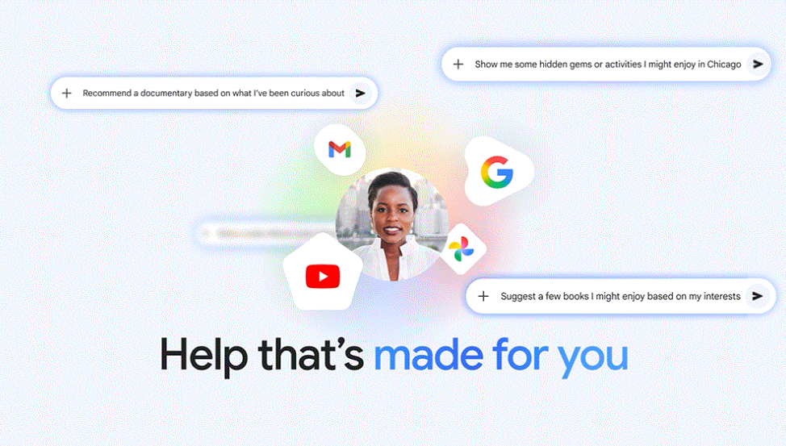

# 구글의 지메일·포토를 광고에 안 쓰겠다던 약속, 이제 조건부다

_구글이 10월 16일 개인정보 처리방침에서 지메일·포토 내용으로는 맞춤 광고를 안 보여 준다던 문장에 예외를 넣었다_

## Executive Summary

> [!callout]
> 이 글은 구글이 10월 16일자 개인정보 처리방침에서 고쳐 쓴 문장 하나를 읽는다. 드라이브와 지메일, 포토의 콘텐츠로는 맞춤 광고를 보여 주지 않는다는 문장이었고, 2021년 7월 1일 처리방침에 들어간 뒤 글자가 바뀐 적이 없었다. 지금 그 문장 뒤에는 사용자가 그 데이터를 맞춤 광고를 지원하는 다른 구글 서비스에 쓰도록 선택한 경우가 아니라면이라는 조건이 붙어 있다.

> 바뀐 분량은 열여덟 낱말이다. 같은 절에는 검색이 접근을 허용받은 데이터 일부를 광고를 포함한 콘텐츠 맞춤화에 처리할 수 있다는 대목과, 퍼스널 인텔리전스를 이름으로 부르는 문장이 새로 들어왔다. 퍼스널 인텔리전스는 지메일과 포토, 드라이브를 제미나이와 검색에 연결해 주는 기능이고 기본값은 꺼짐이다. 즉 이 예외는 아무에게나 적용되지 않는다. 더 나은 답을 받으려고 연결을 켠 사람에게만 적용된다.

> 1절부터 4절까지는 구글 처리방침 현행본과 판본 대조·해설 보도, 구글이 밝힌 안전장치에서 확인되는 내용을 따라간다. 광고가 붙는 경로를 연결 당사자가 제품 화면에서는 확인할 수 없다는 4절 끝의 판단과, 동의의 범위를 어디서 확인해야 하는지를 묻는 5절은 어느 출처에도 없는 이 글의 해석이다.

### 주요 수치

이번 개정에서 움직인 것은 날짜와 낱말 수다. 마지막 칸이 그 예외가 적용되는 범위를 말한다.

출처: [구글 개인정보 처리방침(2026-10-16 시행)](https://policies.google.com/privacy) · [PPC Land, 판본 대조](https://ppc.land/google-lets-connected-gmail-and-photos-data-shape-ads-5-years-after-pledge/)

<!-- stat-card -->
**5년 3개월** — 그 문장이 한 글자도 바뀌지 않은 기간 — 2021년 7월 1일부터 이번 개정 직전까지 열일곱 판본을 건너왔다

<!-- stat-card -->
**18개 낱말** — 문장 끝에 새로 붙은 조건절 길이 — 원래 열다섯 낱말이던 문장이 서른네 낱말이 됐다

<!-- stat-card -->
**15일** — 직전 판본이 살아 있던 기간 — 10월 1일자 개정판이 보름 만에 다시 고쳐졌다

<!-- stat-card -->
**기본값 꺼짐** — 예외를 작동시키는 연결의 최초 상태 — 사용자가 직접 켜지 않으면 지메일·포토는 연결되지 않는다

## 5년을 버틴 약속은 조건부다

구글 개인정보 처리방침 현행본의 시행일은 2026년 10월 16일이다. 광고를 다루는 절에 이런 문장이 있다. "We don't show you personalized ads based on your content from Drive, Gmail, or Google Photos, unless you choose to make data from these services available to other Google services that support personalized ads." 드라이브와 지메일, 구글 포토의 콘텐츠로는 맞춤 광고를 보여 주지 않되, 그 데이터를 맞춤 광고를 지원하는 다른 구글 서비스에 쓰도록 사용자가 선택했다면 그렇지 않다는 뜻이다.

쉼표 앞은 새 문장이 아니다. PPC Land가 1999년 6월 9일 이후 구글이 보관해 둔 판본 54개를 대조해 보니, 앞부분은 2021년 7월 1일판에 실린 그대로였다. 2021년 7월판부터 올해 10월 1일판까지 열일곱 판본이 쌓이는 동안 이 문장만은 글자가 바뀌지 않았다. 광고를 다루는 절에서 기존 문구를 고쳐 쓰고 새 설명을 함께 붙인 전례도 이 대조에서는 나오지 않았다.

다음은 2021년 7월판과 현행본의 같은 문장이다.

| 판본 | 광고 절의 그 문장 |
| --- | --- |
| 2021-07-01~ 2026-10-01 | We don't show you personalized ads based on your content from Drive, Gmail, or Photos.15개 낱말 |
| 2026-10-16현행 | We don't show you personalized ads based on your content from Drive, Gmail, or Google Photos, unless you choose to make data from these services available to other Google services that support personalized ads.34개 낱말 |

****

열다섯에 열여덟을 더하면 서른셋인데 현행 문장은 서른네 낱말이다. 남는 하나는 조건절이 아니라 목록에서 나왔다. 'Photos'가 'Google Photos'로 바뀌면서 낱말이 하나 늘었다. 뜻이 달라진 자리는 어디까지나 쉼표 뒤의 열여덟 낱말이다.

같은 절에 들어온 문장은 둘 더 있다. 하나는 검색의 처리 범위를 적는다. "For example, Search may process some of the data that you allow Search to access to personalize content, including ads." 접근을 허용받은 데이터 일부를 콘텐츠 맞춤화에 처리할 수 있고, 거기에 광고가 포함된다. 맨 앞에 붙은 "For example"을 빼고 읽으면 뜻이 달라진다. 이 대목은 홀로 선 새 권한이 아니라, 바로 앞 문장이 말한 상황을 풀어 보인 예시다. 사용자가 한 서비스에 다른 서비스의 데이터를 쓰도록 허용했을 때 무슨 일이 일어나는지를 검색을 예로 들어 적은 것이다. 다른 하나는 맞춤 광고의 근거를 다시 적은 대목이다. PPC Land의 대조에 따르면 이 자리는 이전까지 관심사와 구글 서비스 전반의 활동이었는데, 지금은 관심사와 활동, 그리고 구글 서비스에서 맞춤화된 콘텐츠로 적혀 있다. 원본 데이터가 아니라 그 데이터에서 뽑아낸 결과물이 세 번째 근거로 들어온 셈이다.

날짜도 촘촘하다. 직전 개정은 10월 1일이었고, 기기 간 활동이라는 표현이 그때 들어왔다. 그 판본의 수명은 보름이었다.

## 예외의 '선택'은 퍼스널 인텔리전스다

이 예외의 무게는 '선택한다'는 낱말에 실려 있다. 무엇을 선택한다는 것인지는 처리방침이 직접 적어 두었다. "If you choose to allow certain services to process data from other services, including for features such as Personal Intelligence, the same data may be used to personalize your experience." 퍼스널 인텔리전스 같은 기능을 위해 한 서비스가 다른 서비스의 데이터를 처리하도록 허용하면, 그 데이터가 경험을 맞춤화하는 데도 쓰일 수 있다는 뜻이다.

1절에서 본 그 절의 앞쪽에 놓인 권한 설명도 같은 구조다. 검색이나 제미나이 앱 같은 특정 구글 서비스가 구글 포토와 지메일·드라이브 같은 워크스페이스 앱의 데이터에 접근하도록 사용자가 허용할 수 있고, 그 허용은 접근하는 쪽 서비스의 정책과 설정을 따른다고 적혀 있다. 문장 둘이 가리키는 행위는 같다. 더 나은 답을 받으려고 내 메일함과 사진첩을 AI 쪽에 열어 주는 일이다.

그 허용이 실제로 무엇을 뜻하는지는 처리방침이 직접 예로 들어 보인다. 최근 호텔 예약에 대해 검색에 물으면, 검색이 메일에 들어 있는 예약 내역을 참고해 호텔 근처에서 할 만한 일을 제안할 수 있다는 것이다. 메일 한 통을 읽어 검색 결과를 바꾼다는 이야기다. 이 예시가 실린 절의 제목이 콘텐츠와 광고를 포함한 맞춤 서비스 제공이고, 1절에서 본 문장 셋도 전부 이 절 안에 있다. 메일을 읽어 추천을 바꾸는 일과 광고를 고르는 일이 처리방침에서는 한 묶음으로 설명된다.

그 기능의 이름이 퍼스널 인텔리전스다. 올해 1월 AI 프로·울트라 유료 가입자에게 먼저 열렸고, 3월에 무료 사용자까지 포함한 미국 전체로 넓어졌다. 지메일과 캘린더, 드라이브, 구글 포토, 유튜브 시청 기록, 검색을 제미나이와 검색의 AI 모드에 연결해 답변을 개인화한다. 기본값은 꺼짐이라 사용자가 직접 켜야 하고, 켜지 않으면 10월 16일의 예외는 적용될 일이 없다. 바꿔 말하면 이번 개정은 모든 지메일 사용자에게 일어난 변화가 아니다. 연결을 켠 사람과 켜지 않은 사람 사이에 전에 없던 경계가 생긴 것이다.

*▲ 구글이 2026년 1월 14일 공개한 퍼스널 인텔리전스 — 사용자가 켜면 지메일·포토·유튜브·검색이 제미나이 쪽으로 열린다 | Source: [구글 블로그](https://blog.google/innovation-and-ai/products/gemini-app/personal-intelligence/)*

> [!callout]
> 연결을 켜는 화면은 더 나은 답변을 약속한다. 그 연결이 광고에도 닿는다는 사실은 그 화면이 아니라 처리방침 문장에 적혀 있다. 같은 행위에 붙은 두 결과가 서로 다른 문서에 흩어져 있다.

## '당분간'이 끝나는 자리

3월에 퍼스널 인텔리전스를 미국 전체로 넓히면서 구글은 광고 이야기를 먼저 꺼냈다. 테크스팟이 옮긴 당시 설명에 따르면, 그 경험은 당분간 광고 없이 유지되지만 앞으로는 앱을 연결한 사람에게도 광고가 비슷하게 작동할 것으로 본다는 것이었다. 조건은 처음부터 시한부였고, 시한이 언제 끝나는지만 빠져 있었다.

10월 16일 조항은 그 문장의 뒷부분을 문서로 옮긴 것에 가깝다. 몰래 뒤집은 약속이라기보다, 7개월 전에 예고한 방향이 처리방침에 자리를 잡은 쪽이다. 다만 예고와 조항 사이에는 차이가 하나 있다. 3월의 말은 앞으로 그렇게 될 것 같다는 전망이었고, 10월의 문장은 지금 그렇게 해도 된다는 허락이다. 전망은 지키지 않아도 그만이지만 허락은 효력이 있다.

시간 축을 더 뒤로 당기면 이 문장이 처음 생긴 사정도 보인다. 구글은 2017년에 소비자 지메일 콘텐츠를 광고 개인화용으로 스캔하는 일을 중단했다. 그렇다고 지메일에서 광고가 사라진 것은 아니다. 검색이나 유튜브 활동처럼 메일함 바깥의 데이터로 겨냥한 광고는 그대로 붙었다. 메일함 안쪽을 광고에서 떼어 놓은 상태가 2021년에 처리방침으로 못 박혔고, 그 상태가 올해 10월에 조건부로 바뀌었다.

테크스팟은 이번 개정을 두고, 2017년 이후 처음으로 구글 자신의 정책이 수신함 콘텐츠가 광고에 관여하도록 허용한 것으로 보인다고 적었다. 간접적으로만 관여한다는 단서는 그 평가에도 붙어 있다. 그래도 9년 동안 정책이 닫아 두었던 쪽으로 조건부 통로가 하나 생긴 것은 맞다. 여기까지가 연표에 들어갈 다섯 시점이다.

| 시점 | 무슨 일이 있었나 |
| --- | --- |
| 2017 | 소비자 지메일 콘텐츠의 광고 개인화 스캔 중단. 메일함 바깥 데이터를 쓰는 광고는 유지 |
| 2021-07-01 | 드라이브·지메일·포토 콘텐츠 기반 맞춤 광고를 하지 않는다는 문장이 처리방침에 들어감 |
| 2026-01 | 퍼스널 인텔리전스가 유료 가입자에게 공개. 기본값 꺼짐 |
| 2026-03 | 미국 전체로 확대. 당분간 광고 없이 유지하되 앞으로는 비슷하게 작동할 것이라고 설명 |
| 2026-10-16 | 연결한 데이터를 맞춤 광고에 쓸 수 있다는 조건절이 처리방침에 삽입 |

광고주 쪽에서 달라진 것은 아직 보이지 않는다. 이번 개정에 맞춰 새 타게팅 옵션이나 광고 설정이 공개된 적은 없다. 지금까지 움직인 것은 제품이 아니라 문서다.

## 안전장치는 있고, 틈도 같이 있다

구글이 내놓은 안전장치는 빈말이 아니다. 연결은 사용자가 켜야 시작되고 언제든 끌 수 있다. 광고주는 지메일과 드라이브, 포토에 접근하지 못한다. 이름이나 메일 주소 같은 신원 정보도 사용자가 허락하지 않으면 광고주에게 넘어가지 않는다. 인종과 종교, 성적 지향, 건강 같은 민감 범주는 광고 타게팅에서 제외된다. 광고가 메일함이나 사진첩에 직접 기반하지는 않는다는 설명도 구글이 공개한 그대로다.

그런데 같은 설명의 다음 문장에 경로가 적혀 있다. AI 모드가 연결된 앱에서 뽑아낸 요약과 발췌, 추론을 활용할 수 있고 같은 정보가 광고 노출에도 쓰일 수 있다는 내용이다. 메일 본문이 광고 시스템으로 넘어가는 것이 아니라, 그 본문을 읽고 만든 요약과 추론이 넘어간다. 직접 기반하지 않는다는 말과 그 데이터로 광고가 맞춰질 수 있다는 말이 동시에 참인 이유가 여기 있다. 1절에서 맞춤 광고의 근거에 맞춤화된 콘텐츠가 추가된 것도 같은 자리를 가리킨다.
