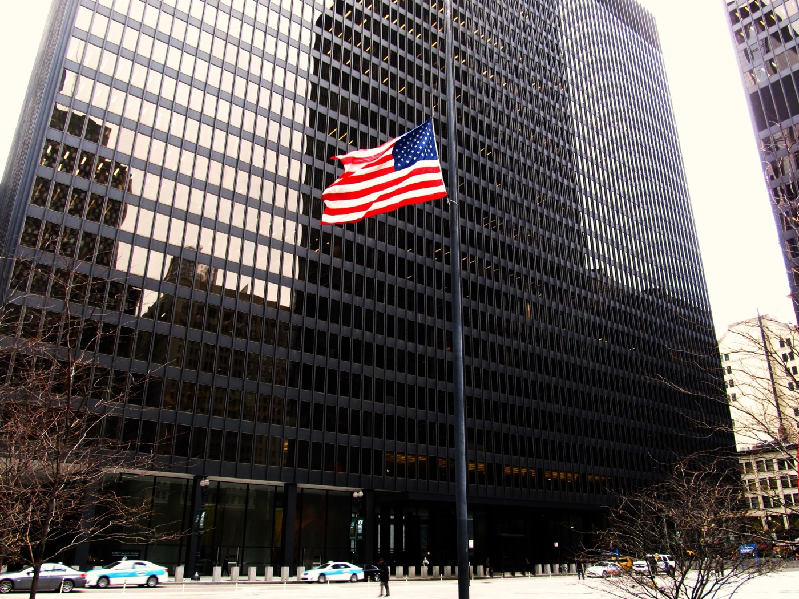

# Grok에 올린 셀카, 얼굴 치수까지 뽑아 갈까?

_일리노이 주민이 증명사진용으로 올린 셀카에서 눈·코·입 사이 거리를 동의 없이 뽑아 갔다고 주장한다. 연방법원 집단소송이다._

## Executive Summary

> [!callout]
> 이 글은 일리노이 주민 세자르 파디야가 2026년 10월 7일 일리노이 북부 연방지방법원에 Grok 운영사를 상대로 낸 집단소송을 읽는다. 그는 증명사진을 만들어 달라며 셀카를 올렸다. 소장이 문제 삼는 것은 그 사진 자체가 아니라, 사진에서 계산해 낸 얼굴의 치수다. 눈과 코와 입과 턱선 사이의 비율과 거리를 서면 동의 없이 수집하고 보관했다는 주장이다.

> 근거가 된 일리노이 생체정보보호법은 위반 1건에 과실이면 1,000달러, 고의나 무모한 경우면 5,000달러를 물린다. 메타가 이 법으로 6억 5,000만 달러를 내놓은 전례가 있어 기업 쪽 체감이 큰 법이기도 하다. 그렇다고 원고가 이긴다는 뜻은 아니다. 같은 법으로 X Corp을 겨눈 소송은 2024년에 기각됐는데, 쟁점이 된 이미지 해시가 개인을 알아볼 수 있는 얼굴 기하 스캔이라는 점을 원고가 구체적으로 주장하지 못했다는 것이 이유였다.

> 여기까지가 보도와 소장에 적힌 사실이다. 4절과 5절에서 이미지 편집 파이프라인의 중간 산출물과 데이터 목록 쪽으로 질문을 돌리는 대목은 어느 당사자의 주장도 법원의 판단도 아니라 이 글의 해석이다.

### 주요 수치

네 숫자를 뽑았다. 앞의 둘은 이 법이 위반 한 건에 매기는 값과 지금까지 실제로 오간 가장 큰 합의금이고, 뒤의 둘은 Grok이 받은 소송 수와 2024년 개정이 바꿔 놓은 셈법이다.

출처: [MediaPost](https://www.mediapost.com/publications/article/418648/grok-sued-over-biometric-privacy.html), [Sigma Law Group](https://sigmalawgroup.com/blog/2026-09-09-meta-xai-bipa-ai-training-photos/), 일리노이 생체정보보호법(740 ILCS 14) 조문.

<!-- stat-card -->
**5,000달러** — 고의·무모한 위반 1건당 배상액 — 과실이면 1,000달러이고, 실제 손해가 그보다 크면 큰 쪽을 따른다

<!-- stat-card -->
**6억 5,000만 달러** — 메타가 이 법으로 낸 합의금 — 구글 포토는 2022년에 1억 달러로 합의했다

<!-- stat-card -->
**세 건** — 한 달 남짓 사이 Grok이 받은 얼굴 데이터 소송 — 9월 초 쿡카운티 주법원, 10월 7일과 12일 연방법원이다

<!-- stat-card -->
**1인당 1회** — 2024년 개정이 정한 위반 산정 단위 — 그전에는 같은 사람에게서 수집할 때마다 따로 세는 해석이 가능했다

## 증명사진을 부탁했을 뿐인데

세자르 파디야는 일리노이에 사는 Grok 이용자다. 그가 한 일은 특별하지 않다. 자기 셀카를 올리고 이것으로 쓸 만한 증명사진을 만들어 달라고 했고, 스타일을 바꾼 이미지도 몇 장 받았다. 요즘 이미지 생성 서비스에서 가장 흔한 쓰임새다. 그는 그 과정에서 Grok이 자기 얼굴을 따로 측정하고 있는 줄 몰랐다고 주장한다.

2026년 10월 7일 그는 일리노이 북부 연방지방법원에 집단소송을 냈다. 소장이 묘사하는 Grok의 동작은 이렇다. "원고의 얼굴을 자동으로 찾아내 스캔하고, 원고 얼굴 윤곽에 관한 기하 데이터와 눈·코·입·턱·얼굴 윤곽 같은 얼굴 랜드마크들 사이의 비율 및 공간적 관계를 추출했다." 영어 원문은 "automatically locating and scanning plaintiff's face, and by extracting geometric data relating to the contours of plaintiff's face and the proportions of, and spatial relationships among, facial landmarks"다.

*▲ 파디야의 소장이 접수된 일리노이 북부 연방지방법원이 입주한 시카고 다이슨 연방청사 | Source: [Wikimedia Commons (Ken Lund, CC BY-SA 2.0)](https://commons.wikimedia.org/wiki/File:Dirksen_United_States_Courthouse,_Chicago_Loop,_Chicago,_Illinois_(11004376983).jpg)*

소장은 한 가지를 더 적는다. 그렇게 뽑아낸 수치가 이용자 계정에 연결되고, 그 데이터를 언제 지우는지 밝힌 공개 문서는 없다는 것이다. 얼굴을 측정하는 행위와 그 결과를 계정에 붙여 두는 행위를 따로 세운 셈인데, 뒤쪽이 보관·파기 정책 조항과 바로 맞물린다.

청구의 뼈대는 일리노이 생체정보보호법 제15조 두 항이다. 하나는 수집하기 전에 수집 사실과 목적, 보관 기간을 서면으로 알리고 본인의 서면 동의를 받아야 한다는 조항이고, 다른 하나는 생체정보를 가진 사설 기관이라면 보관과 파기 일정을 공개된 문서로 마련해 둬야 한다는 조항이다. 그는 손해배상과 함께 추가 수집을 멈추라는 명령, 이미 모은 데이터의 파기를 요청했다.

집단의 범위도 소장에 적혀 있다. 일리노이에서 Grok에 자기 얼굴 사진을 올린 뒤 그 얼굴을 분석해 달라고 했거나 그 사진을 바탕으로 무언가를 만들어 달라고 한 이용자 전부다. 회사가 무엇을 저장했는지가 아니라 이용자가 무엇을 부탁했는지로 선이 그어져 있다.

피고 이름이 조금 헷갈린다. 소장의 피고는 SpaceXAI Corp.과 SpaceXAI LLC다. Grok을 만든 xAI가 X Corp과 합쳐진 뒤 스페이스X 아래로 들어가면서 바뀐 법인 이름이고, 제품 이름 Grok은 그대로다. 그래서 "Grok을 상대로 낸 소송"이라고 부르지만 법정에 선 상대는 SpaceXAI다. 이 글을 쓰는 시점까지 회사 쪽 공식 입장은 확인되지 않았다.

## 법이 그은 선은 이미지가 아니라 스캔에 있다

조문만 읽으면 이 소송은 성립하지 않을 것처럼 보인다. 2008년에 만들어진 일리노이 생체정보보호법은 규제 대상인 "생체 식별자"에 망막·홍채 스캔, 지문, 음성 지문, 그리고 "손 또는 얼굴 기하 스캔"을 넣는다. 그런데 바로 그 정의가 사진은 명시적으로 뺀다. "생체 정보" 쪽 정의도 마찬가지로, 제외된 항목에서 파생된 정보는 역시 제외한다고 적는다. 사진이 빠졌으니 사진에서 나온 것도 빠지는 것 아닌가.

피고들은 실제로 여러 번 그렇게 주장했고, 법원은 여러 번 받아들이지 않았다. Monroy v. Shutterfly에서 피고는 사진에서 파생된 정보를 정의에서 뺐다는 것은 입법자가 사진에서 나온 생체 데이터 전부를 법 바깥에 두려 한 뜻이라고 했다. 법원은 두 정의를 갈라 읽었다. 사진에서 나온 데이터가 '생체 정보'는 아닐 수 있어도 '생체 식별자', 곧 얼굴 기하 스캔은 될 수 있다는 것이다. Vance v. Microsoft에서도 법원은 사진 제외 조항이 이 쟁점과 무관하다고 정리했다. 원고들이 문제 삼는 것은 회사가 얼굴 사진을 갖고 있다는 사실이 아니기 때문이다. Sosa v. Onfido 역시 얼굴에서 뽑아낸 데이터가 얼굴 기하 스캔에 해당할 수 있다고 봤다.

정리하면 선은 이미지에 있지 않다. 사진을 보관하는 일은 법 바깥에 있고, 그 사진을 얼굴 정렬이나 매칭 알고리즘에 돌리는 일은 법 안에 있다. 같은 파일을 쥐고 있어도 거기에 무엇을 했는지가 책임을 가른다.
