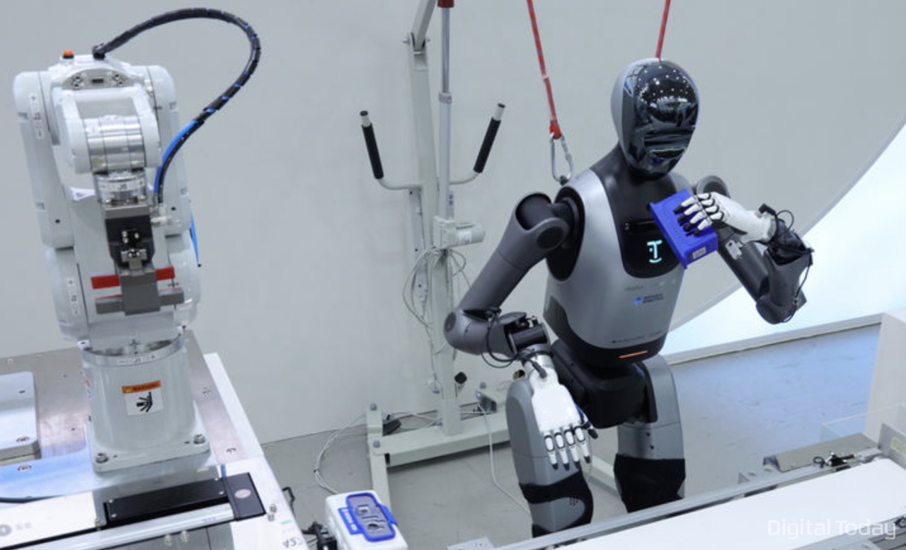
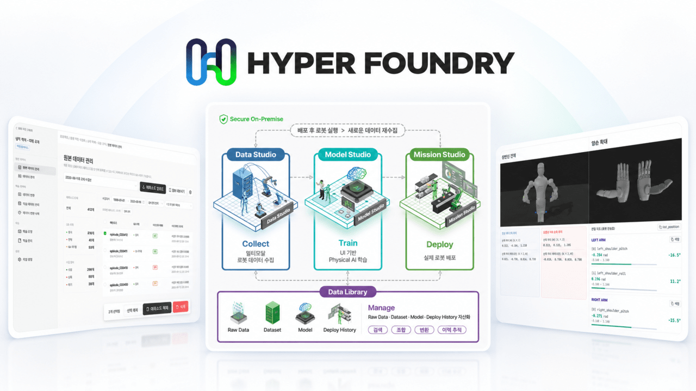

# Who Owns the Robot Data That Hyper Foundry Collects?

_Bigwave Robotics bundled data collection, model training, and robot deployment into one platform. Korean law gives the factory and the platform the same right to use that data_

## Executive Summary

> [!callout]
> This article looks at Hyper Foundry, the integrated physical AI development platform Bigwave Robotics launched on October 20, 2026, through the question of whose the robot data passing through it becomes. Collecting a robot's action data, training a model on that data, and sending the trained model back out to robots on the floor now run inside one environment. The company unveils the platform today at SKY31 in Jamsil, Seoul, at BIGWAVE SHIFT 2026, with a demonstration that links it to humanoid robots.

> What the launch announcement says about the data is one line. The platform supports selective deployments tailored to customers' robot and research environments, as well as on-premises data management. But on-premises is a choice about where the data sits, and who may use that data and how far sits on a different axis. Article 9 of Korea's Industrial Digital Transformation Promotion Act provides that where industrial data has been provided to a third party, the party that generated it and the third party both hold the right to use and profit from it. One proviso follows: where the parties have an agreement between them, the agreement governs.

> Sections 1 through 3 follow what is written in the company's announcement, in the reporting, and in the statutes. Sections 4 and 5, which take up who judges the quality of the data, are this article's reading.

### Key numbers

The first two are the defaults Korea and Europe have set for robot data. The last one is the ground this launch announcement does not cover.

Sources: [Industrial Digital Transformation Promotion Act, Article 9](https://www.ulex.co.kr/%EB%B2%95%EB%A5%A0/238859-014216-%EC%82%B0%EC%97%85%EB%94%94%EC%A7%80%ED%84%B8%EC%A0%84%ED%99%98%EC%B4%89%EC%A7%84%EB%B2%95) · [EU Data Act](https://eur-lex.europa.eu/eli/reg/2023/2854/oj/eng) · [Digital Today](https://www.digitaltoday.co.kr/en/view/116980/bigwave-robotics-launches-hyper-foundry-integrated-physical-ai-development-platform) (October 20, 2026)

<!-- stat-card -->
**Two** — Parties holding the right to use the data — Hand industrial data over and the side that made it and the side that received it both hold the right to use and profit from it, which is the default in Korean law

<!-- stat-card -->
**2025.9.12** — EU Data Act becomes applicable — Europe is the other way around. Without a contract with the user, the maker of the device cannot use that data

<!-- stat-card -->
**On-premises** — How far the launch announcement goes on data — The storage arrangement is written down and the scope of use for the collected data is not. That space belongs to the contract

## Data From the Robots Becomes a Model Inside One Environment

Bigwave Robotics does not build robots. It has run Marosol, a platform that finds automation demand on industrial sites and connects it to a suitable robot, and SOLlink, which monitors and controls robots from different makers on one screen. It listed on the KOSDAQ last month. Hyper Foundry, launched on October 20, carries that line one step further, into developing robot intelligence.

*▲ The robot action data Hyper Foundry handles looks like this — a record of task motion | Source: [Digital Today (image courtesy of Bigwave Robotics)](https://www.digitaltoday.co.kr/news/articleView.html?idxno=708411)*

The problem the company describes is fragmentation. Putting physical AI into practice has meant building robot hardware, GPU servers, a data collection environment, and an AI training environment each on its own. Because the environment breaks at every handoff, from collection to training and from training to use on site, time and cost pile up and scaling gets blocked. Data comes out of the robots and feeds AI training, and the trained intelligence turns back into robot behavior. Hyper Foundry ties that process into a single flow, the company says.

The platform is built from four modules. Data Studio collects and synchronizes behavioral data from multiple robots. Model Studio supports model development based on imitation learning and reinforcement learning. Mission Studio applies trained models to real robots. Data Library centrally manages data, models, and deployment history. For who would use it, the company named universities and research institutes doing robot AI research alongside manufacturing and logistics sites that need field validation. Research institutes concentrate on securing data and on training and validating models, while industrial customers build models from their own task data and test whether those models hold up on the floor.

*▲ Hyper Foundry's four modules — Data Studio, Model Studio, Mission Studio, Data Library | Source: [AI Times (image courtesy of Bigwave Robotics)](https://www.aitimes.com/news/articleView.html?idxno=216427)*

CEO Min-gyo Kim put the goal this way. "For physical AI to establish itself beyond the lab as a core technology in industry, an integrated infrastructure that connects everything from data collection to AI training and application to real robots is essential." With Hyper Foundry, he said, the company will lower the technical barrier to building physical AI and set a new standard for industrial physical AI development. Today the company holds BIGWAVE SHIFT 2026 – Industrial Physical AI Summit at SKY31 in Jamsil, Seoul, where it presents the technical vision and the ways the platform can be used. Nvidia, TwelveLabs, NC AI, RealWorld, and Rainbow Robotics take part, and a demonstration linking Hyper Foundry to humanoid robots is shown alongside.

The claim that the barrier comes down is not an exaggeration. For a site to bring in one robot, gather task data, train a model on it and put that model back on the robot by itself, there is a great deal to have in place besides the robot. Once someone sells that whole process as one package, small and mid-sized manufacturers get room to try. But when collection, training, and deployment move in under one roof, questions that used to be negotiated separately at each stage get settled at once, inside one contract. What goes into that contract is the ground this article wants to look at.

## On-Premises Determines Where the Data Is Kept

The one place the launch announcement touches the data directly is a single sentence. The platform "supports selective deployments tailored to customers' robot and research environments, as well as on-premises data management." On-premises means keeping the data and the training environment on the customer's own infrastructure rather than on an outside cloud. From the factory's side that is a welcome option. A task record holds exactly which part gets handled at what speed and in what order, and that is usually another name for the know-how of that factory.

One thing has to be straight first. A launch story is not a contract. No company's press release carries its data rights clauses. What this article points at is not that the company hid something, but that in a product like an integrated platform those clauses now settle far more at once than they used to.

What on-premises answers is where the data sits. What it does not answer is where the model trained on that data goes. The two look like the same question and are different in kind. The raw files can stay on the on-site server while the weights that grew on those files blend into the platform's own model. And once they have blended, there is no way to pull them back out.

A piece that Thomas Stapp published in the industrial automation trade magazine Automation World on October 7, 2026 likened this structure to energy. "Gas is a commodity you can own: storable, deliverable, severable, title moving with the molecule. Burn it to produce power, and the output enters a grid where it commingles beyond recovery." If operating data is the gas, the trained model is the grid. Once data has trained a shared model, the piece adds, its influence is no longer separable from the model.

It also lays out what the standard contract in the industry looks like right now. "The customer keeps title to raw data and facility specifics. The vendor takes a perpetual, royalty-free license to operational telemetry through improvements and aggregated-data clauses." The raw material belongs to the customer and the asset that grew out of the raw material belongs to the vendor, an asymmetry.

Large buyers do not take that asymmetry as it comes. Their claims, the article writes, climb a ladder: "ownership of raw data, then of derived data, then of customer-specific weights, then perpetual licenses to any underlying model required to run those weights. The last rung is architecture itself: royalty triggers on systems that merely resemble what was built together." The clause saying the customer keeps title to the raw data is no more than the first rung of that ladder.

The same piece sets down where the line actually gets drawn with two cases. The settlement proposed against John Deere by the FTC gives farmers access to repair resources while stating that the access "need not include title to or ownership of any of Deere's intellectual property rights." The machine learning models stay with Deere. Boston Dynamics' Spot terms define "Robot Technical Data" to take in the geometric, terrain and image information the robot observes on site, permit its indefinite retention, and grant a perpetual right to use performance and application data for product improvement. Access is given and it stops in front of model ownership, which is what the two cases have in common.

"The hardest-fought clause is rarely data ownership. It is pool membership: whether one customer's live production data may train the fleet's shared brain," Stapp writes. The example he gives runs this way. "Spend a quarter teaching the fleet to handle your most fragile SKU, and that skill may ship to a competitor working with the same vendor in the next update." Which server the raw files were sitting on changes nothing here.

> [!callout]
> On-premises is a device for keeping data from leaving, not a device for settling rights. If the platform can train a shared model on that data while the raw files stay on the on-site server, the storage location holds still and only the value moves. The thing to ask is not where the data is, but which model the data goes into and who gets access to that model.

## Absent an Agreement, Korean Law Gives the Factory and the Platform Both a Right

Korea already has a law written to answer this question. The Industrial Digital Transformation Promotion Act, in force since July 5, 2022. Rather than attach ownership to data, the Act uses the name right to use and profit from. Article 9(1) provides that a person who has generated industrial data holds the right to use and profit from that data. Generation here means making data that did not exist before, in the course of industrial activity, through substantial investment of human and material resources. A task record a robot leaves on a factory line falls inside that definition.

The paragraph that follows is the one that matters. Article 9(3) provides that where industrial data has been provided to a third party, the party that generated it and the third party both hold the right to use and profit from that data. And a proviso is attached. Where there is an agreement between the parties, the agreement governs.

The moment a factory hands robot task records over to a platform like Hyper Foundry, the default the law has set is that both sides may use them. The platform does not take the right away; the law hands it to the two of them from the start. If the factory wants to narrow that scope there is only one way. Write an agreement. Paragraph 5 of the same Article also says stakeholders shall endeavor to conclude contracts for smooth utilization and for a reasonable distribution of the profits, leaving the final split to the contract.

If the factory is not the side handing data over but the side creating it together from the start, the conclusion comes out the same. Article 9(2) provides that where two or more persons have jointly generated industrial data, each holds the right to use and profit from it, and the same proviso is attached here too. Where there is an agreement between the parties, the agreement governs. Read as handed over or read as made together, the place where both sides use the data absent an agreement does not move.

That agreement does not have to be written from a blank page. Article 10(2) of the same Act provides that the Minister of Trade, Industry and Energy may, in consultation with the heads of relevant central administrative agencies, prepare guidelines on contracts for the utilization of industrial data in order to promote the conclusion of contracts under Article 9(5). What came out of that is the Industrial Data Contract Guideline. It carries points to watch, standard contract forms, and cases by sector, and it sorts contracts into a provision type, a joint-creation type, and a platform type. The example it uses to explain the joint-creation type is a machine tool maker that installs sensors on the machines it delivered to its customers' factories and analyzes the operating data those sensors return. Vendor equipment leaving records on a customer's site is the robot case too, so it is not far from here.

Europe starts from the other side. The EU Data Act, applicable since September 12, 2025, splits data holder from user for the data coming out of connected products. The side that makes the robot or runs the platform is the data holder, and the side that buys or leases the robot and runs it is the user. Article 4(13) reads: "A data holder shall only use any readily available data that is non-personal data on the basis of a contract with the user. A data holder shall not use such data to derive insights about the economic situation, assets and production methods of, or the use by, the user in any other manner that could undermine the commercial position of that user on the markets in which the user is active." To use it, you have to come back with a contract.

Both frames end at the contract, and that much is the same. What differs is who holds the advantage when there is no contract. In Korea, write nothing and both sides end up using the data. In Europe, write nothing and the platform cannot use it. A site in Korea weighing a platform like Hyper Foundry should look at how the terms of use write the scope of use for the collected action data before it looks at the on-premises option. Whether training on it is allowed, and if it is allowed, whether the model serves that customer alone or several customers together, and which side the weights built that way stay with. Those are the conditions that get laid over the default.

## Who Decides Whether the Data Is Good Enough to Train On

Even after the rights are divided, one more question is left. Who decides, by what standard, whether the data gathered is good enough to train on. Settling ownership and settling quality run on different axes, and on an integrated platform the two move into the same building.

Quality in robot action data is not an abstract word. First comes whether records arriving from several robots line up on the same time axis, whether the camera footage and the joint values and the force sensor readings point at the same instant, whether the coordinate frames and the units differ from line to line. Next comes what is inside them. A record holding only successful motions cannot teach recovery from failure. The moment a grip starts to slip, the stretch where a bad hold gets corrected: the scenes a site would rather not leave behind are the ones the model needs.

If this judging standard lives only inside the platform, the site hands its data over without knowing why one record was taken and another turned back. Then the two sides can split the right to use and profit from the data and the real decision still tilts toward whoever judges. Only data judged good enough becomes a model, and only data that became a model creates value. This is where the line about Data Library, one of Hyper Foundry's four modules, centrally managing data, models, and deployment history starts to matter. If that history is equally visible to both sides, judging becomes a procedure that can be checked. If it is visible on one side only, judging is just a notice.

Three things are worth a site's asking. What conditions a collected record has to meet before it goes up as training data, whether a rejected record keeps its reason, and whether a change in the judging rules comes with notice. All three are the kind of thing written into operating documents rather than contracts, which is why they drop out more easily.

## Why Pebblous Is Watching This Announcement

Physical AI stories usually start at the model. What makes this launch stand out is not the model but that it tied together what comes before and after. Once collection, training, and deployment become one environment, development speeds up, and in exchange the conditions around the data get settled in one place at one time. The speeding up and the tying together come out of the same design.

Working to get data into a state where AI can use it right away, Pebblous keeps these conditions in view alongside. The technology for collecting data well and the conditions that make the data usable are different problems, and when the second is empty the gains from the first do not travel outside the site. For anyone weighing a robot deployment, three things are worth confirming in the platform documentation.

- Whether the scope for training on the collected action records is written into the agreement. Korean law takes it as the default that the side handing over and the side receiving may both use the data, so when it is not written down that is what applies
- Whether the trained model serves that customer alone or takes in several customers' data together. If the latter, you may end up on the same model as a competitor
- Whether the standard and the history behind judging data good enough to train on are open to both sides. If the judging is visible on one side only, dividing the right does not divide the decision

These three are a different kind of check from choosing a robot well, and they usually become a problem only after the deployment has been decided. The more integrated platforms there are, the better it is to look at them first.

<!-- stat-card -->
**Editor's Note** — This article is not out to cut Hyper Foundry down. Putting on-premises forward as an option is the result of reading that sites worry about their data and building that reading into the design. Tying a fragmented development environment into one package is a real help to sites in Korea, too. Storage location and rights of use are two different questions, though, so the first being answered does not answer the second along with it. The clauses this article asks about are not the launch announcement's place to cover but the contract's, which is why asking now is the right time.

Thanks for reading this far. The facts in this article were confirmed directly in four reports on the Bigwave Robotics launch, in the text of the Industrial Digital Transformation Promotion Act, in the text of the EU Data Act, and in the Automation World piece. If you are weighing a robot or a physical AI platform, we would be glad to hear what you check first in the agreement.

**Pebblous Data Communication Team**  
October 22, 2026

## References

### News Coverage

- 1.AI Times. (2026). "[Bigwave Robotics launches integrated physical AI platform 'Hyper Foundry'](https://www.aitimes.com/news/articleView.html?idxno=216427)." October 20, 2026.
- 2.Irobotnews. (2026). "[Bigwave Robotics unveils 'Hyper Foundry,' joining robot data collection through deployment](https://www.irobotnews.com/news/articleView.html?idxno=49087)." October 20, 2026.
- 3.Digital Today. (2026). "[Bigwave Robotics Launches Hyper Foundry, Integrated Physical AI Development Platform](https://www.digitaltoday.co.kr/en/view/116980/bigwave-robotics-launches-hyper-foundry-integrated-physical-ai-development-platform)." October 20, 2026.

### Legislation

- 4.Ministry of Trade, Industry and Energy, Republic of Korea. "[Industrial Digital Transformation Promotion Act](https://www.ulex.co.kr/%EB%B2%95%EB%A5%A0/238859-014216-%EC%82%B0%EC%97%85%EB%94%94%EC%A7%80%ED%84%B8%EC%A0%84%ED%99%98%EC%B4%89%EC%A7%84%EB%B2%95)" (Articles 9, 10). In force since July 5, 2022.
- 5.European Parliament and Council of the European Union. (2023). "[Regulation (EU) 2023/2854 (Data Act)](https://eur-lex.europa.eu/eli/reg/2023/2854/oj/eng)." Applicable since September 12, 2025.

### Industry Analysis

- 6.Stapp, T. (2026). "[Who Owns What Robots Learn? The Next Industrial Automation Contract Fight](https://www.automationworld.com/factory/robotics/article/55410053/who-owns-what-robots-learn-the-next-industrial-automation-contract-fight)." Automation World, October 7, 2026.
- 7.CMS Law. "[Data Act and Physical AI: Who owns the data from connected robots?](https://cms.law/en/deu/legal-updates/data-act-and-physical-ai-who-owns-the-data-from-connected-robots)"
