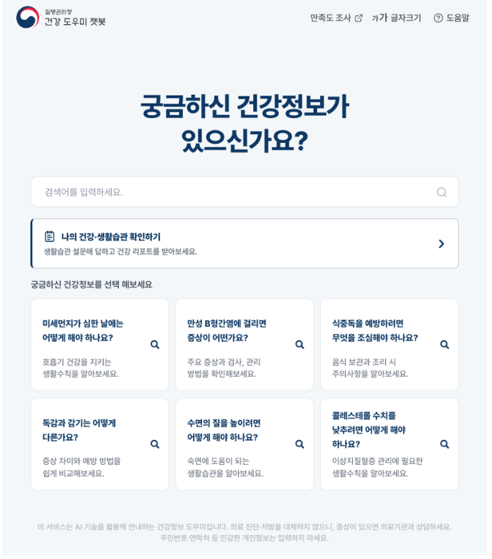

# Which Peers Does KDCA

_Korea_

## Executive Summary

> [!callout]
> The Korea Disease Control and Prevention Agency (KDCA) and the Ministry of Science and ICT opened an AI health chatbot to the whole public on October 28. Answer a short questionnaire on the website of the Korea Community Health Survey, covering basic body measurements such as height and weight along with daily habits, and the service returns your health position relative to a peer group of similar sex and age, plus risk readings for high blood pressure, diabetes, dyslipidemia and obesity, drawn as a traffic light and a graph. It is one piece of the ministry's Public AI Transformation (AX) project, and what sits underneath it is more than 5 million records from two decades of national health surveys.

> What the color of the light means depends on who you are being compared with. Yet nowhere in the announcement is it written which survey those peers come from, which years, or how many years wide the age band is. The Korea Community Health Survey the chatbot sits on began in 2008 and has run since 2010 as a rotating system that splits its items across one-year, two-year and four-year cycles. That is to say it is not a pile built by asking the same questions at the same density every year.

> Sections 1 through 3 follow the two agencies' announcement, together with the Korea Community Health Survey material KDCA has published and its own report on changing the survey method. Section 4, which brings in overseas cohort research, and Section 5, which sets out what is left to do on the data side, are this article's reading.

### Key Figures

What the peer comparison is made of is written into the survey material KDCA has published every year. The shape of that material comes down to four numbers.

Sources: [Korea.kr policy briefing](https://www.korea.kr/news/policyNewsView.do?newsId=148974452) · [KDCA 2025 survey results](https://kdca.go.kr/bbs/kdca/42/305547/download.do) · [Rotating survey overview](https://chs.kdca.go.kr/chs/examinCn/rotatExaminMain.do)

<!-- stat-card -->
**5M+** — National health survey records the chatbot is said to use — Whether one record is one person or one answer line is unclear

<!-- stat-card -->
**18 rounds** — Times the Korea Community Health Survey has run so far — Began in 2008; published microdata runs through the 2025 round

<!-- stat-card -->
**About 900** — People sampled in one city, county or district each year — The size set to hit a target margin of error of ±3% per health center

<!-- stat-card -->
**Four years** — How long the locally selected items stood still — Suspended from 2020 to 2023, asked again in 2024

## Type In Height and Weight, Get Back a Traffic Light

KDCA and the Ministry of Science and ICT said on October 28 that the AI health chatbot service had opened in full. Go to the Korea Community Health Survey website and anyone can use it with no time limit. It is one of the products of the Public AI Transformation (AX) project, the ministry's push to attach AI to the public sector.

From the user's side there are two things to do. One is to answer a short questionnaire on basic body measurements such as height and weight along with daily habits; the other is simply to ask whatever you want to know. Answer the first and back comes where your health sits against a peer group of similar sex and age, together with risk readings for high blood pressure, diabetes, dyslipidemia and obesity, shown as a health traffic light and a graph. The second is a round-the-clock counseling function that takes everyday questions about sleep, exercise and diet.

*▲ Main screen of the AI health assistant chatbot service | Source: [Electronic Times (etnews)](https://www.etnews.com/20261028000321) (image courtesy of KDCA)*

What the two agencies put forward as grounds for trusting it is where the data comes from and how it was checked. They wrote that the service uses authoritative health data vetted by an advisory panel of medical and AI experts, and that it applies encryption in line with national security rules. They wrote down a limit as well. The health report and the counseling the chatbot produces are reference information meant to help with health management, and they do not stand in for a doctor's diagnosis or treatment.

KDCA Commissioner Lim Seung-kwan called the opening a leading case of data-driven public AX administration, one that hands public health data back to the people it came from. Lee Do-kyu, who heads the information and communication policy office at the Ministry of Science and ICT, rated it a service that improves public health and brings real help to people's lives, and said the ministry would work with other agencies to put out more AI services the public can feel.

Which AI model was used, and by what structure the peer comparison is calculated, appears neither in the two agencies' press release nor in the articles that picked it up. A line about applying AI technology stands in that place. So checking the numbers the chatbot returns means looking not at the model but at the survey material underneath it.

## The Survey Behind the Peers Was Built for Neighborhoods

The Korea Community Health Survey has run every year since 2008 as a government-approved statistic. Its legal basis is Article 4 of the Regional Public Health Act, and the purpose of the survey is to ascertain the health status of local residents and supply the groundwork for regional public health plans. The name already holds the answer. It was not built to produce a national average; it was built to produce numbers at the level of each city, county and district.

The way the sample is drawn follows that purpose exactly. About 900 people are picked in each city, county and district and surveyed by the local public health center, and adding all of them together gives roughly 230,000 adults aged 19 and over nationwide. The 2025 round covered 231,615 people across 258 areas; the 2026 round covered about 230,000 through 260 public health centers. A city of 700,000 gets 900 people and a county of 30,000 also gets 900. That follows naturally from a design meant to produce numbers at the same precision for every locality, but it makes for a different composition than a sample drawn in proportion to national population.

The drawing procedure works off that same unit. The smallest administrative units are picked first by probability-proportional systematic sampling, and sample households are then drawn from them by systematic sampling. The design targets KDCA writes into its sampling guide are an average of 900 people per public health center and a target margin of error of ±3%. What the ±3% is promised for is each individual public health center, not the national average. The national figure is not what this design hands over directly; it is assembled afterward.

So building "the average man in his forties nationwide" out of this material takes one more step. The share by which each region is over- or under-represented has to be reweighted to match population and then summed. The national health indicators KDCA publishes each year are values that have passed through that correction. The peer distribution the chatbot returns has probably passed through the same correction, but which weights were applied against which year's population has not been published.
