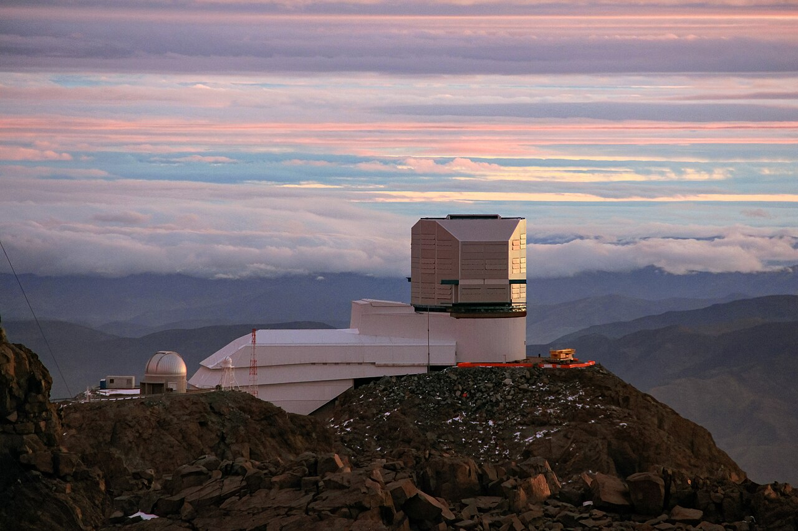

# 루빈 천문대 LSST, AI는 왜 은하보다 별을 놓칠까?

_딥러닝 모델 DeepDISC가 LSST 첫 공개 자료에서 은하는 84.2%를 찾아냈지만 별은 49.1%에 그쳤다_

## Executive Summary

> [!callout]
> 이 글은 2026년 10월 7일 arXiv에 올라온 논문 한 편을 읽는다. 베라 루빈 천문대가 10년짜리 하늘 탐사 LSST를 시작하기 전에 공개한 첫 실관측 자료에, 천체를 찾고 가르는 일을 한 번에 하는 딥러닝 모델 DeepDISC를 처음 돌린 결과다. 같은 하늘에서 은하는 열에 여덟 넘게 찾아냈는데 별은 절반에 못 미쳤다.

> 논문이 보고한 별·은하 분류 정확도는 97.4%다. 측광 수치만 쓰는 기존 랜덤포레스트의 98.5%에 1.1%포인트 차로 붙었다. 그런데 이 숫자는 모델이 찾아낸 천체만 분모에 넣는다. 검출 단계에서 걸러져 나간 천체는 정확도가 세는 자리에 들어가지도 못한다. 논문이 원인으로 지목한 곳은 모델 구조가 아니라 학습에 쓴 주석이다.

> 이 글이 옮긴 수치와 인용은 모두 논문 본문(arXiv:2610.10986)에서 가져왔고, LSST의 시작 시점과 자료 규모는 루빈 천문대 공식 자료에서 확인했다. 정확도만 보고하는 습관이 왜 데이터 품질의 오래된 함정인지를 묻는 5절의 읽기는 논문의 주장이 아니라 이 글의 해석이다.

### 주요 수치

출처: [Yadav et al., arXiv:2610.10986 (2026-10-07)](https://arxiv.org/abs/2610.10986).

<!-- stat-card -->
**84.2%** — 은하 검출 완전도 — 정답표에 있는 은하 가운데 모델이 제자리에서 찾아낸 비율

<!-- stat-card -->
**49.1%** — 별 검출 완전도 — 같은 모델, 같은 하늘, 같은 채점 기준에서 나온 숫자

<!-- stat-card -->
**97.4%** — 별·은하 분류 정확도 — 찾아낸 천체만 세는 숫자. 놓친 별은 이 분모에 없다

<!-- stat-card -->
**6 대 1** — 학습 주석의 은하 대 별 — 은하 주석 163,687개에 별 주석 28,346개

## 같은 하늘, 다른 성적표

베라 루빈 천문대는 2026년 6월 29일 밤부터 10년짜리 하늘 탐사 LSST를 시작했다. 밤마다 약 10테라바이트씩 쌓아 10년이면 30페타바이트가 된다. 하늘의 같은 구역을 800번 가까이 다시 찍어 변하는 것과 변하지 않는 것을 가려내는 설계다. 본 관측이 시작되기 전, 천문대는 리허설에 해당하는 자료를 먼저 공개했다. 그것이 Data Preview 1이다. 시운전용 카메라로 2024년 10월 말부터 2025년 1월 초까지 찍은 일곱 개 필드, 약 15제곱도 분량의 6밴드 영상이 들어 있다.

*▲ 칠레 세로 파촌 산 정상의 베라 루빈 천문대. 이 논문이 분석한 Data Preview 1은 본 관측용 사이먼야이 서베이 망원경이 아니라 시운전용 카메라로 찍혔다 | Source: [Rubin Observatory/NOIRLab/AURA/NSF/J.Fuentes, CC BY 4.0](https://commons.wikimedia.org/wiki/File:A_Cloudy_Day_for_Rubin_(Rubin_dome_jfuentes-CC).jpg)*

논문이 쓴 자료는 그중 가장 깊은 두 필드다. ECDFS와 EDFS는 r밴드에서 각각 26.0등급과 25.5등급까지 보인다. 여기에 DeepDISC를 돌렸다. 이 모델은 천체를 찾고, 윤곽을 그리고, 별인지 은하인지 가르는 세 가지 일을 한 번의 추론으로 끝낸다. 검출과 디블렌딩과 분류를 차례로 거치는 기존 파이프라인과 구조가 다르다. 백본은 Swin-B 비전 트랜스포머이고 파라미터는 백본만 8,680만 개, 전체로는 1억 3,900만 개다.

학습은 LSST 시뮬레이션으로 사전학습한 모델에서 출발했다. 거기에 DP1의 실관측 6밴드 영상을 보여 주며 가중치를 전부 다시 열어 학습했다. 논문은 이 과정을 1단계라 부른다. 실제 하늘을 보기 전 모델의 성적은 은하 40.2%, 별 13%였다. 실관측을 보여 주고 나자 은하 84.2%, 별 49.1%로 올랐다. 두 부류 모두 크게 좋아졌는데, 좋아진 뒤에도 둘 사이의 간격은 그대로 남았다.
