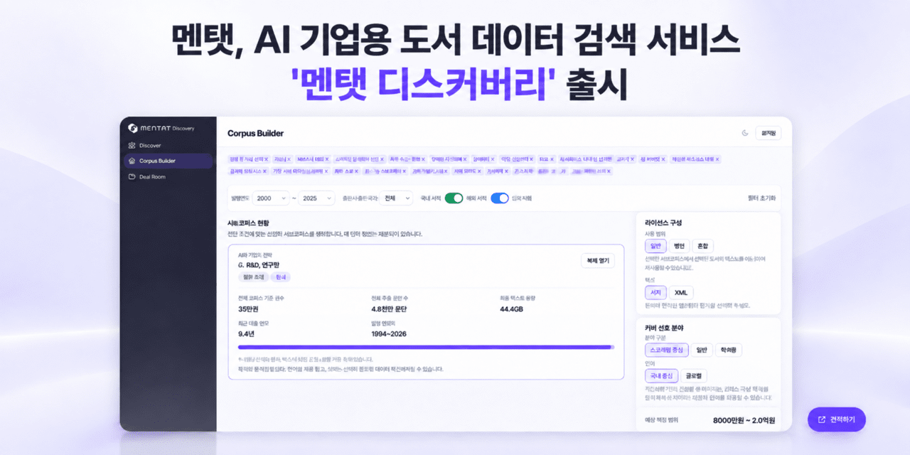

# Mentat Sells Books to AI by the Token. What Sets the Price?

_Mentat opened a book data marketplace on October 13 that lists about 34,000 titles from more than 90 Korean publishers as 8 billion tokens_

## Executive Summary

> [!callout]
> This article looks at a place where the unit of value on a book is changing. Mentat, a Korean book licensing company, opened Mentat Discovery on October 13, 2026. It is a window where an AI company can browse by category through about 34,000 books licensed from more than 90 Korean publishers, check on screen how much text that comes to in tokens and what it would roughly cost, and go on from there to a contract. Until then an AI company had to track down publishers one at a time and start every negotiation from the beginning.

> The holdings on the marketplace come to about 8 billion tokens. Korean publishing counts that list in copies and the AI industry counts it in tokens, and Mentat did the conversion at the platform level before opening the door. A token count measures length and nothing more. Expertise and citation value do not show up in it, which is why Mentat did not let prices track token counts in a straight line.

> Everything to this point is what Mentat announced and what Korean coverage recorded. Reading the overseas cases in section 4 as evidence that a token is only the unit a deal starts from, and all of section 5, is this article's interpretation.

### Key numbers

Four cells. The first two are the same list seen through each industry's own measure. The second two are prices that have actually been put on books handed to AI, one in a commercial deal and one in court.

Source: Mentat's launch announcement and coverage by [AI Times](https://www.aitimes.com/news/articleView.html?idxno=216215), [ZDNet Korea](https://zdnet.co.kr/view/?no=20261013091029) and [VentureSquare](https://www.venturesquare.net/1119236) (October 13, 2026), plus overseas coverage of the Anthropic settlement.

<!-- stat-card -->
**About 8 billion tokens** — The holdings on the AI industry's scale — Everything listed and searchable on Mentat Discovery. It comes in the unit AI companies work in, so size and likely cost can be read straight off the screen

<!-- stat-card -->
**About 34,000 titles** — The same holdings on publishing's scale — Licensed from more than 90 Korean publishers. The two cells are not two different things; they are one list, and only the unit changes between the two industries

<!-- stat-card -->
**About 10 billion won** — Mentat's cumulative contract value — As disclosed in August 2026. About 50 Korean publishers had joined, academic presses and magazines among them, and a licensing contract with a global big tech company was included

<!-- stat-card -->
**About $3,000 a work** — A price signal that went through a US court — The roughly $1.5 billion Anthropic settlement with authors, divided across about 500,000 works, as the figure has been reported. It was set per work rather than per token

## The Window Mentat Discovery Opened

What an AI company does on Mentat Discovery comes in three steps. It searches licensed books by field and category. It reads off the screen how many tokens that bundle holds and roughly what it would cost. It then picks a mode of use and moves to a contract. The modes split in two: taking the books as a dataset file for training a model, or taking them through an API that lets an AI consult the text and show the source as it answers. Mentat labels the two Training Dataset and Citation API.

*▲ Mentat Discovery's Corpus Builder screen — bundle token count (48 million passages), data volume and estimated price range on one screen | Source: [AI Times](https://www.aitimes.com/news/articleView.html?idxno=216215)*

That third step is not a stamp pressed on the screen. A buyer who has checked size and cost requests the detailed catalog, and the contract discussion starts from there. The books are grouped by what is inside them rather than by publisher or year of publication, so a buyer narrows down from whichever field they came for.

Having those three steps on one screen is what changed. Before this, an AI company asked around for publishers holding usable books, checked who owned which rights, and negotiated volume and price publisher by publisher. No list existed anywhere showing which publisher held how many books in which field. Mentat built that list and wrote token counts and estimated costs onto it.

"We focused on letting AI companies easily find books whose licenses are properly cleared and put them to use right away."

Byung Wook Jeon, CEO of Mentat, at the launch announcement of October 13, 2026, translated from the Korean

Mentat was founded in July 2025. Jeon came to it from leading the digital business team at the publisher Changbi and from new business at Kakao Entertainment, and has said the company started from the view that a Korean publisher negotiating alone has little leverage against a global AI company. Mentat raised pre-seed funding from Antler Korea and was selected for TIPS, the startup program run by Korea's Ministry of SMEs and Startups. In August 2026 the company disclosed an AI licensing contract with a global big tech firm, and the cumulative contract value given at that point was about 10 billion won across some 50 participating publishers. The figure given at this launch, two months later, is more than 90 publishers under contract.

*▲ Byung Wook Jeon, CEO of Mentat | Source: [Mentat](https://mentat.so/about/)*

The stake an individual publisher puts on this marketplace is not small either. Jpub, a specialist IT publisher, agreed to supply about 100 titles of technical and computing books as training and citation data and to be paid according to use. One field's specialist list went up as a single bundle.

The goal Mentat set out at launch does not stop at closing deals. Jeon said the company would widen a structure in which books are used more by AI and the revenue from that use flows back to publishers and authors. Opening a marketplace and making the money earned there run back to the people who made the books are not the same undertaking, and the second one depends on how prices get set.

## One Side Counts Copies, the Other Counts Tokens

Publishing counts its goods in copies, printings and print runs. The number written into a contract is a royalty rate, and how many printings a book went through is its report card. The AI industry counts the same prose in tokens. How much a model can read at once is counted in tokens, so is the size of the data that went into training, and so is the bill for using it.

One side says a book printed 3,000 copies, and the other asks how many tokens the data comes to. So the first job at the negotiating table was conversion. Counting the characters in a book, working out how many tokens that makes, and each side guessing from its own instincts what that volume should be worth: the whole sequence ran again every time the publisher changed. The line Mentat used to describe Discovery points straight at that spot.

"Mentat Discovery shows publishers' books in the tokens and costs an AI company is used to, so that both sides can review the data against the same yardstick."

Mentat launch announcement, October 13, 2026, translated from the Korean

A platform doing the conversion in advance also means that one of the two units has become the common language. That common language is the token. The diagram below sets out how one list ends up carrying two different numbers.
