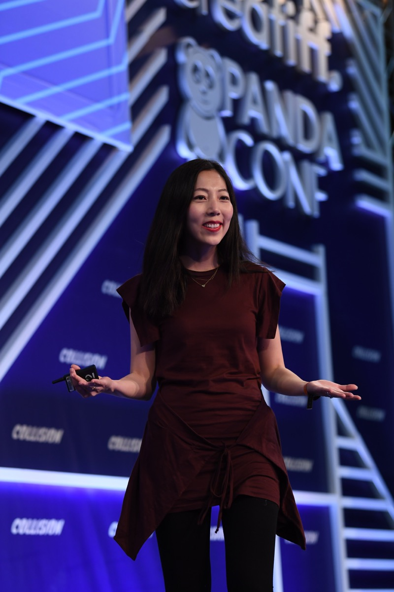

# 메타가 사들인 Sundial, 데이터 팀 없이 분석이 될까?

_메타가 10월 23일 인수를 확인했다. 오픈AI도 쓰던 이 분석 도구는 거래가 끝나면 외부 고객을 받지 않는다_

## Executive Summary

> [!callout]
> 이 글은 메타가 10월 23일 확인한 Sundial 인수를 거래 소식이 아니라 분석 업무의 자리가 옮겨 가는 신호로 읽는다. Sundial은 2021년에 세워진 분석 도구 회사다. 자료를 정리하고 지표의 뜻을 맞추고 데이터베이스에 보낼 질문을 대신 써서, 각 부서가 데이터 팀을 거치지 않고 말로 물어 답을 받게 하는 제품을 만들었다. 공동창업자 둘은 모두 페이스북 시절 그 회사에서 일한 사람이고, 이번에 자기들이 세운 회사와 함께 그곳으로 돌아간다.

> 눈에 걸리는 것은 금액의 대비다. Sundial이 창업 뒤 모은 투자금은 전부 합쳐 2,300만 달러이고, 인수가는 양쪽 다 밝히지 않았다. 그 맞은편에 메타가 올해 설비 투자로 잡아 둔 1,300억에서 1,450억 달러가 있다. AI에만 들어가는 돈이 아니라 기존 핵심 사업까지 받치는 금액이라고 회사는 밝혔다. 그만한 돈을 쓰는 회사가 이번에 손에 넣은 것은 또 하나의 모델이 아니라 그 돈이 무엇을 했는지 묻는 도구였다. 거래가 끝나면 오픈AI를 비롯한 외부 고객은 이 도구를 더 쓸 수 없다.

> 1절부터 3절까지는 메타 대변인이 확인한 내용과 공동창업자 줄리 주오의 발표문, 최고데이터책임자 알렉스 슐츠가 밝힌 조직 구성을 따라간다. 자동으로 정리한 자료가 틀렸을 때 누가 먼저 아는가를 묻는 4절은 어느 출처에도 없는 이 글의 해석이다.

### 주요 수치

이 거래에 붙은 숫자는 네 개뿐이고, 그중 가장 중요한 하나는 비어 있다.

출처: [Axios 단독 보도(Yahoo Finance 전재본)](https://finance.yahoo.com/technology/ai/articles/exclusive-meta-acquires-ai-data-205220376.html) · [TokenPost, 투자 이력과 조직](https://www.tokenpost.com/news/business/39936) · [메타 2026년 설비 투자 전망](https://finance.yahoo.com/technology/ai/articles/meta-lifts-2026-capex-floor-203035634.html)

<!-- stat-card -->
**1,300억~1,450억 달러** — 메타가 밝힌 올해 설비 투자 전망 — 회사 설명으로는 AI 사업과 기존 사업을 함께 받치는 돈이다

<!-- stat-card -->
**2,300만 달러** — Sundial이 창업 뒤 모은 투자금 전부 — 2025년 7월 시리즈 A 1,600만 달러가 여기 든다

<!-- stat-card -->
**비공개** — 메타가 치른 인수 가격 — 메타도 Sundial도 금액을 밝히지 않았다

<!-- stat-card -->
**0곳** — 거래가 끝난 뒤 Sundial이 받는 외부 고객 — 오픈AI와 Gamma를 비롯한 기존 고객은 다른 도구를 찾아야 한다

## 메타가 사 온 것은 모델이 아니다

메타 대변인이 10월 23일 Sundial 인수를 확인했다. Axios가 단독으로 먼저 알렸고, 같은 날 밤 공동창업자 줄리 주오가 X에 발표문을 올렸다. 주오와 찬드라 나라야난이 함께 메타로 들어가고 Stanley Watt, Asa Levi, John Maier를 포함한 팀원 일부도 같이 옮긴다. 금액은 어느 쪽도 밝히지 않았다.

둘 다 메타에서 일하다 나온 사람이다. 주오는 페이스북에 인턴으로 들어가 제품디자인 부사장까지 올랐고, 나라야난은 페이스북 분석 디렉터와 인스타그램 분석 책임자를 거쳐 세쿼이아캐피탈의 분석을 맡았다. 둘이 메타 밖에서 Sundial을 세운 것은 2021년으로 알려져 있고, 주오는 발표문에서 그때를 "거의 6년 전"이라고 적었다. AI 물결이 오기 전에 시작해 회사를 AI 네이티브로 다시 지었다는 말도 같은 글에 있다. 밖에서 키운 회사를 들고 이제 메타 안으로 들어가는 셈이다.

*▲ Sundial 공동창업자 줄리 주오. 페이스북 제품디자인 부사장을 지내다 2021년 나라야난과 함께 회사를 세웠고, 이번 인수로 다시 메타로 돌아간다 | Source: [Wikimedia Commons (Collision Conf, CC BY 2.0)](https://commons.wikimedia.org/wiki/File:Julie_Zhuo_Collision_Conf_2018_04.jpg)*

거래의 성격은 금액을 나란히 놓을 때 조금 더 선명해진다. 메타는 올해 설비 투자로 1,300억에서 1,450억 달러를 쓸 것으로 본다고 7월 말 실적 발표에서 밝혔다. 데이터센터와 칩이 큰 몫이고, 회사는 이 돈이 AI 사업과 기존 핵심 사업을 함께 받친다고 적었다. 이 금액을 "AI에 쓰는 돈 1,300억 달러"로 줄여 적은 쪽은 회사가 아니라 보도와 시장 해설이다. 어느 쪽으로 세든 규모는 분명하다. 그 회사가 이번에 산 것은 모델도 아니고 모델에 먹일 데이터도 아니었다. 이미 쌓여 있는 데이터에 질문을 던져 답을 받는 도구다. 어느 모델이, 어느 클러스터가, 어느 광고가 실제로 값을 했는지 답하는 일이 모델을 만드는 일만큼 급해졌다고 볼 만하다.

거래가 끝나면 Sundial은 외부 고객을 받지 않는다. 제품이 메타 안으로 들어가고 바깥에서는 사라진다는 뜻이다. 주오가 발표문에서 "오픈AI부터 Gamma까지" 빠르게 크는 AI 회사들을 도운 것이 자랑스럽다고 적은 그 고객들도 여기 든다. 오픈AI가 자사 데이터를 분석하는 데 쓰던 도구를 경쟁사가 사서 문을 닫는 모양새다.

> [!callout]
> 기업이 제품을 사서 바로 닫는 거래에서 값이 매겨지는 대상은 대개 제품이 아니라 그 제품을 만든 사람과 그들이 쌓은 방법이다. 메타가 공개한 내용만 보면 이번 거래도 그 모양에 가깝다. 다만 메타는 인수가를 밝히지 않았고, 그래서 이 거래가 사람값인지 기술값인지는 바깥에서 가를 수 없다.

## 판단은 사람에게서 규칙으로 옮겨 간다

주오는 발표문에서 Sundial이 "의미 있는 분석에 이르는 길에 놓인 장애물을 상당 부분 자동으로 치웠다"고 적고, 그 장애물을 네 가지로 들었다. 자료를 정리하는 일, 시맨틱 레이어를 만드는 일, SQL을 쓰는 일, 결과를 이야기로 풀어 주는 일이다. 2025년 7월 투자 발표 때 회사가 자신을 소개한 말은 대시보드와 노트북, 데이터 파이프라인을 한 제품에 묶었다는 것이었고, 챗봇 플러그인을 통해 Slack 같은 도구 안에서 바로 물을 수 있게 한 것이 그 제품의 겉모습이다.

자동화가 실제로 무엇을 걷어 갔는지는 고객 쪽 발언에 한 줄 남아 있다. 그 투자 발표문에서 오픈AI의 분석·인사이트 부사장 데이비드 사사키는 "우리 작은 팀이 직접 만들려면 몇 달이 걸렸을 복잡한 데이터 엔지니어링 작업을 Sundial이 자동으로 처리했다"고 말했다. 원시 로그만 있던 상태에서 데이터를 두루 들여다보는 상태까지 사실상 하룻밤에 갔다는 말도 같이 실렸다. 주오가 발표문에 적은 "오픈AI부터 Gamma까지"라는 고객 언급을 회사 문서가 한 번 더 받친다.

네 가지 가운데 두 번째가 이 글에서 가장 중요한 항목이다. 시맨틱 레이어는 회사가 쓰는 말의 뜻을 한 군데에 모아 둔 층이다. '활성 사용자'가 무엇을 가리키는지, 며칠째부터 세는지, 어떤 계정을 빼는지를 거기 한 번 정해 두면 사람이 묻든 AI가 묻든 같은 질문에 같은 답이 나온다. 그 층이 없으면 부서마다 다른 숫자를 들고 같은 회의에 들어온다.

네 단계를 하나씩 놓고 보면 자동화가 무엇을 가져갔는지가 드러난다. 왼쪽은 주오가 든 네 가지이고, 오른쪽은 그 단계에 원래 들어 있던 판단을 이 글이 풀어 적은 것이다.

| Sundial이 대신해 주던 일 | 그 자리에서 사람이 하던 판단 |
| --- | --- |
| 자료 정리 | 어떤 행을 빼고 어떤 빈칸을 무엇으로 채울지, 이상해 보이는 값을 오류로 볼지 사실로 볼지 |
| 시맨틱 레이어 작성 | '활성 사용자'를 어디부터 세고 어떤 계정을 뺄지, 그 기준을 바꿀 때 지난 숫자를 어떻게 할지 |
| SQL 작성 | 물음을 어느 표와 어느 연결로 옮길지, 그 표가 지금 물음에 답할 만한 자료인지 |
| 결과 설명 | 올라간 숫자를 무엇의 결과로 읽을지, 같이 움직인 다른 값이 설명을 바꾸지는 않는지 |

오른쪽 열의 판단들은 자동화한다고 없어지지 않는다. 자리를 옮길 뿐이다. 전에는 질의를 쓰는 분석가의 머릿속에 있었고, 이제는 도구가 미리 정해 둔 규칙 안에 들어간다. 묻는 사람은 그 규칙을 보지 못한 채 답만 받는다. 셀프서비스 분석이 빠른 이유가 여기 있고, 이 글이 뒤에서 다룰 위험도 같은 자리에서 나온다.

## 풀어 주면서 동시에 중앙에 모았다

Sundial 팀이 들어가는 자리를 보면 메타가 이 도구로 무엇을 하려는지가 조금 더 보인다. 알렉스 슐츠는 2026년 7월 1일 메타의 첫 최고데이터책임자가 됐다. 마케팅 총괄이던 사람이고, 회사가 AI를 써서 배우고 결정하는 방식을 다시 짜는 일을 맡았다. 그 아래에 Data Analytics Tooling & Agents라는 조직이 새로 섰고 사내에서는 머리글자를 따 DATA라고 부른다. 나라야난이 이 조직에서 분석 도구와 에이전트 쪽을 이끈다.

*▲ 메타 본사(캘리포니아 멘로파크). 슐츠가 이끄는 신설 조직 DATA와 Sundial 팀이 이곳에서 합쳐진다 | Source: [Wikimedia Commons (CC BY-SA 4.0)](https://commons.wikimedia.org/wiki/File:Meta_HQ_2023.png)*

조직의 일로 적힌 것은 네 갈래다. 지금 무슨 일이 일어나고 있는지 설명하는 분석, 회사가 아직 던지지 않은 질문을 찾아내는 일, A/B 테스트 같은 실험을 굴리는 일, AI와 데이터 제품의 품질을 지켜보다 이상이 생기면 알리는 일이다. 슐츠는 링크드인에 "AI가 사실상 무한한 인사이트 수요를 만들었고, 우리는 AI 분석의 미래를 정의하려 한다"고 적었다.

여기에 어긋나 보이는 대목이 하나 있다. Sundial이 내세운 쓸모는 각 부서가 중앙의 데이터 팀을 거치지 않고 직접 묻게 해 준다는 것이었다. 그런데 메타는 그 도구를 사다가 중앙 조직 안에 넣었고, 그 조직이 맡은 일 가운데 하나가 품질을 지켜보다 이상이 생기면 알리는 일이다. 중앙을 건너뛰게 하는 제품과 중앙을 세우는 조직이 같은 날 같은 발표에 들어 있다.
