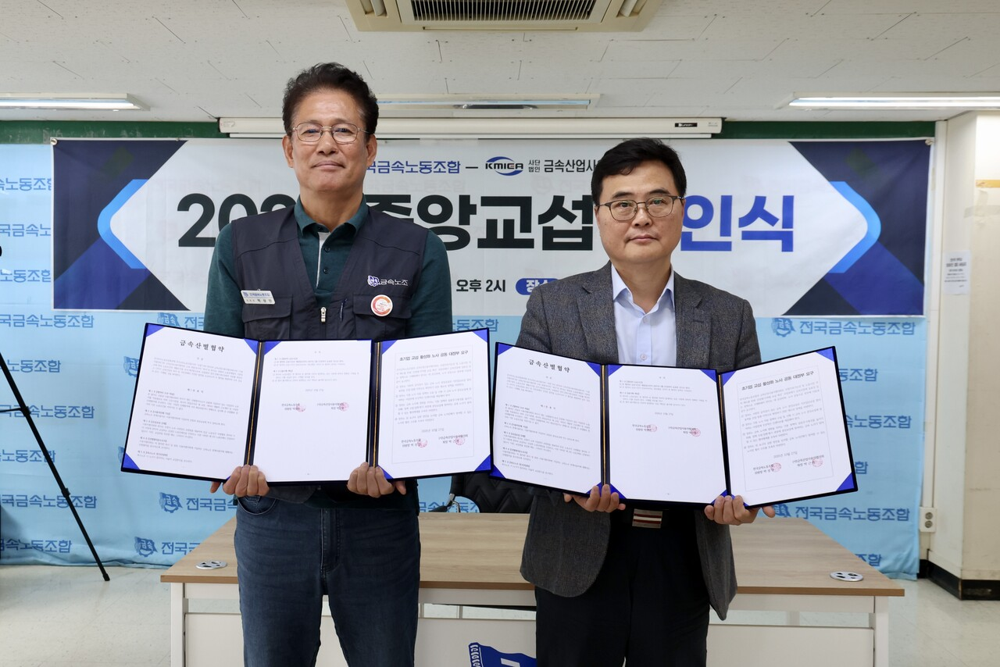

# Korean Metal Workers

_The union and the employers_

## Executive Summary

> [!callout]
> A clause telling employers to settle it with the union before AI comes into the workplace has been written into a collective agreement. On October 27, at the signing ceremony for the 2026 central bargaining round in Korea's metal industry, the Korean Metal Workers' Union and the Korea Metal Industry Employers' Association signed an industry-wide agreement carrying a new clause on protecting labor rights and employment when AI is adopted. Whether the AI runs a process or manages people, the employer has to tell the union first. If the union asks, both sides work out together how it will change jobs and the terms people work under. Only once they have agreed on the measures can it go in. This article looks at the procedure the clause requires and at where that requirement parts from Korea's AI Framework Act as it now stands.

> What goes furthest is that the clause settles in advance which side does the explaining when a dispute arises. Use AI in an HR action and its standards and its procedure have to be made public, and if someone calls that action unfair, the employer is again the side that has to produce reasonable grounds. The AI Framework Act, in full force since January, does count judgments that weigh on a person's rights and duties, hiring among them, as high-impact AI, and it does require a plan for explaining them. What it never settled is who has to prove the case once a dispute actually starts. Sixty-nine companies have to follow it. In the members' ballot 86.4% voted in favor, and what that vote ratified was the whole bargaining round, not the AI clause on its own.

> Sections 1 through 3 follow the clause as it was made public at the signing, the law as it stands, and the amendment bills now before the National Assembly. Sections 4 and 5 ask what an HR AI was taught on and what yardstick it scored people by, and how much of that still has to be on hand for the clause to be met. Those two sections are this article's interpretation.

### Key Numbers

Four figures come out of the agreement and the Act together: the number of member companies it catches at once, the vote the members cast, the span the law names in its own text, and one provision the law does not have.

Source: [Media Today](https://www.mediatoday.co.kr/news/articleView.html?idxno=338034) and [Maeil Labor News](https://www.labortoday.co.kr/news/articleView.html?idxno=237428)

<!-- stat-card -->
**69** — Member companies covered at once — One round of industry-level bargaining reaches all of them together

<!-- stat-card -->
**86.4%** — Yes vote in the members' ballot — Ratified over four days of voting, October 12–15

<!-- stat-card -->
**Up to hiring** — How far the AI Framework Act names high-impact use in employment — The Act's text does not name assignment, appraisal, promotion or discipline

<!-- stat-card -->
**None** — Burden-of-proof provisions in the AI Framework Act — Only the agreement puts that duty on the employer when a worker objects

## What the Two Sides Signed

The signing ceremony for the 2026 metal industry central bargaining round was held on October 27 at the Korean Metal Workers' Union offices in Jeong-dong, Jung-gu, Seoul. Park Sang-man, president of the Korean Metal Workers' Union, and Park Geun-hyung, chair of the Korea Metal Industry Employers' Association, signed the metal industry agreement, and that agreement carries a new clause on protecting labor rights and employment when AI is adopted. It applies to the 69 member companies of the employers' association. TK Elevator, Lotte Energy Materials, DAS, Keyang Electric Machinery and Winia are among the names on that list.

*▲ KMWU president Park Sang-man (left) and KMIEA chair Park Geun-hyung hold the signed metal industry agreement at the October 27 signing ceremony | Source: [Media Today](https://www.mediatoday.co.kr/news/articleView.html?idxno=338034) (Photo courtesy of the Korean Metal Workers' Union)*

The members' ballot ran for four days, from October 12 to 15, and the result was ratified with 86.4% in favor. The AI clause was not the only item put to that vote. The same bargaining round settled an ordinary hourly wage of 10,830 won, a rise of 3.93% that runs ahead of the 3.68% statutory minimum wage increase. The 86.4% ratified the central bargaining result as a whole, with that settlement bundled in.

The union described the clause as a device inside the collective agreement to keep AI adoption from harming employment and working conditions at the workplace. It also set the clause down as the first supra-enterprise industrial agreement in Korea to compel labor-friendly use of AI. Unlike a promise struck company by company, this one is made once at the level of the industry and binds every member company at the same time.

Bargaining was not smooth. The employers' side brought an AI proposal to this round for the first time, but the union replied that the proposal narrowed what counts as AI and ran against the intent of its own demand, and that it could not be accepted. The employers' proposals ran to a fourth version, and the union denounced that fourth proposal as industry-centered with labor left out. The wording that stands now came after that much argument over how far the word AI reaches.

> [!callout]
> The place where one side pushed to narrow the scope and the other to widen it says what kind of clause this is. It does not tell employers not to use AI. It tells them to say what they are using before they use it, and to confirm together how that thing touches people's jobs and working conditions. The fight was not over whether to use AI but over what gets called AI and how much of it has to be put on the table.

## The AI Enters Only After the Union Has Agreed

The clause splits what an employer has to do before bringing AI into work processes or HR management into three steps. First, notify the union in advance. Second, if the union asks, examine jointly what the adoption will do to employment and working conditions. Third, adopt on the premise that both sides have agreed on measures covering employment, training, industrial safety and personal data protection.

Duties remain after adoption. Information the AI collects and supplies has to be disclosed, and where AI is used in an HR action, the standards and the procedure behind it have to be disclosed openly. Where a worker argues the action was unfair, the duty to present reasonable grounds falls on the employer. Member companies agreed to carry the principle into supplementary workplace agreements, and where an existing agreement already holds a stronger protection, not to roll it back. The two sides also asked the government to extend the force of this agreement to other industries, sectors and regions.
