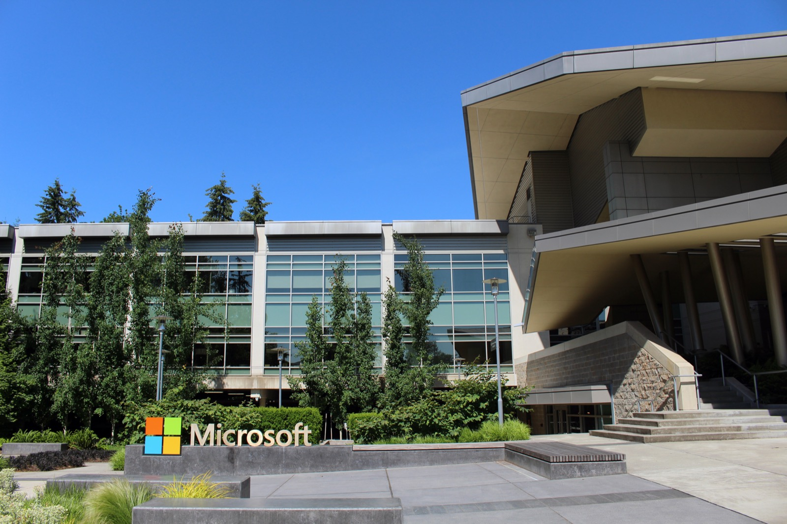

# 마이크로소프트 퇴직 제안, 데이터센터 직원은 대상이 아니다

_퇴직 제안 대상은 미국·캐나다·인도·영국의 사내 직급 70 이하 직원 약 6만 명이고, 데이터센터와 영업·보안은 빠져 있다_

## Executive Summary

> [!callout]
> 마이크로소프트가 직원 약 6만 명에게 회사를 떠날지 스스로 고르라고 제안했다는 소식이다. 10월 26일 대상자에게 개별 이메일이 갔고, 이름은 자발적 퇴직 제안(Voluntary Exit Offer)이다. 회사가 내보내는 해고와 달리 받을지 말지를 직원이 정한다. 결정 시한은 12월 초, 퇴사는 연말이다.

> 이번 발표에서 드문 것은 규모보다 조건이다. 회사는 제안이 간 나라와 직급 상한, 그리고 제안이 가지 않은 조직을 함께 알렸다. 그런데 상한으로 정해진 레벨 70은 사내 기술 사다리의 거의 꼭대기다. 이 조건으로 걸러지는 사람은 많지 않았고, 실제로 사람을 가른 축은 소속 조직이었다. AI 제품을 만드는 코파일럿과 코어AI는 대상에 들어갔고, AI를 돌리는 데이터센터와 매출·방어 최전선인 영업·보안은 빠졌다.

> 1절부터 5절까지는 10월 26일 보도와 사내 메모 문구, 그리고 회사가 공개한 지출 수치에서 확인되는 내용을 따라간다. 이 경계가 "AI가 그 일을 대체하는가"보다 "지금 당장 묶여 있어 되돌리기 어려운 자리인가"에 가깝다는 3절의 읽기와, 공개된 자격 조건을 조직이 쓴 판정 기준으로 보는 6절의 정리는 이 글의 해석이다.

### 주요 수치

이번 제안의 크기와 조건을 네 숫자로 추리면 이렇다. 첫 칸이 제안을 받은 사람의 수, 둘째 칸이 받아들인 사람에게 돌아가는 보상의 상한, 셋째 칸이 그 직전 회계연도에 설비로 나간 돈이다. 마지막 칸은 올해 공개된 인력 조치 가운데 이번이 몇 번째인지다. 제안의 규모와 그 옆에서 이어진 설비 지출을 함께 적어 둔 셈이다.

출처: [CNBC](https://www.cnbc.com/2026/10/26/microsoft-msft-voluntary-buyouts.html) · [TechCrunch](https://techcrunch.com/2026/10/26/microsoft-offers-buyouts-to-around-60000-employees-reports-say/) (모두 2026-10-26 보도 기준)

<!-- stat-card -->
**약 6만 명** — 제안을 받은 직원 — 6월 30일 기준 전체 22만3000명의 약 27%

<!-- stat-card -->
**최대 39주** — 기본급 보상 상한 — 최소 60일분, 근속에 따라 올라간다

<!-- stat-card -->
**약 1450억** — 직전 회계연도 자본지출(달러) — 2026년 6월 종료 회계연도, 연초 가이던스 기준

<!-- stat-card -->
**네 번째** — 올해 공개된 인력 조치 — 4월·7월·9월에 이어 10월이 네 번째다

## 제안은 누구에게 어떤 조건으로 갔는가

10월 26일 월요일, 마이크로소프트 직원 일부의 받은편지함에 개별 조건이 적힌 메일이 도착했다. 회사가 붙인 이름은 자발적 퇴직 제안이다. 회사가 나가라고 통보하는 해고와 달리, 받은 사람이 받아들일지 말지를 정한다. 받지 않는다고 불이익이 따른다는 설명은 없었다.

*▲ 자발적 퇴직 제안이 간 레드먼드 본사 캠퍼스 | Source: [Wikimedia Commons (Coolcaesar, CC BY-SA 4.0)](https://commons.wikimedia.org/wiki/File:Building92microsoft.jpg)*

제안이 간 범위는 네 나라다. 미국, 캐나다, 인도, 영국. 대상 인원은 약 6만 명으로, 6월 30일 기준 전체 임직원 22만3000명의 약 27%에 해당한다. 네 명 중 한 명 넘게 같은 메일을 받은 셈이다. 자격 조건은 사내 직급 70 이하이고, 일부 보도는 같은 선을 "부사장급 이하"로 옮겼다.

시간표는 짧다. 받아들일지는 12월 초까지 답해야 하고, 받아들인 사람의 퇴사는 올해 안에 마무리된다. 보상은 표준 퇴직 패키지에 준한다고 알려졌다. 올해 마이크로소프트의 다른 라운드에 공통으로 적용된 공식은 기본급 최소 60일분에 근속에 따라 올라가는 구조이고, 상한이 39주다. 여기에 일정 기간 주식 베스팅이 이어지고, 임시 건강보험과 커리어 전환 지원이 붙는다. 다만 이번 제안에만 적용되는 세부 공식은 회사가 밝히지 않아, 금액 구조는 올해 라운드에 공통으로 쓰인 공식 수준까지만 확인된다.

조건에서 빠진 항목도 같이 봐야 한다. 나이나 근속 연수의 최소 요건이 없고, 직전 성과평가 결과도 자격과 무관하다. 지난 4월 제도가 "나이와 근속의 합이 70 이상"을 요구했던 것과 다른 설계다. 조건에 드는 사람 전원 앞에 같은 선택지를 올려놓은 방식에 가깝다. 저성과자를 추리려고 만든 장치라는 흔적은 조건 어디에도 없다.

## '레벨 70 이하'는 말단이 아니다

"레벨 70 이하"라는 조건은 숫자만 보면 아래쪽을 솎아낸다는 인상을 준다. 사내 직급 체계를 알고 나면 인상이 뒤집힌다. 마이크로소프트의 기술 트랙 직급은 50대 후반에서 시작해 80번대까지 올라가고, 70은 Distinguished Engineer로 불리는 최상위 기술 직급 구간에 해당한다. 그 위에 남는 것은 Technical Fellow를 비롯한 극소수 자리다.

그래서 이 조건은 사다리의 아래쪽을 자르는 선이 아니라, 사다리 거의 전부를 안에 담는 선이다. 신입 엔지니어와 수석 엔지니어, 디렉터급 관리자가 같은 조건 안에 들어간다. 긱와이어는 이번 제안을 두고 전체 인력의 약 4분의 1, "일부 임원 포함"이라고 적었다.

직급이 조건에서 하는 일은 사람을 가르는 쪽보다 보상 금액을 정하는 쪽에 가깝다. 올해 라운드에 공통으로 쓰인 공식을 직급 구간에 얹으면 아래 그림처럼 된다. 제안 상한선은 사다리의 거의 꼭대기에 그어져 있고, 그 아래 구간마다 근속을 주로 환산하는 비율이 다르다.
