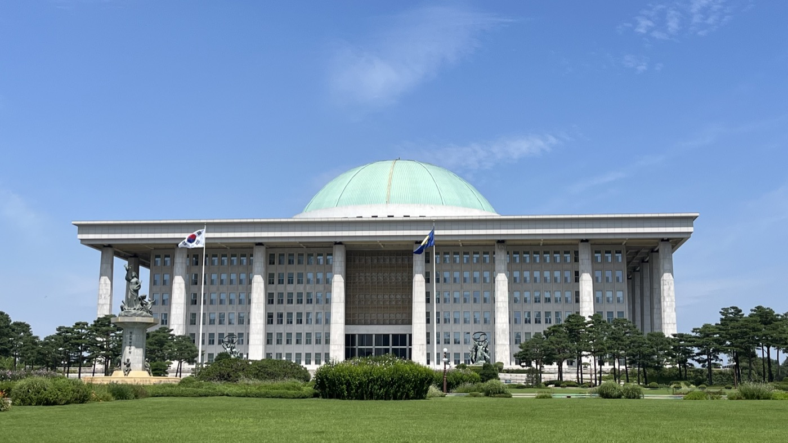

# Korea

_On October 23 a National Assembly office found the chatbot still giving three months of unpaid wages, two months after an amendment raised the state_

## Executive Summary

> [!callout]
> The AI labor law chatbot run by Korea's Ministry of Employment and Labor is answering with rules that have already been amended, and a National Assembly review has put that on the record. The office of Representative Park Jung, a member of the Assembly's Climate, Energy, Environment and Labor Committee, compared the chatbot's answers with current law as of October 23 and found four cases where the service repeated a superseded provision or payment standard after the amendment had taken effect. Put to a general-purpose AI, the same questions came back with answers that matched current law.

> The clearest of the four is the insolvency substitute payment, the money the state pays a worker in place of an employer that has gone under. An amendment to the Wage Claim Guarantee Act that took effect on August 20 widened the coverage from the final three months of wages to the final six and raised the ceiling from 21 million won to 31.5 million won. Two months on, the chatbot was still giving the old standard. Set that beside the 3.1 billion won spent on building and running the service over three years, and the gap is hard to read as a shortfall in model performance.

> Sections 1 through 3 follow the comparison the office released and the three outlets that reported it. Sections 4 and 5, which move this failure from model performance to the path by which amended law reaches the chatbot's documents, are this article's interpretation.

### Key Numbers

The review left four figures behind: the size of the wrong answer, the money that went into it, the route by which an error can travel back to the service, and the number of times someone asked the chatbot for an answer.

Source: [Kyeongin Ilbo](https://www.kyeongin.com/article/1773583) and [NewDaily Economy](https://biz.newdaily.co.kr/site/data/html/2026/10/27/2026102700030.html), carrying material released by Representative Park Jung's office.

<!-- stat-card -->
**3 months → 6 months** — Coverage of the insolvency substitute payment, widened on August 20 — The ceiling rose from 21 million won to 31.5 million won as well

<!-- stat-card -->
**3.097 billion won** — Build and operating budget, 2024 through 2026 — 930 million won in 2024, 200 million won in 2025, 1.967 billion won in 2026

<!-- stat-card -->
**None** — Channels for a user to report a wrong answer — Find a wrong answer and there is no way to say so inside the service

<!-- stat-card -->
**185,903** — Queries from January through September 2026 — Nine months passed the 117,000 drawn in all of last year

## Only the Dedicated Chatbot Got It Wrong

Representative Park Jung's office put labor law questions to the Ministry of Employment and Labor's AI chatbot and matched the answers that came back against current law, one by one, as of October 23. The same questions went to a general-purpose AI. The two sets of answers were released side by side on October 27.

*▲ The National Assembly Building — home to the Climate, Energy, Environment and Labor Committee behind this review | Source: Cjb8293, [Wikimedia Commons](https://commons.wikimedia.org/wiki/File:Republic_of_Korea_capitol.jpg) (CC BY-SA 4.0)*

The passage every outlet led with is the question about an employer on the public list of wage defaulters who withholds wages again. Asked whether criminal punishment is possible in that case, the chatbot answered that it is not if the victim does not want the employer punished. The general-purpose AI, given the same question, answered that a prosecution can be brought even where the worker states no wish to see the employer punished, and that is the answer current law supports.

Withholding wages was for a long time an offense that could not be prosecuted against the victim's wishes. If the worker harmed did not want the employer punished, no charge could be brought. An exception to that principle was added, and an employer on the public list who withholds wages again falls under it. The answer the chatbot gave is the principle as it stood before the exception existed.

> [!callout]
> The error runs all one way. The chatbot called a punishable case unpunishable. A worker who believes that answer drops a case they could have filed. A wrong answer from a counseling service does not end as one missing fact; it changes the decision that rests on the fact.

A general-purpose AI getting it right while a dedicated service costing 3.1 billion won gets it wrong is striking on its own. Read that one case alone, though, and it is easy to land on the conclusion that the general-purpose AI knows labor law better. Put all four cases together and a different explanation comes out.

## The Law Changed Two Months Ago; the Chatbot's Answer Did Not

The office counted four answers as departing from current law: the penalty provision for withholding wages, repeat non-payment by an employer on the public list, the payment standard for the insolvency substitute payment, and the standard for a habitual wage defaulter. All four fall under statutes the Ministry of Employment and Labor administers, and all four came out of a service the administering ministry runs itself.

| Question area | What the chatbot gave | Current standard |
| --- | --- | --- |
| Repeat non-payment by an employer on the public list | No criminal punishment if the victim does not want it | A prosecution can be brought even where the victim states no such wish |
| Payment standard for the insolvency substitute payment | Final three months, up to 21 million won | Final six months, up to 31.5 million won |
| Penalty provision for withholding wages | Pointed to a provision other than the current one | Not set out in the released material |
| Standard for a habitual wage defaulter | Gave a standard other than the current one | Not set out in the released material |

The current standard is left blank in the bottom two rows because the material the office released and the coverage of it set the chatbot's answer against current law for the first two cases only. For the other two, what is confirmed stops at the fact that the guidance differed from current law.

Of the four, the insolvency substitute payment is the one with dates at both ends. The amended Wage Claim Guarantee Act took effect on August 20, widening coverage from the final three months of wages to the final six and raising the ceiling from 21 million won to 31.5 million won. On October 23, the date of the review, the chatbot's answer was the final three months, up to 21 million won.

Two months and three days. In that time the bill was promulgated, the effective date passed and the change ran in the press, and the one place it failed to reach was the counseling chatbot run by the ministry that administers the act. For the other three cases there is no telling when the answers started to go wrong, but this one has the length of the wrong stretch stamped in dates. In time it is half the months a worker can claim; in money it is 10.5 million won missing from the ceiling.

## A Service Costing 3.1 Billion Won Has No Way to Report an Error

Three years of spending on this service are on the record: 930 million won in 2024, 200 million won in 2025 and 1.967 billion won in 2026, for a total of 3.097 billion won. The 2024 share is a government contribution from the National Information Society Agency, and this year's budget alone comes to nearly two thirds of the whole. The oldest answers came out in the year the most money went in.

Use has grown too. The 117,000 queries drawn across all of 2025 became 185,903 through September 2026. Nine months passed the whole of last year, which works out at a little over 20,000 a month.

The ministry keeps no staff of its own to maintain the service. In place of such staff, 173 certified labor attorneys from the Korea Association of Certified Public Labor Attorneys read through questions and AI answers at a rate of about 20,000 a month. That is close to the volume of use itself. They are not working from a sample; they are reading very nearly everything that comes in.

The missing piece sits elsewhere. A user who receives a wrong answer has no way to say so on the spot. Errors surface along two routes only: the attorneys' review after the fact, and an objection from outside such as this one. Twenty thousand a month is close to 700 a day. The person who meets a wrong answer first in those questions is the user, and the signal that person holds has no way into the service.

Accuracy was what the service led with at launch. Its description said hallucination had been minimized by having 173 labor attorneys clean the training data, and the attorneys' association called the result a successful model of public-private cooperation. A cost-benefit study by the Ministry of Employment and Labor put the time saved in finding labor law information at 87.5% against an ordinary search portal.

The range it covers has widened since. When it first appeared at a government expo in November 2024, it ran as an exchange over KakaoTalk and centered on subjects such as unemployment benefits and severance pay. It is now a full service at ai.moel.go.kr fielding questions across labor law, and the insolvency substitute payment and the sanctions on wage defaulters that it answered wrongly this time are inside that range.

Representative Park Jung said that a separate labor law counseling service run on this much public money should at the least show high reliability on the currency and accuracy of the statutes the ministry administers. The call that came with it was for a full review of the quality control system for verifying accuracy on a continuing basis, before the service's features and counseling range are widened any further.

## A Bigger Model Will Not Refresh an Old Provision

What the review looks at explains how these four survived 20,000 readings a month. A reviewer is handed a question and an answer as a pair, and the insolvency substitute payment answer has nothing odd about it taken as a pair. No provision was invented and no figures were mixed. The chatbot copied the standard written in the material it reads exactly, and that material held a standard repealed in August. The fact that the material is out of date does not show in the answer.

Cleaning the data with 173 labor attorneys was in the design. Running that cleaning again every time the law changes appears not to have been. The old payment standard that stayed up for more than two months points at that empty place.

Explaining the general-purpose AI's correct answer by model performance does not hold together. A general-purpose model is unlikely to have learned Korean labor law more deeply. The difference between the two is the date of the material each had in hand when it answered. A general-purpose chatbot with web search attached can pull in a document carrying this year's standard immediately, while a dedicated chatbot that looks only inside its own corpus goes on citing the earlier provision, accurately, until that corpus is refreshed.

Dedicated tools losing this way is not a Korean story alone. A study of the leading American legal research AI tools (Magesh et al., Journal of Empirical Legal Studies, 2025) reported hallucination rates of 17 to 33 percent even in tools wired to dedicated legal databases. Attaching retrieval brings invented answers down, but it does not make them go away.

Where the remainder comes from is the point of "RAGged Edges" (arXiv:2403.01193), a study of retrieval-augmented chatbots. When the material being searched is itself out of date, the retrieval succeeds and the answer is wrong. The model found its source document properly, and the document held a standard that had been repealed. The chatbot's insolvency substitute payment answer is exactly this shape. A legal research report from Vals AI, which scored legal AI tools on practitioner tasks, also recorded items where a general-purpose chatbot with web search produced results comparable to the dedicated tools.

Nothing sits between the point where the law changed and the material the chatbot reads, and the review is attached to the answers rather than to the material.
