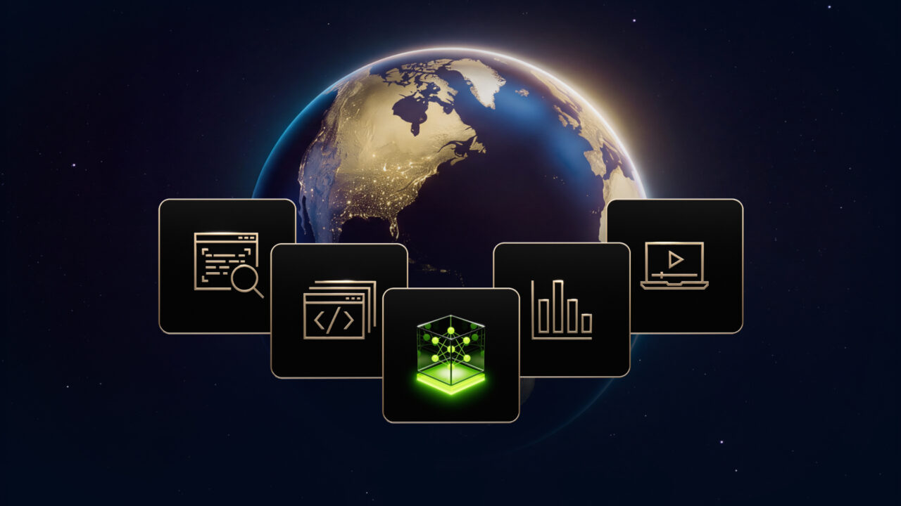

# 엔비디아 네모트론 공개 데이터, 답변을 쓴 건 알리바바·딥시크

_공개된 학습 데이터 11벌 가운데 어떤 AI로 만들었는지 밝힌 5벌은 전부 알리바바·구글·딥시크 같은 경쟁사 모델을 가리킨다_

## Executive Summary

> [!callout]
> 이 글은 엔비디아가 모델 파일과 함께 공개한 학습 데이터가 어디서 왔는지를 본다. 10월 15일 발표한 Nemotron 3.5 Super VL은 누구나 받아 쓸 수 있는 개방 모델이고, 같은 자리에서 학습에 쓴 데이터 열한 벌도 함께 풀렸다. 가중치만 열고 데이터는 닫아 두는 쪽이 업계 관행이라, 데이터까지 연 것 자체는 반가운 일이다.

> 열한 벌 가운데 가장 큰 385만 582건짜리 데이터를 열어 보면, 그 안의 답변을 쓴 것은 엔비디아의 모델이 아니라 문샷AI와 구글과 알리바바의 모델이다. 데이터셋 카드에 적힌 라이선스는 OpenMDW-1.1 한 줄인데, 그 한 줄 뒤에는 서로 다른 약관 셋이 겹쳐 있다. 셋을 다 열어 본 결과 이 데이터로 학습시킨 모델에 따라붙는 조건은 없었다. 다만 그 답이 약관 본문에는 적혀 있지 않아, 한 곳은 저장소 토론 글까지 들어가야 나왔다.

> 4절까지는 데이터셋 카드와 기술 보고서, 공개된 라이선스 문서와 저장소 토론 글에 적힌 사실을 따라간다. 받아 쓰는 쪽이 데이터의 계보를 어디까지 되짚어야 하는지를 묻는 5절은 이 글의 해석이다.

### 주요 수치

앞의 둘은 엔비디아가 연 것의 크기이고, 뒤의 둘은 그 안을 열었을 때 나온 숫자다.

출처: [허깅페이스 데이터셋 카드](https://huggingface.co/datasets/nvidia/Nemotron-SFT-Instruction-Following-Chat-v4), [엔비디아 기술 보고서](https://research.nvidia.com/labs/nemotron/files/NVIDIA-Nemotron-3.5-Super-and-Lightning-Technical-Report.pdf)(2026년 10월 14일), 공개 저장소 전수 조사(orcarouter.ai, 2026년 10월).

<!-- stat-card -->
**385만 582건** — 가장 큰 공개 데이터 한 벌 — 지시따르기와 대화 기록, 압축 전 80.74GB

<!-- stat-card -->
**11벌** — 가중치와 함께 푼 학습 데이터 — 10월 12일부터 15일까지 사흘 사이에 올라왔다

<!-- stat-card -->
**0벌** — 엔비디아 자기 모델로 답을 채운 데이터 — 어떤 모델로 만들었는지 적힌 5벌은 모두 다른 회사 모델이다

<!-- stat-card -->
**셋 다 없음** — 이 데이터로 학습한 모델에 따라붙는 조건 — 그 답이 약관 본문에 적힌 곳은 셋 중 둘뿐이다

## 가중치 옆에 데이터가 같이 놓였다

Nemotron 3.5 Super VL은 엔비디아가 10월 15일 발표한 개방 모델이다. 전체 파라미터는 1,200억이고 질문 하나를 처리할 때 실제로 도는 것은 그중 120억이다. 전문가를 여럿 두고 필요한 전문가만 깨우는 구조라 그렇다. 글과 이미지를 함께 읽는 모델이고, 같은 날 텍스트 전용인 Nemotron 3.5 Lightning도 함께 나왔다. 가중치 파일은 사흘 앞선 10월 12일에 이미 허깅페이스에 올라와 있었다.

*▲ Nemotron 3.5 Super VL 발표 이미지 | Source: [NVIDIA 공식 블로그](https://blogs.nvidia.com/blog/nemotron-3-5-super-vl/)*

발표에서 엔비디아가 내세운 표현은 가중치와 데이터와 조리법을 함께 연다는 것이었다. 모델 파일만이 아니라 학습 뒤 다듬는 단계에 쓴 데이터와 그 절차까지 묶어 공개한다는 뜻이다. 강화학습 환경인 NeMo Gym도 같이 열었다. 목표도 분명히 적어 뒀다. 기업이 자기 데이터센터에서 자기 데이터로 다시 학습시켜 자기 것으로 소유하게 한다는 것이다. 도입한 곳으로는 스카이댄스, EY, 램프, 크라우드스트라이크, 퍼플렉시티, 세일즈포스를 들었다.

성능에 대해서는 소프트웨어 수정 과제 묶음인 SWE-bench Pro에서 51.78%를 냈고, 한 번에 도는 파라미터가 4.6배쯤 적은데도 윗급인 Nemotron 3 Ultra를 넘어섰다고 밝혔다. 앤트로픽 Opus 5와 오픈AI GPT 6.1 Sol보다 에이전트 작업에서 낫다는 주장도 함께 실렸다. 다만 이 비교는 엔비디아가 스스로 돌린 것이고, 터미널 작업 평가인 Terminal-Bench 2.1에서는 기술 보고서에 적힌 수치와 모델 카드에 적힌 수치가 서로 다른 방향을 가리킨다는 지적도 나와 있다.

이 글이 보려는 것은 성능 쪽이 아니다. 가중치만 열고 데이터는 닫아 두는 것이 지금의 관행이라, 데이터까지 열면 바깥에서 그 안을 읽을 수 있게 된다. 읽을 수 있게 되자 보이기 시작한 것이 있다.

## 385만 건 안을 펴 보면

열한 벌 가운데 가장 큰 것은 Nemotron-SFT-Instruction-Following-Chat-v4다. 3,850,582건이 들어 있고 용량은 80.74GB다. 안은 세 갈래로 나뉜다. 답변 길이를 지시대로 맞추는 연습이 266,190건, 일반 대화가 914,716건, 여러 번 주고받으며 지시를 따르는 기록이 2,669,676건이다. 모델이 사람 말을 고분고분 듣게 만드는 데 쓰는 재료다.

이런 데이터를 만드는 방법은 단순하다. 이미 잘하는 모델에게 질문을 던져 답을 받아 두고, 그 문답 묶음을 새 모델의 교재로 쓴다. 답을 내준 쪽을 업계에서는 선생 모델이라고 부른다. 사람이 일일이 쓰는 것보다 싸고 빠르며, 요즘은 여기까지가 특별한 이야기도 아니다.

특별한 것은 데이터셋 카드에 그 선생이 누구인지 적혀 있다는 점이다. 셋이다. 문샷AI의 Kimi-K2.6, 구글의 Gemma4-E4B-it, 알리바바의 Qwen3.5-397B-A17B. 엔비디아 자신의 Nemotron은 그 자리에 없다. 여기에 사람이 실제로 챗봇과 나눈 대화를 앨런 AI 연구소가 모아 공개한 WildChat-1M과, 어느 모델의 답이 더 나은지 사람들이 고른 LMArena 선호 기록이 섞였다. 앞의 것은 ODC-By 1.0, 뒤의 것은 CC-BY-4.0으로 공개된 자료다. 둘 다 가져다 쓰는 것을 막지는 않되 출처를 밝히라고 요구하는 쪽이라, 여기서 이미 지켜야 할 조건이 둘 생긴다.

그런데 데이터셋 카드 맨 위에 걸린 라이선스는 OpenMDW-1.1 한 줄이다. 카드에는 이용자가 데이터 내용을 직접 확인하고 적용되는 라이선스를 검토해 적합한지 판단해야 한다는 문구도 함께 적혀 있다. 안에 섞인 것이 한 가지가 아니라는 사실을 엔비디아도 알고 있고 고지도 해 둔 셈이다. 다만 무엇이 섞여서 어떤 조건이 따라오는지는 그 문구가 말해 주지 않는다.

섞인 것들이 각각 어느 자리에서 들어왔는지를 펴 보면 아래 도식과 같다. 왼쪽으로 갈수록 먼저 있던 재료이고, 오른쪽 끝은 이 데이터를 받아 학습시킬 모델이다. 자리마다 붙은 라이선스가 서로 다르고, 데이터셋 카드가 보여 주는 것은 그중 한 자리뿐이다.
