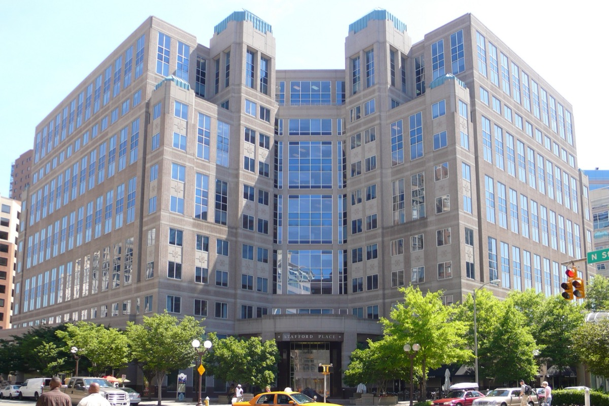

# 미국 국립과학재단, 연구비 서류의 AI를 

_공문서의 AI를 _

## Executive Summary

> [!callout]
> 이 글은 미국 국립과학재단(NSF)의 설명회 웨비나에서 나온 한 문장을 읽는다. 수리과학부 부국장 준핑 왕은 연구비 초록과 관련 문서에 적힌 'AI'를 'SI'로 바꾸는 일을 "담당 프로그램 디렉터가 연구자와 함께 진행할 수 있다"고 말했다. 9월 29일 서명된 행정명령 14434호가 연방 기관 문서의 '인공지능'을 '초지능'으로 바꾸라고 지시한 데 따른 움직임이다.

> 그런데 그 행정명령은 바꿀 자리를 공문과 웹사이트, 보고서 같은 비법정 문서로 한정하면서, 이미 나간 규정과 대통령 조치, 계약, 연구비, 그 밖의 과거 문서는 고치지 않아도 된다고 따로 적어 두었다. 국립표준기술연구소는 이름을 바꾼 페이지마다 그 문장을 거의 그대로 옮겨 붙였다. 국립과학재단이 내놓은 제안은 바로 그 제외 목록에 들어 있는 연구비 문서를 겨냥한다. 미국물리학협회의 과학정책 소식지 FYI는 이를 두고 9월 행정명령이 요구한 범위를 넘어선다고 적었다.

> 여기까지가 행정명령 원문과 보도에 적힌 사실이다. 이름이 바뀐 기록과 바뀌지 않은 기록이 섞이면 'AI 연구비가 한 해 얼마였나'를 나중에 세는 일이 어려워진다는 이 글 4절의 읽기는 어느 기관의 주장이 아니라 이 글의 해석이다.

### 주요 수치

세 숫자를 뽑았다. 행정명령이 초지능의 법적 정의안에 못 박은 기한, 'AI 연구비'를 검색어로 긁었을 때 한 해 걸려 나오는 과제 수, 그리고 명령이 손대지 않아도 된다고 적은 문서의 갈래다.

출처: [행정명령 14434호 원문](https://www.whitehouse.gov/presidential-actions/2026/09/inaugurating-the-era-of-super-intelligence/), [미국과학자연맹 'Trust Issues'](https://fas.org/publication/trust-issues/).

<!-- stat-card -->
**60일** — 초지능의 법적 정의안 제출 기한 — 서명일부터 세어 11월 28일까지 대통령 과학기술보좌관이 입법안을 낸다

<!-- stat-card -->
**약 1,000건** — 한 해 'AI 연구비'로 걸려 나온 과제 — 컴퓨터정보과학공학국 한 곳, 2018~2022 회계연도. 초록을 검색어로 긁은 결과라 AI와 무관한 과제까지 섞였다

<!-- stat-card -->
**5갈래** — 행정명령이 안 고쳐도 된다고 적은 문서 — 이미 나간 규정, 대통령 조치, 계약, 연구비, 그 밖의 과거 문서

## '바꿔 줄 수 있다'와 '바꾸라'는 다른 말이다

웨비나 자체는 평범했다. 미국 국립과학재단 수리·물리과학국이 수리과학 분야 연구비 공고를 설명하려고 연 온라인 설명회다. 재단 행사 안내를 보면 10월 7일 수요일 오후 두 시에 열렸고, 열두 개 넘는 프로그램을 묶은 공고의 신청 방법을 다뤘다. 미국물리학협회의 과학정책 소식지 FYI는 이 웨비나를 "수요일"이라고만 적었다.

*▲ 미국 국립과학재단이 2017년 앨릭잰드리아로 옮기기 전 쓰던 본부 건물(버지니아주 알링턴). 이번 웨비나를 연 곳은 수리·물리과학국이다 | Source: [Wikimedia Commons (Public Domain)](https://commons.wikimedia.org/wiki/File:NSF_building.jpg)*

그 자리에서 수리과학부 부국장 준핑 왕이 한 말을 FYI가 옮겼다. 연구비 초록과 관련 문서에 적힌 'AI'를 'SI'로 바꾸는 일을 "담당 프로그램 디렉터가 연구자와 함께 진행할 수 있다"(your program director may work with you by changing AI to SI)는 것이다. 같은 자리에서 그는 재단 내부의 AI 도구가 제출 자료 일부를 요약하는 데 쓰일 수 있지만 "권고안을 만드는 데는 쓰지 않는다"(but not for making recommendations)고도 말했다.

문장의 핵심은 조동사에 있다. 바꾸라는 지시가 아니라 바꿔 줄 수 있다는 제안이다. 연구자가 요청하지 않으면 'AI'인 채로 남는 초록도 있을 테고, 프로그램 디렉터마다 판단이 다를 수도 있다. 재단이 과제 전체를 한꺼번에 고쳐 쓰겠다고 발표한 것이 아니라는 뜻이다. 동시에, 고쳐진 문서와 고쳐지지 않은 문서가 같은 데이터베이스 안에 나란히 쌓인다는 뜻이기도 하다.

이름을 손보는 움직임은 한 갈래가 아니다. 같은 소식지는 재단이 제안 심사위원회 여덟 곳의 이름을 새 부서 이름에 맞춰 바꾸려 한다는 소식도 함께 전했다. 이쪽은 행정명령이 아니라 조직 개편에서 비롯된 변경이다. 배경에는 2026 회계연도에 과학 기관들이 예년보다 훨씬 적은 수의 과제에 연구비를 집행했고, 재단이 예산 10억 달러 넘게 쓰지 못한 채 해를 넘겼다는 비판도 깔려 있다.

## 행정명령은 어디까지 바꾸라고 했나

9월 29일 서명되고 10월 2일 연방관보에 실린 행정명령 14434호의 제목은 '초지능 시대의 개막'이다. 이름을 바꾸는 이유는 1절에 있다. 지금 나온 시스템이 'AI'라는 말이 처음 가리키려던 대상을 이미 넘어섰다는 것이다. 2절 (a)항의 지시는 짧다. 법이 허용하는 최대한의 범위에서, 각 부처와 기관은 공문과 공개 자료, 웹사이트, 보고서, 정책 문서를 비롯한 행정부 안의 비법정 문서에서 'Artificial Intelligence'와 'AI' 대신 'Super Intelligence'와 'SI'를 쓰라는 것이다.

같은 절의 (b)항은 바로 다음 문장에서 선을 긋는다. "이 절의 어떤 내용도 이미 발급된 규정, 대통령 조치, 계약, 연구비, 그 밖의 과거 문서를 바꿀 것을 요구하지 않는다"(Nothing in this section requires the alteration of previously issued regulations, Presidential actions, contracts, grants, or other historical documents). 과거를 거슬러 고치지 않겠다는 설계가 명령문 안에 들어 있다.

3절은 뜻도 고정했다. '초지능'과 'SI'는 미국 연방법전 15편 9401조 3항이 정의한 '인공지능'과 같은 기술을 가리킨다고 적었다. 이름만 바뀌고 법적 범위는 그대로라는 뜻이다. 다만 그 상태가 끝까지 가지는 않는다. 같은 절은 대통령 과학기술보좌관에게 60일 안에, 그러니까 11월 28일까지 초지능의 연방 정의를 세우는 입법안을 제출하라고 지시했다. 그 입법안에는 지금의 법정 정의를 고치거나 넓히는 안과 거기 맞춰 다른 조문을 손보는 안까지 담으라고 주문했다. 그때 정의가 넓어지거나 바뀌면 이름만의 문제가 아니게 된다.

명령이 닿는 자리도 좁다. 대상은 행정부 안이고, 법률이 정해 둔 용어는 바뀌지 않는다. 행정부 바깥에서 같은 대상을 무엇이라 부르는지는 이 명령이 정하지 않는다.
