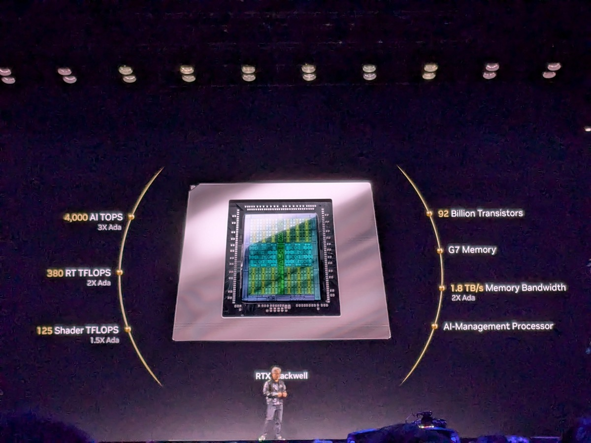

# 네이버의 AI 공장, 칩을 파는 엔비디아가 주주로 들어온다

_엔비디아가 10억 달러로 네이버 지분 4.54%를 가져가고, 네이버는 투자 조건에 따라 컴퓨팅 90억 달러어치를 먼저 확보한다_

## Executive Summary

> [!callout]
> 엔비디아가 네이버 주식을 사서 세 번째로 많이 가진 주주가 된다. 네이버가 10월 30일 공시한 일정에 따르면 제3자 배정 유상증자로 10억 달러를 받고 지분 4.54%를 내주는 거래이고, 돈이 들어오는 날은 11월 6일, 새로 찍은 주식이 증시에 오르는 날은 11월 27일이다. 국민연금공단 9.49%와 블랙록 7.31% 바로 다음 자리이고, 지금까지 그 자리에 있던 이해진 이사회 의장은 4.03%에서 3.84%로 밀린다.

> 금액보다 눈길이 가는 쪽은 조건이다. 7월 24일 맺은 신주인수계약에는 네이버가 이 투자금과 별도로 최소 90억 달러어치 컴퓨팅 인프라를 먼저 확보해야 한다는 선결 조건이 달려 있었다. 네이버는 10월 27일 브룩필드와 계약해 그 조건을 채웠고, 그제야 납입일이 확정됐다. 칩을 파는 회사가 사는 회사의 주주가 되면서 사는 회사에 칩 살 돈부터 마련해 오라고 적어 둔 구조다.

> 1절부터 3절까지는 네이버 공시와 양쪽 발표문, 그리고 이를 옮긴 보도에서 확인되는 내용을 따라간다. 엔비디아가 왜 칩만 팔지 않고 지분까지 쥐려 하는지를 읽은 대목은 증권사 분석을 인용했고 출처를 그 자리에 달아 뒀다. 전기와 땅과 운영사는 국내에 들어서는데 자본과 칩과 설계는 밖에서 온다. 이 구조를 두고 소버린 AI라는 말이 실제로 무엇을 담보하는지 묻는 4절은 이 글의 해석이다.

### 주요 수치

이번 거래에서 네 숫자만 추리면 이렇다. 앞의 셋은 공시에 적힌 값이고, 마지막은 신용평가사가 내놓은 전망이다.

출처: [ZDNet Korea](https://zdnet.co.kr/view/?no=20261030104029) · [전자신문](https://www.etnews.com/20261027000413) · [딜사이트](https://dealsite.co.kr/articles/171709) (2026-10-27~30)

<!-- stat-card -->
**4.54%** — 엔비디아가 받는 네이버 지분 — 국민연금공단 9.49%, 블랙록 7.31% 다음 자리. 받은 신주는 1년간 팔 수 없다

<!-- stat-card -->
**90억** — 투자 전에 채워야 했던 컴퓨팅(달러) — 브룩필드가 100% 출자한 법인 에셋코가 GPU와 데이터센터를 사들인다

<!-- stat-card -->
**18조 7,400억** — 네이버가 선 지급보증(원) — 자기자본의 64.73%. 보증 기간은 2034년 12월 31일까지다

<!-- stat-card -->
**약 2조** — 2028년 이후 늘어날 연간 감가상각비(원) — 한국신용평가 전망. 지난해 네이버 연결 감가상각비는 6,800억 원이었다

## 엔비디아가 네이버의 세 번째 주주가 된다

10월 30일 네이버가 낸 공시로 일정이 확정됐다. 주당 발행가는 20만 4,500원으로 정해졌고, 엔비디아가 인수할 신주는 724만 1,564주로 적혀 있다. 다만 이 주식 수는 아직 예정치다. 납입일은 11월 6일이고 신주 상장 예정일은 11월 27일이다. 원래 적혀 있던 날짜는 납입 10월 30일, 상장 11월 20일이었는데 각각 일주일씩 뒤로 밀렸다. 앞선 날짜는 선결 조건을 채우는 데 걸릴 시간을 감안해 계약서에 적어 둔 최대 기한이었다.

금액을 원화로 적는 자리에서는 보도마다 숫자가 갈린다. 1조 3,400억 원이라 쓴 기사도 있고 1조 4,800억 원이라 쓴 기사도 있다. 어느 쪽도 틀리지 않았다. 10억 달러라는 달러 금액만 고정돼 있고 환산 시점이 저마다 다르기 때문이다. 최종 발행 주식 수와 원화 조달액은 11월 3일 원·달러 시장평균환율을 적용해 정해진다.

납입이 끝나면 주주 명부의 앞쪽이 바뀐다. 최대주주는 국민연금공단으로 9.49%, 2대 주주는 블랙록으로 7.31%이고, 엔비디아가 4.54%로 그 뒤에 선다. 창업자인 이해진 이사회 의장의 지분은 새 주식이 늘어난 만큼 묽어져 4.03%에서 3.84%가 된다. 엔비디아가 받는 신주는 한국예탁결제원에 의무보유로 전자등록돼 1년 동안 인출도 매각도 할 수 없다. 조달한 돈은 전액 AI 팩토리 관련 신규 사업에 쓴다고 공시에 적혀 있다.

엔비디아로서는 금액 자체가 크지 않다. 대신증권 조재윤 연구원은 7월 투자 발표 직후 낸 [분석](https://www.mt.co.kr/stock/2026/07/27/2026072708311112686)에서 10억 달러가 엔비디아 1분기 매출 816억 달러의 1%에 그쳐 재무적 파급력은 제한적이라고 적었다. 그러면서 이 거래의 의미는 자본을 얼마나 넣었느냐가 아니라 어디에 넣었느냐에 있다고 봤다. 네이버는 한국 최대 인터넷 플랫폼이면서 하이퍼클로바X라는 자체 거대언어모델을 굴리는 AI 인프라 수요처다. 조 연구원은 칩을 파는 데 그치지 않고 지분을 직접 쥐는 방식을 한국과 아시아의 소버린 AI 수요를 엔비디아 생태계 안에 묶어 두려는 선택으로 읽었다. 같은 분석은 데이터센터 매출 집중도 92%와 하이퍼스케일러 의존이 엔비디아의 오랜 약점으로 꼽혀 왔다는 점도 함께 짚었다.

*▲ 젠슨 황 엔비디아 CEO가 CES 2025 키노트에서 GPU를 소개하고 있다. 칩을 파는 회사가 이번엔 그 칩을 살 회사의 주주로 들어온다 | Source: [Wikimedia Commons (CC0)](https://commons.wikimedia.org/wiki/File:Jensen_Huang_-_RTX_Blackwell_-_Nvidia_Keynote_-_CES_2025_Las_Vegas_(3).jpg)*

네이버 쪽에서 희석은 알고 치른 값에 가깝다. 이해진 의장은 2025년 11월 실적 발표에서 사업이 우선이고 지분율 감소는 그 다음 문제라고 말한 적이 있다. 네이버는 이번 공시 뒤에도 지금 조달한 자금이면 5~6년 이상 사업을 끌고 가는 데 자본이 모자라지 않을 것으로 본다고 밝혔고, 그 뒤에 돈이 더 필요해지면 그때 사업 상황에 맞춰 조달 방안을 찾겠다고 덧붙였다.

## 돈보다 먼저 채워야 했던 조건

7월 24일 신주인수계약을 맺을 때 엔비디아는 투자금 납입에 앞서 조건 하나를 걸었다. 네이버가 이 10억 달러와 별도로 최소 90억 달러 규모의 컴퓨팅 인프라를 확보해야 한다는 것이었다. 네이버는 10월 27일 브룩필드와 계약을 체결하며 그 조건을 채웠다. 돈을 넣는 쪽이 받는 쪽에게 그 돈으로 살 물건을 미리 주문해 두라고 요구한 셈이고, 두 금액의 차이도 그 자체로 볼 만하다. 지분으로 들어오는 돈은 10억 달러, 그 앞에 세워 둔 조건은 아홉 배다.

조건을 채운 계약의 구조는 이렇다. 브룩필드가 100% 출자해 특수목적법인 에셋코를 세우고, 이 법인이 최대 90억 달러를 들여 GPU와 데이터센터를 사들인다. 네이버클라우드는 에셋코에서 컴퓨팅 자원을 서비스 형태로 받아 고객에게 판다. 네이버와 네이버클라우드가 사업을 주도하고, 엔비디아는 GPU 공급과 DSX 같은 플랫폼으로 기술을 맡는다. 돈을 댄 쪽, 자산을 쥔 쪽, 장사를 하는 쪽이 모두 다르다.

그런데 회계는 다르게 센다. 에셋코의 지분은 브룩필드가 전부 갖지만, 한국채택국제회계기준에서는 네이버의 지배력이 인정돼 이 법인이 네이버의 연결 종속회사로 들어온다. 법률상 출자 지분과 회계상 지배력이 갈라지는 구조다. 그래서 GPU 자산도, 그 자산을 해마다 깎아 나가는 감가상각비도 네이버 연결재무제표에 실린다. 한국신용평가는 GPU 투자 집행이 끝나는 2028년 이후 네이버의 연간 감가상각비가 약 2조 원 늘어날 것으로 봤다. 지난해 네이버의 연결 감가상각비는 6,800억 원이었다.

네이버가 진 다른 의무도 공시에 숫자로 남았다. 네이버는 네이버클라우드의 사용료 지급 의무에 대해 18조 7,400억 원 규모의 채무보증을 섰다. 자기자본의 64.73%에 해당하고, 기간은 2026년 10월 27일부터 2034년 12월 31일까지다. 이 금액은 브룩필드의 투자 한도 90억 달러가 전액 집행된다고 가정했을 때 2034년 말까지 치를 컴퓨팅 서비스 대금의 명목 총액이다. 실제 금액은 집행 규모에 따라 달라지고, 브룩필드의 출자 원금과 수익률, GPU 잔존가치는 보증 대상에서 빠진다. 네이버는 같은 날 네이버클라우드에서 지급보증 수수료 6,707억 2,500만 원을 받기로 한 거래도 함께 공시했다.

> [!callout]
> 이 구조에서 네이버가 내놓은 것은 현금이 아니라 신용이다. GPU를 살 돈은 브룩필드가 대고 자산도 브룩필드가 세운 법인이 쥐는데, 그 법인이 공급한 컴퓨팅 대금을 네이버클라우드가 못 내면 네이버가 대신 문다. 자산을 금융사가 쥐고 쓰는 회사가 장기 사용료를 내는 형태는 [아폴로가 스페이스X에 GPU를 빌려주는 거래](/blog/spacex-apollo-gpu-lease-ownership/ko/)에서도 본 적이 있다.

## 세종에 짓는 공장은 55MW로 문을 연다

돈이 향하는 곳은 네이버가 세종에 둔 데이터센터 각 세종이다. 계획은 네 단계로 적혀 있다. 2027년 상반기에 55MW로 가동을 시작하고, 같은 해 말 누적 100MW, 2028년 누적 200MW로 늘린 뒤, 장기적으로 1GW를 목표로 삼는다. 짧은 요약에서는 중간의 100MW가 자주 빠지는데, 네 단계를 다 적어야 2027년 한 해 안에 용량이 두 배 가까이 되는 속도가 보인다.

네 단계 가운데 연도가 붙은 것은 앞의 셋까지다. 마지막 칸에는 용량만 있고 언제가 없다.
