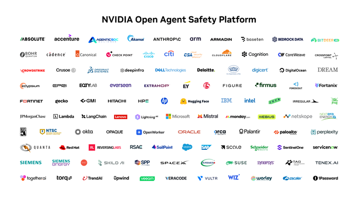

# 엔비디아가 영국 AI 안전 연구에 약속한 컴퓨팅, 얼마짜리일까?

_엔비디아가 10월 13일 약속한 2억 5,000만 달러는 영국 연구진이 5년간 쓸 컴퓨팅 사용권이고, 현금 지원은 없다_

## Executive Summary

> [!callout]
> 이 글은 AI 안전 연구에 모자란 것이 계산 능력일 때 생기는 일을 본다. 엔비디아가 2026년 10월 13일 영국의 에이전트 안전·보안 연구에 5년간 2억 5,000만 달러 규모의 컴퓨팅 자원을 내놓겠다고 발표했다. 현금을 건네는 대신 영국에 있는 엔비디아 클라우드 파트너의 인프라를 쓰게 해 준다. 옥스퍼드가 이끄는 BOLD와 UCL이 이끄는 SOFAIR, 임페리얼칼리지가 발표문에 이름을 올렸고, 나머지 물량은 영국의 안전 연구 공동체가 나눠 쓴다.

> 연 5,000만 달러꼴이지만 이 후원이 실제로 얼마짜리인지는 아직 아무도 모른다. 어느 회사의 어떤 하드웨어를 어떤 조건에 쓰게 할지가 정해지지 않았고, 컴퓨팅 후원의 값은 바로 그 조건이 정하기 때문이다. 영국 정부가 BOLD와 SOFAIR 두 연구소에 6년간 걸어 둔 공적 자금은 최대 6,000만 파운드에 수천만 파운드어치 컴퓨팅 접근권인데, 이번 후원을 파운드로 환산하면 그 현금 몫보다 크다.

> 여기까지는 엔비디아 발표문과 영국 정부 발표, 외신 보도에 실린 사실이다. 평가 비용을 누가 내느냐를 신용평가사 선례와 나란히 놓는 3절의 대목과 4절 전체는 이 글의 해석이다.

### 주요 수치

수치 넷을 뽑았다. 첫째는 이번에 발표된 후원 규모이고, 둘째는 같은 연구소들이 받는 공적 자금이다. 셋째는 그 컴퓨팅이 지나갈 수 있는 파트너와 엔비디아의 관계이고, 넷째는 아직 정해지지 않은 몫의 크기다.

출처: [엔비디아 발표문](https://nvidianews.nvidia.com/news/nvidia-commits-250-million-to-advance-uk-agentic-safety-and-security-research-over-the-next-five-years)(2026년 10월 13일), [영국 정부 발표](https://www.gov.uk/government/news/uk-backs-new-ai-labs-to-make-technology-cheaper-more-reliable-and-easier-to-use)(2026년 6월 23일), [시프티드](https://sifted.eu/articles/nvidia-to-invest-500m-in-uk-ai-factory-startup-nscale) 보도(2025년 9월).

<!-- stat-card -->
**2억 5,000만 달러** — 엔비디아가 5년간 내놓는 컴퓨팅 — 연 5,000만 달러꼴이다. 현금이 아니라 엔비디아 파트너사가 영국에서 운영하는 설비를 쓰는 권리다. 리절트센스는 이를 약 1억 8,900만 파운드, 해마다 3,800만 파운드로 환산했다

<!-- stat-card -->
**최대 6,000만 파운드** — 같은 두 연구소에 붙은 공적 자금 — 영국 연구혁신기구 산하 EPSRC가 2026년 6월 BOLD와 SOFAIR 두 곳을 합쳐 6년간 걸어 둔 현금이다. 수천만 파운드어치 컴퓨팅 접근권이 여기 따로 붙지만, 기업 한 곳이 내놓는 컴퓨팅이 그보다 크다

<!-- stat-card -->
**5억 파운드** — 엔비디아가 엔스케일에 넣은 지분 투자 — 2025년 9월이다. 엔스케일은 영국에 있는 엔비디아 클라우드 파트너여서, 이번 후원 컴퓨팅이 지나갈 수 있는 후보 가운데 하나다

<!-- stat-card -->
**3곳** — 발표문이 이름을 밝힌 연구기관 — 옥스퍼드 BOLD, UCL SOFAIR, 임페리얼칼리지다. 물량의 대부분은 '더 넓은 연구 공동체' 몫이라고만 돼 있고 배분 방식은 공개되지 않았다

## 발표문이 약속한 것과 비워 둔 것

엔비디아가 약속한 것은 5년간 2억 5,000만 달러어치의 가속 컴퓨팅이다. 해마다 5,000만 달러씩이고, 영국에 있는 엔비디아 클라우드 파트너가 운영하는 인프라에서 돌아간다. 데이터도 계산도 영국 안에 머문다는 뜻이다.

쓰임새도 못 박아 두었다. 연구 방향은 안전한 에이전트, 오픈 모델 보안, 현실 위협 완화 세 갈래다. 그 연구가 놓일 환경으로는 격리된 실험 공간과 재현 가능한 연구, 안전성 평가 벤치마크를 들었고, 엔비디아의 오픈셸(OpenShell)과 센트리(Sentry)를 함께 쓴다고 했다. 오픈셸은 개방형 보안 런타임 소프트웨어이고, 센트리는 에이전트를 감시하는 레퍼런스 설계다. 실험을 돌리는 환경과 그 실험을 들여다보는 장치를 한 회사가 같이 댄다는 뜻이다. 이 대목은 3절에서 다시 본다.

*▲ 발표문이 언급한 오픈셸·센트리가 속한 '엔비디아 오픈 에이전트 세이프티 플랫폼'의 참여 기업 목록 | 출처: [엔비디아 뉴스룸](https://nvidianews.nvidia.com/news/nvidia-commits-250-million-to-advance-uk-agentic-safety-and-security-research-over-the-next-five-years)*

받는 쪽으로 이름이 오른 곳은 세 군데다. 옥스퍼드가 주관하는 BOLD(British Open-ended Learning and Discovery)는 AI가 사람 곁에서 배우고 움직이는 방식을 다시 설계하는 연구소이고, UCL이 주관하는 SOFAIR(Science of Fundamental AI Research)는 흔한 하드웨어로 돌릴 수 있는 오픈소스 AI 구조를 찾는다. 임페리얼칼리지는 안전공학과 로보틱스를 맡는다. 앞의 두 곳은 2026년 6월 영국 연구혁신기구 산하 EPSRC가 6년간 최대 6,000만 파운드를 걸고 세운 국가 AI 연구소다. BOLD는 야코프 푀르스터 교수가, SOFAIR는 데이비드 바버 교수가 이끈다.

이름이 셋이라고 기관이 셋인 것은 아니다. 영국 정부 발표를 다시 보면 BOLD는 옥스퍼드가 이끌되 UCL과 임페리얼칼리지가 파트너 대학으로 들어가 있고, SOFAIR는 UCL이 이끌면서 케임브리지·옥스퍼드·에든버러가 함께한다. 발표문에 나란히 놓인 세 이름은 서로 겹치는 컨소시엄의 다른 단면이다. 나머지가 '더 넓은 공동체' 몫이라는 문장이 실제로 어디까지 넓어지는지도 이 컨소시엄 바깥을 어떻게 세느냐에 따라 달라진다.

"AI의 능력과 안전은 함께 나아가야 한다. 영국은 이 핵심적인 공학 과제에 세계 최고 수준의 과학적 엄밀함을 가져온다."

젠슨 황 엔비디아 창업자 겸 CEO, 2026년 10월 13일 발표문

영국 정부도 환영 논평을 냈다. 카니슈카 나라얀 AI 장관은 이번 약속을 영국의 AI 연구 역량에 대한 신임 투표라고 불렀고, 조너선 레이놀즈 기업부 장관은 영국 연구자들이 신뢰를 쌓는 돌파구를 앞당기는 데 도움이 될 것이라고 했다. 푀르스터 교수는 받은 컴퓨팅으로 투명하고 사람 중심인 AI 접근법을 탐색하겠다고 밝혔다.

임페리얼칼리지 AI 연구소를 이끄는 알레산드라 루소 교수의 말도 발표문에 실렸다. 안전과 보증을 이 변화의 한가운데 두어 영국이 피지컬 AI를 믿을 수 있게 만드는 일에 앞서도록 하겠다는 것이다. 나라얀 장관의 문장에도 'AI 연구, 특히 프런티어 AI 안전'이라는 단서가 붙어 있었다. 발표문은 이 컴퓨팅이 어디에 쓰이는 컴퓨팅인지를 꽤 좁혀 적어 두었다.

정해지지 않은 것도 발표문에 적혀 있다. 어느 공급사를 쓸지, 기술 구조를 어떻게 짤지, 상업 조건을 어떻게 맞출지가 모두 협의 단계다. 이 발표를 다룬 리절트센스는 그래서 실제로 전달되는 가치가 아직 보이지 않는다고 지적했고, 해마다 3,800만 파운드 가운데 이름이 오른 세 곳 밖의 연구 그룹에 얼마만큼, 또 얼마나 빨리 가 닿는지가 영국 연구자들에게 진짜 시험이 될 것이라고 덧붙였다.

## 컴퓨팅 후원은 현금 후원과 어디가 다른가

에이전트 안전 연구에서 가장 많이 드는 비용은 사람이 아니라 계산이다. 공격을 격리된 환경에서 재연해 보고, 설정을 바꿔 가며 같은 실험을 수백 번 돌리고, 모델이 어디서 무너지는지 벤치마크로 확인하는 일은 전부 GPU 시간으로 환산된다. 영국은 프런티어 모델을 직접 만드는 회사가 없는 대신 그 모델을 평가하는 자리를 노려 왔고, 평가에도 계산이 든다. 그러니 계산 능력을 내놓겠다는 제안은 영국이 가장 아쉬워하던 곳을 정확히 겨눈 셈이다.

그런데 같은 금액이라도 현금과 컴퓨팅은 성질이 다르다. 현금은 받는 쪽이 어디에 쓸지 정하지만, 컴퓨팅 사용권은 어디서 쓸지가 이미 정해져 있다. 값을 매기는 쪽도 다르다. 2억 5,000만 달러라는 숫자는 엔비디아 생태계의 가격표로 환산된 액수이고, 그 가격표를 쓰는 주체가 곧 후원자다. 리절트센스가 "컴퓨팅 기부는 현금 보조금이 아니며, 그 값은 하드웨어와 호스팅 조건에 달려 있다"고 짚은 이유가 여기 있다.

공급사는 아직 고르지 않았지만, 후보 명단은 이미 좁다. 엔비디아 클라우드 파트너로 등록된 업체 가운데 영국에서 대규모 데이터센터를 가진 곳은 엔스케일과 코어위브다. 엔비디아는 2025년 9월 엔스케일에 5억 파운드를 지분 투자하면서 그 회사가 영국 AI 인프라의 내셔널 챔피언이 될 수 있겠다고 말했고, 같은 주에 엔스케일·코어위브·마이크로소프트와 함께 최대 110억 파운드 규모의 영국 데이터센터 투자와 블랙웰 울트라 GPU 12만 장 배치 계획을 내놓았다.

*▲ 엔비디아가 2025년 9월 엔스케일 지분 투자와 함께 발표한 영국 AI 인프라 확장 계획에 쓰인 이미지 | 출처: [엔비디아 뉴스룸](https://nvidianews.nvidia.com/news/nvidia-and-united-kingdom-build-nations-ai-infrastructure-and-ecosystem-to-fuel-innovation-economic-growth-and-jobs)*

지분 관계는 그때 한 번으로 끝나지 않았다. 엔비디아는 엔스케일의 11억 달러 시리즈B에 이어 2026년 3월 20억 달러 시리즈C에도 들어갔고, 그 라운드에서 엔스케일의 기업가치는 146억 달러로 매겨졌다. 엔스케일은 이번 발표 한 달 전인 9월 뉴욕증권거래소 상장을 공개 신청해 최대 30억 달러를 모으겠다고 밝힌 상태다. 영국에서 이 후원 컴퓨팅을 받아 돌릴 후보 한 곳의 주주 명부에는 후원자의 이름이 계속 적혀 있다.

그래서 돈의 흐름을 따라가면 원이 그려진다. 엔비디아가 영국 안전 연구에 컴퓨팅을 내놓고, 그 컴퓨팅은 엔비디아가 칩을 팔고 지분을 가진 회사의 데이터센터에서 돌아가며, 후원 액수에 붙는 가격표도 엔비디아 것이다. 이것 자체가 잘못은 아니다. 하드웨어를 가진 쪽만이 하드웨어를 내놓을 수 있다. 다만 후원의 크기와 후원이 머무는 자리를 같은 회사가 쥐고 있다는 점은 기록해 둘 만하다.

> [!callout]
> 현금 보조금이라면 연구자는 공급사를 직접 고를 수 있고, 후원이 끝나도 장비나 인력이 남는다. 컴퓨팅 사용권은 기한이 끝나면 그 자리에서 사라진다. 5년이라는 숫자가 금액만큼이나 중요한 조건이다.

## 심판 비용을 누가 내는가

평가받는 쪽이 평가 비용을 대는 구도는 AI 업계가 이미 몇 해째 다투고 있는 문제다. 2026년 7월 29일 휴스턴대 로스쿨의 가브리엘 바일 조교수는 AI 개발사가 자기 심판을 고용하게 두지 말라는 글을 냈다. 정부가 인가한 민간 검증기관이 개발사의 안전 관리를 인증하는 구조가 여럿 제안되고 있는데, 그 구조에서는 개발사가 검증기관을 고르고 비용도 낸다. 그러면 검증기관이 관대해진다는 것이 바일의 경고다. 2008년 금융위기 직전 신용평가사가 평가 대상인 발행사에게 수수료를 받던 구조와 같다는 것이다. 그가 내놓은 대안은 책임보험이다. 보험료를 낮게 매긴 보험사는 사고가 났을 때 보험금으로 물어내고, 높게 매긴 보험사는 고객을 잃는다. 양쪽으로 손해가 걸려 있어야 값이 정확해진다는 논리다.

이 걱정은 이미 현실에 자리를 잡았다. AI 기업의 위험 관리에 등급을 매기는 비영리 세이퍼AI(SaferAI)의 주 후원자는 스카이프 공동창업자 얀 탈린인데, 그는 2021년 앤트로픽의 시리즈A 1억 2,400만 달러를 이끌었고 지금도 앤트로픽 이사회에 옵저버로 참여한다. 앤트로픽 소속 연구원이 세이퍼AI 자문위원으로 평가 방법론에 조언하기도 한다. 그런데 세이퍼AI는 이해상충 공시 정책을 따로 공개하지 않는다. 제약업계였다면 공시 의무가 걸렸을 관계라는 지적이 나온 배경이다.

초점은 세이퍼AI가 매긴 등급의 내용보다 그것이 놓인 자리에 있다. 비판한 쪽도 문제는 결과물이 아니라 배치라고 선을 그었다. 누가 부정직했느냐를 따지는 것이 아니라, 바깥에서 결과를 검증할 길을 좁히는 관계가 놓여 있느냐를 묻는 것이다. 이 구분을 놓치면 남는 것은 의심뿐이고, 의심은 공시 규칙을 만들지 못한다.

퓨 자선기금을 비롯해 기존 후원망 바깥의 재단으로 자금을 다변화한 METR도 구조에서 자유롭지는 않다. 평가를 하려면 모델에 접근해야 하는데, 접근 권한을 쥔 쪽이 평가 대상이다. 어느 회사도 외부 기관에 자기 모델을 열어 줄 법적 의무가 없으니, 비판적인 결과가 다음 접근을 어렵게 만들 수 있다는 긴장이 남는다.

| 사례 | 평가하는 쪽이 받는 것 | 남는 긴장 |
| --- | --- | --- |
| 세이퍼AI | 평가 대상에 투자한 인물의 자금 | 공시 정책이 공개돼 있지 않아 관계를 외부에서 확인할 길이 좁다 |
| METR | 평가 대상이 열어 주는 모델 접근권 | 자금을 끊어도 접근을 끊으면 평가가 멈춘다 |
| 영국 안전 연구 + 엔비디아 | 평가에 쓰일 계산 자원과 런타임·감시 설계 | 계약 조건이 미정이라 발표 제한이나 중단 사유에 어떤 문구가 들어갈지 알 수 없다 |

엔비디아의 자리는 앞의 두 사례와 조금 다르다. 엔비디아는 프런티어 모델을 만드는 회사가 아니고, 영국 연구자들이 평가할 대상 대부분을 직접 내놓지 않는다. 그 대신 평가가 돌아가는 바닥을 만든다. 발표문이 연구 기반으로 내건 오픈셸 런타임과 센트리 감시 설계가 모두 엔비디아의 것이다. 안전 연구가 한 회사의 런타임과 감시 설계 위에서 수행되면 그 설계를 벗어난 구성에서 생기는 문제는 상대적으로 덜 측정된다. 보안 연구에서 어떤 환경을 기본값으로 두느냐는 결과의 범위를 정하는 선택이다.

> [!callout]
> 지금 빠져 있는 것은 돈이 아니라 공시 규칙이다. 연구자가 어떤 조건으로 컴퓨팅을 받는지, 결과 발표에 사전 검토가 붙는지, 후원이 중단될 수 있는 사유가 무엇인지는 아직 협의 중인 계약 조건 안에 있다. 조건이 정해지지 않았다는 말은 지금이라면 그 규칙을 써 넣을 수 있다는 말이기도 하다.

## 페블러스가 이 후원을 주목하는 이유

안전 평가는 결론 아래에 기록을 깔아 둔다. 공격 시도 기록, 모델이 무너진 지점, 실패한 응답, 벤치마크를 돌린 원본 로그가 함께 쌓인다. 이 기록은 다음 평가의 재료이고 어떤 면에서는 평가 결과보다 오래 쓰인다. 평가 인프라를 누가 소유하느냐는 질문이 데이터 문제가 되는 지점이 여기다. 그 기록이 어느 클라우드에 남고, 누구의 약관 아래 보관되며, 연구가 끝난 뒤 누가 가져가는지는 지금 협의 중인 계약서가 정한다.

재현 가능성도 거기서 갈린다. 발표문은 재현 가능한 연구를 후원의 목적 가운데 하나로 들었다. 재현은 다른 연구자가 같은 환경을 다시 구할 수 있을 때 성립하는데, 후원받은 컴퓨팅에서만 돌아가는 벤치마크는 후원이 끝나는 순간 재현이 끊긴다. 환경 자체를 기술해 두지 않으면 5년 뒤에 남는 것은 숫자뿐이다.

AI가 쓸 수 있게 데이터를 준비한다고 할 때 보통 떠올리는 일은 정제와 라벨링이다. 안전 평가가 낳는 기록에도 같은 요구가 걸린다. 누가 어떤 환경에서 만들었고, 어떤 조건으로 다시 쓸 수 있으며, 어디에 보관되는지가 데이터 옆에 적혀 있어야 다음 사람이 이어받는다. 출처와 이용 조건을 본문과 함께 보관하지 않으면 나중에 복원할 길이 없다는 사정은 학습 데이터 쪽에서 이미 오래 겪은 일이다.

남는 질문도 있다. 영국이 AI 평가의 중심이 되겠다는 구상은 공적 예산만으로는 속도가 나지 않았다. 민간 컴퓨팅이 그 간격을 메우는 흐름은 영국만의 일도 아니다. 그렇다면 후원자가 평가 대상과 겹치는 정도를 어디까지 허용할지, 그 선을 누가 그을지가 다음 질문이 된다. 돈을 거절하기 어렵다면 조건을 공개하는 쪽이 답에 가깝다.

여기까지 읽어 주셔서 감사하다. 발표 원문은 [엔비디아 뉴스룸](https://nvidianews.nvidia.com/news/nvidia-commits-250-million-to-advance-uk-agentic-safety-and-security-research-over-the-next-five-years)에서, 두 국가 AI 연구소의 설립 내용은 [영국 정부 발표](https://www.gov.uk/government/news/uk-backs-new-ai-labs-to-make-technology-cheaper-more-reliable-and-easier-to-use)에서 더 볼 수 있다. 여러분의 팀이 외부 인프라에서 돌리는 평가에는 그 결과물을 누가 보관하고 다시 쓸 수 있는지가 적혀 있는가? 의견을 나눠 주시면 좋겠다.

## 참고문헌

### 발표 원문·공식 자료

- 1.NVIDIA. (2026). "[NVIDIA Commits $250 Million to Advance UK Agentic Safety and Security Research Over the Next Five Years](https://nvidianews.nvidia.com/news/nvidia-commits-250-million-to-advance-uk-agentic-safety-and-security-research-over-the-next-five-years)." NVIDIA Newsroom.
- 2.GOV.UK. (2026). "[UK backs new AI labs to make technology cheaper, more reliable and easier to use](https://www.gov.uk/government/news/uk-backs-new-ai-labs-to-make-technology-cheaper-more-reliable-and-easier-to-use)." Department for Science, Innovation and Technology.
- 3.NVIDIA. (2025). "[NVIDIA and United Kingdom Build Nation's AI Infrastructure and Ecosystem to Fuel Innovation, Economic Growth and Jobs](https://nvidianews.nvidia.com/news/nvidia-and-united-kingdom-build-nations-ai-infrastructure-and-ecosystem-to-fuel-innovation-economic-growth-and-jobs)." NVIDIA Newsroom.

### 보도

- 4.ResultSense. (2026). "[Nvidia pledges $250m of UK compute for agentic safety research](https://www.resultsense.com/news/2026-10-14-nvidia-uk-agentic-safety-compute-pledge/)."
- 5.Global Banking & Finance Review. (2026). "[Nvidia pledges $250 million to boost UK AI safety research](https://www.globalbankingandfinance.com/nvidia-pledges-250-million-boost-uk-ai-safety-research/)."
- 6.Sifted. (2025). "[Nvidia to invest £500m in UK AI factory startup Nscale](https://sifted.eu/articles/nvidia-to-invest-500m-in-uk-ai-factory-startup-nscale)."
- 7.CNBC. (2026). "[Nvidia backs AI data center startup Nscale as it hits $14.6 billion valuation](https://www.cnbc.com/2026/03/09/nscale-ai-data-center-nvidia-raise.html)."
- 8.Bloomberg. (2026). "[Nvidia-Backed Data Center Firm Nscale Files Publicly for US IPO](https://finance.yahoo.com/technology/ai/articles/nvidia-backed-data-center-firm-195220456.html)." Yahoo Finance.

### 평가 독립성 논의

- 9.Weil, Gabriel. (2026). "[Don't Let AI Developers Hire Their Own Referees](https://ai-frontiers.org/articles/dont-let-ai-developers-hire-their-own-referees)." AI Frontiers.
- 10.Inside The Black Box. (2026). "[Who Funds the Watchdogs?](https://itbb.substack.com/p/who-funds-the-watchdogs)"
