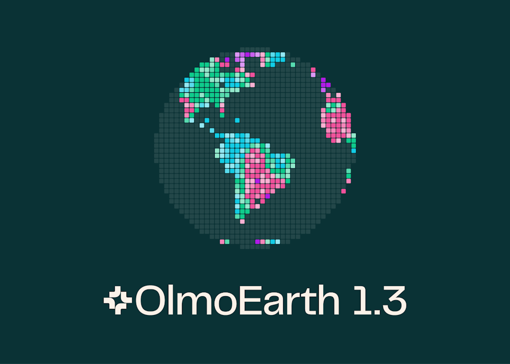

# OlmoEarth, 지구 전체 위성 사진을 숫자로 바꿔 둔다

_앨런 AI 연구소가 지구 전체 위성 자료를 미리 분석해 무료 공개 — 성능 시험 27개 중 20개에서 구글 자료를 제치고 1위_

## Executive Summary

> [!callout]
> 이 글은 앨런 AI 연구소(Ai2)가 2026년 10월 22일 공개한 OlmoEarth v1.3을 읽는다. 연구소가 내놓은 것은 모델만이 아니다. 레이더와 다분광 위성이 1년 동안 찍은 관측을 10미터 칸마다 숫자 128개로 요약해 두고, 그 요약을 지구 전체 분량으로 미리 계산해 내려받을 수 있게 풀었다. 위성 사진을 받아 모델을 돌리는 일이 이미 끝나 있는 상태로 배포된 셈이다.

> 여섯 대륙에서 진행한 27개 평가 가운데 128차원판이 20개, 가벼운 64차원판이 18개에서 1위였다. 비교 대상은 구글의 AlphaEarth Foundations와 Tessera v2였다. 다만 지구 전체가 채워진 해는 2023년부터 2025년까지이고, 2017년부터 2022년까지는 일부 국가만 있다.

> 1절부터 4절까지는 연구소의 발표문과 외부 보도에 적힌 내용을 따라간다. 이 공개를 데이터를 미리 손질하는 판단에 겹쳐 읽는 5절은 이 글의 해석이다.

### 주요 수치

앞의 둘은 이 공개가 무엇을 손에 쥐여 주는지를, 뒤의 둘은 그것을 만드는 데 든 값과 아직 비어 있는 자리를 말한다.

출처: [Ai2 공식 발표문](https://allenai.org/blog/olmoearth-v1-3) · [Unite.ai](https://www.unite.ai/ai2-releases-olmoearth-v1-3-with-global-10m-satellite-embeddings/) (2026년 10월 22일)

<!-- stat-card -->
**128개** — 10미터 칸 하나의 숫자 — 위성 관측 1년치가 이만큼으로 줄어든다. 앞의 64개만 떼어 써도 된다

<!-- stat-card -->
**20 / 27** — 1위를 차지한 평가 수 — 여섯 대륙 27개 평가에서 128차원판 기준. 64차원판은 18개에서 앞섰다

<!-- stat-card -->
**53%** — 직전 판 대비 학습 시간 — v1.2의 53%, 첫 판 v1의 18%. 마지막 학습을 다시 돌리는 값은 H100 임대 기준 약 2,720달러다

<!-- stat-card -->
**2017~2022** — 지구 전체가 아닌 구간 — 이 구간은 일부 국가만 있다. 전 지구가 채워진 해는 2023~2025년이다

## 10미터 칸 하나에 숫자 128개

지구를 찍은 위성 사진은 이미 넘칠 만큼 공개돼 있다. 유럽우주국의 센티널 위성과 미국의 랜드샛 위성이 같은 자리를 며칠에 한 번씩 지나가며 수십 년째 쌓아 왔고, 누구나 받을 수 있다. 문제는 받은 다음이다. 한 나라 넓이의 원본 영상만 해도 수 테라바이트이고, 거기서 무엇인가를 찾아내려면 그 영상을 통째로 읽는 모델을 돌려야 한다. 그래서 지금까지는 저장 공간과 GPU를 갖춘 쪽만 질문을 던질 수 있었다.

OlmoEarth v1.3이 바꾼 지점은 그 앞 단계다. 연구소는 레이더로 찍는 센티널-1과 색을 여러 갈래로 나눠 찍는 센티널-2·랜드샛의 1년치 관측을 모델에 먼저 통과시켜 두고, 10미터짜리 칸 하나마다 숫자 128개를 뽑아 놨다. 이 숫자 묶음을 임베딩이라 부른다. 그 자리가 어떤 곳인지를 모델이 요약해 적은 지문에 가깝다. 색과 질감과 계절에 따른 변화가 한꺼번에 눌려 들어가 있어서, 사람이 읽을 수는 없지만 기계끼리 비교하기에는 원본 사진보다 훨씬 편하다.

*▲ 지구 전체를 10미터 칸으로 나눠 숫자로 바꿔 둔다는 발상을 그대로 로고에 담았다 | Source: [Ai2 공식 발표문](https://allenai.org/blog/olmoearth-v1-3)*
