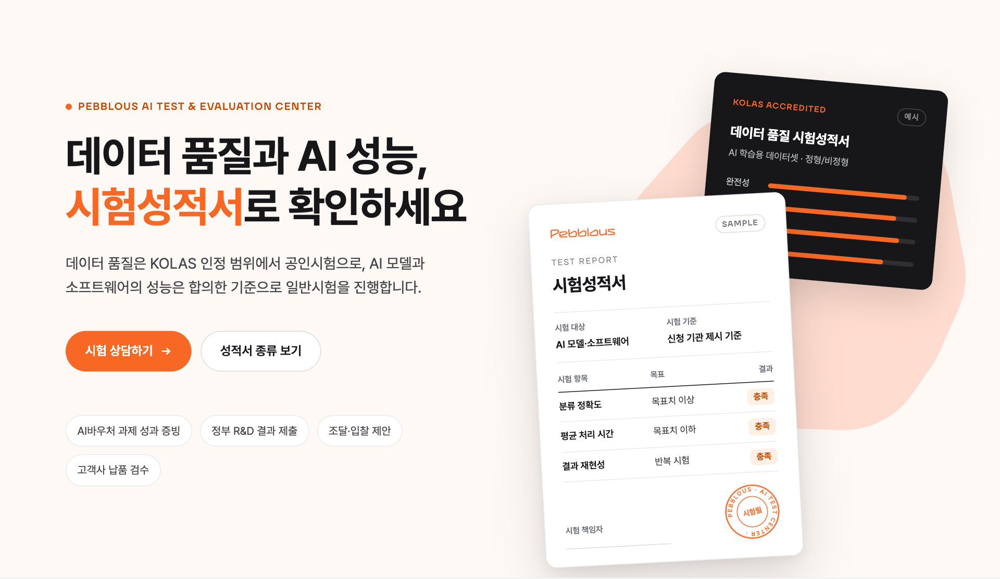
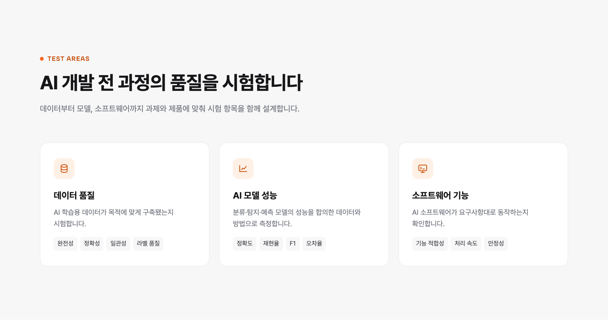
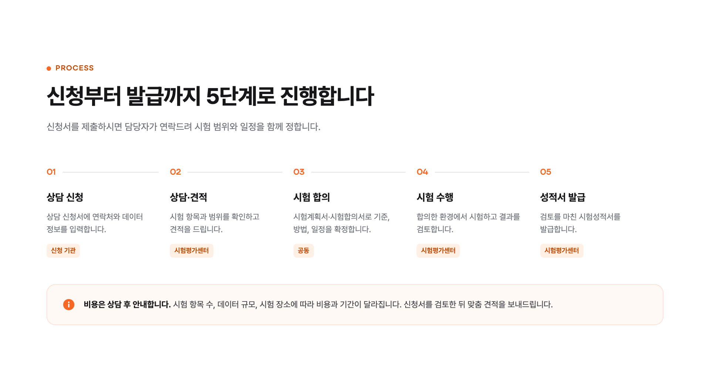

# 페블러스 AI 시험평가센터 개설… AI 학습 데이터 품질 KOLAS 공인시험성적서 발급

_공인시험은 ISO/IEC 5259-2와 25024 기준으로 데이터셋을, 일반시험은 신청 기관이 정한 기준으로 모델을 시험한다_

## Executive Summary

> [!callout]
> 페블러스가 데이터 품질을 국제표준으로 시험해 성적서를 내주는 AI 시험평가센터를 열었다. 근거는 2026년 9월 한국인정기구(KOLAS)가 내준 공인시험기관 인정으로, 인정번호 KT1362의 유효기간은 2030년 9월까지다. 센터는 두 가지 성적서를 발급한다. KOLAS 공인시험성적서는 ISO/IEC 5259-2와 ISO/IEC 25024에 따라 데이터셋을 시험한 결과를 담고, 일반시험성적서는 신청 기관이 정한 항목과 방법으로 AI 모델과 소프트웨어를 시험한 비공인 문서다. 공인시험은 인정 범위 안의 항목에만 적용되므로 어느 쪽이 필요한지는 제출처의 요구가 정한다.

페블러스가 AI 시험평가센터를 열고 AI 학습 데이터의 품질을 시험해 성적서를 발급하는 사업에 나섰다. 페블러스는 2026년 9월 한국인정기구(KOLAS)로부터 ISO/IEC 5259-2:2024와 ISO/IEC 25024:2015 기준의 데이터 품질 공인시험기관으로 인정받았다. 인정번호는 KT1362이고 유효기간은 2030년 9월까지다.

센터가 발급하는 성적서는 두 종류다. KOLAS 공인시험성적서는 위 두 국제표준에 따라 데이터 품질을 시험한 결과를 담는다. 일반시험성적서는 신청 기관이 정한 항목과 방법으로 AI 모델과 소프트웨어를 시험한 결과를 담는 비공인 성적서이며, KOLAS 인정 범위 밖이다. 상담과 신청은 [페블러스 AI 시험평가센터](https://pebblous.ai/ai-test-center)에서 받는다.

[https://pebblous.ai/ai-test-center](https://pebblous.ai/ai-test-center)

*페블러스 AI 시험평가센터 페이지 첫 화면. 성적서 그림은 예시다. [센터 페이지 열기](https://pebblous.ai/ai-test-center)*

## 데이터 품질에 제3자의 증빙이 필요한 자리

AI 모델의 성능은 학습 데이터에 크게 좌우된다. 그런데 데이터를 만든 쪽이 품질이 좋다고 말하는 것만으로는 발주처나 심사기관을 설득하기 어렵다. 공공 데이터 구축 사업의 납품 검수, 정부 연구개발 과제의 최종 평가, 조달 제안 같은 자리에서는 제3자가 발급한 증빙이 힘을 갖는다.

이주행 페블러스 대표는 인정 발표에서 이번 인정으로 데이터 품질을 국제표준에 따라 측정하고 국가가 인정하는 성적서로 보여 줄 수 있게 됐다고 밝혔다. AI 시험평가센터는 그 시험 업무를 맡는 조직이다.

## 인정, 시험, 인증은 서로 다른 말이다

성적서를 고르기 전에 세 낱말을 구분해 둘 필요가 있다.

| 구분 | 하는 곳 | 뜻 |
| --- | --- | --- |
| 인정 | KOLAS | 시험기관이 ISO/IEC 17025 요구사항을 갖추고 정해진 범위의 시험을 수행할 능력이 있는지 평가해 공인한다 |
| 시험 | 페블러스 AI 시험평가센터 | 합의한 표준과 절차로 대상을 측정하고 결과를 성적서로 발급한다 |
| 인증 | 별도의 인증기관 | 제품이나 서비스, 체계가 기준에 맞는지 판정해 인증서를 준다 |

KOLAS의 인정은 시험기관의 능력을 공인하는 제도다. 특정 제품이나 데이터셋의 품질을 KOLAS가 보증한다는 뜻이 아니다. 페블러스가 발급하는 문서도 인증서가 아니라 시험성적서이며, 의뢰받은 대상을 측정한 결과를 기록한다.

합격과 불합격도 저절로 정해지지 않는다. ISO/IEC 5259-2는 품질을 재는 방법을 정할 뿐 합격선을 정하지 않는다. 성적서에 적합 여부를 적으려면 판정 기준을 신청 단계에서 합의해야 한다.

## 어떤 표준으로 시험하나

공인시험의 기준은 두 국제표준이다.

| 표준 | 다루는 대상 | 측정하는 것 |
| --- | --- | --- |
| ISO/IEC 5259-2:2024 | 분석과 머신러닝에 쓰는 데이터 | 정확성·완전성·일관성 같은 기본 특성과 균형·다양성·대표성·유사성처럼 AI 학습에 중요한 특성 |
| ISO/IEC 25024:2015 | 정형 데이터 | 데이터 품질 모델에 따른 측정 항목 |

5259-2가 정의한 [24개 품질 특성과 측정 기준](/project/ISO5259/5259-2-cheetsheet-01/ko/)은 페블러스 블로그의 요약표에서 볼 수 있다. 인정 범위는 5259-2의 품질 특성군과 25024의 측정 항목군이다. 인정번호와 유효기간, 인정서 사본은 [KOLAS 공인기관 검색](https://www.knab.go.kr/usr/inf/srh/InfoTestInsttSearchList.do?searchCompany=%ED%8E%98%EB%B8%94%EB%9F%AC%EC%8A%A4)에서 직접 확인할 수 있다. 의뢰 건마다 공인시험을 적용할 수 있는지는 시험 방법과 지표 산식을 검토해 확정한다.

## 두 성적서는 쓰임이 다르다

| 구분 | KOLAS 공인시험성적서 | 일반시험성적서 |
| --- | --- | --- |
| 성격 | KOLAS 인정 범위 안의 공인시험 | 비공인 시험, KOLAS 인정 범위 밖 |
| 시험 기준 | ISO/IEC 5259-2, ISO/IEC 25024 | 신청 기관이 정한 기준과 방법 |
| 시험 대상 | AI 학습용 정형·비정형 데이터셋 | AI 모델·소프트웨어, 데이터 처리 시스템 |
| 주요 측정 | 완전성·정확성·일관성 등 데이터 품질 | 정확도·처리 속도·재현성 등 기능과 성능 |
| 시험 장소 | 페블러스 세종 시험사업장 | 협의에 따라 신청 기관 현장 또는 원격 |
| KOLAS 공인 표시 | 있음 | 없음 |
| 주된 쓰임 | 공공 데이터 구축 사업 납품, 대외 공식 제출 | 과제 정량목표 증빙, 내부 검증 |

고르는 기준은 제출처의 요구다. 제출처가 공인시험기관의 성적서를 요구하면 KOLAS 공인시험성적서가 필요하다. 다만 공인시험은 인정 범위 안의 항목에만 적용된다. 모델 성능이나 응답 속도처럼 범위 밖 항목은 일반시험으로 다루고 성적서도 따로 발급한다. 과제 협약이 모든 지표에 공인 성적서를 요구한다면, 일반시험성적서를 제출해도 되는지 과제 담당기관에 먼저 확인해야 한다.

[https://pebblous.ai/ai-test-center#fields](https://pebblous.ai/ai-test-center#fields)

*센터의 시험 분야. 데이터 품질은 KOLAS 인정 범위 안에서 공인시험으로, AI 모델 성능과 소프트웨어 기능은 일반시험으로 다룬다. [시험 분야 보기](https://pebblous.ai/ai-test-center#fields)*

## 성적서가 필요한 네 가지 경우

- **데이터 구축 사업:** 납품하는 데이터셋의 품질을 KOLAS 공인시험성적서로 증빙한다.
- **정부 연구개발 과제:** 최종 평가에서 성능 목표를 달성했는지 시험 결과로 제출한다.
- **AI 바우처 사업:** 수요기업과 합의한 정량목표의 달성 여부를 증빙한다.
- **조달과 납품:** 제안하거나 납품하는 제품의 성능을 객관적인 자료로 보여 준다.

## 신청부터 발급까지 다섯 단계

1. **상담 신청:** 상담 신청서에 연락처와 데이터 정보를 적는다.
2. **상담과 견적:** 시험 항목과 범위를 확인하고 견적을 받는다.
3. **시험 합의:** 시험계획서와 시험합의서로 기준, 방법, 일정을 확정한다.
4. **시험 수행:** 합의한 환경에서 시험하고 결과를 검토한다.
5. **성적서 발급:** 검토를 마친 시험성적서를 발급한다.

[https://pebblous.ai/ai-test-center#process](https://pebblous.ai/ai-test-center#process)

*센터 페이지의 진행 절차. 단계마다 신청 기관과 시험평가센터의 몫이 나뉜다. [진행 절차 보기](https://pebblous.ai/ai-test-center#process)*

신청서만 내도 접수된다. 시험항목 정의서, 정량목표 문서, 제품 매뉴얼, 시험환경 구성도가 있으면 상담이 빨라진다. 비용과 기간은 시험 항목 수, 데이터 규모, 시험 장소에 따라 달라지므로 신청서를 검토한 뒤 안내한다.

AI 시험평가센터는 대전에 있고, KOLAS 공인시험은 세종 시험사업장에서 수행한다. 신청 기관의 현장에서 시험하는 방식은 일반시험성적서에만 적용된다.

## 시험은 솔루션과 분리해 진행한다

페블러스는 데이터 품질을 진단하고 개선하는 솔루션 데이터 클리닉도 공급한다. 같은 회사가 솔루션과 시험을 함께 다루는 만큼 공평성이 중요하다. 시험성적서 발급은 이 솔루션과 분리된 독립 시험으로 진행한다.

ISO/IEC 17025는 시험기관에 공평성과 결과의 유효성을 요구한다. 시험 결과는 객관적 증거에 근거해야 하며, 시험을 의뢰했다고 해서 목표값 달성이 보장되지는 않는다.

## 국제 통용의 뜻과 한계

KOLAS는 국제시험기관인정협력체(ILAC)의 상호인정협정(MRA)에 서명한 인정기구다. [ILAC MRA](https://ilac.org/ilac-mra-and-signatories/)의 서명 기구들은 서로가 인정한 기관의 결과를 받아들이기로 합의했다. 그래서 페블러스의 공인시험성적서는 협정 가입국 사이에서 통용될 수 있다.

이 효력이 모든 규제 절차를 대신하는 것은 아니다. 특정 국가의 규제나 조달 절차가 어떤 성적서를 받아들이는지는 그 절차의 규정이 정한다. 유럽연합 규제를 예로 들면 시험기관의 인정과 피통보기관의 지정은 별개의 제도이며, 그 차이는 [국내 데이터 품질 성적서가 유럽에서 만나는 세 관문](/report/korea-robot-training-center-evidence-chain/ko/)에서 따로 다뤘다. 공인시험성적서는 기술문서의 근거 자료가 될 수 있지만 적합성평가를 대신하지는 않는다.

## 신청 전에 확인할 다섯 가지

### 어떤 성적서를 신청해야 하나?

제출처가 공인 성적서를 요구하거나 데이터 품질을 공식적으로 증빙해야 하면 KOLAS 공인시험성적서를 신청한다. 직접 정한 기준으로 모델이나 소프트웨어의 성능을 확인하려면 일반시험성적서가 맞다. 판단이 어려우면 신청서에 상황을 적으면 상담 때 안내한다.

### 일반시험성적서도 공인 성적서로 쓸 수 있나?

쓸 수 없다. 일반시험성적서는 KOLAS 인정 범위 밖의 비공인 성적서이며 KOLAS 공인 표시가 없다.

### 페블러스 성적서를 받으면 데이터 품질 인증을 받은 것인가?

아니다. 시험성적서는 측정 결과를 기록한 문서이고, 페블러스는 인증기관이 아니라 공인시험기관이다.

### 현장 시험도 가능한가?

일반시험성적서는 가능하다. 시험 대상 시스템을 옮기기 어려우면 신청 기관 현장에서 시험한다. KOLAS 공인시험은 세종 시험사업장에서 수행하므로 현장 시험을 하지 않는다.

### 비용과 기간은 어떻게 되나?

시험 항목 수, 데이터 규모, 시험 장소에 따라 달라진다. 제출 기한이 있으면 신청서의 문의 내용에 적으면 일정에 반영한다.

## 상담 신청

시험 범위와 견적 상담은 [페블러스 AI 시험평가센터](https://pebblous.ai/ai-test-center)에서 신청할 수 있다. 문의는 contact@pebblous.ai 로 받는다.

## 참고 자료

- [페블러스 AI 시험평가센터](https://pebblous.ai/ai-test-center)
- [페블러스, AI 학습데이터 품질 국제표준 KOLAS 공인시험기관 인증, 뉴스와이어(2026-09-23)](https://www.newswire.co.kr/newsRead.php?no=1043252)
- [ISO/IEC 5259-2:2024, Data quality measures](https://www.iso.org/standard/81860.html)
- [ISO/IEC 25024:2015, Measurement of data quality](https://www.iso.org/standard/35749.html)
- [ISO/IEC 17025:2017, General requirements for the competence of testing and calibration laboratories](https://www.iso.org/standard/66912.html)
- [ILAC MRA and Signatories](https://ilac.org/ilac-mra-and-signatories/)
- [ISO/IEC 5259 시리즈 허브](/project/ISO5259/ko/)
