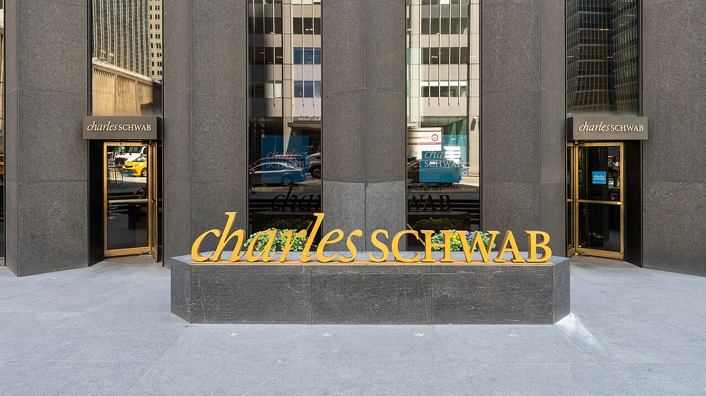

# 찰스 슈왑은 내 계좌에 들어오는 AI 비서를 막는다

_슈왑이 고객 비밀번호를 받아 대신 로그인하는 외부 AI 비서를 막기로 했고, 나흘 사이 미국 은행 네 곳이 같은 선을 그었다_

## Executive Summary

> [!callout]
> 10월 15일 찰스 슈왑 3분기 실적 발표에서 최고경영자 릭 워스터가 외부 AI 비서의 계좌 로그인을 허용하지 않겠다고 말했다. 고객에게서 아이디와 비밀번호를 받아 브라우저를 대신 조작해 들어오는 방식을 두고 한 말이다. 같은 주에 JP모건·뱅크오브아메리카·씨티도 비슷한 방침을 내놨고, 웰스파고는 차단 대신 약관을 고쳤다. 이 글은 나흘 사이에 벌어진 그 결정들이 각각 무엇을 막고 무엇을 열어 두었는지 본다.

> 은행들이 앞세운 이유는 책임 소재다. 사고가 나면 누가 물어내느냐는 것이다. 다만 같은 보도에 다른 숫자가 함께 실렸다. JP모건·뱅크오브아메리카·웰스파고가 들고 있는 무이자 예금이 1조 6천억 달러인데, 이 돈이 AI 비서의 손에 이끌려 이자를 주는 상품으로 옮겨 가면 세 은행이 매년 더 내야 할 돈이 470억 달러로 추산된다. 슈왑은 완전히 문을 잠그지도 않았다. 잔고 조회와 리서치는 열고 송금은 막는 연결 통로를 따로 준비하고 있다.

> 4절까지는 실적 발표와 보도에 적힌 사실을 따라간다. 그 결정을 데이터 접근권의 문제로 옮겨 읽는 5절은 이 글의 해석이다.

### 주요 수치

출처: 슈왑 3분기 실적 발표와 [아메리칸 뱅커](https://www.americanbanker.com/news/schwab-blocks-unauthorized-ai-agents-points-clients-to-charley), [온인베스트](https://en.oninvest.com/article/citi-and-bofa-block-ai-agents-from-client-accounts-amid-fears-of-deposit-outflows) 보도.

<!-- stat-card -->
**열 몇~스무 몇 건** — 슈왑이 한 주에 막는 외부 AI 비서 로그인 — 워스터가 주간 보고로 받아 보는 수다. 큰 에이전트만 센 것이다

<!-- stat-card -->
**4,928억 달러** — 9월 말 슈왑 고객의 대기성 예수금 — 3분기 순이자수익 35억 달러가 주로 여기서 나왔다

<!-- stat-card -->
**1조 6천억 달러** — 세 은행이 이자를 주지 않고 받아 둔 예금 — JP모건·뱅크오브아메리카·웰스파고 합산으로, 세 곳 부채의 16%다

<!-- stat-card -->
**470억 달러** — 그 예금에 연 3% 이자가 붙을 때 세 은행의 연간 부담 — 아폴로 수석이코노미스트 토르스텐 슬록의 추산이다

## 슈왑이 막는 것은 로그인 방식이다

찰스 슈왑은 미국의 대형 증권사다. 개인이 주식을 사고팔고 은퇴자금을 굴리는 계좌를 수천만 개 들고 있고, 9월 말 기준 고객이 당장 투자하지 않고 계좌에 묶어 둔 대기성 예수금만 4,928억 달러다. 10월 15일 3분기 실적 발표에서 최고경영자 릭 워스터가 그 계좌에 관한 방침을 하나 말했다.

*▲ 찰스 슈왑 뉴욕 사무소 입구 | Source: [Wikimedia Commons (Ajay Suresh, CC BY 4.0)](https://commons.wikimedia.org/wiki/File:Charles_Schwab_Corporation_(55283756063).jpg)*

워스터의 문장은 조건이 분명하다. 고객에게 AI를 안전하게 전해 주고 싶지만 안전하지 않다고 보는 방식이 하나 있고, 에이전트가 사이트에 찾아와 고객을 대신해 로그인하려는 것이 그 방식이다. 그건 허용하지 않겠다고 했다. 막는 대상이 AI 자체가 아니라 들어오는 방식이라는 점이 여기서 갈린다. 고객이 자기 아이디와 비밀번호를 외부 프로그램에 넘기고, 그 프로그램이 사람인 척 화면을 조작해 들어오는 경로가 차단 대상이다.

다음 날 블룸버그 텔레비전 인터뷰에서 워스터가 규모를 덧붙였다. 차단 건수를 주간 보고로 받아 보는데, 큰 에이전트 기준으로 한 주에 열 몇 건에서 스무 몇 건 수준이라고 했다. 수백 건도 수천 건도 아니다. 워스터는 이 수를 이렇게 읽었다. 사람들이 AI를 좋아하기는 하지만 아직 자기 금융 계좌를 통째로 넘길 생각은 없다는 뜻이다.

차단하는 쪽의 논리는 워스터가 든 예 하나에 다 들어 있다. 메타의 개인용 AI 비서 뮤즈다. 고객이 뮤즈에게 비밀번호를 건네고 대신 움직이게 하는 상황을 두고, 우리도 통제할 수 없고 고객도 통제할 수 없는데 뭔가 잘못되면 누가 책임지느냐고 물었다. 고객을 보호하기 위해서도, 슈왑 자신을 보호하기 위해서도 허용하지 않는다는 말이 뒤에 붙었다.

> [!callout]
> 여기서 막히는 것은 권한이 아니라 신원이다. 고객의 자격증명을 빌려 들어온 프로그램은 기록에 고객 본인으로 남는다. 사고가 난 뒤 그 접속이 사람이었는지 프로그램이었는지 기록만으로는 알 수 없고, 알 수 없으면 책임을 나눌 방법도 없다.

## 나흘 사이에 다섯 은행이 선을 그었다

슈왑만의 결정이 아니었다. 미국 대형 금융사의 3분기 실적 발표가 몰린 10월 13일부터 16일까지 나흘 동안, 다섯 곳이 외부 AI 에이전트를 어떻게 대할지 차례로 밝혔다. 같은 질문에 답했지만 답의 모양은 서로 달랐다.

| 시점 | 누가, 어디서 | 무엇을 정했나 |
| --- | --- | --- |
| 10월 13일 | JP모건 제이미 다이먼, 실적 발표 | 외부 에이전트를 자사 시스템 안에 들이지 않겠다고 했다. "통제를 벗어난 에이전트는 원치 않는다. 그런 게 수천 개가 될 수도 있다." 현재 제3자 도구에는 계좌 조회만 열어 두고 송금과 청구서 납부는 막아 두고 있다 |
| 10월 14일 | 뱅크오브아메리카 브라이언 모이니핸, 실적 발표 | "계좌에서 돈이 나가는 것을 승인하는 자리에는 반드시 사람이 있어야 한다고 우리는 굳게 믿는다." 전면 차단보다는 사람의 승인을 조건으로 거는 쪽이다 |
| 10월 15일 | 찰스 슈왑 릭 워스터, 실적 발표 | 고객을 대신한 에이전트의 로그인을 허용하지 않는다. 다음 날 블룸버그 인터뷰에서 주당 차단 건수와 별도 연결 통로 계획을 밝혔다 |
| 10월 16일 | 씨티그룹, 파이낸셜타임스에 밝힌 입장 | 에이전트가 "고객 계좌에 로그인하거나 직접 거래하는 것"을 허용하지 않는다 |
| 11월 24일 시행 | 웰스파고, 온라인 이용약관 개정 | 차단하겠다고 하지 않았다. 대신 제3자 AI 도구로 들어온 요청을 "고객 본인이 직접 보낸 것처럼" 처리할 수 있다고 약관에 적고, 그 도구를 관리할 책임을 고객에게 지웠다. 필요하면 특정 도구의 접근을 제한하거나 막을 권리도 함께 적었다 |

출처: 각 사 실적 발표와 이를 전한 보도 종합. 웰스파고 항목은 은행이 공지한 온라인 이용약관 개정 내용이며, 날짜는 시행일이다.

표를 세로로 읽으면 온도차가 보인다. 씨티는 로그인과 거래를 모두 막는 쪽이다. JP모건은 자사 시스템에 외부 에이전트를 들이지 않겠다고 하면서도 조회는 이미 열어 둔 상태다. 뱅크오브아메리카는 차단보다 사람의 승인이라는 조건을 건다. 웰스파고는 아예 문을 잠그는 대신 약관 문장을 바꿨다. 보글헤즈 포럼의 한 이용자가 두 판본을 비교해 본 바로는, 11월 24일 시행되는 새 약관에 'AI'라는 말이 44번 나온다. 5월 21일 판에는 한 번 나왔다.

이 결정들이 한 주에 몰린 데에는 앞선 사건이 있다. 메타가 9월 8일에 내놓은 개인용 AI 비서 뮤즈다. 대화로 시키면 메일을 정리하고 예약을 잡고 물건을 주문하는 이 에이전트는 출시 한 주 만에 미국 앱스토어 무료 앱 1위에 올랐고, 9월 20일 밤에는 아마존이 이용약관 위반을 이유로 뮤즈의 구매를 막았다. 페블러스는 그 차단을 [계약의 문제로 읽은 글](/blog/amazon-blocks-meta-agent-access-rights/ko/)에서 한 번 다뤘다. 이번 건은 같은 트리거에서 갈라져 나온 두 번째 전선이고, 걸려 있는 것이 주문 단추가 아니라 돈이 들어 있는 계좌라는 점에서 무게가 다르다.

## 내세운 이유와 걸려 있는 돈

다섯 곳이 공개적으로 든 이유는 대체로 같다. 보안과 책임 소재다. 외부 프로그램이 고객 자격증명으로 들어와 돈을 옮겼는데 그 지시가 고객의 본뜻과 달랐다면 손해를 누가 물어내는가. 현행 미국 법은 이 질문에 명확한 답을 주지 않는다. 보도에 따르면 연방준비제도 쪽 인사들은 비공개로는 은행들의 조치에 공감하면서도, 누가 거래를 승인했고 책임은 어디에 있는지를 법으로 정리할 필요가 있다고 본다. 아직 그 입법은 없다.

같은 보도에 다른 숫자가 함께 실린다. 은행이 외부 에이전트를 들였을 때 잃을 수 있는 것은 소송 비용만이 아니다. JP모건·뱅크오브아메리카·웰스파고 세 곳이 들고 있는 무이자 예금이 1조 6천억 달러로, 세 곳 부채를 합한 금액의 16%에 해당한다. 고객이 이자를 거의 받지 못한 채 당좌계좌에 넣어 둔 돈이고, 은행 입장에서는 가장 싸게 조달한 자금이다.

그 돈이 지금 받는 이자는 사실상 없다. 미국 당좌계좌의 평균 금리가 연 0.1%다. 이자를 주는 계좌로 옮기면 연 3.3%에서 5.0%를 받는다. 보도가 나란히 적은 두 숫자가 이것이다. 그 간격이 새로 생긴 것도 아니고 고객이 몰랐던 것도 아니다. 옮기려면 사람이 계좌를 하나 더 열고 이체를 걸어야 했을 뿐이다.

AI 비서가 이 돈에 무엇을 할 수 있는지는 짐작하기 어렵지 않다. 계좌 잔고를 읽고 더 나은 금리를 찾아 옮기는 일은 에이전트가 잘하는 종류의 일이고, 사람이 귀찮아서 미뤄 두던 종류의 일이기도 하다. 아폴로의 수석이코노미스트 토르스텐 슬록은 그 1조 6천억 달러에 연 3%의 이자가 붙는다고 가정하고 세 은행이 매년 추가로 부담할 금액을 470억 달러로 계산했다.
