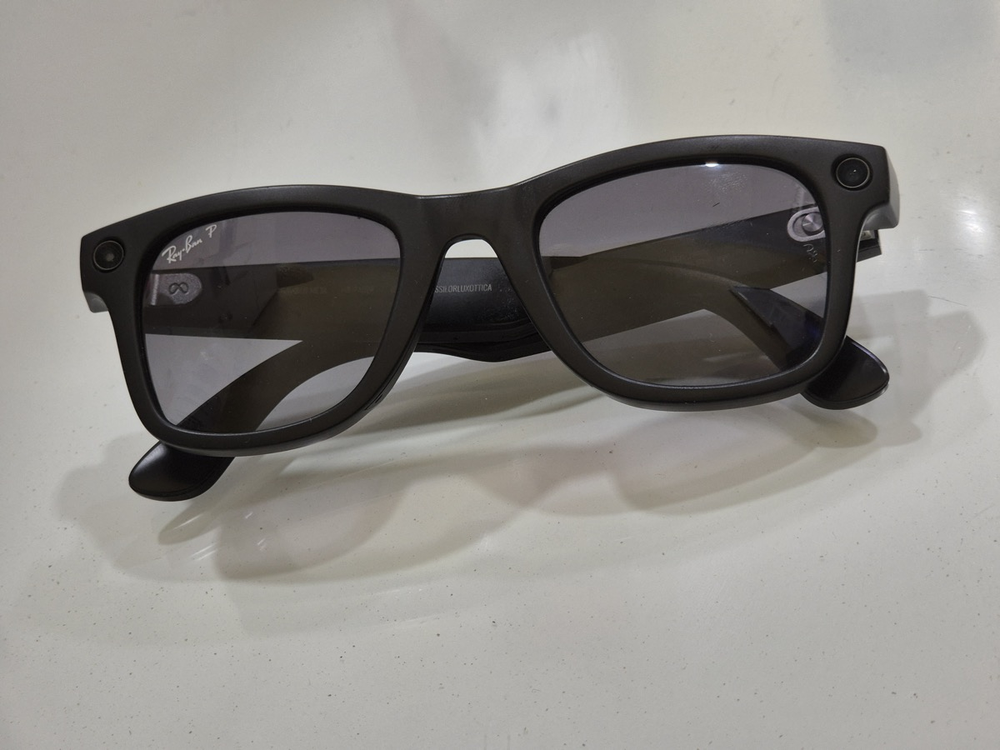

# How Far Would Norway

_Norway said it would temporarily ban smart glasses in parks, schools and changing rooms, and eight days later the European Data Protection Board asked producers to signal capture_

## Executive Summary

> [!callout]
> This article reads two regulatory documents published eight days apart, side by side. On October 5 the Norwegian government announced that it would propose a bill temporarily banning smart glasses with cameras and microphones in places such as parks, schools, and sports facilities with changing rooms. On October 13 the European Data Protection Board adopted a statement on smart glasses at its Brussels plenary, asking producers to make it obvious, through an indicator light or a sound, that recording or capture is taking place.

> Both documents aim at the same problem. It is not the person wearing the glasses but the face and the voice of the person walking past that turn into data without consent. The answers diverge. Norway settled on places, and the Board asked for a signal on the device. Neither is a finished rule yet. The Norwegian bill leaves even the definition of a smart glass open across three options, and the Board's statement is an eight-page document with no binding force.

> Everything to this point is what the two documents say. Reading the later part of section 4 and all of section 5 as two solutions that put one boundary on different parties, people and devices, is this article's interpretation.

### Key numbers

Four cells. The first two are how far the Norwegian bill would reach and what it has not settled. The second two are the force the Board's statement carries and where that statement puts responsibility.

Source: press release of the Norwegian Ministry of Digitalisation and Public Governance (October 5, 2026), [European Data Protection Board statement (October 13, 2026)](https://www.edpb.europa.eu/news/edpb-publishes-statement-on-the-data-protection-challenges-of-smart-glasses_en).

<!-- stat-card -->
**3 groups of places** — The line Norway would draw — Places people pass through in daily life, places children go in particular, and places where privacy matters in a special way. Whether universities and other higher education institutions belong there is still under review

<!-- stat-card -->
**3 device options** — The box still left empty — Glasses with a camera and sound recording, glasses with a camera and AI, or any body-worn technology carrying at least one of the three. Which one the ban targets is still to be decided

<!-- stat-card -->
**Non-binding** — What the Board's statement carries — An eight-page document with no binding force. It creates no penalty by itself, but national supervisory authorities use it as a yardstick when they weigh whether producers and users meet the GDPR

<!-- stat-card -->
**On the producer** — Where responsibility was placed — The company that makes the glasses and the provider of a linked service are controllers in their own right, and they cannot pass those duties to the person wearing the glasses

## Two Answers in Eight Days

On October 5, Torgeir Micaelsen, Norway's Minister of Digitalisation and Public Governance, said he would bring forward a bill temporarily banning smart glasses in selected places. He had been in the post for less than a month, and his predecessor, Karianne Tung, had held back from the same ban, so the announcement read as a change of direction inside the cabinet. On October 13 the European Data Protection Board adopted its smart glasses statement at the Brussels plenary. It released alongside the statement a report prepared at the French supervisory authority's proposal, "The connected gaze. Video recording, surveillance and administering evidence in the age of smart glasses."

The two landing in the same month was no coincidence. Footage of women and girls filmed without their knowledge had been circulating in Europe and had drawn public protest, and the Board set out separately in its statement that the risk grows in sensitive settings such as medical facilities and schools, and in public places such as beaches, and that children are more vulnerable to covert processing of their data. Pressure had been building inside Norway too. The data protection authority asked parliament over the summer to consider halting sales until rules were in place, and the education minister, Kari Nessa Nordtun, asked municipalities across the country to ban smart glasses in schools. Oslo's schools and the municipality of Fredrikstad already enforce such a ban.

Each body picked a different point of attack on the same problem. Norway said it would leave the device alone and name the places where it cannot be used. The Board, without regard to place, asked the device to announce its own state. One regulates space and the other regulates design. Put the two documents side by side and the range of answers available to this problem comes into fairly sharp relief.

## Norway Draws the Line Around Places

The reason the minister gave for the ban was not what the technology can do but the fact that people are recorded without knowing it. The sentence in the Norwegian press release reads as follows.

"I am worried that new, powerful technology is being introduced where people risk being photographed, filmed or audio-recorded without knowing it."

Torgeir Micaelsen, Norwegian Minister of Digitalisation and Public Governance, press release of October 5, 2026, in the English rendering carried by wire coverage. The Norwegian original reads "Jeg er urolig for at det introduseres ny, kraftig teknologi der folk risikerer å bli fotografert, filmet eller tatt lydopptak av uten at de vet det."

*▲ Torgeir Micaelsen, Norway's Minister of Digitalisation and Public Governance (photographed 2012) | Source: [Arbeiderpartiet, Wikimedia Commons (CC BY-SA 2.0)](https://commons.wikimedia.org/wiki/File:Torgeir_Micaelsen_-_Arbeiderpartiet.jpg)*

What the government put forward is a list of places sorted into three groups. Places people pass through in daily life, places children go in particular, and places where privacy matters in a special way. The third group takes in hospitals and clinics, and it also takes in swimming pools and gyms, which have changing rooms and showers.

| Group of places | Examples given | Reason the government gave |
| --- | --- | --- |
| Places people pass through in daily life | Parks, bathing beaches, museums, amusement parks, and sports, music and cultural events. Norwegian media place shopping centers in the same group | People can be filmed covertly where they are used to not being watched |
| Places children go in particular | Playgrounds, schools, kindergartens, after-school clubs. Whether universities and other higher education institutions belong here is under further review | Children have a right to special protection |
| Places where privacy matters in a special way | Hospitals and clinics, swimming pools, gyms, and other facilities with changing rooms and showers | People undress there, so exposure does more damage |

The list of places is that specific, and yet the question of what exactly is banned sits empty. The government wrote that it would look further into which technology to cover, and laid out three options. Glasses with a camera and sound recording, glasses with a camera and AI functions, or body-worn technology in general carrying at least one of camera, sound recording and AI. Pick the third and badge cameras and pendant devices that are not glasses get caught as well; pick the first and a product that runs AI without recording sound slips out. Where the glasses cannot be used has been settled, and what cannot be used has not.

While the definition stayed empty, municipalities moved first. Fredrikstad introduced a ban across all its primary and lower secondary schools in mid-September, and days later the municipality of Moss named "KI glasses, camera glasses and equivalent body-worn technology" as what it would ban. Of the three options, the field reached for the widest one first. The argument in the other direction has not gone away either. Karianne Tung, the previous minister, held that banning individual products achieves little and preferred tightening the rules to banning, though she stayed open to restricting the facial recognition functions of smart glasses on their own. The same word, ban, catches a single kind of eyewear or a camera worn around the neck depending on which definition it is given.

It is not a total ban either. The government said private use, and use in settings where there is no risk of filming others without their consent, would remain allowed. It also left room for exceptions for vulnerable groups and limited exceptions for socially beneficial uses. Sales are untouched. The bill has not been submitted yet, and it takes a vote in parliament to have any effect. The measure is temporary because an expert group is being set up separately to advise on permanent regulation. So walking into these places wearing smart glasses is not, at this moment, against the law in Norway.

## The Board Asks the Device to Announce Itself

The place the European Data Protection Board picked is the design of the device. A sentence from its chair, Anu Talus, carries the gist of the statement.

"Smart glasses should make their recording obvious – for instance with bright LED lights, audio signals or voice activation cues, privacy-friendly smartphone notifications, or unique designs. These warnings need to be reliable, hard to ignore, and always up to date."

Anu Talus, Chair of the European Data Protection Board, press release accompanying the statement of October 13, 2026

*▲ Anu Talus, Chair of the European Data Protection Board (March 2025, during a visit to the European Commission) | Source: [European Commission Audiovisual Service, Wikimedia Commons (CC BY 4.0)](https://commons.wikimedia.org/wiki/File:Anu_Talus_(P-066170-00-01)_(cropped).jpg)*

Why the device side was chosen is set out in chapter 2 of the statement. Smart glasses can be hard to tell apart from ordinary eyewear, which allows a near invisible collection and storage of personal data, and some carry advanced microphones that pick up background conversations the wearer is not part of. One more sentence was added: used together with facial or voice recognition systems, these devices raise unprecedented questions about societal choices and pose a high risk to rights and freedoms in public spaces. The Board took this to be a problem that good manners on the part of the wearer cannot reach.

The conditions for the indicator are spelled out in fine detail. It should be visible in many lighting conditions, noticeable enough to attract the attention of the individuals within the field of collection, and activated long enough for those individuals to understand that recording, or capture of images and video for an AI assistant, is going on. A suggestion to vary the pattern by function was included too, with a prolonged activation while recording and a flash when a picture is taken. There is also the condition that recording should not be possible while the indicator is covered. A footnote notes that a white indicator can generally be mistaken for a reflection or solar glare, and that visually impaired individuals may find such a light difficult or impossible to notice.

One indicator by itself is not the point either. The Board asked for a combination of signals switched on by default, and added that they should be difficult to disable. The measures the statement names go beyond transparency alone.

- •An indicator visible in many lighting conditions, plus audio signals such as a shutter click or a voice command the wearer has to say out loud
- •A notification sent over Bluetooth to nearby phones, though the Board said this should not be the sole method
- •Limiting collection and retention so that continuous recording and live streaming do not simply run on. The Board was blunt here: "a user should not justify their continuous or indiscriminate recording of other individuals solely by a general or hypothetical concern for their personal safety"
- •Blurring the faces of bystanders on the device itself
- •Turning storage off by default where the glasses are built mainly for real-time assistance
- •Geofencing, meaning location-based limits that shut capture down in contexts likely to be particularly sensitive
- •Privacy frictions that slow down sharing on social media, together with industry-wide standards for recording signals and awareness raising campaigns that help people identify smart glasses

Who carries the duty is the other axis of this statement. The Board holds that the company making the glasses and the provider of a linked application or service are controllers in their own right, and that they should not rely on their users' actions to meet obligations of their own. The wearer becomes a controller too when posting photos or video to a public social media account, or using the device in official, professional or political activity. Purely personal use, such as filming family or friends or translating something for oneself, falls under the household exemption in the GDPR, although other law, criminal or labor law among it, can still apply. That exemption comes with a condition attached: it must be narrowly construed. The standard was set by the Court of Justice of the European Union in a case about a home security camera that also covered the public footpath.

> [!callout]
> The consent route is narrow. Obtaining prior consent from a passerby is hard, and the Board held that a legitimate interest claim resting on the training of AI models would be particularly difficult to demonstrate. That sentence drives a wedge into the path that turns faces and voices gathered without anyone noticing into training data.

An assessment of the products on the market today sits in the statement. The current state of the art in indicators, the Board wrote, leaves many non-users unaware that their data is being processed. Meta's Ray-Ban smart glasses, widely counted as the best selling product in this category, had their safeguards widened in July 2026 on the second-generation model, so that the camera stops when the capture indicator is tampered with and not only when it is covered with tape or a finger. That indicator is white, exactly the color the Board's footnote picked out as liable to be mistaken for something else.

*▲ Second-generation Meta Ray-Ban smart glasses — the camera and recording indicator sit in the frame corners | Source: [ItzANormalFioko, Wikimedia Commons (CC BY-SA 3.0)](https://commons.wikimedia.org/wiki/File:Rayban_x_Meta_glasses_Generazione_2_con_lenti_Polaroid,_wayfarer.jpg)*

## Two Answers That Agree on the Places, Not on Who Knows Them

Reading the two documents purely as places against indicators misses something. Places appear in the Board's own list of recommendations, in the item asking for geofencing so that capture is blocked in sensitive contexts. The boundary Norway asked people to observe is the boundary the Board asked the device to observe. A rule saying do not use these glasses in a park or a changing room, and a design in which the camera stops itself on entering a park or a changing room, are two ways of drawing one line. Only the party that has to keep it differs.

The recommendations are not the only place where the statement writes places down. Chapter 2 lists medical facilities, schools and other places where minors are present, changing rooms, swimming pools, beaches and toilets as settings in which the use of smart glasses may be especially sensitive. That list overlaps almost exactly with the three groups Norway wants to put into law. In such situations, the Board holds, recording or audio capture may be inappropriate, or prohibited under national law or local rules. A footnote even carries the initiative in Hamburg, Germany, to propose a ban on smart glasses in public transport and swimming pools. At no point does the statement object to a line drawn by place.

The way each document frames the harm overlaps too. The Board put into the statement that people behave differently under the mere possibility of being watched, altering their behavior, suppressing spontaneity and conforming to social norms they take to be more acceptable. That is the same worry the Norwegian government pointed at with the phrase about places where people are used to not being watched, its reason for the first group. Neither document worried only about where the footage travels; both worried about what the state of possibly being filmed does to a person.

Which is where the criticism of the Norwegian bill lands. The places have been settled, and who identifies a place as one of them has not. Nothing in the announcement requires the device to know its own position and shut its functions down, in the way drone rules do. Leave that job with people, and taking the glasses off at the park entrance and catching whoever did not take them off both come down to whoever happens to be looking.

Breaking the path from filming to data into three stages shows where each document has hold of it. The camera seeing, the AI reading what it saw, and the keeping and sending of the result.
