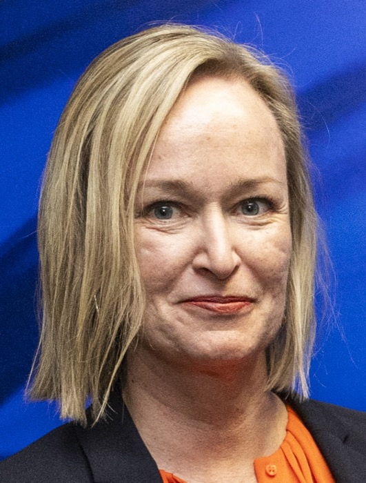

# 노르웨이가 막으려는 스마트 안경, 어디까지 못 쓰게 될까?

_노르웨이는 공원·학교·탈의실에서 스마트 안경 한시 금지를 예고했고, 유럽 개인정보보호이사회는 촬영 표시등을 켜라고 권고했다_

## Executive Summary

> [!callout]
> 이 글은 여드레 사이에 나온 규제 문서 두 건을 나란히 읽는다. 노르웨이 정부는 10월 5일 카메라와 마이크가 달린 스마트 안경을 공원과 학교, 탈의실이 있는 체육시설 같은 곳에서 한시적으로 금지하겠다는 법안을 예고했다. 10월 13일에는 유럽 개인정보보호이사회가 브뤼셀 총회에서 스마트 안경을 다룬 성명을 채택했다. 촬영 중이라는 사실을 표시등과 소리로 분명히 알리라고 제조사에 요구하는 내용이다.

> 두 문서가 겨냥한 문제는 같다. 안경을 쓴 사람이 아니라 그 앞을 지나간 사람의 얼굴과 목소리가 동의 없이 데이터가 된다는 것이다. 답은 갈렸다. 노르웨이는 장소를 정했고, 이사회는 기기에 표시를 붙이라고 했다. 어느 쪽도 아직 완성된 규칙은 아니다. 노르웨이 법안은 무엇을 스마트 안경으로 볼지조차 세 갈래로 열어 뒀고, 이사회 성명은 법적 구속력이 없는 여덟 쪽짜리 문서다.

> 여기까지는 두 문서에 적힌 사실이다. 4절 뒤쪽과 5절에서 두 해법이 같은 경계를 서로 다른 쪽에 지운다고 읽는 대목은 이 글의 해석이다.

### 주요 수치

네 칸을 뽑았다. 앞의 둘은 노르웨이 법안이 어디까지 금지하려 하는지와 무엇을 아직 정하지 못했는지, 뒤의 둘은 이사회 성명이 가진 힘과 그 성명이 책임을 누구에게 지웠는지다.

출처: 노르웨이 디지털화·행정부 보도자료(2026년 10월 5일), [유럽 개인정보보호이사회 성명(2026년 10월 13일)](https://www.edpb.europa.eu/news/edpb-publishes-statement-on-the-data-protection-challenges-of-smart-glasses_en).

<!-- stat-card -->
**장소 세 묶음** — 노르웨이가 그으려는 선 — 사람들이 일상적으로 드나드는 곳, 어린이가 특히 많이 다니는 곳, 사생활이 특별히 중요한 곳. 대학 같은 고등교육기관을 넣을지는 아직 검토 중이다

<!-- stat-card -->
**기기 정의 세 갈래** — 아직 비어 있는 칸 — 카메라와 녹음이 달린 안경, 카메라와 AI가 달린 안경, 셋 중 하나라도 갖춘 모든 몸에 걸치는 기술. 무엇을 막을지는 이 중에서 더 따져 정한다

<!-- stat-card -->
**구속력 없음** — 이사회 성명의 효력 — 여덟 쪽짜리 비구속 문서다. 벌칙을 바로 만들지는 않지만, 각국 감독기구가 제조사와 이용자의 GDPR 준수를 따질 때 기준으로 쓰인다

<!-- stat-card -->
**제조사 쪽** — 성명이 지운 책임의 자리 — 안경을 만든 회사와 연결된 서비스 제공자가 스스로 개인정보 처리자이며, 그 의무를 안경 쓴 사람에게 넘길 수 없다고 적었다

## 여드레 사이에 답이 둘 나왔다

10월 5일, 노르웨이 디지털화·행정부 장관 토르게이르 미카엘센이 스마트 안경을 일부 장소에서 한시적으로 금지하는 법안을 내겠다고 밝혔다. 취임한 지 한 달이 채 안 된 시점이었고, 전임 장관 카리안네 퉁이 같은 금지안에 소극적이었던 터라 내각의 방향이 바뀐 발표로 읽혔다. 10월 13일에는 유럽 개인정보보호이사회가 브뤼셀 총회에서 스마트 안경 성명을 채택했다. 프랑스 감독기구의 제안으로 만든 보고서 「연결된 시선: 스마트 안경 시대의 영상 녹화와 감시, 증거」도 함께 공개했다.

두 발표가 같은 달에 겹친 것은 우연이 아니다. 유럽에서는 몰래 촬영된 여성과 소녀의 영상이 퍼지면서 공개적인 항의가 이어졌다. 이사회는 학교와 병원 같은 민감한 공간, 해변 같은 공공장소에서 위험이 커진다고 성명에 적었다. 어린이가 더 취약하다는 점도 따로 짚었다. 노르웨이 안에서도 이미 움직임이 쌓여 있었다. 데이터보호청은 여름에 규칙이 마련될 때까지 판매를 멈추는 방안을 검토해 달라고 의회에 요청했고, 교육부 장관 카리 네사 노르툰은 전국 지자체에 학교에서 스마트 안경을 금지하라고 요청했다. 오슬로 학교와 프레드릭스타드 지자체는 이미 금지를 시행하고 있다.

같은 문제를 두고 두 기관이 고른 지점은 달랐다. 노르웨이는 기기를 금지하지 않고 그 기기를 쓸 수 없는 장소를 정하겠다고 했다. 이사회는 장소를 가리지 않고 기기가 자기 상태를 알리게 하라고 했다. 하나는 공간을 규제하고 하나는 설계를 규제한다. 두 문서를 나란히 놓으면 같은 문제에 가능한 답이 어디서 갈리는지가 꽤 선명하게 보인다.

## 노르웨이는 장소에 선을 긋는다

장관이 든 금지 사유는 기술의 성능이 아니다. 모르는 사이에 찍힌다는 점이다. 노르웨이어 보도자료의 문장은 이렇다.

"사람들이 자기도 모르는 사이에 사진이 찍히거나 촬영되거나 음성이 녹음될 위험이 있는 상황에서 새롭고 강력한 기술이 들어오는 것이 걱정된다."

토르게이르 미카엘센 노르웨이 디지털화·행정부 장관, 2026년 10월 5일 보도자료. 원문은 "Jeg er urolig for at det introduseres ny, kraftig teknologi der folk risikerer å bli fotografert, filmet eller tatt lydopptak av uten at de vet det."

*▲ 토르게이르 미카엘센 노르웨이 디지털화·행정부 장관(2012년 촬영) | Source: [Arbeiderpartiet, Wikimedia Commons (CC BY-SA 2.0)](https://commons.wikimedia.org/wiki/File:Torgeir_Micaelsen_-_Arbeiderpartiet.jpg)*

정부가 제시한 금지 대상은 장소를 세 묶음으로 나눈 목록이다. 사람들이 일상적으로 드나드는 곳, 어린이가 특히 많이 다니는 곳, 그리고 사생활이 특별히 중요한 곳이다. 세 번째 묶음에 병원과 진료소가 들어가고, 수영장과 헬스장처럼 탈의실과 샤워실이 있는 시설도 같이 들어간다.

| 장소 묶음 | 예로 든 곳 | 정부가 든 이유 |
| --- | --- | --- |
| 사람들이 일상적으로 드나드는 곳 | 공원, 해수욕장, 박물관, 놀이공원, 스포츠·음악·문화 행사장. 노르웨이 언론은 쇼핑센터도 같은 범주로 든다 | 감시받지 않는 데 익숙한 자리에서 몰래 찍힐 수 있다 |
| 어린이가 특히 많이 다니는 곳 | 놀이터, 학교, 어린이집, 방과후 클럽. 대학 등 고등교육기관을 넣을지는 추가로 검토한다 | 어린이는 특별한 보호를 받을 권리가 있다 |
| 사생활이 특별히 중요한 곳 | 병원과 진료소, 수영장, 헬스장, 그 밖에 탈의실과 샤워실이 있는 시설 | 옷을 갈아입는 공간이라 노출의 피해가 크다 |

장소 목록은 이만큼 구체적인데, 정작 무엇을 금지할지는 비어 있다. 정부는 어떤 기술을 금지 대상으로 삼을지 더 따져 보겠다고 적으면서 세 갈래를 늘어놓았다. 카메라와 녹음 기능이 있는 안경, 카메라와 AI 기능이 있는 안경, 또는 카메라나 녹음이나 AI 중 하나라도 갖춘 몸에 걸치는 기술 전반이다. 세 번째를 고르면 안경이 아닌 배지형 카메라나 목걸이형 기기도 같이 걸리고, 첫 번째를 고르면 녹음 없이 AI만 돌리는 제품이 빠져나간다. 어디서 못 쓰는지는 정해졌는데 무엇을 못 쓰는지가 아직 정해지지 않은 셈이다.

정의가 비어 있는 동안 먼저 움직인 쪽은 지자체다. 프레드릭스타드가 9월 중순 모든 초·중등학교에 금지를 도입했고, 며칠 뒤 모스 지자체는 "KI 안경, 카메라 안경, 그리고 그에 준하는 몸에 걸치는 기술"을 금지 대상에 올렸다. 세 갈래 가운데 가장 넓은 쪽을 현장이 먼저 집은 것이다. 반대 방향의 주장도 남아 있다. 전임 장관 카리안네 퉁은 개별 제품을 금지하는 일은 실익이 적다며 금지보다 규칙을 엄격하게 하는 쪽을 택했다. 다만 스마트 안경의 얼굴 인식 기능만 따로 제한하는 데는 열려 있었다. 같은 "금지"라는 말이 어느 정의를 받느냐에 따라 안경 한 종류에 걸리기도 하고 목에 거는 카메라까지 걸리기도 한다.

전면 금지도 아니다. 정부는 사적인 사용, 그리고 남을 동의 없이 찍을 위험이 없는 자리에서는 계속 쓸 수 있게 하겠다고 밝혔다. 취약 집단을 위한 예외와 사회적으로 유익한 용도의 제한적 예외도 열어 뒀다. 판매는 건드리지 않는다. 법안은 아직 제출 전이고, 의회를 통과해야 효력이 생긴다. 한시 조치인 이유는 영구적인 규제를 자문할 전문가 그룹을 따로 꾸리고 있기 때문이다. 그러니까 지금 노르웨이에서 이 장소들에 스마트 안경을 쓰고 들어가는 일이 불법인 것은 아니다.

## 이사회는 기기에 표시를 요구한다

유럽 개인정보보호이사회가 고른 자리는 기기 설계다. 의장 아누 탈루스의 문장이 성명의 요지를 그대로 담는다.

"스마트 안경은 촬영하고 있다는 사실을 분명히 드러내야 한다. 밝은 LED 표시등, 소리 신호나 음성 활성화 신호, 프라이버시를 해치지 않는 스마트폰 알림, 또는 눈에 띄는 외형 설계 같은 방법이 있다. 이런 경고는 믿을 수 있고, 무시하기 어렵고, 늘 최신 상태여야 한다."

아누 탈루스 유럽 개인정보보호이사회 의장, 2026년 10월 13일 성명 보도자료

*▲ 아누 탈루스 유럽 개인정보보호이사회 의장(2025년 3월, 유럽연합 집행위원회 방문 당시) | Source: [유럽연합 집행위원회 영상자료실, Wikimedia Commons (CC BY 4.0)](https://commons.wikimedia.org/wiki/File:Anu_Talus_(P-066170-00-01)_(cropped).jpg)*

왜 기기 쪽이었는지는 성명 2장에 적혀 있다. 스마트 안경은 평범한 안경과 구별하기 어려워서 거의 눈에 띄지 않는 수집과 저장이 가능하고, 성능 좋은 마이크를 단 제품은 착용자가 참여하지 않은 주변 대화까지 담는다. 얼굴 인식이나 음성 인식 시스템과 함께 쓰일 때는 공공장소의 권리에 높은 위험을 만든다는 문장도 들어갔다. 사회가 무엇을 받아들일지를 두고 전례 없는 질문을 던진다는 대목이 같은 자리에 이어진다. 안경 쓴 사람이 알아서 조심하기를 바라는 방식으로는 닿지 않는 문제라고 본 것이다.

성명은 표시등의 조건을 꽤 세밀하게 적었다. 여러 조명 조건에서 보여야 하고, 촬영 범위 안에 있는 사람의 눈길을 끌 만큼 눈에 띄어야 하며, 그 사람이 지금 촬영이나 AI 비서용 영상 수집이 일어나고 있음을 이해할 만큼 오래 켜져 있어야 한다. 기능마다 패턴을 달리하라는 제안도 들어갔다. 녹화는 계속 켜 두고 사진은 깜박이는 식이다. 표시등을 가린 상태에서는 촬영이 되지 않아야 한다는 조건도 붙었다. 각주에는 흰색 표시등이 반사광이나 햇빛 반사로 오인될 수 있다고 적혀 있다. 시각장애인은 빛을 알아채기 어렵거나 불가능하다는 지적도 함께 달렸다.

표시등 하나로 끝내라는 뜻도 아니다. 이사회는 여러 신호를 조합하고 기본값으로 켜 두라고 요구했고, 신호를 끄기 어렵게 만들라고 덧붙였다. 성명이 든 수단은 표시 말고도 더 있다.

- •모든 조명 조건에서 보이는 표시등, 셔터음이나 착용자가 소리 내어 말해야 하는 음성 명령 같은 소리 신호
- •근처 휴대전화에 블루투스로 알리는 방식. 다만 이것만 유일한 신호로 쓰지는 말라고 했다
- •계속 녹화나 생중계를 이어 가지 않도록 수집과 보관을 줄이기. 이사회는 막연한 신변 안전 걱정만으로 남을 계속 또는 무차별로 찍는 일이 정당화되지는 않는다고 잘라 말했다
- •주변 사람의 얼굴을 기기 안에서 흐리게 처리하기
- •실시간 비서 기능은 저장을 기본으로 꺼 두기
- •민감한 장소에서는 촬영이 막히도록 위치를 기준으로 기능을 제한하는 지오펜싱
- •소셜미디어 공유를 한 박자 늦추는 프라이버시 마찰, 그리고 촬영 신호에 관한 업계 표준과 사람들이 스마트 안경을 알아보도록 돕는 인식 제고 캠페인

책임을 누구에게 지우느냐가 이 성명의 또 다른 축이다. 이사회는 안경을 만든 회사와 연결된 앱·서비스 제공자가 스스로 개인정보 처리자이며, 자기 의무를 이용자에게 넘길 수 없다고 적었다. 착용자도 공개된 소셜미디어 계정에 사진이나 영상을 올리거나 공적·직업적·정치적 활동에 쓰면 처리자가 된다. 가족이나 친구를 찍거나 개인적으로 통역에 쓰는 일처럼 순수하게 개인적인 사용은 GDPR의 가정용 예외에 들어가지만, 형법이나 노동법 같은 다른 법은 그대로 적용될 수 있다. 다만 이 예외는 좁게 해석해야 한다는 조건이 함께 붙었다. 자택에 단 감시 카메라가 공공 도로까지 담은 사건에서 유럽사법재판소가 세운 기준이다.

> [!callout]
> 동의 쪽에서는 길이 좁다. 지나가는 행인에게서 사전 동의를 받기는 어렵다. 이사회는 AI 모델 학습을 목적으로 내세우는 정당한 이익 주장은 입증하기가 특히 어렵다고 못 박았다. 사람들이 알아채지도 못한 사이에 모인 얼굴과 목소리를 학습 데이터로 돌리는 경로에 쐐기를 박은 문장이다.

현재 제품에 대한 평가도 성명에 들어 있다. 이사회는 지금의 촬영 표시 방식으로는 많은 비이용자가 자기 데이터가 처리된다는 사실을 모른 채로 남는다고 적었다. 가장 많이 팔린 제품으로 꼽히는 메타 레이밴 스마트 안경은 2026년 7월에 2세대 제품의 안전장치를 넓혔다. 촬영 표시등을 테이프나 손가락으로 가리는 경우뿐 아니라 파손한 경우에도 카메라가 멈춘다. 그 표시등이 바로 흰색이다. 이사회 각주가 흰색 표시등의 오인 가능성을 지적한 자리와 정확히 겹친다.

*▲ 메타 레이밴 2세대 스마트 안경 — 프레임 모서리에 카메라와 촬영 표시등이 달려 있다 | Source: [ItzANormalFioko, Wikimedia Commons (CC BY-SA 3.0)](https://commons.wikimedia.org/wiki/File:Rayban_x_Meta_glasses_Generazione_2_con_lenti_Polaroid,_wayfarer.jpg)*

## 두 답은 같은 장소에서 만나고 누가 아는가에서 갈린다

두 문서를 장소와 표시등의 대결로만 읽으면 놓치는 대목이 있다. 이사회 성명의 권고 목록에도 장소가 들어 있다. 민감한 장소에서 촬영이 막히도록 지오펜싱을 걸라는 항목이다. 노르웨이가 사람에게 요구한 것과 같은 경계를 이사회는 기기에 요구했다. 공원과 탈의실에서 쓰지 말라는 규칙이 하나다. 공원과 탈의실에 들어가면 카메라가 스스로 멈추는 설계가 다른 하나다. 같은 선을 긋는 두 가지 방식이고, 지키는 주체만 다르다.

성명이 장소를 적어 둔 곳은 권고 목록만이 아니다. 2장은 스마트 안경 사용이 특히 민감해지는 자리로 의료시설, 학교와 미성년자가 있는 곳, 탈의실, 수영장, 해변, 화장실을 들었다. 노르웨이가 법으로 묶으려는 세 묶음과 거의 그대로 겹치는 목록이다. 그런 자리에서는 촬영이나 음성 수집이 부적절할 수 있다는 것이 이사회의 판단이다. 각국 법이나 현지 규칙으로 금지될 수도 있다고 덧붙였다. 각주에는 독일 함부르크가 대중교통과 수영장에서 스마트 안경을 금지하는 안을 내놓았다는 사실까지 달아 뒀다. 성명이 장소로 긋는 선을 반대한 적은 한 번도 없다.

피해를 짚는 방식도 두 문서가 겹친다. 이사회는 감시당할지 모른다는 느낌만으로 사람들의 행동이 달라진다는 점을 성명에 담았다. 몸가짐을 고치고 즉흥성을 줄이며 더 받아들여질 법한 쪽으로 자신을 맞춘다는 것이다. 노르웨이 정부가 첫 번째 장소 묶음의 이유로 든 "감시받지 않는 데 익숙한 자리"라는 표현도 같은 걱정을 가리킨다. 두 문서는 찍힌 영상이 어디로 가는지만 걱정한 것이 아니라, 찍힐지도 모른다는 상태가 사람을 어떻게 바꾸는지를 나란히 걱정했다.

그래서 노르웨이 법안을 두고 나온 비판도 이 지점을 향한다. 장소는 정해졌는데 그 장소를 누가 판별하느냐가 비어 있다는 것이다. 드론 규제처럼 기기가 자기 위치를 알고 스스로 기능을 끄도록 요구하는 조항은 지금 발표에 없다. 그 역할이 사람에게 남으면 공원 입구에서 안경을 벗는 일도, 당국이 벗지 않은 사람을 적발하는 일도 전부 현장의 눈에 달린다.

촬영이 데이터가 되는 과정을 세 단계로 끊어 보면 두 문서가 각각 어디를 잡고 있는지가 보인다. 카메라가 보는 단계, AI가 그 영상을 읽는 단계, 그리고 저장하고 내보내는 단계다.
