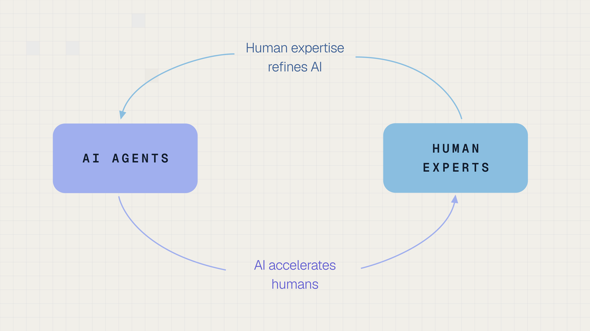

# Snorkel AI Trades Labeling Tools for Training Data and Nearly Triples Its Value

_A company that sold labeling software now builds training data itself, and its valuation has gone from $1.3 billion to $3.5 billion_

## Executive Summary

> [!callout]
> Snorkel AI raised a $350 million Series E at a $3.5 billion valuation, close to three times the $1.3 billion it carried at its $100 million Series D in May 2025. The company used to sell software that automated the job of putting labels on a customer's data. Since September 2025 it has built finished datasets, reinforcement learning environments and evaluation tasks itself and delivered them. The round came a year after that change in what it sells.

> The figure the company put forward is an annualized revenue run rate of $375 million, more than eighteen times what it was less than a year earlier. Reuters put the run rate a year before at about $20 million. Much of the size of the multiple comes from how small the base was. An annualized run rate is not money that came in over twelve months but a recent stretch of performance projected out to a year.

> Sections 1 to 3 compare the company's post and press release with reporting by TechCrunch and Reuters. Section 4 is Pebblous's interpretation.

### Key Figures

Sources: [Snorkel AI's announcement](https://snorkel.ai/blog/data-2-0-and-the-research-era-of-ai-data/) and [press release](https://snorkel.ai/press/snorkel-ai-raises-350m-to-scale-the-data-factory-for-frontier-ai/) (2026-09-22), [TechCrunch](https://techcrunch.com/2026/09/22/snorkel-ai-triples-valuation-to-3-5b-as-demand-for-ai-training-data-booms/) and [Reuters](https://www.reuters.com/legal/transactional/snorkel-ai-valued-35-billion-amid-surging-demand-complex-ai-training-data-2026-09-22/). The 9x ratio is this article's own division of the published figures.

<!-- stat-card -->
**$3.5B** — Valuation set at the Series E — At the Series D in May 2025 it was $1.3 billion, on a raise of $100 million

<!-- stat-card -->
**$375M** — Annualized run rate the company disclosed — Not twelve months of receipts but a recent run projected to a year. The company says it crossed that line the week of the announcement

<!-- stat-card -->
**about $20M** — Run rate a year earlier — As reported by Reuters. It squares with $375 million divided by 18 (about $21 million)

<!-- stat-card -->
**about 9x** — Valuation divided by run rate — $3.5 billion over $375 million comes to 9.3. The multiple assumes the run rate turns into a full year of revenue

## From Selling the Tool to Selling the Dataset

Snorkel AI began as a research project at the Stanford AI Lab, led by co-founder and chief executive Alex Ratner, and became a company in 2019. For most of the years since, the product was software. Rather than have people put a label on every record by hand, customers used rules and models to apply those labels automatically. Building the data stayed the customer's job, and what Snorkel sold was the tool that made the job faster.

*▲ Alex Ratner, who led the research at a Stanford AI lab and founded Snorkel AI in 2019 | Source: [Snorkel AI's announcement](https://snorkel.ai/blog/data-2-0-and-the-research-era-of-ai-data/)*

In that arrangement the price is capped by what the customer can do. Hand someone a good tool and nothing moves if nobody on their side can decide which label belongs on a given record. Software is priced by seats and usage, while the hard part, the judgment, stays with the buyer. The boundary is what the company changed over the past year. Snorkel now sells the result: finished datasets that experts have worked over, reinforcement learning environments for training models, and evaluation tasks for checking what a model can do. The company's press release dates the start of this business to September 2025.

The post lists the customers as the leading frontier labs, hyperscalers, neolabs, vertical AI leaders, enterprises, and U.S. government agencies. TechCrunch puts the growth down to "AI labs' insatiable appetite for high-end training data." Insight Partners and S32 co-led the round, with significant participation from existing investor Addition. Third Point Ventures, March Capital, Blumberg Capital and others joined as new investors, and existing backers including Greylock, Lightspeed, GV and Wells Fargo took part.

The way it gets made is different too. TechCrunch calls the method hybrid: "Rather than operating purely as a human expert marketplace, Snorkel relies on a hybrid approach, using its software and models to generate data synthetically alongside subject matter experts." Machines draft and people rule on the draft, instead of people building each item end to end, and that is also why the money going out to experts lands in a different place on this company's books than on a competitor's.

> [!callout]
> Snorkel's revenue climbed steeply when the unit of sale changed. Sell a license and the invoice is set by how many people use it. Sell datasets and it is set by how hard the data is and how much of it there is. That is how the same technology can produce revenue of an entirely different size.

## The Founder's Two Names: Data 1.0 and Data 2.0

Ratner titled the post announcing the round "Data 2.0 and the research era of AI data." Inside it he splits the market for AI training data into two phases. The earlier one, Data 1.0, is "all about volume, and is largely a staffing and logistics problem." The later one, Data 2.0, is "all about the right curriculum of extremely complex, precisely targeted, high quality data – and is primarily a research and technology problem."

The same post restates the split as a distance: "the first mile is driven by volume of simpler data, and the last mile is driven by quality of more complex data." Once a model has already solved the easy problems, multiplying the hands on the job stops moving performance, and only a small amount of data aimed precisely at the hard problems closes what gap is left.

Ratner works the distinction out on coding data. Several years ago large language models could barely manage code auto-complete, so what was wanted was large volumes of raw code for pre-training, plus large volumes of simple coding problems and code preference labels for supervised fine-tuning and preference learning. Today models are approaching superhuman capability across many areas of coding. So Ratner writes down five things a usable coding dataset or RL environment now has to do: approximate software development problems that a senior engineer might struggle with over days or weeks; capture nuanced goals and reward signals over complex product-scale outputs; distributionally target the model's error modes; stand up to those advanced models' attempts to hack, cheat, or circumvent; and pass several hundred other quality control checks.

The same pattern is spreading through legal, finance and biology. Where it was once enough to gather a sufficient volume of relevant experts to write basic chatbot Q&A tasks or preference labels, one frontier data point now stands for an expert task that might take a person days or weeks, and some cases call for an environment simulating an entire company.

Ratner states the conclusion in two sentences. "Frontier data is no longer solvable by the optimized supply of human hours and bodies." And: "building the data and environments to safely measure and train AI is becoming too hard for even the smartest human experts to do alone." The bottleneck in data work has moved from the supply of people to the difficulty of the judgment, which doubles as the explanation for why this company chose to build and sell data rather than recruit people.

Ratner adds that calling it a research and technology problem does not mean people can be taken out. Frontier data is worth something only insofar as it targets what a model does not already know, and purely synthetic data will be highly correlated with what the model knows already. Once AI makes its own data and trains on it, mode collapse follows and the range of answers it gives narrows. Setting aside distillation, which carries a large model's capability down into a small one, the conclusion is that data with a human in the loop stays the most valuable kind.

A normative reason is written in alongside it. Data is how AI gets measured and aligned to human values and judgment, so data developed without any humans in the loop is, in the post's words, "tantamount to abdicating human oversight and alignment entirely." It is closer to a plan to move where people stand, toward review and adjudication, than a plan to use fewer of them.

### 2.1. The One Piece of Evidence the Company Offers

For evidence, the post points at its own quality control on coding data. When building coding agent environments and data, Snorkel puts hundreds of specialized agents on quality control on top of human expert review, which it says "accelerates our QC efficiency by 50%+ and improves accuracy of review by 15+ accuracy points compared to a human + off-the-shelf-only LLM review baseline."

The loop turns once more from there. Human review at scale is fed back as weak supervision to train those agents, and the post reports a current 2x+ accuracy improvement over a non-specialized frontier LLM baseline for the agents that come out of it. The company calls this feedback structure the RSI engine for data, RSI standing for recursive self improvement, and says that loop is what has powered its growth to date. Hence the sentence: "Only humans and AI agents, collaborating together in compounding ways, can meet the accelerating needs of the frontier and keep humans in the driver's seat of AI progress for decades to come."

*▲ The recursive self-improvement loop as Snorkel AI describes it — AI agents accelerate human experts, and human feedback in turn refines the AI agents | Source: [Snorkel AI's announcement](https://snorkel.ai/blog/data-2-0-and-the-research-era-of-ai-data/)*

These are numbers the company measured on its own process by its own standard. It defined the baseline it measured against, and no third party has published a check of the same thing under the same conditions. So they are given here as company-reported figures.

The Data 1.0 and 2.0 split has another effect. Naming 1.0 a staffing and logistics problem and 2.0 a research and technology problem also sets this company apart from the competitors that grew by putting more people to work. The phrase describes a change running through the industry and it describes what this company sells. Nothing in this post separates the two.

Nor is the argument new. Ratner brings back, in the same post, the thesis the project started from at Stanford a decade ago: AI progress would become increasingly data-centric, and therefore data development should be studied as a true research and technology problem, not just a staffing and crowdsourcing one. What changed this time is the name, and Ratner sees the market as having come around to the argument.

## Conditions on the $375 Million

The most quoted figure from this announcement is the annualized revenue run rate of $375 million. Three things are worth knowing before it is copied across as annual revenue.

- •**It is not a year of earnings.** It stretches the most recent month or quarter out to a year, and it assumes the present pace continues.
- •**The eighteenfold looks large because the base was small.** [Reuters](https://www.reuters.com/legal/transactional/snorkel-ai-valued-35-billion-amid-surging-demand-complex-ai-training-data-2026-09-22/) put the run rate a year earlier at about $20 million. The company says the data service launched in September 2025, yet a product under the same name was already announced as generally available in the [May 2025 Series D press release](https://www.businesswire.com/news/home/20250529083998/en/Snorkel-AI-Announces-$100-Million-Series-D-and-Expanded-Platform-to-Power-Next-Phase-of-AI-with-Expert-Data).
- •**It does not compare directly with competitors.** The figures for Mercor ($2 billion), Handshake ($1 billion) and Micro1 ($500 million) are gross, before the 60 to 70 percent paid out to experts. Snorkel says it books expert costs as cost of goods sold.

> [!callout]
> Companies in the same market define revenue differently. Before lining the numbers up, check what each one measures.

## Why Pebblous Is Watching This Round

What caught Pebblous's attention is less the size of the round than the logic Ratner sets out. That logic overlaps with the technology Pebblous has built since its founding and with where it is headed.

### 4.1. To Aim, First Find the Gaps

The core of Ratner's Data 2.0 argument is that a small amount of data aimed precisely at the hard problems makes the remaining difference. Pebblous started from the same idea. When the company was founded in 2021, its first project was synthesizing only the data a model was missing, aimed with precision.

To aim, you first have to know where the data has gaps. Pebblous's DataClinic maps data into a high-dimensional space and finds the density and the empty regions of its distribution. That diagnostic technology, and the synthetic data generation that fills the gaps it finds, are core technologies Pebblous holds under U.S. [patents](/project/ISO5259/iso5259-standardization-roadmap/en/) (US 12,481,720 and US 11,967,308). Ratner lists distributionally targeting a model's error modes as a condition of good data, and finding those spots is what DataClinic does.

### 4.2. A Loop That Grows Data

Snorkel calls the loop in which human experts and AI agents improve each other an RSI engine. Pebblous works differently but has a structure that plays the same role. The [Data Greenhouse](/project/DataGreenhouse/data-greenhouse-strategy/en/) runs a loop that diagnoses data, fills what is missing with synthetic data, trims what is unnecessary, and diagnoses again. PebbloSim is the simulation environment that generates that synthetic data. Pebblous is extending the loop to AI agents as the Agent Greenhouse.

### 4.3. Cultivating Data Instead of Hunting for It

The difference is clear too. Snorkel builds and sells data; Pebblous does not yet sell data it makes. Still, the two companies share a similar dream: moving from finding and gathering the data you need to diagnosing what is missing, aiming at it, and growing it.

Pebblous has put this as ["We do not hunt for data. We cultivate it."](/project/PhysicalAI/data-greenhouse-vision/en/) Hunting for scattered data depends on luck; cultivating it by diagnosing and aiming depends on design. This round is a sign that the market has begun to price the work of cultivating data, and that is why Pebblous is paying attention.

The documents this article cites can be read directly in [Snorkel AI's announcement](https://snorkel.ai/blog/data-2-0-and-the-research-era-of-ai-data/) and [press release](https://snorkel.ai/press/snorkel-ai-raises-350m-to-scale-the-data-factory-for-frontier-ai/), and in reporting by [TechCrunch](https://techcrunch.com/2026/09/22/snorkel-ai-triples-valuation-to-3-5b-as-demand-for-ai-training-data-booms/) and [Reuters](https://www.reuters.com/legal/transactional/snorkel-ai-valued-35-billion-amid-surging-demand-complex-ai-training-data-2026-09-22/).

## References

- 1.Ratner, A. (2026, September 22). "[Data 2.0 and the Research Era of AI Data](https://snorkel.ai/blog/data-2-0-and-the-research-era-of-ai-data/)." Snorkel AI Blog.
- 2.Temkin, M. (2026, September 22). "[Snorkel AI triples valuation to $3.5B as demand for AI training data booms](https://techcrunch.com/2026/09/22/snorkel-ai-triples-valuation-to-3-5b-as-demand-for-ai-training-data-booms/)." TechCrunch.
- 3.Snorkel AI. (2025, May 29). "[Snorkel AI Announces $100 Million Series D and Expanded Platform to Power Next Phase of AI with Expert Data](https://www.businesswire.com/news/home/20250529083998/en/Snorkel-AI-Announces-$100-Million-Series-D-and-Expanded-Platform-to-Power-Next-Phase-of-AI-with-Expert-Data)." Business Wire.
- 4.Snorkel AI. (2026, September 22). "[Snorkel AI Raises $350M Series E](https://snorkel.ai/press/snorkel-ai-raises-350m-to-scale-the-data-factory-for-frontier-ai/)." Snorkel AI Press.
- 5.Reuters. (2026, September 22). "[Snorkel AI valued at $3.5 billion amid surging demand for complex AI training data](https://www.reuters.com/legal/transactional/snorkel-ai-valued-35-billion-amid-surging-demand-complex-ai-training-data-2026-09-22/)." Reuters.
