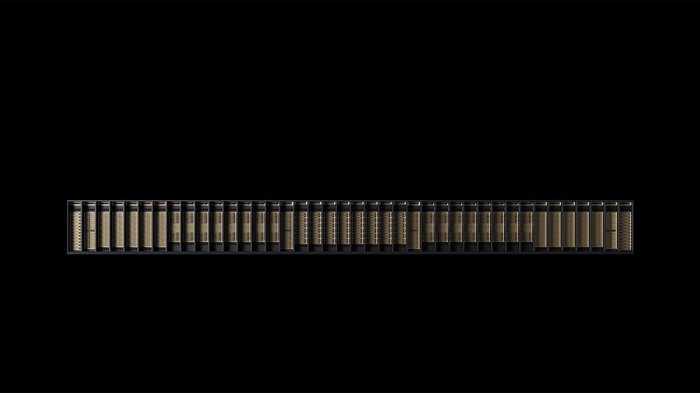

# SpaceX Pays for the AI Chips, and Apollo Owns Them

_An Apollo-managed entity buys the Nvidia chips and leases them to SpaceX, which repays about $40 billion over five years._

## Executive Summary

> [!callout]
> SpaceX has decided to rent its AI chips rather than buy them. According to the filing it put before the Securities and Exchange Commission on October 26, an entity managed by Apollo Global Management will acquire Nvidia's next-generation chips and server equipment, and SpaceX will lease them batch by batch for five years to five years and three months. The leases begin in the first half of 2027, when the equipment arrives.

> The $40 billion in the filing is the aggregate principal SpaceX has agreed to repay as rent over the lease terms. The quarterly payment comes in three pieces, and the principal piece is 5% of what that batch cost to acquire. Twenty quarters make 100%. SpaceX pays the whole price, and the party holding the equipment is still the Apollo-managed entity. What becomes of that equipment once the lease ends is written in neither the filing nor the press release.

> Sections 1 through 4 follow what SpaceX's filing, Apollo's press release, Anthropic's registration statement filed the same day, and the reporting that carried them record. Section 5, which asks again where data lives once ownership and use have been pulled apart, is this article's reading.

### Key Numbers

Four numbers carry this deal. The first three are values written into the filing and the registration statement. The last one is a slot where nothing has been written.

Sources: [Apollo press release](https://www.apollo.com/insights-news/pressreleases/2026/10/spacex-secures--40-billion-in-the-largest-gpu-financing-ever) · [TechCrunch](https://techcrunch.com/2026/10/26/spacex-locks-in-40b-gpu-financing-deal-with-apollo) · [Tech Monitor](https://www.techmonitor.ai/news/spacex-secures-40bn-finance-lease-commitment-for-gpus) (October 26, 2026)

<!-- stat-card -->
**$40B** — Principal to be repaid over the lease terms — What the Apollo entity spends to buy the equipment, and what SpaceX repays as principal

<!-- stat-card -->
**100%** — Share of acquisition cost repaid over the term — 5% a quarter, twenty times. The owner is still the Apollo-managed entity

<!-- stat-card -->
**$120.5B** — Ceiling on what Anthropic will spend with SpaceX — Once the initial non-cancelable period ends, either side can walk on 90 days' notice

<!-- stat-card -->
**Zero** — Public documents stating where the equipment goes after the lease — Return, purchase option, and residual value appear in neither the filing nor the press release

## What SpaceX Signed Is Not a Purchase

SpaceX filed a Form 8-K with the U.S. Securities and Exchange Commission on October 26. It says the company signed a binding commitment two days earlier, on October 24. The counterparty is an entity managed by Apollo Global Management, and the contract the two have agreed to enter is a master finance lease. That entity buys batches of GPUs and related equipment, and SpaceX places the equipment in data centers of its own choosing and leases it.

The amount is approximately $40 billion. What deserves attention is the slot the filing attaches that number to. It is the aggregate principal SpaceX is expected to have paid once the lease schedules have each run their term. One number serves two slots at once. It is what the Apollo entity spends to acquire the equipment, and it is also the sum of principal SpaceX repays as rent. That these two values are expected to meet is what decides the character of the deal. SpaceX called it the largest committed GPU financing to date.

The equipment comes in batches, and each batch carries its own lease schedule. Each schedule runs roughly five years to five years and three months from the day that batch is delivered. The master agreement is expected to be executed before the end of 2026, and the leases themselves commence in the first half of 2027, when the equipment arrives. Rent is paid quarterly in advance.

Terms that remain unsettled sit in the filing as well. The fixed rate on the lease will be determined at pricing, it says, and nothing further. Which chips are coming is not in the body of the filing either. The name of Nvidia's next-generation platform, Vera Rubin, came from the press release Apollo issued the same day, and SpaceX said the equipment goes to its terrestrial compute buildout.

*▲ Nvidia's next-generation Vera Rubin platform, the equipment coming to SpaceX under this lease | Source: [NVIDIA Newsroom](https://nvidianews.nvidia.com/news/nvidia-vera-rubin-platform)*

Apollo is not the only party putting up money. The financing commitment was led by Apollo and Goldman Sachs, with Goldman Sachs serving as sole structuring agent. Funds managed by BlackRock and Goldman Sachs Asset Management, along with accounts advised by KKR, came in as anchors. The entity standing in the lessor's position, buying the equipment and leasing it out, is managed by Apollo, but several institutions stand behind it.

Bret Johnsen, chief financial officer of SpaceX, set out the company's goal and what this deal is for in Apollo's press release.

"SpaceX aims to deploy the largest compute infrastructure in the world. As demand for compute continues to accelerate, we're seeing less than one year payback periods on our SI infrastructure investments."

Johnsen also said the lease diversifies the company's funding sources and addresses a notable portion of the funding its growth plans require. For the use of the compute he named Grok for enterprises and consumers, along with cloud services customers. SI is the name of the division inside SpaceX that runs this business, and $7.6 billion of third-quarter revenue of $14.6 billion came from it.

## The Price Is Paid in Full and the Owner Is Someone Else

The least-read part of this deal is how the quarterly payment is built. Under the reported terms, the rent paid in advance each quarter splits into three pieces. First, 5% of what that batch cost to acquire, which is one twentieth. Second, interest at a fixed annual rate on the remaining lease balance. Third, operating costs and expenses agreed in advance.

Take the first piece on its own and the conclusion is plain. Paying 5% a quarter gets to 100% in twenty quarters, which is five years. The filing puts the lease term at five years to five years and three months, so twenty quarters meets the short end of it. The reporting puts it directly: cumulative principal payments are expected to equal the amount financed over each term. SpaceX pays the entire cost of acquiring the equipment, plus interest and operating costs on top.

And still the party holding the equipment is not SpaceX. The structure the filing and the press release both describe is that an Apollo-managed entity acquires the equipment and leases it to SpaceX. The one paying the full price and the one owning it are not the same.

*▲ The lessor buying the equipment and leasing it to SpaceX — Apollo Global Management's headquarters, the Solow Building in New York | Source: [Wikimedia Commons (King of Hearts, CC BY-SA 3.0)](https://commons.wikimedia.org/wiki/File:Solow_Building_New_York_August_2012.jpg)*

> [!callout]
> So what happens in five years? Whether the equipment goes back, whether SpaceX can buy it at a set price, who takes whatever value is left. That clause appears nowhere: not in the filing, not in Apollo's press release, not in any of the reporting that carried them. The amount, the term, and the formula for the rate are all public. Only the ending is blank.

The accounting treatment is blank in the same way. The term finance lease normally points to a classification that puts a right-of-use asset and a lease liability on the lessee's books together. That classification follows when the term covers much of the asset's life, or when the present value of the payments comes close to fair value, and the principal formula above sits nearer the second condition. But the filing does not state the classification, so there is nothing in the documents released so far that would support calling this a structure that stays off SpaceX's financial statements.

That blank does not have to be read as concealment. A disclosure at the binding-commitment stage routinely leaves clauses out, and the master agreement has not been executed yet. What remains is that every number thrown around about this deal describes the front end. The $40 billion, the five years, the 5% all record money going out, and not one of them records what is left when that money stops.

## Why Lease Instead of Buy

Half the answer is in a post Elon Musk put on X the day before the filing. Musk wrote that the 200-plus neoclouds are headed for guppy-level death and consolidation. A neocloud is one of the young rental outfits that buy GPUs and rent them out by the hour. The reason he gave had nothing to do with weak demand. It was money.

"Debt markets have almost entirely shut off access to money for any company that doesn't have substantial revenue independent of AI data centers."

Musk gave two reasons SpaceX stands inside that line. One is that it has already secured $40 billion in financing. The other is that it has revenue from outside AI infrastructure, Starlink among it. The rating agencies had put SpaceX at investment grade on June 18 as well: Baa1 from Moody's, BBB from S&P, and BBB+ from Fitch, all three with a stable outlook.

The label and the price have parted ways, though. In early July, less than three weeks after the ratings, the average credit spread on SpaceX bonds was 1.62 percentage points over Treasuries. That is far wider than the 0.92-point average for BBB credits, and wider even than the 1.55-point average for BB, which is speculative grade. As of October 5, the bonds maturing in 2046 traded at 7.84% and those maturing in 2056 at 7.67%. A company carrying an investment-grade label borrows at more than investment-grade prices in the market, and the gap had opened as soon as the ratings landed. Moody's, in assigning its rating, listed execution risk on the large AI buildout, continued negative free cash flow, and uncertain returns as constraints, and S&P expects that negative free cash flow to run through 2029.

Set a comparison beside it and the line Musk drew comes into focus. CoreWeave, a pure GPU rental business, saw the premium on its five-year credit default swaps reach 1,194.5 basis points on October 15, an all-time high. Backed out of the market price, that reads as better than a 60% chance of default within five years. It is a figure from a risk-neutral assumption rather than a real probability, but it is enough to set against other companies measured on the same scale. In the same month, the only hyperscalers with bond yields above 7.5% were Oracle and SpaceX. In a market where credit has narrowed, standing a lessor outside the company instead of buying the assets directly is one of the few routes open to a company whose borrowing has grown expensive.

Buying outright goes on all the same. SpaceX spent $19.6 billion on capital expenditures in the third quarter alone. On the October 20 earnings call, Johnsen put fourth-quarter capital spending at $35 billion to $40 billion. The principal to be repaid over five years under this lease is $40 billion. One quarter of cash going out stands alongside five years of lease principal. Holding the pace of buying and adding to it takes one more channel that is not buying.

Meta announced the same week that it would raise equity to fund AI facilities, and the companies that sell it chips put their names on the offering as investors. The shape where the party putting up the money and the party selling the equipment overlap inside one deal is something [this blog has looked at once before](/blog/meta-equity-raise-chip-supplier-cornerstone/en/). This lease is a variation on it. Here an asset manager stands where the chip supplier stood, and what it takes in return is ownership of the equipment rather than equity.

## Tenant and Landlord at Once

On that same October 26, Anthropic filed a registration statement. A contract with SpaceX is written into it. Anthropic said it entered into and amended several compute agreements with SpaceX.AI LLC, a wholly owned subsidiary of SpaceX, between May and October of this year, and committed to spend up to $120.5 billion over a period running through 2029. Once all contracted capacity is delivered, from December 2026 onward, roughly $3.1 billion goes out each month.

What that capacity consists of is in the statement as well. The Colossus 1 facility alone, which Anthropic took in its entirety first, holds more than 220,000 Nvidia GPUs and draws more than 300 megawatts. Colossus 2, which comes online later, is added to that. The equipment includes Vera Rubin, the statement says. Whether this is the same hardware as the batches leased from Apollo is set out separately in neither document.

The $120.5 billion is a ceiling, not a promise. The statement says the initial non-cancelable periods of the two agreements end in January and March of 2027, and that after those dates either Anthropic or SpaceX may terminate on 90 days' written notice. That clause is what separates the character of the two contracts. The table below is the difference.

|  | The lease with Apollo | The compute agreements with Anthropic |
| --- | --- | --- |
| Where SpaceX stands | The party leasing in | The party leasing out |
| Amount | About $40 billion in aggregate principal (money going out) | Up to $120.5 billion (money coming in) |
| Term | About 5 years to 5 years 3 months per batch, starting in the first half of 2027 | Through 2029 |
| Can it be cut short | A binding commitment. No termination clause has been disclosed | Either side, on 90 days' notice, after January and March 2027 |
| Source document | SpaceX Form 8-K (October 26) | Anthropic Form S-1 (October 26) |

One side is tied down for more than five years and the other comes loose in 90 days. The obligation to lease the equipment is long and firm, and the money earned with that equipment is short and loose.

Nor is that looseness the general shape of Anthropic's arrangements. The minimum payment obligations from the agreements Anthropic entered after the end of 2025 come to roughly $417 billion on their own. The Google TPU portion, whose terms are not yet fixed, sits outside that total. The compute agreement with Google runs from April 2026 to July 2033 at a minimum of $114.5 billion, and cannot be terminated absent a material breach by Google. The amount is close to the $120.5 billion for SpaceX and the exit terms are the opposite. How to read the profit and loss lines in Anthropic's registration statement is something [we have set out separately](/blog/anthropic-s1-operating-loss-vs-net-loss/en/).

Lay the two contracts over each other and three layers stack on one batch of chips. The party that owns them, the party that leases them in and leases them out again, and the party that actually runs models on top.
