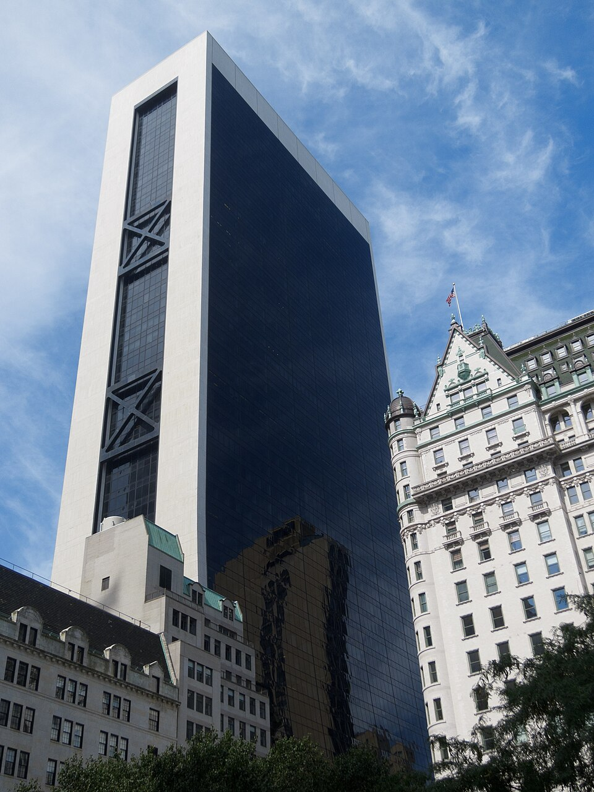

# 스페이스X의 AI 칩, 돈은 다 내도 주인은 자산운용사 아폴로

_아폴로가 운용하는 법인이 엔비디아 칩을 사서 5년 넘게 빌려주고, 스페이스X는 그 사이 400억 달러를 나눠 갚는다_

## Executive Summary

> [!callout]
> 스페이스X가 AI 칩을 사지 않고 빌리기로 했다는 소식이다. 10월 26일 미국 증권거래위원회에 낸 공시에 따르면 아폴로 글로벌 매니지먼트가 운용하는 법인이 엔비디아 차세대 칩과 서버 장비를 사들이고, 스페이스X는 그것을 물량마다 5년에서 5년 3개월씩 빌려 쓴다. 장비가 도착하는 2027년 상반기부터 임대가 시작된다.

> 공시가 적은 400억 달러는 스페이스X가 리스 기간에 임대료로 갚기로 한 원금의 합계다. 분기마다 내는 돈은 세 조각인데, 그 가운데 원금 몫이 해당 물량 조달원가의 5%다. 스무 분기면 100%가 된다. 값을 다 치르는 셈인데도 장비를 가진 쪽은 아폴로가 운용하는 법인이고, 리스가 끝난 뒤 그 장비가 누구 것이 되는지는 공시에도 보도자료에도 적혀 있지 않다.

> 1절부터 4절까지는 스페이스X가 낸 공시와 아폴로 보도자료, 같은 날 나온 앤트로픽의 상장 신청서, 그리고 이를 옮긴 보도에서 확인되는 내용을 따라간다. 소유와 사용이 갈린 자리에서 데이터의 거처를 다시 묻는 5절은 이 글의 해석이다.

### 주요 수치

이 계약을 숫자 넷으로 줄이면 이렇다. 앞의 셋은 공시와 상장 신청서에 적힌 값이고, 마지막 칸은 어디에도 적히지 않은 자리다.

출처: [아폴로 보도자료](https://www.apollo.com/insights-news/pressreleases/2026/10/spacex-secures--40-billion-in-the-largest-gpu-financing-ever) · [TechCrunch](https://techcrunch.com/2026/10/26/spacex-locks-in-40b-gpu-financing-deal-with-apollo) · [Tech Monitor](https://www.techmonitor.ai/news/spacex-secures-40bn-finance-lease-commitment-for-gpus) (2026-10-26)

<!-- stat-card -->
**400억** — 리스 기간에 갚을 원금 합계(달러) — 아폴로 쪽 법인이 장비를 사는 데 드는 돈이자, 스페이스X가 갚을 원금이다

<!-- stat-card -->
**100%** — 리스 기간에 갚는 조달원가 비율 — 분기마다 5%씩 스무 번. 그래도 소유자는 아폴로가 운용하는 법인이다

<!-- stat-card -->
**1,205억** — 앤트로픽이 스페이스X에 쓰기로 한 상한(달러) — 초기 구속 기간이 끝나면 양쪽 다 90일 통지로 끊을 수 있다

<!-- stat-card -->
**0건** — 리스 종료 뒤 장비 귀속을 적은 공개 문서 — 반환·매수 선택권·잔존가치 조항이 공시에도 보도자료에도 없다

## 서명한 것은 구매 계약이 아니다

스페이스X가 10월 26일 미국 증권거래위원회에 Form 8-K를 냈다. 이틀 전인 10월 24일에 구속력 있는 약정서에 서명했다는 내용이다. 약정의 상대는 아폴로 글로벌 매니지먼트가 운용하는 법인이고, 맺기로 한 계약의 이름은 마스터 파이낸스 리스다. 그 법인이 GPU 묶음과 관련 장비를 사들이면, 스페이스X가 자기가 고른 데이터센터에 그 장비를 놓고 빌려 쓴다.

금액은 약 400억 달러다. 다만 공시가 그 숫자를 어디에 붙였는지를 봐야 한다. 리스 일정이 저마다의 기간을 다 돌았을 때 스페이스X가 낸 원금의 합계가 그만큼이 될 것으로 본다는 뜻이다. 한 숫자가 두 자리를 겸한다. 그 법인이 장비를 사들이는 데 드는 돈이면서, 스페이스X가 임대료로 갚을 원금의 합계이기도 하다. 두 값이 같아진다는 이 전망이 거래의 성격을 가른다. 스페이스X는 이것을 지금까지 확정된 GPU 금융 가운데 가장 큰 규모라고 불렀다.

장비는 여러 물량으로 나뉘어 들어오고, 물량마다 리스 일정이 따로 붙는다. 각 일정은 그 물량이 도착한 날부터 약 5년에서 5년 3개월 동안 돈다. 마스터 계약 자체는 2026년이 끝나기 전에 체결할 것으로 보고, 실제 임대는 장비가 오는 2027년 상반기부터 시작된다. 임대료는 분기마다 선불로 낸다.

아직 정해지지 않은 조건도 공시에 그대로 적혀 있다. 리스에 붙는 고정금리는 가격을 매길 때 정한다고만 했다. 어떤 칩이 들어오는지도 공시 본문에는 없다. 엔비디아의 차세대 플랫폼 베라 루빈이라는 이름은 같은 날 아폴로가 낸 보도자료에서 나왔고, 스페이스X는 이 장비를 지상 컴퓨팅 증설에 쓴다고 밝혔다.

*▲ 이번 리스로 스페이스X에 들어올 엔비디아 차세대 베라 루빈 플랫폼 | Source: [NVIDIA Newsroom](https://nvidianews.nvidia.com/news/nvidia-vera-rubin-platform)*

자금을 댄 기관은 여럿이다. 자금 약정을 이끈 곳은 아폴로와 골드만삭스이고, 구조 설계는 골드만삭스가 단독으로 맡았다. 블랙록과 골드만삭스자산운용이 운용하는 펀드, 그리고 KKR이 자문하는 계정이 앵커로 들어왔다. 장비를 사서 빌려주는 임대인 자리에 서는 것은 아폴로가 운용하는 법인이지만, 그 뒤에는 여러 기관이 함께 서 있다.

스페이스X의 최고재무책임자 브렛 존슨(Bret Johnsen)은 아폴로 보도자료에서 회사의 목표와 이 거래의 쓰임을 이렇게 밝혔다.

"스페이스X는 세계에서 가장 큰 컴퓨팅 인프라를 배치하는 것을 목표로 합니다. 컴퓨팅 수요가 계속 가속되면서, 우리는 SI 인프라 투자에서 1년이 채 안 되는 회수 기간을 보고 있습니다."

존슨은 이 리스가 자금 조달원을 다변화하고 성장 계획에 필요한 자금의 상당 부분을 해결한다고도 말했다. 컴퓨팅의 용처로는 기업과 소비자를 위한 그록, 그리고 클라우드 서비스 고객을 들었다. SI는 스페이스X 안에서 이 사업을 맡은 부문의 이름이고, 3분기 매출 146억 달러 가운데 76억 달러가 여기서 나왔다.

## 돈은 다 갚는데 장비 주인은 따로 있다

이 거래에서 가장 덜 읽힌 대목은 분기마다 내는 돈의 구성이다. 보도된 조건에 따르면 선불 임대료는 세 조각으로 나뉜다. 첫째, 그 물량에 들어간 조달원가의 5%, 곧 20분의 1이다. 둘째, 남은 리스 잔액에 고정 연이율로 붙는 이자다. 셋째, 미리 정해 둔 운영비와 비용이다.

첫 조각만 따로 떼어 세어 보면 결론이 분명해진다. 분기마다 5%씩 내면 스무 분기, 그러니까 5년이면 100%가 된다. 공시가 적은 리스 기간은 5년에서 5년 3개월이니, 그중 짧은 쪽과 맞물리는 숫자다. 실제로 보도는 누적 원금 지급액이 각 기간 동안 조달된 금액과 같아지는 것으로 전망된다고 적는다. 스페이스X는 장비를 사는 데 든 돈을 전부, 거기에 이자와 운영비까지 얹어 치른다.

그런데도 장비를 가진 쪽은 스페이스X가 아니다. 공시와 보도자료가 한결같이 적는 구조는 아폴로가 운용하는 법인이 장비를 취득해 스페이스X에 임대한다는 것이다. 값을 다 치르는 쪽과 소유자가 갈린다.

*▲ 장비를 사서 스페이스X에 빌려주는 임대인 — 아폴로 글로벌 매니지먼트 본사(뉴욕 솔로 빌딩) | Source: [Wikimedia Commons (King of Hearts, CC BY-SA 3.0)](https://commons.wikimedia.org/wiki/File:Solow_Building_New_York_August_2012.jpg)*

> [!callout]
> 그러면 5년 뒤에는 어떻게 되는가. 장비를 돌려주는지, 스페이스X가 정해진 값에 사 올 수 있는지, 그때 남은 가치는 누구의 몫인지. 공시에도, 아폴로 보도자료에도, 이를 옮긴 어느 보도에도 이 조항은 나오지 않는다. 금액과 기간과 금리 산식은 공개됐고 끝나는 자리만 비어 있다.

회계 처리도 마찬가지로 비어 있다. 파이낸스 리스라는 이름은 보통 빌린 쪽 장부에 사용권 자산과 리스 부채가 함께 올라가는 분류를 가리킨다. 기간이 자산 수명의 상당 부분을 덮거나 지급액의 현재가치가 공정가치에 거의 닿으면 그렇게 분류되는데, 위에서 본 원금 산식은 뒤쪽 조건에 가깝다. 다만 공시가 분류를 명시하지 않았으므로, 이 거래가 스페이스X 재무제표에서 빠지는 구조라고 단정할 근거는 지금 공개된 문서에 없다.

이 공백을 은폐로 읽을 필요는 없다. 구속력 있는 약정서 단계의 공시가 모든 조항을 담지 않는 것은 흔한 일이고, 마스터 계약은 아직 체결 전이다. 다만 이 거래를 두고 쏟아진 숫자가 전부 앞쪽 조건이라는 사실은 남는다. 400억 달러도, 5년도, 5%도 모두 나가는 돈을 적은 값이고, 그 돈이 끝났을 때 무엇이 남는지를 적은 값은 아직 하나도 없다.

## 왜 사지 않고 빌리나

답의 절반은 공시 전날 일론 머스크가 X에 올린 글에 있다. 머스크는 200곳이 넘는 네오클라우드가 치어처럼 떼로 죽고 통폐합될 것이라고 썼다. 네오클라우드는 GPU를 사들여 시간 단위로 빌려주는 신생 임대업체를 가리킨다. 그가 든 이유는 수요가 모자란 데 있지 않았다. 돈줄이었다.

"채권시장은 AI 데이터센터와 무관한 상당한 매출이 없는 회사라면 어디든 자금 접근을 거의 완전히 차단했다."

스페이스X가 그 선 안쪽에 있다고 머스크가 든 근거는 두 가지다. 하나는 이미 400억 달러 조달을 확보했다는 것이고, 다른 하나는 스타링크처럼 AI 인프라 바깥에서 나오는 매출이 있다는 것이다. 신용평가사도 6월 18일 스페이스X에 투자등급을 매겼다. 무디스가 Baa1, S&P가 BBB, 피치가 BBB+이고 셋 다 안정적 전망이었다.

다만 딱지와 가격은 갈린다. 등급을 받고 3주가 지나지 않은 7월 초, 스페이스X 채권의 평균 신용 스프레드는 국채 대비 1.62%포인트였다. BBB 등급 평균 0.92%포인트보다 훨씬 넓고, 투기등급인 BB 평균 1.55%포인트보다도 넓은 값이다. 10월 5일 기준으로 2046년 만기 채권은 7.84%, 2056년 만기 채권은 7.67%에 거래됐다. 투자등급 딱지를 받은 회사가 시장에서는 그보다 비싸게 빌리고 있고, 이 간극은 등급이 붙자마자 벌어져 있었다. 무디스도 등급을 매기면서 대규모 AI 증설의 집행 부담과 지속되는 마이너스 잉여현금흐름, 불확실한 수익을 제약 요인으로 들었고, S&P는 그 마이너스가 2029년까지 이어질 것으로 봤다.

비교 대상을 보면 머스크가 가른 선이 어디인지 뚜렷해진다. 순수 GPU 임대업체인 코어위브의 5년 만기 신용부도스와프 프리미엄은 10월 15일 1,194.5bp까지 올라 사상 최고를 찍었다. 시장 가격에서 역산하면 5년 안에 부도가 날 확률이 60%를 넘는 것으로 읽힌다. 실제 확률이 아니라 위험중립 가정에서 나온 값이지만, 같은 잣대로 잰 다른 회사와 견주기에는 충분하다. 같은 달 하이퍼스케일러 가운데 채권 수익률이 7.5%를 넘는 곳은 오라클과 스페이스X뿐이었다. 돈줄이 좁아진 시장에서 자산을 직접 사들이는 대신 밖에 임대인을 세우는 것은, 빌리는 값이 비싸진 회사가 고를 수 있는 몇 안 되는 길이다.

그러면서도 직접 사는 일은 그대로 이어진다. 스페이스X는 3분기에만 설비투자로 196억 달러를 썼다. 존슨은 10월 20일 실적 발표에서 4분기 설비투자를 350억~400억 달러로 잡았다. 이번 리스로 5년에 걸쳐 갚을 원금 합계가 400억 달러다. 한 분기에 현금으로 나갈 돈과 5년치 리스 원금이 같은 자리에 선다. 사는 속도를 그대로 두고 더 늘리려면 사지 않고 쓰는 통로가 하나 더 있어야 한다.

같은 주 메타도 AI 시설 자금을 주식으로 모으겠다고 발표했고, 그 공모에 칩을 파는 회사들이 투자자로 이름을 올렸다. 돈을 대는 쪽과 장비를 파는 쪽이 한 거래 안에서 겹치는 구조는 이 블로그에서 [한 번 다룬 적이 있다](/blog/meta-equity-raise-chip-supplier-cornerstone/ko/). 이번 리스는 그 변형이다. 이번에는 돈을 대는 자리에 칩 공급사 대신 자산운용사가 섰고, 그 대가로 받는 것도 지분 대신 장비의 소유권이다.

## 빌리는 쪽이자 빌려주는 쪽이다

같은 10월 26일, 앤트로픽이 상장 신청서를 냈다. 거기에 스페이스X와 맺은 계약이 적혀 있다. 앤트로픽은 올해 5월부터 10월 사이 스페이스X의 완전자회사인 SpaceX.AI LLC와 여러 건의 컴퓨팅 계약을 맺고 고쳤으며, 2029년까지 이어지는 기간 동안 최대 1,205억 달러를 쓰기로 했다고 밝혔다. 계약한 용량이 모두 인도되는 2026년 12월 이후에는 한 달에 약 31억 달러씩 나간다.

용량의 내용도 신청서에 적혀 있다. 처음 통째로 받은 콜로서스 1 시설만 해도 엔비디아 GPU 22만 개가 넘고 전력은 300메가와트가 넘는다. 여기에 나중에 가동되는 콜로서스 2가 더해진다. 장비에는 베라 루빈도 포함된다고 했다. 다만 이 물량이 아폴로에서 빌려 오는 물량과 같은 것인지는 두 문서 어디에도 갈라 적혀 있지 않다.

1,205억 달러는 천장이지 약속이 아니다. 신청서는 두 계약의 초기 해지 불가 기간이 각각 2027년 1월과 3월에 끝나고, 그 뒤로는 앤트로픽이든 스페이스X든 90일 전에 서면으로 알리면 끊을 수 있다고 적는다. 이 조항 때문에 두 계약의 성질이 갈린다. 아래 표가 그 차이다.

|  | 아폴로와 맺은 리스 | 앤트로픽과 맺은 컴퓨팅 계약 |
| --- | --- | --- |
| 스페이스X의 자리 | 빌려 쓰는 쪽 | 빌려주는 쪽 |
| 금액 | 원금 합계 약 400억 달러(나가는 돈) | 최대 1,205억 달러(들어오는 돈) |
| 기간 | 물량마다 약 5년~5년 3개월, 2027년 상반기 시작 | 2029년까지 |
| 중간에 끊을 수 있나 | 구속력 있는 약정. 해지 조항은 공개되지 않았다 | 2027년 1월·3월 이후 90일 통지로 양쪽 다 가능 |
| 근거 문서 | 스페이스X Form 8-K(10월 26일) | 앤트로픽 Form S-1(10월 26일) |

한쪽은 5년 넘게 묶이고 한쪽은 90일이면 풀린다. 장비를 빌려 쓰는 의무는 길고 단단한데, 그 장비로 버는 돈은 짧고 느슨하다.

이 느슨함이 앤트로픽 쪽의 일반적인 조건인 것도 아니다. 앤트로픽이 2025년 말 이후 새로 맺은 계약의 최소 지급 의무만 더해도 약 4,170억 달러다. 조건이 아직 확정되지 않아 이 합계에 들어가지 않은 구글 TPU 몫은 따로 있다. 구글과 맺은 컴퓨팅 계약은 2026년 4월부터 2033년 7월까지 최소 1,145억 달러인데, 구글이 계약을 중대하게 어기지 않는 한 해지할 수 없다. 스페이스X 몫 1,205억 달러와 금액은 비슷하고 끊는 조건은 반대다. 앤트로픽의 상장 신청서에서 손익 항목을 읽는 법은 [따로 정리한 적이 있다](/blog/anthropic-s1-operating-loss-vs-net-loss/ko/).

두 계약을 겹쳐 놓으면 칩 한 묶음 위에 세 겹이 쌓인다. 소유하는 쪽, 빌려 쓰면서 다시 빌려주는 쪽, 그 위에서 실제로 모델을 돌리는 쪽이다.
