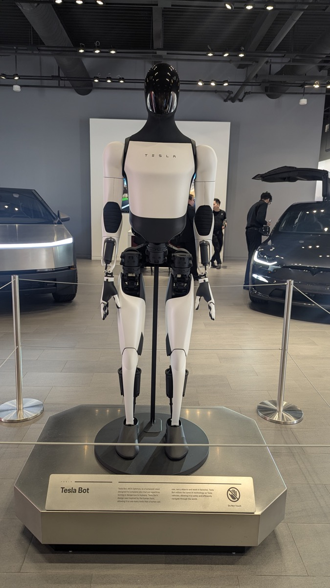

# Tesla Won

_On the same third-quarter earnings call, Musk said it takes 10,000 to 20,000 robots running self-play to gather the data that teaches Optimus its work_

## Executive Summary

> [!callout]
> This article reads the Optimus mass production announcement Tesla put out alongside its third-quarter results on October 21, 2026. The heart of it is that the robots coming off the high-volume line at the Fremont plant in California are the first Tesla has built to production quality.

> The list of what that same announcement held back is longer. How fast the line runs, how many robots have come off it so far, what one costs, when a customer could buy one, and which generation is on the line were all left out. And in that same room Elon Musk said that getting the data to teach a robot its work means building 10,000 or 20,000 of them and having them play against themselves. The count Tesla needs it gave as a figure. The count Tesla has it did not give at all.

> Sections 1 through 3 follow what is written in Tesla's third-quarter update, in the earnings call transcript, and in the reporting from that room. Sections 4 and 5, which read the undisclosed count as the denominator of the robot training data market, are this article's own.

### Key numbers

The first two cover what Tesla did not say and what it said it needs. The last two cover the target rate and what happened to the financials while that target was being chased.

Sources: [TechCrunch](https://techcrunch.com/2026/10/21/tesla-stars-optimus-robot-production-in-california-as-profit-falls-43/) · [Tesla North](https://teslanorth.com/2026/10/21/tesla-optimus-production-quality-fremont/) · [Q3 earnings call transcript](https://www.fool.com/earnings/call-transcripts/2026/10/22/tesla-tsla-q3-2026-earnings-call-transcript/) (October 21–22, 2026)

<!-- stat-card -->
**Five** — Items the production announcement left blank — Production rate, cumulative count, price, customer sale date, generation in build. The California row of the factory table says 'Early Ramp' and nothing more

<!-- stat-card -->
**10,000–20,000** — Robots Musk said the learning requires — Build that many, have them play against themselves, and the data accumulates, he said. A different number from the production rate target

<!-- stat-card -->
**20,000 a week** — Annualized production rate target — Musk said getting there takes "at least a year, maybe a little longer"

<!-- stat-card -->
**43%** — Fall in third-quarter net income — $787 million. The same quarter a year earlier was $1.37 billion

## The Fremont Line Is Running, but Five Things Stay Undisclosed

On October 21, 2026 Tesla put out its third-quarter business update with one sentence in it. Optimus production has started on the high-volume line at Fremont, and what comes off that line is the first robot Tesla will call production quality. It also means that nothing built before it earns the label.

*▲ Optimus on display at a Tesla showroom (November 2025) | Sikander Iqbal, CC BY-SA 4.0, [Wikimedia Commons](https://commons.wikimedia.org/wiki/File:Optimus_bot_at_Tesla_showroom_-_20251118_-_01.jpg)*

What gave up the floor space was the Model S and the Model X. Musk announced the end of both at the fourth-quarter earnings call on January 28, 2026, and the last cars left the line in the second quarter of 2026. The two debuted in 2012 and 2015 and sold about 750,000 between them. According to a time-lapse Tesla's manufacturing account posted on July 10, tearing that assembly line out took 46 days. Concrete trenches come up, robotic equipment goes out, rebar goes down on a new floor.

*▲ The Model S body line at Fremont (2012) — the Optimus line now occupies this same floor space | Steve Jurvetson, CC BY 2.0, [Wikimedia Commons](https://commons.wikimedia.org/wiki/File:Tesla_Motors_Assembly_Line_(6858583426).jpg)*

What the announcement did not say can be counted off a list. Tesla North named five items the announcement leaves unconfirmed: the production rate, the number built so far, the price, when customers can buy one, and which generation of Optimus Fremont is building. In the factory status table the California row reads 'Early Ramp' and the Texas row, where the second line will go, reads 'Construction.' The stage has a name. The number of units coming out of that stage does not.

The same table carries that number on its other rows. The vehicle lines each list an annual production capacity as a figure. The format for writing capacity down already sits inside that table, and only the two Optimus rows leave the cell empty.

## Every Number Musk Gave Belongs to the Future

Musk handed out plenty of numbers on the call. Most of the equipment for a line designed at a million units a year is already inside Fremont, he said. On the annualized rate of 20,000 a week: "I would expect that it takes us probably at least a year, maybe a little longer to get to that annualized rate to get to 20,000 units a week." Deliveries to outside customers sit about a year out, late 2027, conditional on sorting out the AI architecture and the reliability and durability of the electromechanical design.

Outside Fremont the numbers get bigger. The second line going up on the north campus at Giga Texas aims at 10 million units a year, ten times the Fremont target, a figure Ashok Elluswamy, who leads Tesla's AI work, has confirmed publicly. When that rate arrives the company has never said, and in this quarter's factory table the Texas row still reads 'Construction.'

The outlook on speed is careful too. Of the early stretch of the S-curve Musk said it "has a shallow slope and is somewhat bumpy because it is such a radically new product." The biggest obstacle named was the hand. Konstantinos Laskaris, who leads Optimus engineering, said "the hand is one of the most challenging hardware areas actually," and Musk filled it in: "It's hard to make a hand that... can handle lots of wear and tear, but it's still squishy enough to pick up delicate objects and has all the sensors."

Line these numbers up and what they have in common is plain. None of them has been reached. The design capacity is a specification of the line, 20,000 a week is a target a year out, late 2027 is a delivery date. The only figure missing is the one that says how many robots are actually standing right now.
