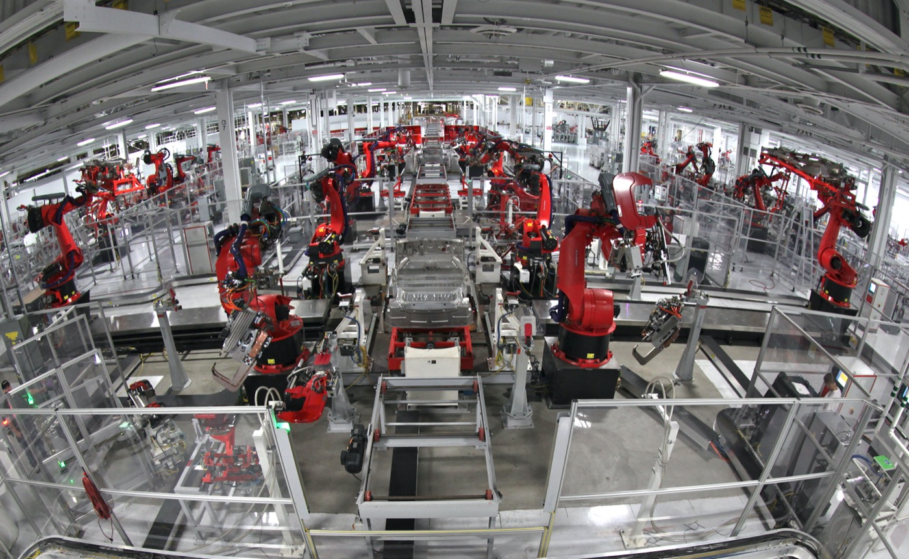

# 테슬라 옵티머스, 몇 대 만들었는지는 말하지 않는다

_테슬라 3분기 실적 발표에서 머스크는 로봇을 가르칠 데이터를 모으려면 옵티머스 1만~2만 대가 필요하다고 말했다_

## Executive Summary

> [!callout]
> 이 글은 테슬라가 2026년 10월 21일 3분기 실적과 함께 내놓은 옵티머스 양산 개시 발표를 읽는다. 캘리포니아 프리몬트 공장의 고용량 라인에서 나온 로봇이 테슬라가 만든 첫 양산 품질 제품이라는 것이 발표의 골자다.

> 같은 자리에서 밝히지 않은 쪽이 더 길다. 생산 속도도, 지금까지 만든 대수도, 가격도, 고객에게 파는 시점도, 어느 세대를 만들고 있는지도 공개하지 않았다. 그런데 바로 그 자리에서 일론 머스크는 로봇에게 일을 가르칠 데이터를 얻으려면 1만~2만 대를 만들어 스스로 겨루게 해야 한다고 말했다. 필요한 대수는 숫자로 말하고, 가진 대수는 말하지 않은 셈이다.

> 1절부터 3절까지는 테슬라의 3분기 업데이트 자료와 실적 발표 녹취록, 그리고 그 자리를 전한 보도에 적힌 내용을 따라간다. 공개되지 않은 대수를 로봇 학습 데이터 시장의 분모로 읽는 4절과 5절은 이 글의 해석이다.

### 주요 수치

앞의 둘은 테슬라가 말하지 않은 것과 필요하다고 말한 것을, 뒤의 둘은 목표 속도와 그 목표를 좇는 동안 재무에서 일어난 일을 말한다.

출처: [테크크런치](https://techcrunch.com/2026/10/21/tesla-stars-optimus-robot-production-in-california-as-profit-falls-43/) · [테슬라노스](https://teslanorth.com/2026/10/21/tesla-optimus-production-quality-fremont/) · [3분기 실적 발표 녹취록](https://www.fool.com/earnings/call-transcripts/2026/10/22/tesla-tsla-q3-2026-earnings-call-transcript/) (2026년 10월 21~22일)

<!-- stat-card -->
**다섯 가지** — 양산 발표가 비워 둔 항목 — 생산 속도, 누적 대수, 가격, 고객 판매 시점, 제작 중인 세대. 공장 현황표의 캘리포니아 칸은 'Early Ramp' 한 마디다

<!-- stat-card -->
**1만~2만 대** — 머스크가 학습에 필요하다고 말한 로봇 수 — 이만큼 만들어 스스로 겨루게 해야 데이터가 모인다는 설명. 생산 속도 목표와는 다른 수다

<!-- stat-card -->
**주 2만 대** — 연환산 목표 생산 속도 — 머스크는 여기까지 "최소 1년, 어쩌면 조금 더" 걸린다고 말했다

<!-- stat-card -->
**43%** — 3분기 순이익 감소폭 — 7억 8,700만 달러. 1년 전 같은 분기는 13억 7,000만 달러였다

## 프리몬트 라인은 돌아가는데, 밝히지 않은 것이 다섯 가지다

2026년 10월 21일 테슬라가 3분기 사업 업데이트를 내면서 한 문장을 적었다. 프리몬트의 고용량 라인에서 옵티머스 생산이 시작됐고, 이 라인에서 나오는 로봇이 테슬라가 지금까지 만든 것 가운데 첫 양산 품질 제품이라는 내용이다. 그 전까지 만들어진 로봇은 양산 품질로 치지 않는다는 뜻이기도 하다.

*▲ 테슬라 쇼룸에 전시된 옵티머스(2025년 11월) | Sikander Iqbal, CC BY-SA 4.0, [Wikimedia Commons](https://commons.wikimedia.org/wiki/File:Optimus_bot_at_Tesla_showroom_-_20251118_-_01.jpg)*

자리를 내준 쪽은 모델 S와 모델 X다. 머스크는 2026년 1월 28일 4분기 실적 발표에서 두 차종의 단종을 알렸고 마지막 차량은 2026년 2분기에 라인을 떠났다. 2012년과 2015년에 각각 데뷔해 합쳐 75만 대쯤 팔린 라인이다. 테슬라 제조 계정이 7월 10일 공개한 타임랩스 영상에 따르면 그 조립 라인을 걷어내는 데 46일이 걸렸다. 콘크리트 트렌치를 뜯어내고 로봇 설비를 들어내고 새 바닥에 철근을 까는 장면이 이어진다.

*▲ 프리몬트 공장의 모델 S 차체 라인(2012년) — 이 라인이 있던 자리에 옵티머스 라인이 들어섰다 | Steve Jurvetson, CC BY 2.0, [Wikimedia Commons](https://commons.wikimedia.org/wiki/File:Tesla_Motors_Assembly_Line_(6858583426).jpg)*

발표가 말하지 않은 쪽은 목록으로 셀 수 있다. 테슬라노스는 이번 발표에서 확인되지 않은 항목으로 생산 속도, 지금까지 만든 대수, 가격, 고객에게 파는 시점, 그리고 프리몬트에서 만들고 있는 옵티머스의 세대를 꼽았다. 공장 현황표에서 캘리포니아 칸의 상태는 'Early Ramp'(초기 증산)이고, 두 번째 라인이 들어설 텍사스 칸은 'Construction'(건설 중)이다. 단계 이름은 있는데 그 단계에서 몇 대가 나오는지는 없다.

같은 표의 다른 줄에는 그 수가 적혀 있다. 차량 라인 줄에는 공장마다 연간 생산능력이 숫자로 올라와 있다. 적는 양식이 이미 그 표 안에 있는데, 옵티머스가 들어간 두 줄에서만 그 칸이 비었다.

## 머스크가 준 숫자는 전부 미래의 숫자다

실적 발표에서 머스크가 내놓은 수는 적지 않다. 프리몬트에는 연간 100만 대 규모로 설계한 라인의 설비 대부분이 이미 들어와 있다고 했다. 주당 2만 대라는 연환산 속도에 대해서는 "거기까지 가는 데 아마 최소 1년, 어쩌면 조금 더 걸린다"고 말했다. 외부 고객 인도는 2027년 말쯤으로 잡혔고, 그 전에 AI 구조와 전기기계 설계의 신뢰성, 내구성을 풀어야 한다는 조건이 붙었다.

프리몬트 밖으로 나가면 수는 더 커진다. 기가 텍사스 북쪽 부지에 짓고 있는 2호 라인의 목표는 연간 1,000만 대다. 프리몬트 목표의 열 배이고, 테슬라 AI를 이끄는 아쇼크 엘루스와미가 공개적으로 확인한 수이기도 하다. 다만 언제 그 속도에 닿는지는 회사가 말한 적이 없고, 이번 공장 현황표에서 텍사스 칸은 여전히 'Construction'이다.

속도에 대한 전망도 조심스럽다. 머스크는 S자 곡선의 초반부를 두고 "기울기가 완만하고 다소 울퉁불퉁하다. 워낙 근본적으로 새로운 제품이기 때문"이라고 말했다. 가장 큰 걸림돌로는 손이 지목됐다. 옵티머스 엔지니어링을 이끄는 콘스탄티노스 라스카리스는 "손은 하드웨어 영역에서 가장 어려운 축에 든다"고 했고, 머스크는 "마모를 견디면서도 섬세한 물건을 집을 만큼 말랑하고, 센서까지 다 들어간 손을 만들기는 어렵다"는 말로 설명을 보탰다.

이 수들을 나란히 놓으면 공통점이 보인다. 전부 아직 도달하지 않은 값이다. 설계 용량은 라인의 사양이고, 주당 2만 대는 1년 뒤의 목표이고, 2027년 말은 인도 시점이다. 현재 시점에 실제로 몇 대가 서 있는지를 말하는 수만 비어 있다.
