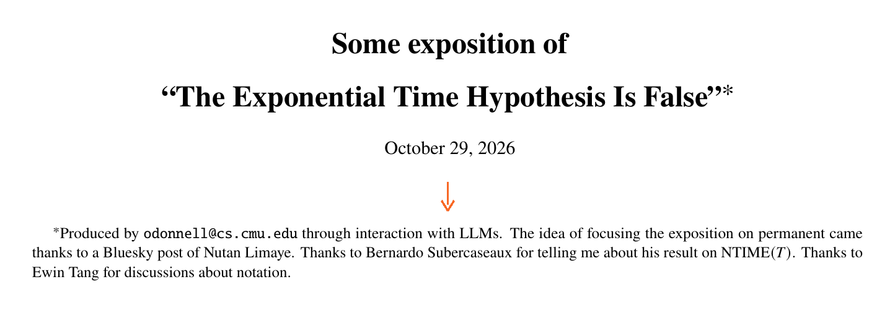

# The Exponential Time Hypothesis is false, the papers say. Where do they say an AI found it?

_Two papers from OpenAI and Anthropic and the four write-ups that followed put the sentence about using a model in seven different places_

## Executive Summary

> [!callout]
> On October 26, 2026, OpenAI put a 67-page paper into its own repository saying the Exponential Time Hypothesis is false. About six hours later Anthropic put up a 49-page paper of its own. Neither author field carries a human name. Within the five days that followed came two human-written documents, a simplified proof and an exposition, plus a Lean bridge joining the two proofs and a third-party certificate measuring the join. This article looks at where each of those six documents wrote the sentence "an AI found this."

> Every one of them said a model had been used. What differed every time was where the sentence sat: outside the paper entirely, inside the opening section, in an appendix, in an unnumbered paragraph at the very end of the body, in a footnote on page 1, in the body of a GitHub issue, at the bottom of a comment. Academic policies agree that an AI cannot be listed as an author, and both papers came out somewhere those policies do not reach. The document that reads as most trustworthy, meanwhile, is not the one that claimed the most but the one that wrote down what it had not checked. One appendix section of the Anthropic paper lists four layers of machine checking and, in the same section, states that no machine can check whether the definitions say what they are meant to say.

> Five days in, one person tried putting both proofs into a single kernel. The statements themselves came out as the same term, but across the two library versions even addition on the reals was a different term. The verdict was DIFFERENT, and the same record carries "almost certainly the same mathematics" and "no single kernel has yet checked it" side by side. That is where the facts end. What follows is this article's reading of them. Nobody has settled where the words beside "an AI found this" belong or what they have to say, and the best model published so far is an appendix section that wrote down where its own checking stopped.

<!-- stat-card -->
**6 documents / 7 places** — Documents on the same theorem in five days, and where inside each the AI notice sits — Only the Anthropic paper used two places, which is why places outrun documents by one (§§2, 4)

<!-- stat-card -->
**0 hits** — `Lean`, `Claude` and the discovery date across all 67 pages of the OpenAI paper — How the result was found appears nowhere inside the paper. All of it sits outside (§2)

<!-- stat-card -->
**412 constants** — Constants that failed to match when both proofs were loaded into one kernel — Among them are addition, multiplication, 0 and 1 on the reals (§6)

<!-- stat-card -->
**1010000** — Variables needed before the algorithm starts beating brute force — Brute force is already out of reach at 100 variables. There is no practical gain (§1)

## What happened in five days

One name needs separating out first. The ETH in this article shares its spelling with the ticker for Ether and has nothing to do with it. Here ETH is the Exponential Time Hypothesis, a conjecture in computational complexity that Russell Impagliazzo and Ramamohan Paturi put forward in 1999 and published in a journal in 2001. At least one outlet has built a headline on the collision.

The hypothesis itself fits in a sentence. Take 3-SAT: given n true-or-false variables and a pile of three-literal clauses, can every clause be satisfied at once? The conjecture says you cannot settle that question in time growing more slowly than exponentially in the number of variables. In symbols, no 2o(n)-time algorithm exists, and this article calls that kind of running time subexponential. The conjecture matters less for itself than for what has been stacked on top of it. A large share of the lower bounds in the field, the results of the form "this problem cannot be solved any faster than that," hold only because they assume it.

In the last week of October 2026, two companies released papers saying the assumption is false, less than a day apart. The event itself has already been covered: TechCrunch ran a piece on October 27, and Korean-language outlets followed on October 28. So this section lays out only the facts the other five sections lean on, in order of time, and moves on.

### 1.1. One change, three official timestamps

The table below gathers the timestamps left in both repositories alongside the dates the announcements state. Both companies are on a single timeline rather than in separate columns for a simple reason: both put the discovery on October 16, and the order of publication came after that. All times are UTC, which the trailing `Z` marks.

| When | What | Which record says so |
| --- | --- | --- |
| 2026-10-16 | An internal OpenAI model produces a natural-language refutation; the same day, an internal Claude research model finds the core algorithm | OpenAI announcement · Anthropic paper, §1 |
| 2026-10-17 | OpenAI's Lean formalization completed | OpenAI announcement |
| 2026-10-25 | OpenAI paper revised | Title page: 17 October 2026, revised 25 October 2026 |
| 2026-10-26 20:35:02Z | The commit adding the paper to the repository is authored (author: Dan Roberts) | Author time on commit 42907c9e. Its commit time is 20:52:18Z, a third value |
| 2026-10-26 21:18:04Z | That change merges into main and becomes visible from outside | merged_at on PR #3. The merge commit itself reads 21:18:03Z |
| 2026-10-26 | Shiva Kintali releases a 22-page simplified proof | Kintali title page |
| 2026-10-27 03:07:22Z | The Anthropic paper and Lean development go public | merged_at on anthropics/formal-math PR #31 |
| 2026-10-28 | Lance Fortnow posts his judgment on his blog; a developer files a GitHub issue carrying a Lean bridge between the two proofs | Blog post · issue #36 |
| 2026-10-29 | Ryan O'Donnell releases a 20-page exposition; a different person releases a certificate measuring the join between the two proofs | O'Donnell write-up · comment on issue #36 |

````````

Table 1. October 16 to 29, 2026. Rows carrying only a date come from announcements and title pages; rows down to the second come from the GitHub API. Live counters such as fork counts on the OpenAI side are left out, and the repositories were queried on October 31, 2026.

The rows worth staring at are the two from October 26. A single change carries three official timestamps: authored at 20:35:02Z, committed at 20:52:18Z, merged at 21:18:04Z. Coverage picks one of them, and which one it picked usually goes unwritten. The whole of what this article is about sits here in miniature. The problem is not that the record is thin but that it is plural, and when nobody writes down which record they used, the reader cannot line them up.

One misreading is worth closing off here too. Anthropic did not scramble to follow six hours behind. The `anthropics/formal-math` repository was created on August 6, 2026, and already held a result on the Riemann zeta function and another on the 3SUM problem; it is a standing channel. The Exponential Time Hypothesis is its third project. And the immediate release on the OpenAI side was not the company's call either, but a disclosure practice set by an outside verification group. That story is §5.

### 1.2. Nothing gets any faster

Any hope that this makes real computation faster is retracted by the papers themselves first. Section 1 of the Anthropic paper states that on a typical 3-SAT formula with five times as many clauses as variables, the bound beats brute-force 2n only once the variable count passes 1010000, and that the bound written in terms of variables alone, independent of clause count, needs more than 10108. It also states that the approach yields nothing at all below 107 variables. The very next sentence notes that brute force is already impractical at 100 variables.

Thus our result says nothing about solving formulas in practice.
                        Source: Anthropic, A 2^{o(n)} Time Algorithm for 3-SAT, §1

That does not make the result empty. What moves is not speed but a premise. The Anthropic paper states that more than 800 papers prove their results resting on this hypothesis or one that implies it, and that number arrives with two conditions attached in the same sentence. One is that the literature survey behind it was run by Claude. The other is that results also provable from assumptions this work does not refute, such as the Orthogonal Vectors conjecture, were excluded from the count. The OpenAI announcement writes the same claim as "hundreds" and gives no criterion at all. The two companies' precision about the same fact already parts ways here.

Which is why the reaction from mathematicians was neither celebration nor reserve but a third register. Lance Fortnow, who writes the field's best-known complexity blog, caught that register in one sentence on October 28.

I have not verified the proof myself, but it is safe to assume now that the exponential-time hypothesis is toast.
                        Source: Lance Fortnow, Computational Complexity blog, 2026-10-28

He writes down that he has not checked, and then writes his judgment. That order is the form this article keeps running into across the five days of record, and as the later sections show, every document this article ends up valuing carries it. For context, the Pebblous blog covered [another chapter of the same repository](/report/openai-math-722-verification-ledger/en/) eighteen days ago. That piece counted formal-verification rates and a field that had been left empty; this one is looking at the form of the record. Same repository, different question.

## Two papers with no human name on them

Open the two papers side by side and the first thing that catches is the author field. The OpenAI paper gives the company name, **OpenAI**. The Anthropic paper gives **CLAUDE / ANTHROPIC**. Neither carries a human name, and that much they share; what differs is what each put in the vacated slot. One put a company there. The other put a model.


*▲ Direct capture of both title pages. Each author field names a company or a model, not a person | Source: [github.com/openai/math](https://github.com/openai/math), [github.com/anthropics/formal-math](https://github.com/anthropics/formal-math/tree/main/eth)*

The difference does not stop at the cover. This article converted both papers to text and counted words directly. Across all 67 pages of the OpenAI paper, `Lean`, `Claude`, `Anthropic` and `token` never appear, nor does any word meaning acknowledgment, nor the discovery date of October 16. Every count is zero. Anyone reading only this paper has no way to learn who made the result, when, or with what. That story lives only in the company announcement and the repository's README.

# Case-sensitive counts across the full 67-page OpenAI paper
Lean          0
Claude        0
Anthropic     0
token         0
acknowledg*   0
October 16    0

One counting trap is worth recording alongside. Search case-insensitively for `lean` and 79 hits come back, every one of them the letters inside `Boolean`. Each hit was opened in context, which is why the counts above are case-sensitive.

The Anthropic paper is the inverse. The provenance sits not outside the paper but in a paragraph at the end of §1, and that paragraph even carries the label `Provenance`. It is also not one sentence but two. The distinction matters enough to quote both.

The core algorithm was found on October 16 by an internal Claude research model with 14M output tokens and no human input. Anthropic researchers worked with Claude to improve the presentation, resulting in this paper.
                        Source: Anthropic paper, §1, paragraph labeled Provenance

What had no human in it is the **discovery**; the paper was made with humans. Compress the two sentences into one and the result is false. This is the first instance of what this article will go on calling the form of the record. Writing down the same fact in one sentence rather than two changes what gets across.

The model in the author field is not confined to the cover page humans read. Download the PDF hosted on the public platform Hexagon, open its document properties, and the `Author` field reads `Claude`. There is no human name even at the file-metadata level. Worth adding: the platform listing is itself a place where two records disagree. The repository's README still says a link is forthcoming, while the platform already carries the paper. It was checked against the Anthropic paper down to the page count of 49, the title and the title-page date, and it is the same document.

### 2.1. Academic policy says an AI cannot be an author

At which point the obvious question arrives. Can a model be the author of a paper? The bodies that distribute papers say no. The clearest verbatim is in arXiv's moderation rules, in three consecutive sentences.

… we now include in particular text-to-text generative AI among those that should be reported consistent with subject standards for methodology.  

                        … they each individually take full responsibility for all its contents, irrespective of how the contents were generated.  

                        … generative AI language tools should not be listed as an author; instead authors should refer to (1).
                        Source: arXiv Moderation Rules. "(1)" is the disclosure requirement quoted in the first line.

Other policies run the same way. ACM states that generative AI tools cannot be listed as authors under any circumstances and that all use must be disclosed within the work. The Committee on Publication Ethics, in its February 2023 position statement, wrote that AI tools cannot be authors because they cannot take responsibility, cannot declare conflicts of interest and cannot manage copyright. Springer Nature and Elsevier say the same. The shared reasoning converges on one point: authorship names a responsibility only a person can carry.

This article does not go on from there to "Anthropic broke the rules," because that is not what happened. Neither paper went to arXiv. OpenAI published to its own GitHub repository, Anthropic to its own repository and a new platform. The accurate sentence is this one. **The rule that an AI cannot be an author exists only where that rule reaches, and these two papers came out beyond it.** No rule was broken; the event happened on ground where no rule had yet been laid.

## What Lean checked and what it did not

"Verified in Lean" is attached to both papers. What that phrase covers, though, differs between the two companies. Before measuring the difference, the word needs splitting. In this article, verification can point at four distinct jobs: a machine walking back through every step of a proof; a second, separately built machine doing that walk again; a person judging whether a formal statement says what a person meant; and outside experts organizing community review. Call all four by one word and this section collapses.

The document that records the first two most tightly is an appendix section of the Anthropic paper. It writes out the machine path in four layers. First, the Lean 4 kernel accepted it; the kernel is the small program that re-walks a proof one step at a time. Second, `leanchecker` re-walked it module by module. Third, `nanoda`, a kernel implemented independently of Lean, accepted it through a comparator. Fourth, `leanchecker` re-walked it from scratch in an empty environment, covering every declaration the proof depends on, Mathlib included. All 1,050 Lean modules of the development were built together from nothing, and nothing escaped the standard axiom set of `propext`, `Classical.choice` and `Quot.sound`. The versions are pinned too: Lean 4.33.1 and Mathlib commit `0df444a3`.

Up to here it reads as "we checked everything." Then the same section turns around and writes down what was **not** checked. These three sentences are the passage this article values most in the whole five days of record.

Whether the two definitions say what they are meant to say, that the Exponential Time Hypothesis is false and the Main Theorem, no machine can check; that is for the reader of the listing to judge.  

                        The simulation and the rewriting are standard facts; they are not part of the Lean statements or proofs.  

                        The Lean development was written by AI models and reviewed by other instances of the same models; at the time of writing no person is known to have checked it.
                        Source: Anthropic paper, Appendix E

The last sentence needs reading one notch narrower. What it says is that **there is no record of a person checking the Lean development**, not that nobody read the paper. Those are different claims. The paper itself was read by plenty of people from the moment it went up, and §§4 and 6 of this article deal with what those people wrote. That one sentence surfaces the fact that what a machine passed and what a person read are two different objects.

### 3.1. Only one side has "the hypothesis is false" as a Lean statement

Open both companies' Lean files and set them against each other and the difference in scope sharpens. The Anthropic file defines the hypothesis inside Lean. It writes the lower bound on the exponent needed to solve 3-SAT as `s 3`, names the statement that this quantity is greater than zero the Exponential Time Hypothesis, and names its negation "the hypothesis is false." In that file, in other words, "the Exponential Time Hypothesis is false" exists as a statement a machine reads.

# The two definitions in Anthropic's MainResults.lean
ETH        := 0 < s 3
ETHIsFalse := ¬ ETH

The OpenAI file is another matter. Read all 220 lines and the word ETH never appears. What that file states is only the time and space bounds of an algorithm that counts satisfying assignments. The final step, from a bound growing more slowly than the variable count to the hypothesis being false, lives in prose outside Lean. The step itself is textbook, and a third party did in fact lay that bridge in Lean and publish it. That is §6.

Whether the formalized time bound matches the paper's headline also splits between the two. On the Anthropic side the main Lean theorem uses the same expression, literally, as Theorem 1 of the paper. On the OpenAI side what got formalized is not the stronger bound announced in Theorem 1.1 at the front, but the one §6.4 of the body calls the weaker exponent. The stronger bound lives in Appendix D alone and never went onto a machine. One thing is worth adding: the humans who wrote it out explain the same side. The exposition Ryan O'Donnell released picks up that weaker exponent on its first page and unpacks it. So what the machine holds and what the humans wrote out stand on the same side, and only the paper's headline sits further forward.

| What | OpenAI | Anthropic |
| --- | --- | --- |
| Name of the theorem put on a machine | exact_count_and_sat | ethIsFalse · mainTheorem |
| Is "the hypothesis is false" a Lean statement? | No. Only the counting algorithm's bounds; the last step is prose | Yes. The hypothesis and its negation are both defined |
| Which time bound reached Lean | The weaker exponent of §6.4. Headline Theorem 1.1 stays in an appendix | The same expression as Theorem 1 of the paper |
| Re-checked by an independent kernel (nanoda) | Off. Of 418 configurations in that repository, 2 have it on | On. It runs automatically on every configuration |
| A place recording what the machine cannot do | None | A whole appendix section |

``````

Table 2. The result of opening both companies' Lean files and configurations and setting them against each other. **This is not a scorecard.** The two repositories run different operations. The OpenAI side is a large repository turning hundreds of mathematical manuscripts and the 418 configurations that come with them; the Anthropic side is a small channel curating three projects by hand. The paragraph below unpacks that difference.

The fourth row invites misreading, so the counts belong with it. OpenAI did not single this paper out for skipping independent-kernel re-checking. Count all 418 configuration files in that repository and exactly two have the independent kernel on, 413 have it off, and three have no such entry at all. The Exponential Time Hypothesis configuration belongs to the 413. The difference, that is, is practice rather than intent, and without 418 against 2 written beside it the sentence bends the fact.

One last misreading to head off. Build either Lean development and a warning appears saying a declaration uses `sorry`. Since `sorry` is Lean's marker for a proof left blank, it looks like a defect, but here it is by design. The challenge file is the place where statements are written without proofs, and the actual proving happens in the main check below it. Anthropic's README says in advance that both warnings come from that file. For the record, the full build takes about eight minutes on 24 virtual CPUs and peaks around 7 GB of memory.

## The human write-ups carried the same notice

Had putting a model in the author field been one odd corporate choice, the story would end there. But across the same five days four more documents appeared under human names, and **all four carried the same notice.** What varied was not whether the notice was there but where it was put.

First is the 22-page simplified proof Shiva Kintali released on October 26. He put his notice at the very end of the body, in an unnumbered paragraph immediately before the references.

Use of AI: The author prompted Claude and ChatGPT interactively to simplify the proofs, focusing only on disproving basic statement of ETH, without optimizing log factors. The author expanded the proofs manually and made them more human-readable and added explanations and a worked example.
                        Source: Shiva Kintali, A simplified proof of ETH is false, 2026-10-26

Second is the 20-page exposition Ryan O'Donnell of Carnegie Mellon released on October 29. He chose the opposite end. He put an asterisk on the title on page 1 and the notice in that footnote, where the reader meets it before any of the body. And that footnote is this section's high point.

* Produced by odonnell@cs.cmu.edu through interaction with LLMs. The idea of focusing the exposition on permanent came thanks to a Bluesky post of Nutan Limaye. Thanks to Bernardo Subercaseaux for telling me about his result on NTIME(T). Thanks to Ewin Tang for discussions about notation.
                        Source: Ryan O'Donnell, Some exposition of "The Exponential Time Hypothesis Is False", 2026-10-29

Four attributions sit inside one footnote: one notice about using a model, three thanks to people. The person who supplied the idea, the person who pointed to another result, the person he worked through notation with. And all four are written in the same sentence shape, in a row. Of everything published so far this is the **only case that puts a model and people in the same place in the same form**. O'Donnell gave the model notice no special handling, and did not bury it either. He simply put it on the same line as the other help.


*▲ The footnote the title-page asterisk points to. The model notice and three thanks to people share one line | Source: R. O'Donnell, [Some exposition of "The Exponential Time Hypothesis Is False"](#references), 2026-10-29*

Third is not a paper but a GitHub issue. On October 28 a user going by TSavo opened issue #36 on the Anthropic repository. It runs four short paragraphs and contains nearly everything this article is about. The second paragraph is the notice, the third is what the writer could not verify, and it closes by declining to ask for anything.

I linked your Lean proof to OpenAI's. The theorem is `OpenAI.Claim → MainResults.ETHIsFalse` …  

                        Claude wrote it with me, and the kernels checked it.  

                        I haven't verified that `MainResults.lean` means ETH, so I'd like someone to look at that. I'm not asking you to merge anything.
                        Source: issue anthropics/formal-math#36, 2026-10-28T03:22:34Z

Fourth is a comment on that issue. A user going by carlostoledo1891 posted the result of machine-matching the two proofs and attached one line at the very bottom of the comment. Of everything this article read, it is the **only one that also writes down a conflict of interest**.

Disclosure: our tools and these proofs are written with Claude (Anthropic's model); one of the two claims is Anthropic's; no affiliation with either lab.
                        Source: comment on issue #36, 2026-10-29

Three things are in that one line: what tool was used, which of the two claims being matched belongs to whom, and that the writer is attached to neither lab. The same person left two comments on this issue, and the line appears once at the end of each. If the three places before this one record that a model was used, this line records who the person writing it is as well.

### 4.1. The same sentence, seven places

The five days can now go into one table. Six documents, seven places, because the Anthropic paper alone split its notice between §1 and an appendix. One rule for reading it, set before you look. **This table is not ranking anyone by diligence.** That all seven places are different, and that a reader therefore has no way of knowing in advance where to look, is everything the table says.

| # | Document | Author field | Where model use is written |
| --- | --- | --- | --- |
| 1 | OpenAI paper, 67 pages | OpenAI (company) | Not in the paper. Only in the announcement and the repository README |
| 2 | Anthropic paper, 49 pages | CLAUDE / ANTHROPIC (model) | Closing paragraph of §1 |
| 3 | Appendix of the same paper | — | A whole appendix section on what was checked and by whom |
| 4 | Kintali simplified proof, 22 pages | Shiva Kintali (person) | End of the body, one unnumbered paragraph |
| 5 | O'Donnell exposition, 20 pages | Not on the title page | Asterisk footnote on the page-1 title |
| 6 | Lean bridge between the two proofs | TSavo (person) | Second paragraph of a GitHub issue |
| 7 | Third-party join certificate | A person | A one-line "Disclosure" at the end of a comment |

Table 3. October 26 to 29, 2026: six documents on the same theorem and the seven places that record model use. All seven rows were confirmed against the sources themselves.

A company's document needed that sentence, a professor's document needed it, and so did a GitHub issue from an individual with no affiliation. On that count all seven are alike. The only difference is that nowhere has anyone settled where the sentence goes. The paper format has an author field, a place for acknowledgments, a place for references. It has no box for "a model found this result." So seven people picked seven places.

## What the people in the judging seat asked for first

Up to here this article has read what the documents say. This section looks at who asked for what before those documents existed. OpenAI published an announcement on the same day as the paper, and it sets out how the company works with outside researchers as four principles. Coverage has barely quoted the passage, so all four appear below as written.

**Transparency.** We are transparent about the existence of our collaborations. Participants will not be asked to sign nondisclosure agreements and will be free to discuss the work, share intermediate products, and publish their conclusions.  
**No Academic Credit.** We do not seek academic credit for the discoveries produced by our internal models. Inviting a researcher to help steward a collaboration also does not imply that they or their working group made the original discovery.  
**Recognition.** This group should receive recognition for the understanding they develop, the writeups they author, and the other materials they create.  
**Independence.** Participation is voluntary and unpaid. Working-group members participate independently, and their conclusions are their own. They do not speak on behalf of OpenAI, and OpenAI does not speak on their behalf.
                        Source: OpenAI, Working with academic communities to build scientific understanding, 2026-10-26

Read the second and fourth together and one sentence falls out. **Participation is not endorsement.** What this article expected at the planning stage was that the outside researchers would have demanded that line be drawn; in fact the company wrote it first. Reading the involvement of a named researcher as a guarantee of the result is a common move, and the sentence blocking that misreading came from the publishing side.

Who sits in that judging seat is itself a rare detail in this episode. The group handling the Exponential Time Hypothesis includes Russell Impagliazzo and Ramamohan Paturi, the two people who proposed the hypothesis in 1999. Ryan Williams of MIT is on it as well. The people who built the conjecture are seated where it is decided whether the conjecture has broken. This article quotes only those of the three whose public statements it could confirm; what Impagliazzo and Paturi have said about this result, it could not establish.

What the group asked of the company first was not confirmation of a conclusion but materials. The announcement states that two requests were accepted: release all raw artifacts behind the result so the community can verify it independently, and have OpenAI support a workshop on what the work means for the field as a whole. The same paragraph states that the group asked the community to help organize public review, hanging four questions on it at once: verification, access, credit and the future of research. The announcement also states that this collaboration complements a recently announced $5 million contribution to the Simons Foundation.

### 5.1. One company, one day, three disclosure rules

The announcement covers not one result but three. Their disclosure arrangements differ, and what matters is that the arrangement was set in each case by the outside group in that field rather than by the company. The table below gathers the three.

| Field | Disclosure arrangement the group set | Channel for talking back |
| --- | --- | --- |
| Mathematics | Release the AI output as is and let researchers organize themselves | None specified |
| Computer science | An outside collaboration group handles exposition, and the AI output goes out in full, immediately | GitHub issues, open |
| Physics | Hold the artifacts back and have the group write it up itself | One Gmail address |

****

Table 4. The disclosure arrangements for the three results in the OpenAI announcement. In all three rows the announcement credits the decision to the field's own researchers rather than to OpenAI.

The middle row is the result this article is about. The choice of full immediate release is what produced the six-hour shape, and that shape got covered as a race. The choice, though, was not the company's. And it carries a cost. Open the channel as GitHub issues and in comes the precise audit record §6 is built on, and into the same thread comes the crude noise alongside it. Physics picked the other side: no artifacts, and the channel closed down to a single Gmail address. The same company, on the same day, published a different channel design per result.

The section closes in the group's own voice. On October 27, Williams gave TechCrunch a short account of reading the proof.

Some parts are, maybe you could say routine, but then yes, there are two or three alien-looking parts, and it's exactly these parts that I saw that made me think, wow, this is something that the whole community needs to work on together.
                        Source: Ryan Williams, TechCrunch, 2026-10-27

In the same piece Williams said one of the first things he asked Dan Roberts, OpenAI's head of science, was whether there was any effect on cryptographic systems. He added that he was told, after checking, that the company was fairly confident the systems in use today do not break. The two or three alien parts come first, and the grounds for reassurance come after. That is the same order as Fortnow's in §1.

## Putting the two proofs into one kernel

Two companies say the same hypothesis is false. Do the two proofs then say the same thing? On the fifth day someone put that question to a machine. Issue #36 from §4 is the starting point, and the two comments on it are this section's material. The person who wrote them stated that they have no relationship with either company, and published the tools used, the commit hashes and the CI run numbers in full.

The first comment reports a reading. Two people read independently, without seeing each other's notes, and found that Anthropic's Lean definition is literally the statement that the quantity Impagliazzo and Paturi named is zero, with no escape hatch. The same comment also points at what never reached a machine: the simulation between machine models, and the conversion that rewrites textbook formulas into each proof's input format, both of which remain prose on both sides. Which is to say a third party independently confirmed, on both sides, the two gaps the Anthropic appendix had written down about itself in §3.

The second comment is this section's substance. He wrote the hypothesis and its counting variant into Lean once, then proved that version from each company's statement. The 51 theorems that came out were put through three passes each: the Lean kernel at build time, the Lean kernel inside the comparator on a fresh runner, and then nanoda, the independently implemented kernel. Nothing left the standard axiom set.

Then comes the join. He measured whether the two companies' statements are recognized as the same thing inside a single kernel. The answer split in two. The statements themselves were the same; the ground they stand on was not.

A kernel matches two statements across two layers. It sees a statement not as characters but as a term broken into pieces, and the diagram below calls each of those pieces a node. The first layer asks whether the nodes making up the statement itself agree in count and shape; the second asks whether the definitions and constants those nodes summon by name agree. On the first layer the two environments came out identical at 335 nodes. On the second, 412 of the 2,689 constants they summon were different terms.

Figure 1. Recounted by parsing the third-party certificate file directly. 412 = 308 + 104, and adding up the breakdown by cause gives 412 as well.

What is inside the 412 matters more than the number. Rather than throwing code names around, here is the certificate author's own prose. **Across the two Mathlibs, addition, multiplication, ≤, <, 0, 1, inverses and natural-number powers on the reals are different terms.** Lay those eight out and what happened tells itself. The reals, the most basic object there is, are written differently in the two environments. Of the 151 constants the statement names directly, 8 differ, and these are those 8.

The causes are classified one by one too. The largest block is the 231 that come from Mathlib's monoid hierarchy being restructured, then 94 from the files constructing the reals, the complex numbers and the non-negative reals having been moved. The rest are 61 the kernel treated as the same thing on both sides, 10 renamings beneath real exponentiation, and smaller differences. The mathematics did not diverge; the library version did. Anthropic proved on Lean 4.33.1 and Mathlib `0df444a3`, OpenAI on 4.34.1 and `d13f23b7`. The two statements were joined by the fact that their source text matches, not by ever meeting inside a single kernel run.

So the verdict is DIFFERENT. And the same record sets two sentences side by side next to that verdict. Here an outsider held to the same form the §3 appendix set for itself.

So no single kernel has yet checked that the two statements are one proposition.  

                        It is almost certainly the same mathematics. A join built on a single Mathlib, or OpenAI's proof replayed on 0df444a3, would close the gap.
                        Source: comment on issue anthropics/formal-math#36, 2026-10-29T20:41:38Z

**Reading this as the two proofs contradicting each other would be false.** The difference came from library versions, the certificate classified every cause, and two ways of closing the gap are written into the same paragraph. The certificate file also carries its own limitations, six lines of them: that different terms do not entail different meanings, that the kernel cannot see the monoids of the two Mathlibs as the same thing, and that the classification of causes was read and attached by hand.

### 6.1. What else landed in the same thread

Fairness requires recording what an open audit channel actually looks like. Issue #36 drew four comments, two of them written by one person and off the rails: a claim that the axioms of set theory are contaminated and that his own theory brings down computational complexity, a demand that his homemade license be honored. Several other issues on the same repository are the same genre, visible from the titles alone, among them "FINAL COMPLIANCE MANDATE" and "YOU STOLE MY STUFF HERE ON GITHUB!!!" The most precise record and the crudest noise land in the same thread, alternating. That is what keeping a channel open means. None of which should be taken off the audit itself. Without GitHub issues, no record measuring the join between the two proofs would exist anywhere.

Finally, what this article could not confirm. It did not obtain the full text of what Williams posted to his personal account, found no public statement at all from Impagliazzo or Paturi, and did not independently count how many papers actually rest on the hypothesis. On whether the monoid-hierarchy change is really the cause of 231 of the 412, confirmation goes only as far as the certificate author having classified them that way. It is written here because this article should do what the documents it praised did.

## Why Pebblous cares

So far this article has read something that happened elsewhere. This section turns that record back toward what Pebblous does. Mathematical proof and data quality look far apart, but the shape of the problem these five days exposed is the shape of something that happens on the data side every day.

### The second column that belongs beside the score

AI-Ready Data asks whether a dataset is in a usable state and returns the answer as a score. What this episode showed is the second column that score needs beside it. **Who checked this score, with what tool, how far, and what did they not check?** Look at how the Anthropic appendix filled that column. It writes the path the kernel accepted down to four layers, and right beside it writes the place a machine cannot judge. Data quality reports with a column for "this is as far as we measured" are still rare.

### Matching schemas still break when the dictionary versions differ

The single most usable line is in §6. The reason two proofs that are almost certainly the same mathematics could not meet inside one kernel was not the mathematics but the library version. The statements agree completely at 335 nodes, while the set of definitions they lean on disagrees in 412 places. What disagrees is addition and multiplication and 0 and 1 on the reals, the most elementary things in the room.

The schemas match, the values match, and the dictionary defining what those values mean is on a different version. So two aggregations fail to agree. What this episode supplies is one worked example of writing that mismatch down as a number. How many differ, why they differ, and what the resulting verdict is, all in one file.

### Three checks you can run today

None of the three needs a new tool. Open the document you are already working in.

- **Find where in the document you wrote that an AI found something.** Body text, footnote, speaker notes on a slide, or nowhere at all? These six documents used seven places.
- **Check whether what the humans did is written beside that sentence.** Anthropic split it: the model made the discovery, the researchers made the presentation. Merge the two into one and it stops being true.
- **Count the lines recording what you did not check.** If there are none, the report is saying everything was checked.

None of the three is a question about whether you are doing well. They ask whether the sentences being written now are sentences that can be checked again later.

### Where Pebblous stands

The four documents that earned trust across these five days were the ones that wrote down what they had failed to do. The Anthropic appendix wrote that no person is known to have checked it. The third-party certificate shipped six lines of its own limitations. The person who built the bridge wrote that he had not verified the meaning and asked for someone to look. The field's main blog put its own "I have not verified the proof myself" ahead of the judgment that followed.

The place in data quality that does the same job, the column beside the score that says how far the measurement went, is where Pebblous stands. The diagnostic DataClinic returns has the same structure in the end: writing what was measured, against which criteria, and where those criteria stopped reaching, into the same document.

The figures and verbatim quotations in this article come from opening the full text of both papers and their Lean files, the full OpenAI announcement, the third-party certificate file, and the GitHub repositories and issues directly. The word counts and configuration tallies were recounted by running commands against archived copies, and the commits, pull requests and CI runs were re-queried through the GitHub API on October 31, 2026. Sections 1 through 6 are what the record says; everything after the third paragraph of the Executive Summary, together with this section, is this article's interpretation. As noted at the end of §6, there are four things it could not confirm. Please read the two apart. Thank you for reading this long piece.

## References

### Primary documents

- 1.OpenAI, The Exponential Time Hypothesis is False, 67 pages — [github.com/openai/math](https://github.com/openai/math). Title page reads 17 October 2026, revised 25 October 2026. The word counts in §2 were taken by converting the full paper to text and counting case-sensitively.
- 2.Claude (Anthropic), A 2^{o(n)} Time Algorithm for 3-SAT, 49 pages, October 26, 2026 — [github.com/anthropics/formal-math/tree/main/eth](https://github.com/anthropics/formal-math/tree/main/eth) · [hexagonmath.org/pdf/2610.00577v1](https://hexagonmath.org/pdf/2610.00577v1). The verbatim text from the closing paragraph of §1 and from the appendix comes from here, as does the check of the PDF's `Author` property.
- 3.OpenAI, [Working with academic communities to build scientific understanding](https://openai.com/index/building-scientific-understanding-with-academic-communities/), 2026-10-26 — the four principles, the three results and their three disclosure arrangements, the group's two requests and the Simons Foundation contribution in §5 are all in this announcement.
- 4.GitHub issue [anthropics/formal-math#36](https://github.com/anthropics/formal-math/issues/36) — issue body (TSavo, 2026-10-28T03:22:34Z) and two comments (carlostoledo1891, 2026-10-29T00:28:28Z and 2026-10-29T20:41:38Z). ⚠️ The source of the "no single kernel has yet checked … almost certainly the same mathematics" verbatim in §6 is the **second comment**, not the certificate JSON file.
- 5.[carlostoledo1891/cert-machine](https://github.com/carlostoledo1891/cert-machine) — the join certificate `certs/eth-seam.json` (CI run 40947568989, 2026-10-29T20:16:37Z, success). The 335, 2,585, 308, 104 and 412 in the §6 figure, and the breakdown by cause, were recounted by parsing this file directly. The bridge reproduction certificate is `certs/eth-tsavo-bridge.json` (run 40789891989).
- 6.[TSavo/eth-bridge](https://github.com/TSavo/eth-bridge) — the Lean bridge deriving Anthropic's "the hypothesis is false" from OpenAI's statement.
- 7.Both companies' Lean files — Anthropic `eth/MainResults.lean` (182 lines) and OpenAI `lean/ComparatorChallenges/SubexponentialSAT.lean` (220 lines) together with their configuration files. The five rows of the §3 table are the result of opening these files and setting them against each other. The tally of 418 configurations was counted directly in the same repository.

### Scholarly sources

- 8.R. Impagliazzo & R. Paturi, On the complexity of k-SAT, Journal of Computer and System Sciences 62(2) 367–375, 2001. [doi:10.1006/jcss.2000.1727](https://doi.org/10.1006/jcss.2000.1727) — the paper where the Exponential Time Hypothesis was first proposed.
- 9.R. Impagliazzo, R. Paturi & F. Zane, Which problems have strongly exponential complexity?, Journal of Computer and System Sciences 63(4) 512–530, 2001. [doi:10.1006/jcss.2001.1774](https://doi.org/10.1006/jcss.2001.1774)
- 10.S. Kintali, A simplified proof of ETH is false, 22 pages, 2026-10-26 — source of the "Use of AI" verbatim in §4. That passage is a single unnumbered paragraph immediately before the references.
- 11.R. O'Donnell, Some exposition of "The Exponential Time Hypothesis Is False", 20 pages, 2026-10-29 — source of the page-1 asterisk footnote in §4, and the basis for the claim in §3 that the human exposition also explains the weaker exponent.
- 12.A. Bastounis, F. Circelli & A. C. Hansen, [arXiv:2610.08144](https://arxiv.org/abs/2610.08144), 2026-10-06 — precedent for a formally verified result diverging from its natural-language proof. ⚠️ This paper was covered in detail in the Pebblous report of 2026-10-13; it is cited here as a one-line precedent only.

### Policy, coverage and commentary

- 13.arXiv, [Moderation Rules](https://info.arxiv.org/help/moderation/) — source of the three verbatim sentences in §2.1: the duty to disclose generative AI use, the author's full responsibility, and the bar on listing generative AI as an author.
- 14.COPE (Committee on Publication Ethics) position statement, 2023-02 · ACM Authorship Policy · the AI authorship policies of Springer Nature and Elsevier — the four bodies grouped as "other policies" in §2.1. Only the arXiv text is quoted verbatim.
- 15.L. Fortnow, [Computational Complexity](https://blog.computationalcomplexity.org/) blog, 2026-10-28 — source of the "I have not verified the proof myself … safe to assume" verbatim in §1.
- 16.TechCrunch, Frontier AI labs say their models refuted the Exponential Time Hypothesis. What does that mean?, 2026-10-27 — source of the Williams verbatim and the exchange about cryptography in §5.
- 17.Korean-language coverage — AI Times (Lim Dae-jun, 2026-10-28) · TokenPost · DigitalToday · Digital Focus. The basis for keeping §1 short. This article does not restate facts those outlets already carried.

### Related Pebblous blog pieces

- 18.[OpenAI's math papers carry a review field, and what it says is unchecked](/report/openai-math-722-verification-ledger/en/) (2026-10-13) — an earlier chapter on the same repository. That piece counted rates and an empty field; this one looks at the form of the record.
- 19.[25 Fields Medalists Signed a Declaration Against How AI Proofs Are Announced](/blog/fields-medalists-declaration-proof-provenance/en/) (2026-09-14) — the source of the premise that a machine guaranteeing a proof is true and a record of how that proof came about are two different things. This article starts from there.
- 20.[The Proof Was Right. How It Got There Wasn't Recorded](/report/ai-math-proof-provenance-gap/en/) (2026-08-09) — a case where no record was kept. This episode is the other side: records in abundance, with no format for them.
