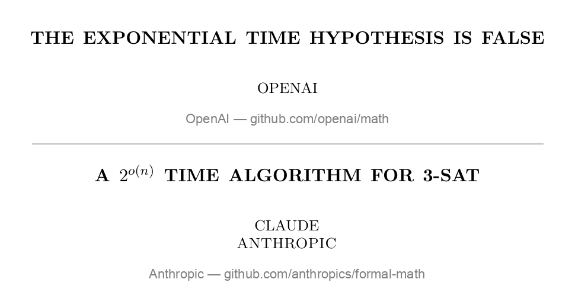

# 오픈AI·앤트로픽이 깬 수학 난제 지수 시간 가설, AI 공로는 어디에 적나?

_오픈AI와 앤트로픽 논문에 사람 저자가 없고, 닷새 동안 나온 글 여섯 편이 _

## Executive Summary

> [!callout]
> 오픈AI 가 지수 시간 가설은 거짓이라는 67쪽 논문을 자사 저장소에 올린 것이 2026년 10월 26일이다. 약 여섯 시간 뒤 앤트로픽이 49쪽 논문을 올렸다. 두 논문 모두 저자란에 사람 이름이 없다. 그 뒤 닷새 안에 사람이 쓴 간략 증명과 해설이 두 편, 두 증명을 잇는 Lean 다리가 하나, 제3자가 만든 인증이 하나 더 붙었다. 이 글은 그 여섯 편이 「이것을 AI 가 찾았다」는 말을 각각 어디에 적었는지를 본다.

> 「이 일에 모델을 썼다」는 말은 글마다 들어 있었는데, 그것을 둔 자리가 매번 달랐다. 논문 밖, 논문 첫 절 안, 부록, 본문 맨 끝 번호 없는 절, 1쪽 각주, 깃허브 이슈 본문, 댓글 끝. 학술 규정들은 공통으로 AI 를 저자로 올릴 수 없다고 적는데, 두 논문 다 그 규정이 닿지 않는 곳에서 나왔다. 그리고 가장 믿을 만한 문서는 가장 많이 주장한 문서가 아니라 자기가 확인하지 않은 것을 적은 문서였다. 앤트로픽 논문의 부록 한 절은 기계 검사 네 겹을 적고, 같은 절에서 「두 정의가 뜻한 바를 말하는지는 어떤 기계도 확인할 수 없다」를 적는다.

> 닷새째에 한 사람이 두 증명을 한 커널에 붙여 보려 했다. 명제 자체는 같은 항이었는데, 두 라이브러리 판본에서 실수의 덧셈부터 서로 다른 항이었다. 판정은 「다름」이었고, 같은 기록에 「거의 확실히 같은 수학이다」와 「어떤 커널도 아직 확인하지 않았다」가 나란히 적혀 있다. 여기까지가 사실이다. 여기서부터는 이 글의 해석이다. 「AI 가 찾아냈다」고 말하려면 그 말 옆에 무엇을 어디에 적어야 하는지는 아직 아무 데도 정해져 있지 않고, 지금 공개된 것 중 가장 나은 본보기는 「여기까지만 확인했다」를 적은 부록 한 절이다.

<!-- stat-card -->
**6편 / 7자리** — 닷새 동안 같은 정리에 붙은 글, 그 안에서 AI 고지가 놓인 칸 — 앤트로픽 논문 한 편만 두 자리에 적어 글보다 자리가 하나 많다(2·4절)

<!-- stat-card -->
**0회** — 오픈AI 논문 67쪽 전문의 `Lean`·`Claude`·발견 날짜 — 발견 경위가 논문 안에 한 글자도 없다. 전부 논문 밖에 있다(2절)

<!-- stat-card -->
**412개** — 두 증명을 한 커널에 붙였을 때 어긋난 상수 — 어긋난 것 가운데 실수의 덧셈·곱셈·0·1이 들어 있다(6절)

<!-- stat-card -->
**1010000** — 이 알고리즘이 전수 탐색을 이기기 시작하는 변수 개수 — 전수 탐색은 변수 100개에서 이미 비현실적이다. 실용 효과는 없다(1절)

## 닷새 동안 벌어진 일

먼저 이름부터 가른다. 이 글에서 말하는 ETH 는 암호화폐 이더리움의 티커와 철자가 같을 뿐 전혀 다른 것이다. 여기서 ETH 는 지수 시간 가설(Exponential Time Hypothesis)이고, 러셀 임파글리아조와 라마모한 파투리가 1999년에 내놓아 2001년 학술지에 실린 계산 복잡도 추측이다. 이후로는 한국어 이름인 지수 시간 가설로만 쓴다. 국내 보도 하나가 이 혼동을 제목에 쓴 적도 있다.

가설의 내용은 한 문장이다. 3-SAT, 그러니까 참·거짓을 고르는 변수 n개에 대해 세 개짜리 조건들이 모두 맞아떨어지게 만들 수 있는지 묻는 문제를, 변수 수에 지수보다 느리게 늘어나는 시간으로는 풀 수 없다는 추측이다. 수학 기호로는 2o(n) 시간 알고리즘이 없다는 말이고, 그런 시간을 아래에서는 준지수 시간이라 부른다. 이 추측이 중요한 이유는 그 자체보다 그 위에 쌓인 것 때문이다. 어떤 문제를 이보다 빨리 풀 수는 없다는 형태의 하한 증명 상당수가 이 가설을 전제로 깔고 성립한다.

2026년 10월 마지막 주에 두 회사가 그 전제가 거짓이라는 논문을 하루도 안 되는 사이에 내놓았다. 사건 자체는 이미 국내에도 보도됐다. AI타임스가 10월 28일에, 토큰포스트·디지털투데이·디지털포커스가 그 전후로 같은 사실을 전했다. 그래서 이 절은 뒤의 다섯 절이 기댈 사실만 시간 순으로 세워 두고 짧게 넘어간다.

### 1.1. 같은 변경 하나에 공식 시각이 셋이다

아래 표는 두 회사의 저장소에 남은 시각과 발표문이 적은 날짜를 한 줄로 모은 것이다. 두 회사를 따로 세우지 않고 한 시간축에 함께 둔 이유는 간단하다. 두 회사가 적은 발견일이 10월 16일로 같고, 공개 순서는 그다음 일이기 때문이다. 시각은 모두 협정 세계시(UTC)이고 끝의 `Z`가 그 표시다.

| 시점 | 무슨 일 | 어느 기록이 적었나 |
| --- | --- | --- |
| 2026-10-16 | 오픈AI 내부 모델이 자연어 반증을 내놓고, 같은 날 앤트로픽의 내부 Claude 연구 모델이 핵심 알고리즘을 찾았다 | 오픈AI 발표문 · 앤트로픽 논문 1절 |
| 2026-10-17 | 오픈AI 쪽 Lean 형식화 완료 | 오픈AI 발표문 |
| 2026-10-25 | 오픈AI 논문 개정 | 논문 표제면 17 October 2026, revised 25 October 2026 |
| 2026-10-26 20:35:02Z | 논문을 저장소에 올리는 커밋이 작성됐다(작성자 댄 로버츠) | 커밋 42907c9e 의 작성 시각. 커밋 확정 시각은 20:52:18Z 로 또 다르다 |
| 2026-10-26 21:18:04Z | 그 변경이 main 에 머지돼 밖에서 보이게 됐다 | PR #3 의 merged_at. 머지 커밋 자체의 시각은 21:18:03Z |
| 2026-10-26 | 신바 킨탈리가 22쪽짜리 간략 증명을 공개했다 | 킨탈리 글 표제면 |
| 2026-10-27 03:07:22Z | 앤트로픽 논문과 Lean 개발물이 공개됐다 | anthropics/formal-math PR #31 의 merged_at |
| 2026-10-28 | 랜스 포트나우가 블로그에 판단을 적었고, 한 개발자가 두 증명을 잇는 Lean 다리를 깃허브 이슈로 올렸다 | 블로그 글 · 이슈 #36 |
| 2026-10-29 | 라이언 오도널이 20쪽짜리 해설을, 다른 한 사람이 두 증명의 이음매를 잰 인증을 내놓았다 | 오도널 글 · 이슈 #36 댓글 |

````````

표 1. 2026년 10월 16일부터 29일까지. 날짜만 적힌 줄은 발표문과 글 표제면에서, 초 단위까지 적힌 줄은 깃허브 API 에서 받은 값이다. 오픈AI 쪽 포크 수 같은 실시간 변동값은 이 글에 쓰지 않았고, 저장소 조회 시각은 2026년 10월 31일이다.

표에서 눈여겨볼 줄은 10월 26일의 두 줄이다. 같은 변경 하나가 작성 20:35:02Z, 커밋 확정 20:52:18Z, 머지 21:18:04Z 라는 세 개의 공식 시각을 갖는다. 보도는 그중 하나를 골라 쓰고, 어느 것을 골랐는지는 보통 적지 않는다. 이 글이 뒤에서 다룰 이야기의 축소판이 여기 있다. 기록이 모자라서가 아니라 여럿이라서, 어느 것을 적었는지가 적혀 있지 않으면 읽는 쪽이 맞출 수 없다.

앤트로픽이 여섯 시간 만에 급히 따라 올린 것이 아니다. `anthropics/formal-math` 저장소는 2026년 8월 6일에 만들어졌고, 리만 제타 함수에 관한 결과와 3SUM(세 수의 합) 문제에 관한 결과가 이미 올라가 있던 상설 창구다. 지수 시간 가설은 그 저장소의 세 번째 프로젝트다. 그리고 오픈AI 쪽의 즉시 공개도 회사가 고른 것이 아니라 외부 검증 그룹이 정한 공개 방식이었다. 그 이야기는 5절에서 한다.

### 1.2. 빨라지는 것은 아무것도 없다

이 결과가 실제 계산을 빠르게 만든다는 기대는 논문 자신이 먼저 거둔다. 앤트로픽 논문 1절은 조건 수가 변수 수의 다섯 배인 보통의 3-SAT 식에서 이 한계가 전수 탐색 2n 을 이기려면 변수가 1010000 개를 넘어야 하고, 조건 수와 무관하게 변수 수만으로 쓴 한계는 10108 개를 넘어야 한다고 적는다. 접근법 자체가 변수 107 개 아래에서는 아무 이득이 없다는 말도 같은 절에 있다. 그리고 바로 다음 문장에서 전수 탐색은 변수 100개에서 이미 비현실적이라고 못 박는다.

우리 결과는 실제로 식을 푸는 일에 대해 아무것도 말하지 않는다.
                        "Thus our result says nothing about solving formulas in practice." — 앤트로픽, A 2^{o(n)} Time Algorithm for 3-SAT, 1절

그렇다고 의미가 없다는 뜻은 아니다. 흔들리는 것은 속도가 아니라 전제다. 앤트로픽 논문은 이 가설이나 그것을 함의하는 가설에만 기대어 자기 결과를 증명한 논문이 800편 넘는다고 적는데, 이 숫자에는 조건 두 개가 같은 문장에 붙어 있다. 하나는 그 문헌 조사를 돌린 주체가 Claude 라는 것이고, 다른 하나는 직교 벡터 가설처럼 이번에 반증되지 않은 가정으로도 증명되는 결과는 세지 않았다는 것이다. 오픈AI 발표문은 같은 자리를 수백 편이라고만 적고 기준을 밝히지 않는다. 같은 사실을 적는 두 회사의 정밀도가 여기서 이미 갈린다.

그래서 수학계의 반응은 환호도 유보도 아닌 제3의 어조였다. 계산 복잡도 분야의 대표 블로그를 쓰는 랜스 포트나우가 10월 28일에 남긴 한 문장이 그 어조를 가장 짧게 담는다.

나는 그 증명을 직접 확인하지 않았지만, 이제 지수 시간 가설은 끝났다고 보는 편이 안전하다.
                        "I have not verified the proof myself, but it is safe to assume now that the exponential-time hypothesis is toast." — 랜스 포트나우, Computational Complexity 블로그, 2026-10-28

확인하지 않았다고 먼저 적고, 그다음에 판단을 적는다. 이 순서가 닷새 동안의 기록에서 반복해 만나게 될 형식이고, 뒤에서 보겠지만 이 글이 값지게 본 기록은 전부 이 형식을 갖고 있었다. 참고로 페블러스 블로그는 열여드레 전에 [같은 저장소의 다른 장](/report/openai-math-722-verification-ledger/ko/)을 다룬 적이 있다. 그 글이 센 것은 형식 검증 비율과 비어 있던 칸이었고, 이 글이 보는 것은 기록의 양식이다. 둘은 같은 저장소를 보지만 다른 질문을 한다.

## 저자란에 사람 이름이 없는 논문 두 편

두 논문을 나란히 열면 가장 먼저 눈에 걸리는 것은 저자란이다. 오픈AI 논문의 저자란에는 **OpenAI** 라는 회사 이름이 적혀 있고, 앤트로픽 논문의 저자란에는 **CLAUDE / ANTHROPIC** 이 적혀 있다. 둘 다 사람 이름이 없다는 점은 같은데, 지운 자리에 무엇을 놓았는지가 다르다. 한쪽은 회사를 놓았고, 다른 쪽은 모델을 놓았다.


*▲ 두 논문 표제면을 직접 캡처한 것이다. 저자란에 회사 이름과 모델 이름이 각각 적혀 있다 | Source: [github.com/openai/math](https://github.com/openai/math), [github.com/anthropics/formal-math](https://github.com/anthropics/formal-math/tree/main/eth)*

그 차이는 표지에서 끝나지 않는다. 두 논문의 전문을 텍스트로 바꿔 낱말을 직접 세어 봤다. 오픈AI 논문 67쪽 어디에도 `Lean`·`Claude`·`Anthropic`·`token` 이 한 번도 나오지 않고, 감사의 말에 해당하는 낱말도, 발견 날짜인 10월 16일도 나오지 않는다. 전부 0회다. 이 논문만 읽은 사람은 누가 언제 무엇으로 이 결과를 만들었는지 알 길이 없다. 그 이야기는 회사 발표문과 저장소 설명 파일에만 있다.

# 오픈AI 논문 전문(67쪽)에서 대소문자를 구분해 정확히 센 횟수
Lean          0
Claude        0
Anthropic     0
token         0
acknowledg*   0
October 16    0

세는 데는 함정이 하나 있다. 대소문자를 무시하고 `lean` 을 찾으면 79건이 잡히는데 전부 `Boolean` 안에 들어 있는 글자다. 문맥을 전수로 열어 봤고, 그래서 위 표는 대소문자를 구분해 센 값이다.

앤트로픽 논문은 정반대다. 발견 경위가 논문 바깥이 아니라 1절 끝의 한 문단에 들어 있고, 그 문단에는 `Provenance` 라는 이름표까지 붙어 있다. 그리고 그 문단은 한 문장이 아니라 두 문장이다. 이 구분이 중요해서 둘 다 옮긴다.

핵심 알고리즘은 10월 16일에 내부 Claude 연구 모델이 출력 토큰 1,400만 개를 써서 사람 입력 없이 찾았다. 앤트로픽 연구자들이 Claude 와 함께 제시 방식을 다듬어 이 논문이 됐다.
                        "The core algorithm was found on October 16 by an internal Claude research model with 14M output tokens and no human input. Anthropic researchers worked with Claude to improve the presentation, resulting in this paper." — 앤트로픽 논문 1절

사람이 없는 것은 **발견**이고, 논문은 사람이 함께 만들었다. 두 문장을 한 문장으로 줄이면 거짓이 된다. 뒤에서 「기록의 양식」이라고 부를 것의 첫 사례가 여기다. 같은 사실을 적더라도 문장을 몇 개로 나누느냐에 따라 전달되는 내용이 달라진다.

저자란이 모델이라는 사실은 사람이 읽는 표지에만 있는 것이 아니다. Hexagon 이라는 공개 플랫폼에 올라와 있는 PDF 를 내려받아 문서 속성을 열어 보면, `Author` 필드에 `Claude` 가 적혀 있다. 파일 속성 수준까지 사람 이름이 없다. 덧붙이면 이 플랫폼 게재 상태 자체도 두 기록이 어긋난 대목이다. 저장소의 설명 파일은 아직 「링크가 나올 예정」이라고 적어 두었는데, 플랫폼에는 이미 그 논문이 올라와 있다. 49쪽, 제목, 표제면 날짜까지 앤트로픽 논문과 전부 같은 문서였다.

### 2.1. 학술 규정은 AI 를 저자로 올릴 수 없다고 적는다

이쯤에서 당연한 물음이 생긴다. 논문 저자가 모델이어도 되나. 논문을 유통하는 쪽의 규정은 안 된다고 적는다. 가장 분명한 축자는 arXiv 의 조정 규칙에 있다. 세 문장이 이어진다.

저자는 자기 작업에 쓴 정교한 도구의 의미 있는 사용을 계속 밝혀야 하며, 이제 그 목록에 글을 만들어 내는 생성 AI 를 특히 포함한다.  

                        저자로 이름을 서명함으로써 각자는 그 내용이 어떻게 생성됐든 상관없이 내용 전부에 대한 전적인 책임을 진다.  

                        생성 AI 언어 도구는 저자로 올려서는 안 되며, 대신 저자는 위 고지 규정을 따라야 한다.
                        "…we now include in particular text-to-text generative AI among those that should be reported consistent with subject standards for methodology." / "…they each individually take full responsibility for all its contents, irrespective of how the contents were generated." / "…generative AI language tools should not be listed as an author; instead authors should refer to (1)." — arXiv Moderation Rules

다른 규정들도 같은 취지다. ACM 은 생성 AI 도구를 어떤 조건에서도 저자로 올릴 수 없고 사용은 저작물 안에 전부 밝히라고 적는다. 출판윤리위원회(COPE)는 2023년 2월 입장문에서 AI 도구가 책임을 질 수 없고 이해관계를 선언할 수 없으며 저작권을 관리할 수 없으므로 저자가 될 수 없다고 적었다. 슈프링거 네이처와 엘스비어도 같다. 공통된 근거는 하나로 모인다. 저자됨은 사람만 질 수 있는 책임을 뜻한다는 것이다.

그러나 이 글은 여기서 「앤트로픽이 규정을 어겼다」로 가지 않는다. 사실관계가 그렇지 않기 때문이다. 두 논문 모두 arXiv 에 올라가지 않았다. 오픈AI 는 자사 깃허브 저장소에, 앤트로픽은 자사 저장소와 새 플랫폼에 올렸다. 정확한 문장은 이것이다. **AI 는 저자가 될 수 없다는 규정은 그 규정이 닿는 곳에만 있고, 이 두 논문은 그 바깥에서 나왔다.** 규정이 깨진 것이 아니라, 규정이 미처 서 있지 않은 자리에서 일이 일어났다.

## Lean 이 확인한 것과 확인하지 않은 것

「Lean 으로 검증됐다」는 말이 두 논문 모두에 붙었다. 그런데 이 말이 가리키는 범위가 두 회사에서 다르다. 범위를 재려면 낱말부터 나눠야 한다. 이 글에서 확인이라는 말은 서로 다른 네 가지 일을 가리킬 수 있다. 증명의 각 단계를 기계가 다시 밟아 보는 일, 그 일을 다른 사람이 따로 만든 기계로 한 번 더 하는 일, 형식으로 적힌 명제가 사람이 뜻한 말과 같은지 사람이 판단하는 일, 그리고 외부 전문가들이 공동체 검토를 조직하는 일이다. 네 가지를 한 낱말로 부르면 이 절의 내용이 통째로 뭉개진다.

앞의 두 가지를 가장 촘촘하게 적은 문서는 앤트로픽 논문의 부록 한 절이다. 그 절은 증명이 기계를 통과한 경로를 네 겹으로 적는다. 첫째로 Lean 4 커널이 받아들였다. 커널은 증명 한 단계 한 단계를 다시 밟아 보는 작은 프로그램이다. 둘째로 린체커(`leanchecker`)가 모듈 단위로 다시 밟았다. 셋째로 컴퍼레이터를 통해 나노다(`nanoda`)가 받아들였는데, 나노다는 Lean 과 독립적으로 따로 구현된 커널이다. 넷째로 린체커가 빈 환경에서 처음부터 다시, 그 증명이 기대는 모든 선언을 Mathlib 까지 포함해 밟았다. 개발물의 Lean 모듈 1,050개를 전부 아무것도 없는 상태에서 함께 빌드했고, 표준 공리 셋인 `propext`·`Classical.choice`·`Quot.sound` 밖으로 나가지 않았다. 판본도 고정돼 있다. Lean 4.33.1 과 Mathlib 커밋 `0df444a3` 이다.

여기까지는 「다 확인했다」는 이야기로 읽힌다. 그런데 같은 절이 바로 이어서 확인하지 **않은** 것을 적는다. 이 글이 닷새치 기록에서 가장 값지다고 보는 자리가 이 세 문장이다.

두 정의가 뜻하고자 한 바를 말하는지는 어떤 기계도 확인할 수 없다. 그것은 목록을 읽는 사람이 판단할 일이다.  

                        기계 모델 사이의 시뮬레이션과 식을 바꿔 쓰는 변환은 표준적인 사실이며, Lean 명제나 증명의 일부가 아니다.  

                        이 Lean 개발물은 AI 모델이 썼고 같은 모델의 다른 인스턴스가 검토했다. 이 글을 쓰는 시점에 사람이 확인했다고 알려진 바는 없다.
                        "Whether the two definitions say what they are meant to say … no machine can check; that is for the reader of the listing to judge." / "The simulation and the rewriting are standard facts; they are not part of the Lean statements or proofs." / "The Lean development was written by AI models and reviewed by other instances of the same models; at the time of writing no person is known to have checked it." — 앤트로픽 논문 부록 E

마지막 문장은 한 번 더 좁혀 읽어야 한다. 이 문장이 말하는 것은 **Lean 개발물을 사람이 확인한 기록이 없다**는 것이지, 논문을 아무도 읽지 않았다는 것이 아니다. 두 말은 다르다. 논문 자체는 공개 직후부터 여럿이 읽었고, 이 글의 4절과 6절이 그 사람들의 글을 다룬다. 기계가 통과시킨 것과 사람이 읽은 것이 서로 다른 대상이라는 사실을 이 한 문장이 드러낸다.

### 3.1. 「가설은 거짓」이 Lean 명제로 적혀 있는 쪽은 하나뿐이다

두 회사의 Lean 파일을 직접 열어 맞대 보면 범위의 차이가 선명해진다. 앤트로픽 쪽 파일은 가설 자체를 Lean 안에 정의한다. 3-SAT 를 푸는 데 필요한 지수의 하한을 `s 3` 이라 적고, 그것이 0보다 크다는 명제에 지수 시간 가설이라는 이름을 붙인 뒤, 그 부정에 「가설은 거짓」이라는 이름을 붙인다. 그러니까 이 파일에서는 「지수 시간 가설은 거짓」이 기계가 읽는 명제로 존재한다.

# 앤트로픽 MainResults.lean 의 정의 두 줄
ETH        := 0 < s 3
ETHIsFalse := ¬ ETH

오픈AI 쪽 파일은 다르다. 220줄 전부를 읽어도 ETH 라는 낱말 자체가 나오지 않는다. 그 파일이 적는 것은 만족시키는 배정의 개수를 세는 알고리즘의 시간과 공간 한계뿐이다. 그 한계가 변수 수보다 느리게 늘어나므로 가설이 거짓이라는 마지막 한 걸음은 Lean 바깥의 산문에 있다. 그 걸음 자체는 교과서적이고, 실제로 제3자가 그 다리를 Lean 으로 놓아 공개했다. 그 이야기가 6절이다.

형식화된 시간 한계가 논문 간판과 같은지도 두 회사에서 갈린다. 앤트로픽 쪽은 Lean 의 주 정리가 논문 정리 1과 글자 그대로 같은 식을 쓴다. 오픈AI 쪽이 기계에 올린 것은 논문 맨 앞 정리 1.1 이 내건 더 센 한계가 아니라, 본문 6.4절이 더 약한 지수라고 부른 것이다. 더 센 한계는 부록 D 에만 있고 기계에 올라가지 않았다. 덧붙일 것이 하나 있다. 사람이 쓴 글도 그 약한 지수를 설명한다. 라이언 오도널이 낸 해설은 첫 쪽에서 바로 그것을 가져다 푼다. 즉 기계가 붙든 것과 사람이 풀어 쓴 것이 같은 지수이고, 논문 간판만 혼자 더 세다.

| 무엇을 | 오픈AI | 앤트로픽 |
| --- | --- | --- |
| 기계에 올린 정리의 이름 | exact_count_and_sat | ethIsFalse · mainTheorem |
| 「지수 시간 가설은 거짓」이 Lean 명제인가 | 아니다. 세는 알고리즘의 한계만 적고 마지막 걸음은 산문 | 그렇다. 가설과 그 부정이 둘 다 정의돼 있다 |
| Lean 에 올라간 시간 한계 | 논문 6.4절의 더 약한 지수. 간판 정리 1.1 은 부록에만 | 논문 정리 1과 같은 식 |
| 독립 구현 커널(나노다)로 다시 확인 | 끔. 그 저장소 설정 418개 중 켠 것이 2개다 | 켬. 모든 설정에 자동으로 걸린다 |
| 기계가 못 하는 일을 적어 둔 자리 | 없다 | 부록 한 절 전체 |

``````

표 2. 두 회사의 Lean 파일과 설정을 직접 열어 맞댄 결과. **이 표는 우열표가 아니다.** 두 저장소는 다른 물건을 운영한다. 오픈AI 쪽은 수학 원고 수백 편과 그에 딸린 설정 418개를 굴리는 대형 저장소이고, 앤트로픽 쪽은 세 프로젝트를 손으로 꾸리는 작은 창구다. 아래 문단이 그 차이를 설명한다.

네 번째 줄은 오해를 사기 쉬워서 수를 같이 적는다. 오픈AI 가 이 논문에만 독립 커널 재확인을 피해 간 것이 아니다. 그 저장소의 설정 파일 418개를 전부 세어 보면 독립 커널을 켠 것은 두 개뿐이고, 끈 것이 413개, 아예 그 항목이 없는 것이 세 개다. 지수 시간 가설 설정은 그 413개 가운데 있다. 차이는 의도가 아니라 관행이고, 418 대 2 라는 수를 같이 적지 않으면 그 문장은 사실을 비튼다.

양쪽 Lean 개발물을 빌드하면 「선언이 `sorry` 를 쓴다」는 경고가 뜬다. `sorry` 는 증명을 비워 둔 자리를 뜻하는 Lean 의 표시라 결함처럼 보이는데, 여기서는 설계상 그렇다. 챌린지 파일은 증명 없이 명제만 적어 두는 자리이고, 실제 증명은 그 아래의 본 검사에서 이뤄진다. 앤트로픽 쪽 설명 파일은 경고 두 건이 모두 그 파일에서 나온다고 미리 적어 둔다. 참고로 그 전체 빌드는 가상 CPU 24개에서 약 8분이 걸리고 최대 메모리는 약 7GB 다.

## 사람이 쓴 해설에도 같은 고지가 붙었다

저자란에 모델을 올리는 일이 회사의 특이한 선택이었다면 이야기는 거기서 끝났을 것이다. 그런데 같은 닷새 동안 사람이 자기 이름으로 쓴 글이 넷 더 나왔고, **넷 다 같은 고지를 달았다.** 다른 점은 고지의 유무가 아니라 그것을 둔 자리였다.

첫째는 신바 킨탈리가 10월 26일에 낸 22쪽짜리 간략 증명이다. 그는 고지를 본문 맨 끝에 놓았다. 참고문헌 바로 앞, 절 번호도 없는 한 문단이다.

AI 사용: 글쓴이는 증명을 간단히 하려고 Claude 와 ChatGPT 에 대화식으로 물었고, 로그 인수를 최적화하지 않은 채 가설의 기본 진술을 반증하는 데만 집중했다. 글쓴이가 증명을 손으로 늘려 사람이 읽기 쉽게 만들고 설명과 풀이 예를 더했다.
                        "Use of AI: The author prompted Claude and ChatGPT interactively to simplify the proofs, focusing only on disproving basic statement of ETH, without optimizing log factors. The author expanded the proofs manually and made them more human-readable and added explanations and a worked example." — 신바 킨탈리, A simplified proof of ETH is false, 2026-10-26

둘째는 카네기멜런대의 라이언 오도널이 10월 29일에 낸 20쪽짜리 해설이다. 그는 정반대 자리를 골랐다. 1쪽 제목에 별표를 달고, 그 각주에 고지를 넣었다. 독자가 본문을 읽기 전에 먼저 보게 된다. 그리고 이 각주가 이 절의 절정이다.

* odonnell@cs.cmu.edu 가 LLM 과의 상호작용을 통해 만들었다. 해설의 초점을 퍼머넌트에 맞추자는 착상은 누탄 리마예의 블루스카이 글 덕분이다. NTIME(T)에 관한 자기 결과를 알려 준 베르나르도 수베르카소에게 감사한다. 표기에 관해 논의해 준 유잉 탕에게 감사한다.
                        "* Produced by odonnell@cs.cmu.edu through interaction with LLMs. The idea of focusing the exposition on permanent came thanks to a Bluesky post of Nutan Limaye. Thanks to Bernardo Subercaseaux for telling me about his result on NTIME(T). Thanks to Ewin Tang for discussions about notation." — 라이언 오도널, Some exposition of "The Exponential Time Hypothesis Is False", 2026-10-29

한 각주 안에 귀속이 넷 들어 있다. 모델을 썼다는 고지 하나와 사람에 대한 사사 셋이다. 착상을 준 사람, 다른 결과를 알려 준 사람, 표기를 함께 논의한 사람. 그리고 넷이 같은 문장 꼴로 나란히 적혀 있다. 지금까지 공개된 글 가운데 **모델과 사람을 같은 자리에 같은 꼴로 적은 유일한 사례**다. 오도널은 모델에 대한 고지를 특별 취급하지 않았고, 반대로 숨기지도 않았다. 다른 도움과 같은 줄에 뒀을 뿐이다.


*▲ 1쪽 제목의 별표(*)가 가리키는 각주. 모델 고지와 사람에 대한 사사 셋이 같은 줄에 있다 | Source: R. O'Donnell, [Some exposition of "The Exponential Time Hypothesis Is False"](#references), 2026-10-29*

셋째는 논문이 아니라 깃허브 이슈다. 10월 28일에 TSavo 라는 사용자가 앤트로픽 저장소에 이슈 #36 을 열었다. 네 문단짜리 짧은 글인데, 여기서 다루는 주제가 거의 다 들어 있다. 둘째 문단이 고지이고, 셋째 문단이 자기가 확인하지 못한 것이며, 그 끝이 요구하지 않는다는 선언이다.

당신들의 Lean 증명을 오픈AI 의 것과 이어 봤다. 정리는 `OpenAI.Claim → MainResults.ETHIsFalse` 이고 저장소에 있다.  

                        Claude 가 나와 함께 썼고, 커널들이 확인했다.  

                        나는 `MainResults.lean` 이 지수 시간 가설을 뜻하는지는 확인하지 못했으니 누가 봐 주면 좋겠다. 무언가를 병합해 달라는 것은 아니다.
                        "I linked your Lean proof to OpenAI's. The theorem is OpenAI.Claim → MainResults.ETHIsFalse… Claude wrote it with me, and the kernels checked it. I haven't verified that MainResults.lean means ETH, so I'd like someone to look at that. I'm not asking you to merge anything." — 이슈 anthropics/formal-math#36, 2026-10-28T03:22:34Z

넷째는 그 이슈에 달린 댓글이다. carlostoledo1891 이라는 사용자가 두 증명을 기계로 맞대 본 결과를 올리면서, 댓글 맨 끝에 한 줄을 붙였다. 닷새치 기록 가운데 **이해관계까지 적은 유일한 쪽**이다.

고지: 우리 도구와 이 증명들은 Claude(앤트로픽의 모델)로 썼다. 두 주장 가운데 하나는 앤트로픽의 것이다. 어느 연구소와도 소속 관계가 없다.
                        "Disclosure: our tools and these proofs are written with Claude (Anthropic's model); one of the two claims is Anthropic's; no affiliation with either lab." — 이슈 #36 댓글, 2026-10-29

한 줄에 세 가지가 적혀 있다. 쓴 도구가 무엇인지, 맞대 본 두 주장 가운데 하나가 누구 것인지, 그리고 자기가 어느 연구소에도 속해 있지 않다는 것이다. 같은 사람이 이 이슈에 남긴 댓글은 둘인데, 두 댓글 끝에 이 줄이 각각 한 번씩 붙어 있다. 앞의 세 자리가 모델을 썼다는 사실을 적은 자리라면, 이 한 줄은 거기에 적는 사람 자신이 누구인지를 함께 적은 자리다.

### 4.1. 같은 문장, 일곱 자리

이제 닷새치를 한 표에 모을 수 있다. 글은 여섯 편인데 자리는 일곱 군데다. 앤트로픽 논문 한 편만 1절과 부록 두 곳에 나눠 적었기 때문이다. **이 표는 누가 더 성실한가를 가리는 표가 아니다.** 일곱 자리가 전부 다르다는 것, 그래서 독자가 어디를 봐야 할지 미리 알 방법이 없다는 것이 이 표가 말하는 전부다.

| # | 글 | 저자란 | 모델을 썼다는 말이 적힌 자리 |
| --- | --- | --- | --- |
| 1 | 오픈AI 논문 67쪽 | OpenAI(회사) | 논문 안에 없다. 발표문과 저장소 설명 파일에만 |
| 2 | 앤트로픽 논문 49쪽 | CLAUDE / ANTHROPIC(모델) | 1절 끝 문단 |
| 3 | 같은 논문의 부록 | — | 부록 한 절 전체가 「무엇을 누가 확인했나」 |
| 4 | 킨탈리 간략 증명 22쪽 | 신바 킨탈리(사람) | 본문 맨 끝, 번호 없는 한 문단 |
| 5 | 오도널 해설 20쪽 | 표제면에 없음 | 1쪽 제목에 달린 별표 각주 |
| 6 | 두 증명을 잇는 Lean 다리 | TSavo(사람) | 깃허브 이슈 본문 둘째 문단 |
| 7 | 제3자 이음매 인증 | 사람 | 댓글 끝 「고지」 한 줄 |

표 3. 2026년 10월 26일부터 29일까지, 같은 정리를 두고 나온 글 여섯 편과 모델 사용을 적은 일곱 자리. 일곱 줄 모두 원문에서 직접 확인했다.

회사가 쓴 글에도, 교수가 쓴 글에도, 이름 없는 개인이 쓴 깃허브 이슈에도 같은 문장이 필요했다. 그 점에서는 일곱이 모두 같다. 다른 것은 그 문장을 놓을 자리가 아무 데도 정해져 있지 않다는 것뿐이다. 논문 양식에는 저자란이 있고 감사의 말 자리가 있고 참고문헌 자리가 있는데, 「이 결과를 모델이 찾았다」를 적는 칸은 없다. 그래서 일곱 명이 일곱 군데를 골랐다.

## 판정석에 앉은 사람들이 먼저 요구한 것

지금까지는 글에 적힌 것을 읽었다. 이 절은 그 글들이 나오기 전에 누가 무엇을 요구했는지를 본다. 오픈AI 는 논문과 같은 날 발표문을 하나 냈는데, 거기에 외부 연구자들과 일하는 방식이 네 가지 원칙으로 적혀 있다. 보도에서 거의 인용되지 않아 네 항목을 아래에 그대로 싣는다.

**투명성.** 우리는 이 협업의 존재를 공개한다. 참여자에게 비밀유지계약 서명을 요구하지 않으며, 참여자는 자유롭게 이 작업을 논의하고 중간 산출물을 공유하고 자기 결론을 발표할 수 있다.  
**학술 공로 주장 안 함.** 우리는 내부 모델이 만들어 낸 발견에 대해 학술적 공로를 주장하지 않는다. 협업을 이끌어 달라고 연구자를 초청하는 일이, 그 연구자나 그 모임이 원래 발견을 했다는 뜻도 아니다.  
**인정.** 이 모임은 자신들이 만들어 낸 이해와 자신들이 쓴 글과 그 밖의 자료에 대해 인정받아야 한다.  
**독립성.** 참여는 자발적이며 무보수다. 모임의 구성원은 독립적으로 참여하고 그 결론은 그들의 것이다. 그들은 오픈AI 를 대변하지 않고, 오픈AI 도 그들을 대변하지 않는다.
                        "Participants will not be asked to sign nondisclosure agreements…" / "We do not seek academic credit for the discoveries produced by our internal models…" / "This group should receive recognition for the understanding they develop…" / "Participation is voluntary and unpaid… They do not speak on behalf of OpenAI, and OpenAI does not speak on their behalf." — OpenAI, Working with academic communities to build scientific understanding, 2026-10-26

두 번째와 네 번째를 붙여 읽으면 한 문장이 나온다. **참여는 인증이 아니다.** 이 글이 기획 단계에서 예상한 것은 외부 연구자들이 그 선을 그어 달라고 요구했으리라는 것이었는데, 실제로는 회사가 먼저 적어 두었다. 이름 있는 연구자가 협업에 참여했다는 사실을 결과의 보증처럼 읽는 일은 흔하다. 그 오독을 막는 문장이 발표문 안에 이미 들어 있었다.

그 판정석에 앉은 사람들이 누구인지도 이 사건에서 드문 대목이다. 지수 시간 가설을 다루는 모임에는 러셀 임파글리아조와 라마모한 파투리가 들어가 있다. 1999년에 이 가설을 처음 내놓은 바로 그 두 사람이다. 그리고 매사추세츠공대의 라이언 윌리엄스가 함께 있다. 가설을 만든 사람들이 그 가설이 깨졌는지를 보는 자리에 앉은 셈이다. 다만 세 사람 가운데 공개 발언이 남은 사람만 인용한다. 임파글리아조와 파투리가 이 결과에 대해 무엇이라 말했는지는 이 글이 확인하지 못했다.

그 모임이 회사에 먼저 요구한 것은 결론 확인이 아니라 자료였다. 발표문은 두 가지 요구를 수락했다고 적는다. 결과의 모든 원자료를 공개해 공동체가 독립적으로 확인할 수 있게 할 것, 그리고 이 작업이 분야 전체에 갖는 함의를 다룰 학회를 오픈AI 가 지원할 것. 같은 문단에서 그 모임은 공동체에 공개 검토를 함께 조직하자고 요청하면서, 확인과 접근과 공로와 연구의 미래라는 네 가지 질문을 같이 걸어 두었다. 발표문 끝에는 이 협업이 최근 발표한 사이먼스 재단 500만 달러 기여를 보완한다는 말이 붙어 있다.

### 5.1. 같은 회사, 같은 날, 세 개의 공개 규칙

발표문이 다룬 결과는 하나가 아니라 셋이다. 그리고 셋의 공개 방식이 서로 다른데, 그 방식을 정한 쪽이 회사가 아니라 각 분야의 외부 모임이었다는 점이 중요하다. 아래 표가 그 셋을 모은 것이다.

| 분야 | 그 모임이 정한 공개 방식 | 바깥에서 말을 거는 창구 |
| --- | --- | --- |
| 수학 | AI 출력을 그대로 공개하고, 연구자들이 알아서 조직한다 | 따로 정하지 않음 |
| 전산학 | 외부 협업 모임이 설명을 맡고, AI 출력은 즉시 전부 공개한다 | 깃허브 이슈가 열려 있다 |
| 물리 | 자료 공개를 보류하고 모임이 직접 글을 쓰기로 했다 | 지메일 주소 하나 |

****

표 4. 오픈AI 발표문이 적은 세 결과의 공개 방식. 세 줄 다 회사가 아니라 각 분야의 외부 모임이 정했다고 발표문이 밝힌다.

가운뎃줄이 여기서 다루는 결과다. 즉시 전부 공개라는 선택이 여섯 시간 간격이라는 모양을 만들었고, 그 모양이 경쟁처럼 보도됐다. 그런데 그 선택을 한 것은 회사가 아니다. 그리고 그 선택에는 대가가 따른다. 창구를 깃허브 이슈로 열어 두면 6절에서 보게 될 정밀한 감사 기록이 들어오는 대신, 같은 스레드에 거친 소음도 함께 들어온다. 물리 쪽은 반대쪽을 골랐다. 자료를 내놓지 않고 창구를 지메일 주소 하나로 닫았다. 같은 회사가 같은 날, 결과마다 다른 창구 설계를 공개한 것이다.

모임 쪽의 목소리로 이 절을 닫는다. 윌리엄스는 10월 27일 테크크런치에 증명을 읽은 소감을 짧게 말했다.

어떤 부분은, 뭐랄까 평범하다고 할 수도 있겠지만, 그렇다 두세 군데는 낯설어 보인다. 그리고 내가 본 것이 바로 그 부분들이고, 그래서 이건 공동체 전체가 함께 매달려야 할 일이라고 생각하게 됐다.
                        "Some parts are, maybe you could say routine, but then yes, there are two or three alien-looking parts, and it's exactly these parts that I saw that made me think, wow, this is something that the whole community needs to work on together." — 라이언 윌리엄스, TechCrunch, 2026-10-27

같은 기사에서 윌리엄스는 오픈AI 의 과학 책임자 댄 로버츠에게 처음 물은 것 가운데 하나가 암호 체계에 영향이 있는지였다고 말했다. 확인한 결과 지금 쓰는 체계가 깨지는 것은 아니라고 꽤 자신한다는 답을 받았다고 덧붙였다. 낯선 두세 군데를 먼저 말하고, 그다음에 안심할 근거를 말한다. 이 순서가 1절에서 본 포트나우의 순서와 같다.

## 두 증명을 한 커널에 붙여 봤더니

두 회사가 같은 가설이 거짓이라고 말한다. 그러면 두 증명은 같은 말을 하고 있나. 닷새째에 이 물음을 기계로 물어본 사람이 있었다. 4절에 나온 이슈 #36 이 그 출발점이고, 거기 달린 댓글 둘이 이 절의 재료다. 댓글을 쓴 사람은 두 회사 어느 쪽과도 관계가 없다고 스스로 밝혔고, 쓴 도구와 커밋 해시와 CI 실행 번호를 전부 공개했다.

첫 댓글이 보고한 것은 읽기 결과다. 두 사람이 서로의 글을 보지 않고 각자 읽어 보니, 앤트로픽 쪽 Lean 정의가 글자 그대로 임파글리아조와 파투리가 말한 그 값이 0이라는 명제이고 빠져나갈 구멍이 없더라는 것이다. 동시에 같은 댓글은 기계에 올라가지 않은 자리도 짚는다. 기계 모델 사이의 시뮬레이션과, 교과서에 나오는 식을 각 증명의 입력 형식으로 바꾸는 변환이 양쪽 모두 산문으로 남아 있다는 것이다. 3절에서 앤트로픽 부록이 스스로 적었던 바로 그 두 가지를, 제3자가 양쪽 다에서 독립으로 확인한 셈이다.

둘째 댓글이 이 절의 본론이다. 그는 가설과 그 세는 판본을 Lean 으로 한 번 적어 두고, 두 회사의 명제에서 각각 그것을 증명했다. 그렇게 나온 정리 51개를 전부 세 번씩 통과시켰다. 빌드할 때 Lean 커널이 한 번, 새 실행기에서 컴퍼레이터 안의 Lean 커널이 또 한 번, 그리고 독립 구현 커널인 나노다가 다시 한 번이다. 표준 공리 셋 밖으로는 나가지 않았다.

그다음이 이음매다. 그는 두 회사의 명제가 하나의 커널 안에서 같은 것으로 인정되는지를 쟀다. 결과는 둘로 갈렸다. 명제 자체는 같았고, 그 명제가 기대고 선 바닥이 달랐다.

커널이 두 명제를 맞대는 방식은 두 층으로 갈린다. 커널은 명제를 글자가 아니라 항으로 쪼개 보는데, 그 항 하나하나를 아래 도식에서는 노드라고 적었다. 첫째 층은 명제 자체를 이루는 노드의 수와 모양이 같은가이고, 둘째 층은 그 노드들이 이름으로 불러 오는 정의와 상수가 같은가다. 첫째 층에서 두 환경은 노드 335개로 똑같았다. 둘째 층에서는 불러 오는 상수 2,689개 가운데 412개가 서로 다른 항이었다.

도식 1. 제3자 인증 파일을 직접 파싱해 다시 센 값이다. 412 = 308 + 104 이고, 원인별 분해를 따로 더해도 412 가 나온다.

412라는 수보다 중요한 것은 그 안에 무엇이 들어 있느냐다. 코드 이름을 던지는 대신 인증을 만든 사람 자신의 산문을 옮긴다. **두 Mathlib 에서 실수의 덧셈·곱셈·≤·<·0·1·역원·자연수 거듭제곱이 서로 다른 항이다.** 여덟 개를 늘어놓고 보면 무슨 일이 일어났는지가 저절로 전해진다. 실수라는 가장 기본적인 대상이 두 환경에서 다르게 적혀 있다. 명제가 직접 이름을 부르는 상수 151개 가운데 8개가 다른데, 그 8개가 바로 이것들이다.

원인도 하나하나 분류돼 있다. 가장 큰 덩어리는 Mathlib 에서 모노이드 위계가 새 꼴로 바뀐 것이 231개, 실수와 복소수와 음이 아닌 실수를 만드는 파일이 옮겨진 것이 94개다. 나머지는 커널이 양쪽을 같은 것으로 본 61개, 실수 거듭제곱 아래의 이름 변경 10개, 그 밖의 작은 차이들이다. 즉 수학이 갈린 것이 아니라 라이브러리 판본이 갈렸다. 앤트로픽 쪽은 Lean 4.33.1 과 Mathlib `0df444a3` 위에서, 오픈AI 쪽은 4.34.1 과 `d13f23b7` 위에서 각자 증명했다. 두 명제는 원문 텍스트가 같다는 사실로 이어 붙은 것이지, 한 번의 커널 실행 안에서 만난 적이 없다.

그래서 판정은 「다름」이다. 그리고 같은 기록이 그 판정 옆에 두 문장을 나란히 적는다. 3절의 부록이 세운 그 형식을, 바깥에 있던 사람이 여기서 한 번 더 지켰다.

그러니 어떤 커널도 아직 두 명제가 하나의 명제인지 확인하지 않았다.  

                        거의 확실히 같은 수학이다. 하나의 Mathlib 위에서 합치거나, 오픈AI 의 증명을 앤트로픽 쪽 판본에서 다시 돌리면 그 틈이 닫힐 것이다.
                        "So no single kernel has yet checked that the two statements are one proposition." / "It is almost certainly the same mathematics. A join built on a single Mathlib, or OpenAI's proof replayed on 0df444a3, would close the gap." — 이슈 anthropics/formal-math#36 댓글, 2026-10-29T20:41:38Z

**이것을 두 증명이 모순된다는 뜻으로 읽으면 거짓이다.** 차이는 라이브러리 판본에서 왔고, 인증은 그 원인을 하나하나 분류해 뒀으며, 틈을 닫는 방법 두 가지까지 같은 문단에 적어 뒀다. 덧붙여 그 인증 파일은 자기 한계를 여섯 줄로 함께 싣는다. 항이 다르다고 해서 뜻이 다른 것은 아니라는 것, 커널이 두 Mathlib 의 모노이드를 같은 것으로 보지 못한다는 것, 그리고 원인 분류는 사람이 읽고 손으로 붙인 것이라는 점까지 적는다.

### 6.1. 같은 스레드에 무엇이 함께 달렸나

공개 감사 창구의 실상도 같이 적어야 공정하다. 이슈 #36 에 달린 댓글은 넷이고, 그중 둘은 한 사람이 쓴 엉뚱한 글이다. 집합론의 공리계가 오염됐고 자기가 만든 이론으로 계산 복잡도가 무너진다는 주장, 자작 라이선스를 지키라는 요구 같은 것들이다. 같은 저장소의 다른 이슈 여럿도 같은 계열이고, 제목만 봐도 그렇다. 「최종 준수 명령」, 「내 것을 훔쳤다」 같은 것들이다. 가장 정밀한 기록과 가장 거친 소음이 같은 스레드에 번갈아 달린다. 창구를 열어 둔다는 것은 그런 뜻이다. 다만 이것으로 감사 자체를 깎을 일은 아니다. 깃허브 이슈가 아니었다면 두 증명의 이음매를 잰 기록은 어디에도 생기지 않았다.

끝으로 이 글이 확인하지 못한 것을 적어 둔다. 이 글은 윌리엄스가 개인 계정에 올린 글의 전문을 받지 못했고, 임파글리아조와 파투리의 공개 발언을 하나도 찾지 못했으며, 이 가설에 기댄 논문이 실제로 몇 편인지 독립으로 세지 않았다. 모노이드 위계 변경이 정말 412개 중 231개의 원인인지도 인증을 만든 사람이 그렇게 분류했다는 것까지만 확인했다. 이 절이 칭찬한 문서들이 한 일을 이 글도 해야 한다고 생각해서 적는다.

## 페블러스 관심의 이유

여기까지는 바깥에서 벌어진 일을 읽었다. 이 절은 그 기록을 페블러스가 하는 일 쪽으로 돌려 놓는다. 수학 증명과 데이터 품질이 멀어 보이지만, 이번 닷새가 드러낸 문제의 모양은 데이터 쪽에서 매일 일어나는 일과 같다.

### 점수 옆에 있어야 할 두 번째 칸

AI-Ready Data 는 「이 데이터가 쓸 수 있는 상태인가」를 묻고 그 대답을 점수로 돌려준다. 이번 사건이 보여 준 것은 그 점수 옆에 필요한 두 번째 칸이다. **이 점수를 누가 어떤 도구로 어디까지 확인했고, 무엇을 확인하지 않았는가.** 앤트로픽 부록이 그 칸을 어떻게 채웠는지 보면 된다. 커널이 받아들인 경로를 네 겹까지 적어 두고, 바로 그 옆에 기계가 판단할 수 없는 자리를 적는다. 데이터 품질 리포트에 그런 칸을 둔 제품은 아직 드물다.

### 스키마가 같아도 사전 판본이 다르면 어긋난다

가장 쓸모 있는 한 줄은 6절에 있다. 두 증명이 거의 확실히 같은 수학인데도 한 커널에서 만나지 못한 이유는 수학이 아니라 라이브러리 판본이었다. 명제는 노드 335개로 완전히 같은데, 그 명제가 기대는 정의의 집합이 412군데 어긋난다. 어긋난 것이 실수의 덧셈과 곱셈과 0과 1 같은 가장 기본적인 것들이다.

스키마가 같고 값도 같은데, 그 값이 무엇을 뜻하는지 정의한 사전의 판본이 다르다. 그래서 두 집계가 안 맞는다. 이번 사건이 준 것은 그 어긋남을 숫자로 적어 둔 사례 하나다. 몇 개가 다르고, 왜 다르고, 그래서 판정이 무엇인지까지 한 파일에 적혀 있다.

### 오늘 바로 할 수 있는 확인 셋

셋 다 새 도구가 필요 없다. 지금 쓰고 있는 문서를 열어 보면 된다.

- **우리가 「AI 가 찾았다」고 적은 문장이 문서의 어디에 있는지 본다.** 본문인가, 각주인가, 슬라이드 발표자 메모인가, 아무 데도 없는가. 이번 여섯 편이 일곱 자리에 적었다.
- **그 문장 옆에 사람이 무엇을 했는지가 적혀 있는지 본다.** 앤트로픽은 발견은 모델이, 제시는 연구자가 했다고 갈라 적었다. 둘을 합쳐 적으면 사실과 달라진다.
- **확인하지 않은 것을 적은 줄이 있는지 센다.** 없으면, 그 보고서는 다 확인했다고 말하고 있는 것이다.

셋 다 잘하고 있는지를 묻는 물음이 아니다. 우리가 지금 쓰는 문장이 나중에 다시 확인될 수 있는 문장인지를 묻는 일이다.

### 페블러스가 서 있는 자리

이번 닷새 동안 신뢰를 얻은 문서 넷은 자기가 못 한 일을 적어 놓은 쪽이었다. 앤트로픽 부록은 사람이 확인한 기록이 없다고 적었고, 제3자 인증은 자기 한계 여섯 줄을 같이 실었고, 다리를 만든 사람은 뜻이 맞는지는 자기가 확인하지 못했으니 봐 달라고 적었고, 분야의 대표 블로그는 자기가 증명을 읽지 않았다는 말을 판단보다 앞에 뒀다.

데이터 품질에서 같은 일을 하는 자리, 그러니까 점수 옆에 「여기까지만 측정했다」를 적어 두는 자리가 페블러스가 서 있는 곳이다. DataClinic 이 돌려주는 진단서도 결국 같은 구조를 갖는다. 무엇을 어떤 기준으로 쟀고, 그 기준이 닿지 않은 데가 어디인지를 같은 문서에 적어 두는 일이다.

이 글의 수치와 축자 인용은 두 회사의 논문 전문과 Lean 파일, 오픈AI 발표문 전문, 제3자 인증 파일, 깃허브 저장소와 이슈를 직접 열어 확인한 것이다. 낱말 세기와 설정 집계는 보존본에 직접 명령을 돌려 다시 셌고, 커밋과 PR 과 CI 실행은 깃허브 API 로 2026년 10월 31일에 재조회했다. 1절부터 6절까지는 그 기록이 적은 것이고, Executive Summary 셋째 문단 뒤와 이 절은 이 글의 해석이다. 6절 끝에 적은 대로 확인하지 못한 것도 넷 있다. 나눠서 읽어 주시기 바란다. 긴 글 읽어 주셔서 감사하다.

## 참고문헌

### 1차 문서

- 1.OpenAI, The Exponential Time Hypothesis is False, 67쪽 — [github.com/openai/math](https://github.com/openai/math). 표제면은 17 October 2026, revised 25 October 2026. 2절의 낱말 세기는 이 논문 전문을 텍스트로 바꿔 대소문자를 구분해 직접 센 값이다.
- 2.Claude (Anthropic), A 2^{o(n)} Time Algorithm for 3-SAT, 49쪽, October 26, 2026 — [github.com/anthropics/formal-math/tree/main/eth](https://github.com/anthropics/formal-math/tree/main/eth) · [hexagonmath.org/pdf/2610.00577v1](https://hexagonmath.org/pdf/2610.00577v1). 1절 끝 문단과 부록의 축자가 여기서 나왔고, PDF 속성의 `Author` 필드 확인도 이 파일에서 했다.
- 3.OpenAI, [Working with academic communities to build scientific understanding](https://openai.com/index/building-scientific-understanding-with-academic-communities/), 2026-10-26 — 5절의 네 원칙과 세 결과·세 공개 방식, 모임의 요구 둘, 사이먼스 재단 기여가 전부 이 발표문에 있다.
- 4.깃허브 이슈 [anthropics/formal-math#36](https://github.com/anthropics/formal-math/issues/36) — 이슈 본문(TSavo, 2026-10-28T03:22:34Z)과 댓글 둘(carlostoledo1891, 2026-10-29T00:28:28Z · 2026-10-29T20:41:38Z). ⚠️ 6절의 「어떤 커널도 아직 확인하지 않았다 … 거의 확실히 같은 수학이다」 축자의 출처는 인증 JSON 파일이 아니라 **둘째 댓글**이다.
- 5.[carlostoledo1891/cert-machine](https://github.com/carlostoledo1891/cert-machine) — 이음매 인증 `certs/eth-seam.json`(CI 실행 40947568989, 2026-10-29T20:16:37Z, 성공). 6절 도식의 335·2,585·308·104·412 와 원인별 분해는 이 파일을 직접 파싱해 다시 센 값이다. 다리 재현 인증은 `certs/eth-tsavo-bridge.json`(실행 40789891989).
- 6.[TSavo/eth-bridge](https://github.com/TSavo/eth-bridge) — 오픈AI 의 명제가 앤트로픽의 「가설은 거짓」을 함의한다는 Lean 다리.
- 7.두 회사의 Lean 파일 — 앤트로픽 `eth/MainResults.lean`(182줄) · 오픈AI `lean/ComparatorChallenges/SubexponentialSAT.lean`(220줄)과 그 설정 파일. 3절 표의 다섯 줄은 이 파일들을 직접 열어 맞댄 결과다. 설정 418개 집계도 같은 저장소에서 직접 셌다.

### 학술

- 8.R. Impagliazzo & R. Paturi, On the complexity of k-SAT, Journal of Computer and System Sciences 62(2) 367–375, 2001. [doi:10.1006/jcss.2000.1727](https://doi.org/10.1006/jcss.2000.1727) — 지수 시간 가설이 처음 제기된 논문.
- 9.R. Impagliazzo, R. Paturi & F. Zane, Which problems have strongly exponential complexity?, Journal of Computer and System Sciences 63(4) 512–530, 2001. [doi:10.1006/jcss.2001.1774](https://doi.org/10.1006/jcss.2001.1774)
- 10.S. Kintali, A simplified proof of ETH is false, 22쪽, 2026-10-26 — 4절의 「Use of AI」 절 축자 출처. 그 절은 참고문헌 바로 앞, 절 번호 없는 한 문단이다.
- 11.R. O'Donnell, Some exposition of "The Exponential Time Hypothesis Is False", 20쪽, 2026-10-29 — 4절의 1쪽 별표 각주 출처이자, 3절에서 말한 「사람 해설도 더 약한 지수 쪽을 설명한다」의 근거.
- 12.A. Bastounis, F. Circelli & A. C. Hansen, [arXiv:2610.08144](https://arxiv.org/abs/2610.08144), 2026-10-06 — 형식 검증을 통과한 결과와 자연어 증명이 어긋날 수 있다는 선례. ⚠️ 이 논문은 페블러스의 2026-10-13 리포트가 상세히 다뤘다. 여기서는 선례 한 줄로만 든다.

### 규정·보도·해설

- 13.arXiv, [Moderation Rules](https://info.arxiv.org/help/moderation/) — 2.1절의 축자 세 문장 출처. 생성 AI 사용 고지 의무, 저자의 전적 책임, 생성 AI 를 저자로 올리지 말 것.
- 14.COPE(Committee on Publication Ethics) 입장문, 2023-02 · ACM Authorship Policy · Springer Nature 및 Elsevier 의 AI 저자 정책 — 2.1절에서 「규정들이 공통으로」라고 묶은 네 곳. 축자는 arXiv 것만 옮겼다.
- 15.L. Fortnow, [Computational Complexity](https://blog.computationalcomplexity.org/) 블로그, 2026-10-28 — 1절의 「직접 확인하지 않았지만 … 끝났다고 보는 편이 안전하다」 축자 출처.
- 16.TechCrunch, Frontier AI labs say their models refuted the Exponential Time Hypothesis. What does that mean?, 2026-10-27 — 5절의 윌리엄스 축자와 암호 관련 문답의 출처.
- 17.국내 보도 — AI타임스(임대준, 2026-10-28) · 토큰포스트 · 디지털투데이 · 디지털포커스. 1절의 분량을 짧게 잡은 근거다. 이 글은 그 네 기사가 이미 전한 사실을 다시 쓰지 않는다.

### 페블러스 블로그 인접 글

- 18.[오픈AI 수학 논문, 누가 검토했는지 적는 칸이 비어 있다](/report/openai-math-722-verification-ledger/ko/)(2026-10-13) — 같은 저장소를 다룬 이전 장. 그 글은 비율과 비어 있던 칸을 셌고, 이 글은 기록의 양식을 본다.
- 19.[필즈상 수상자들의 선언](/blog/fields-medalists-declaration-proof-provenance/ko/)(2026-09-14) — 기계가 증명의 참을 보증하는 일과 그것이 어떻게 나왔는지를 적는 일이 다르다는 명제가 여기서 나왔다. 이 글은 그 전제 위에서 시작한다.
- 20.[AI 수학 증명의 계보 공백](/report/ai-math-proof-provenance-gap/ko/)(2026-08-09) — 기록이 남지 않은 사례. 이번 사건은 반대쪽, 그러니까 기록이 넘치는데 양식이 없는 쪽이다.
