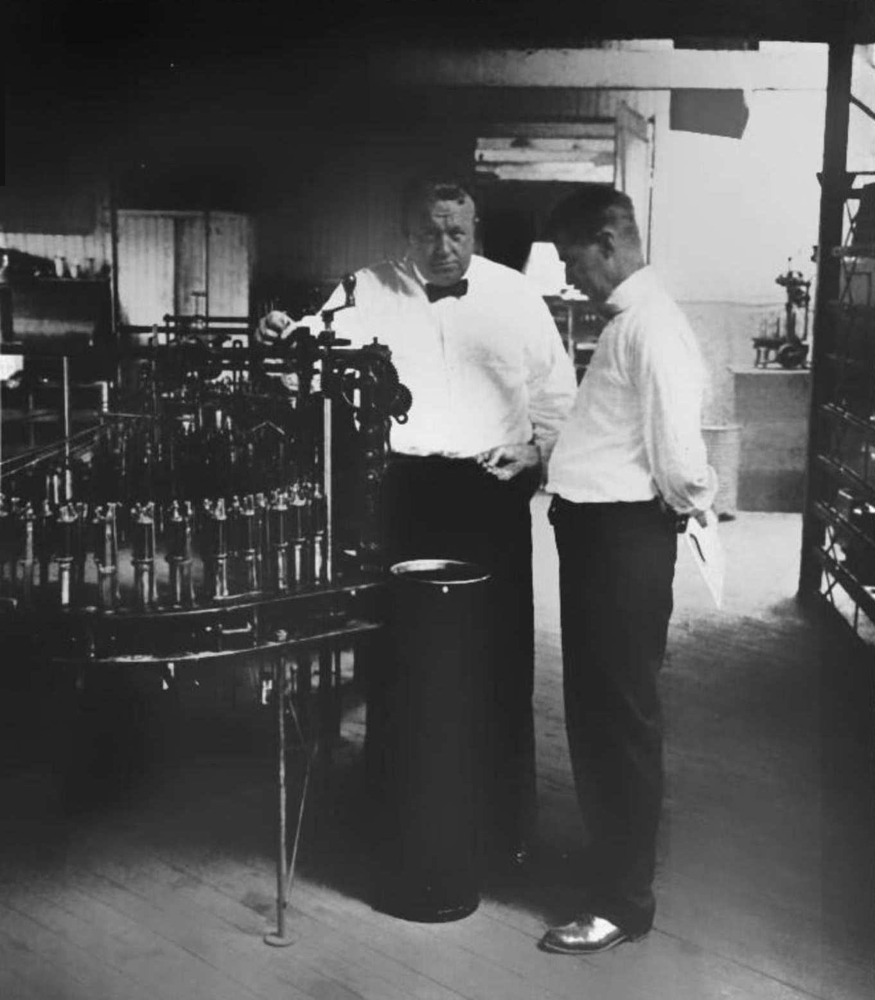

# A Recount of METR

_All 246 issues from METR_

## Executive Summary

> [!callout]
> If a job that used to take two hours is done in thirty minutes with AI, the time saved is ninety minutes. That is what a clock records. An eighteen-page paper posted to arXiv on 23 October 2026 argues that this ledger has one column left blank: the minutes somebody else will spend cleaning up the one wrong figure that went out unchecked. The paper collects no new data of its own. It works from the 246 developer issues METR published, its author is one person with no institution and no outside funding, and it withdraws the measurement proposal he himself put forward in April and writes this in its place.

> Run the 246 issues again and METR's published number comes back exactly. The same records also support a different summary just as well. Neither is an arithmetic slip; the gap is a choice about which summary to report. The harder result comes next. "What share of issues did AI actually help on" cannot be recovered from this design at all, and a larger sample does not narrow it. And in a small experiment the paper ran itself, an AI reviewer told that the drafter erred ten times less often than it did opened, on average, fewer than two of the nine figures it was free to check. It was not blind. Every time it opened the line that exposed the wrong figure it fixed it, twenty times out of twenty, and everything that escaped came out of lines nobody ever opened.

> That much is the paper and the primary sources. From here on it is our reading. Anyone who takes this as an article against METR has read it backwards. METR reported the unadjusted number itself, and in February 2026 it put an out-of-date notice on its own result and announced a redesign. OpenAI, for its part, wrote into the GDPval announcement that the 100x figure was model time. The caveats were all in the originals; they just did not reach the reader. And even with every caveat carried across, one question survives. Nowhere in any of these announcements is there an exchange rate between a minute saved and a wrong figure let through. While that column stays empty, "N% faster" is not yet a number.

<!-- stat-card -->
**19% · 24% · 34%** — Three slowdown figures the same 246 issues support at once — Geometric mean ratio or ratio of means, with or without the forecast adjustment. All three come out of the same February–June 2025 records

<!-- stat-card -->
**2.6% – 82.1%** — The whole range the 'share of issues AI helped on' is pinned to — Each issue is done once, in one arm, so a larger sample does not narrow this range

<!-- stat-card -->
**9 → 1.85** — Lines an AI reviewer opened when a true 30% error rate was reported to it as 3% — In the same condition, the share of briefs that carried a wrong figure out rose from 0% to 22.5%

<!-- stat-card -->
**3.6x** — The ceiling review time alone puts on the GDPval workflow — OpenAI wrote in the same announcement that its 100x figure is model inference time

## Two razors saved 44 seconds and cost two minutes of bandage

Frank Gilbreth, the efficiency engineer of the early twentieth century, buttoned his waistcoat from the bottom up because that took three seconds instead of seven. For a while he also shaved with two razors at once. Then he gave it up. The grumble that followed survives in the memoir his children wrote.

"I can save forty-four seconds, but I wasted two minutes this morning putting this bandage on my throat."  
Frank Gilbreth, in _Cheaper by the Dozen_ (1948). The paper opens its first section with this story.

*▲ Frank Gilbreth (center, bow tie) timing motion on a factory floor — what he counted was never seconds alone, it was bandages | Source: [Wikimedia Commons](https://commons.wikimedia.org/wiki/File:Frank_Bunker_Gilbreth_ca1916.jpg)*

Three years of research into how much faster AI makes work fit inside that one scene. There is a tool that speeds up the visible part of a job, a cost that turns up somewhere else, and a small sample. And Gilbreth had one thing the recent literature often lacks. **He counted the bandages.** That is where the paper's title, _Counting the Bandages_, comes from.

What the recent work lacks is that bandage column. Which is why answers to the same question pile up and disagree. Developers using Copilot finished a bounded programming task in 56% less time. In METR's public-repository experiment, measured from February to June 2025 with Cursor Pro and Claude 3.5 and 3.7 Sonnet, experienced developers took 19% longer. Consultants were 25% faster inside the region the model handles well, and on a task deliberately placed outside it they were faster too but 19 points less likely to be right. OpenAI's GDPval announcement said frontier models are "roughly 100x faster and 100x cheaper than industry experts," and the GDPval paper itself, once an expert reviews the output and redoes what fails, puts the figure for GPT-5 at 1.12 to 1.39 times.

These numbers do not contradict each other. They were never measuring the same thing. The paper's point is that there are two ways of seeing "time saved" and that the two have never been pulled apart.

The first stands there with a clock. Run the task once each way, read off the two durations, and the gap between them is the saving; the measuring is finished when the clock is. Whatever follows belongs to a different piece of research. The second opens a ledger. The saving is what separates two complete workflows carried all the way to the point where the deliverable is actually put to use, and whatever minutes landed on somebody else's desk en route are entered there as well. Call the first the stopwatch view and the second the ledger view.

| The view | What time saved means | What checking is | After the clock stops |
| --- | --- | --- | --- |
| Stopwatch view | Time it with the tool, time it without, subtract | A cost of saving time | Somebody else's study |
| Ledger view | Two whole workflows, each run until its output is used | Not checking is the most common way of saving time | Moved time goes into the ledger too |

********

The distinction the paper draws in its first section. A clock records where time was spent; it does not record what the time bought. Some of what looks like saved time is moved time — from writing to reading, from now to later, from me to whoever finds my mistake.

The thought experiment the paper uses to separate them is short. Two analysts get the same model and the same task: a one-page brief built from figures in three companies' filings, ninety minutes by hand. The first reads the draft against the filings, finds two wrong figures, fixes them, and is done in thirty-four minutes. The second reads the draft, likes it, and is done in six. Who saved more?

On the stopwatch, the second, by a wide margin. In the paper's phrasing, the second analyst has rediscovered "the oldest productivity technology there is, which is not checking." On the ledger the second analyst has saved nothing yet. They have borrowed twenty-eight minutes against two wrong figures, at a rate that will be set by whoever finds them.

The author is Solomon Shalom Lijo. He gives his affiliation as independent researcher and declares no outside funding. The arXiv posting date is 23 October 2026, the length is eighteen pages, the licence is CC BY 4.0, and there is a mirror on Zenodo. His day job is at Rōmy, a company that builds AI software, and he states inside the paper that nothing in it evaluates that product. There is one unusual thing in his record. **This paper withdraws a proposal the same author published in April 2026 and takes its place.** Back then he put forward a five-metric "time-saved benchmark," and in this paper he writes out how it was wrong. The reliability-adjusted metric charged a full redo on top of completion times that already contained the redo; it treated errors that ship as though they cost redo time; and **"two of its headline numbers did not survive contact with their sources."** Rather than patch the old version he replaced it whole, and he left the wrong code in the repository so that the error stays reproducible.

Before the argument proper, three terms. The whole article moves on these three. The formulas come out in section 2; here only the meanings.

- **Time saved** — by what percentage the mean completion time of the arm with the tool falls below the mean of the arm without. It is what a manager means by "we saved 30% of our time."
- **Excess escaped defects** — the probability that the final deliverable carries a defect in the arm with the tool, minus the same probability without it. A defect is something the person who commissioned the work would send back: a wrong figure, a failing test, an invented citation. When this number is negative, the tool improved quality.
- **Break-even defect cost** — how many minutes one escaped defect has to eat downstream before the tool stops paying. It is a single number, written in minutes. A tool that saves 18 minutes per task and lets three extra defects through per 100 tasks pays only if one defect costs less than 600 minutes downstream.

The third is the design centre of the paper. It never fixes the price of a defect itself. A wrong figure in a board report and a badly colored slide cannot carry the same price, and naming either as the default would be a declaration rather than a finding. What it reports instead is **the price at which the verdict flips**. A reader who knows their own situation can follow the decision through without accepting the author's price list. The shape is the incremental cost-effectiveness ratio from health economics, with minutes in place of money and escaped defects in place of health outcomes. The only new thing is pointing that instrument **at claims about time saved**.

## A better model makes the work faster, not cleaner

In its third section the paper builds a very plain model of how a person checking work behaves. The conclusion first: **the rate at which a worker who checks properly lets defects through has no model performance in it.** What a better model buys is not quality but checking time, and less of that than you would think. The paper itself notes in this section that it is a model and that its predictions are labeled as predictions, so what follows is best read as a result derived on top of assumptions.

### 2.1. Hunting a defect works like hunting a lost object

Suppose a draft contains one defect. Write down, as a single number, how many minutes it takes on average to find it, and call that mean κ (kappa). With no particular clue, and looking steadily, the probability of finding the defect within V minutes flattens out as time goes on. The first few minutes return the most, and later minutes return less. This is the exponential detection law that came out of submarine search in the Second World War, and the paper takes Koopman's (1946) expression as it stands.

Detection probability   s(V) = 1 − e−V/κ

V is the minutes spent checking; κ is the mean minutes it takes to find a defect that is there.

Two more quantities get attached. Call R the minutes it takes to repair a defect once found, and c the minutes an escaped defect eats downstream. c is usually far larger than R, and more to the point **somebody else usually pays it**. If the worker picks the checking time that minimizes their own minutes plus the downstream minutes, one expression drops out.

Checking threshold   q† = κ / (c − R)

On the paper's worked example (κ = 5 min, R = 10 min, c = 600 min) this comes to about 0.85%.

What the threshold means is simple. If the draft's error rate sits above it, checking pays; below it, not checking pays. And nowhere in that expression is there any model performance. There are three things in it and only three: how cheap checking is (κ), how cheap repair is (R), and how expensive a miss is (c).

### 2.2. An improved model pays in checking time instead of quality

Here is the model's sharpest conclusion. For a worker who has the error rate right, the share of defects that reach the final deliverable is **whichever is smaller, the error rate q or the threshold q†**. While the error rate sits above the threshold, that share is pinned at the threshold value. A better model lowers the error rate, the worker checks correspondingly less, and the amount going out stays put. Quality starts to improve only once the error rate falls below the threshold and nobody checks at all any more.
