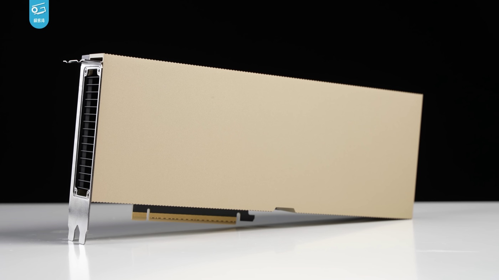

# Vercel AI Gateway: Cheap Models Do the Work, Expensive Ones Take the Money

_In Vercel_

## Executive Summary

> [!callout]
> Open-weight models handled 71.5% of the tokens and took 23% of the spend. That is the headline of the September numbers Vercel published on 15 October in its AI Gateway production index, and most coverage carried it that far. This report lines those two numbers up against the other figures printed alongside them, and once they are lined up, the reading that "cheap open models pushed expensive closed ones out" will not stand. Vercel's own write-up puts about two-thirds of the recent growth in open-weight spending on models that cost more than four times the open-weight average.

> What splits the numbers is the work, not the camp. Inside one application, cheap jobs such as classification, extraction and bulk preprocessing go down to low-priced models, while long reasoning and final judgments go up to frontier or expensive open models. The token count is pulled by the first group and the spend by the second. The evidence is that 68% of the teams that increased open-weight spending in September increased closed-weight spending as well. They did not switch; they split the work.

> That is as far as the facts go. This table covers traffic through one gateway, the spend is estimated from list prices rather than invoiced, and most of the accounts are startups billed in the United States. The interpretation starts here. Once models become interchangeable parts, the question left is not "which model is best" but "can this job go to something cheaper." No model answers that for you. It takes data with known answers for each kind of job, and an evaluation set that shows what breaks when the job moves down.

<!-- stat-card -->
**71.5% / 23%** — Open-weight share of September tokens and of September spend — In August the same two axes read 56% and 14%. One bundle stands in two very different places by volume and by value

<!-- stat-card -->
**about two-thirds** — Of the growth in open-weight spend, the part from models above four times the average price — Nearly half of that growth is Kimi K3 alone. Expensive open models pulled open-weight spending

<!-- stat-card -->
**2.6%** — Spend share of DeepSeek V4.1 Flash, which handled close to half of September's tokens — Its price per token is about a fifth of the open-weight average. Inside one bundle, prices differ by more than tenfold

<!-- stat-card -->
**68%** — Share of teams that raised open-weight spending and raised closed-weight spending too — More than two in five teams already paying for frontier models also spent more than in August, the highest this year

## Two Numbers From the Same Month

Vercel bundles the traffic crossing its AI Gateway into a monthly production index. The gateway is an intermediary layer that gathers models from many companies behind one entry point, and every call crossing it records both a token count and an estimated cost. The September edition, published on 15 October, is where this report starts. Open-weight models handled 71.5% of the tokens, and they took 23% of the spend.

*▲ Guillermo Rauch, co-founder and CEO of Vercel, the company behind the monthly AI Gateway production index this report works from. | Source: [Wikimedia Commons (CC BY-SA 4.0)](https://commons.wikimedia.org/wiki/File:Guillermo_Rauch_photo.jpg)*

Both numbers describe a single stream of traffic, but they count different things in it. Token share counts volume: how many tokens a model read and wrote. Spend share counts value: how much money that processing attracted. Prices differ by model, so there is no reason for the two to agree, and in September they stood more than three times apart. A share quoted without naming its axis never says which of the two it means.

The two bars measure the same traffic with different rulers. The denominator of the upper bar is total gateway tokens; the denominator of the lower bar is total gateway spend as estimated from list prices. They are not numbers to add or subtract. The source is the Vercel AI Gateway Production Index, October 2026 edition.

A single month gives no way to tell which number is unusual. Collect the months Vercel has published and a shape emerges in which the token side rises first and the spend side follows well behind. The table below carries only values Vercel published in a given edition, and cells it never published are left empty.

| Month | Open-weight token share | Open-weight spend share | Edition |
| --- | --- | --- | --- |
| December 2025 | 7% | not published | September edition |
| April 2026 | varies by edition | not published | July and September editions |
| June 2026 | 29% | 5% | July and October editions |
| July 2026 | 36% | 8.6% | August edition |
| August 2026 | 56% | 14% | September edition |
| September 2026 | 71.5% | 23% | October edition |

Only values Vercel published in a given edition appear here, with no interpolation. April and May 2026 carry no value entered for two separate reasons. No edition published an open-weight spend share for May, and the April token share appears as "about 10%" and "11%" in the July edition and as "13%" in the September edition, which leaves the same month circulating with different values. Whichever one is picked, a calculation anchored on that month loses its footing. June's spend figure has the same problem: the contemporaneous July edition said "under 4%", while the October edition, looking back, said 5%. The June cell above uses 5%, the figure from the more recent edition.

Vercel itself describes the September spend share as more than four times June's. Setting 23% against the 5% the October edition gives for June makes it four times over, with a little to spare. The token side went from 29% to 71.5% across the same stretch, so both axes rose. The subject here, though, is the gap between them rather than the rise in either. In June the token share was more than five times the spend share; by September the ratio had narrowed to three. Sections 2 through 4 are about why that narrowing is not a case of expensive models being pushed out.

> [!callout]
> One caveat has to be set aside before the table can be read. The October edition states that its open-weight classification follows the current gateway model list and is a broader definition than in earlier reports, and that figures for prior months may be revised as the methodology is updated. The 56% and the 71.5% were therefore published on either side of a definition that was widening. Subtract one from the other, call it a jump of 15.5 points, and nobody can say how much of those 15.5 points is the model list growing. This report does not perform that subtraction.

There is another way to check. Vercel releases the daily raw data behind its gateway leaderboards as open data, available to anyone who honors the attribution requirement. Pulling the daily shares for the eleven labs that publish open-weight models and re-aggregating them by month gives 56.6% of tokens and 14.8% of spend for August, and 73.0% of tokens and 22.9% of spend for September, within 1.5 percentage points of the published figures. Anthropic's spend share comes out the same way at 64.1% for August and 45.8% for September, landing beside the published 63.7% and 43.9%. The numbers handled below are not creatures of a press release; they can be retraced from outside. How far that retracing holds has limits of its own, and section 6 deals with them.

## Open Weight Is a License, Not a Price

Open weight means the weight file can be downloaded and run. That is a fact about licensing, not about price. Yet in coverage the phrase is read almost every time as "the cheap side." The September record shows where that reading breaks, inside a single bundle.

Vercel's own sentence runs: the cheapest models drive token growth, and the expensive models drive spend. The subject of that sentence is not closed-weight models, and that is the point. Breaking down where the last three months of growth in open-weight spending came from, the same report attributes about two-thirds of it to models priced more than four times the open-weight average. Kimi K3 led, and a chart annotation adds that nearly half of the growth came from Kimi K3 alone. The denominator behind "four times" is not a closed model but the average price of open-weight models. Inside its own bundle, open weight spreads fourfold above its own mean.

At the other end sits DeepSeek V4.1 Flash. This single model processed close to half of all gateway tokens in September and took 2.6% of spend. Vercel puts its price per token at roughly a fifth of the open-weight average. Within one bundle, one model sits four times above the mean and another a fifth below it. The chart below redraws that spread.

A redrawing of the bubble chart in Vercel's October edition. The original was not reproduced; only the named models and the tick scale (0.125× to 16×) were taken from it. Vercel never published coordinates for individual models, so the positions here can be trusted for the ordering they show and nothing finer. The models labeled in Vercel's chart are Average, DeepSeek V4.1 Flash, Kimi K3, DeepSeek V4 Flash 0731, GLM 5.3 Flash, GLM 5.2, Step 3.7 Flash and GLM 5.3, eight in all. This version moves Average onto the axis as the reference line and keeps the other seven as circles.

Multiples alone are hard to feel. Opening each lab's published pricing and lining up like with like gives the table below. Input is compared with input and output with output. The moment the two are blended into a single average, that average stops being Vercel's number and becomes the number of whoever blended it.

| Model | Per 1M input tokens | Per 1M output tokens |
| --- | --- | --- |
| Kimi K3 (Moonshot) | $3.00 | $15.00 |
| DeepSeek V4.1 Flash (off-peak) | $0.15 | $0.60 |
| GLM 5.3 Flash (Z.ai) | $0.15 | $0.50 |

Values checked on each lab's official pricing page on 18 October 2026. There is no guarantee that these match the list prices Vercel uses to estimate spend, so this table should be read only as a sense of the size of the multiple. DeepSeek applies two time-of-day tiers and the values above are the off-peak ones. Prices for the other models named in the bubble chart could not be cross-checked and are left out.

The published shares alone are enough to retrace the same spot. If DeepSeek V4.1 Flash handled close to half of the tokens and took 2.6% of spend, its price per token lands somewhere between a sixth and a fifth of the open-weight average, which is where Vercel's own "about a fifth" sits. That a price multiple can be recovered from two published shares is also a sign that the numbers in this report interlock.

> [!callout]
> Keep these two sentences apart. "Open-weight models handled 71.5% of tokens" is a count by license. "Cheap models handled most of the tokens" is a count by price. In September the two nearly coincide, but they coincide because most cheap models happen to be open weight, not because open weight means cheap. Kimi K3 is open weight and sits at the expensive end of this table. Any sentence that infers price from license breaks right there.

## Splitting Work Instead of Switching Models

Look only at tokens crowding toward the cheap end and one picture suggests itself: teams that used expensive models moved to cheap ones, and the expensive side shrank as a result. The September record contains a figure that does not fit that picture. Of the teams that put more money into open-weight models, 68% also put more money into closed-weight models in the same month.

A second figure points the same way. Among teams already spending on frontier models, more than two in five spent more than they had in August, the highest that ratio has been this year. The long view sharpens it. Against December 2025, spending on frontier models has grown tenfold and spending on open-weight models more than seventyfold. In percentage terms the open-weight side runs away with it, but the first fact is that both axes grew in the same direction. Teams did not abandon one side for the other; they enlarged both.

> [!callout]
> A footnote in Vercel's report limits how any of this can be phrased. Any description of volume moving somewhere compares month-over-month changes for the same teams rather than tracing individual tokens. The accurate sentence is therefore not "tokens moved from A to B" but "a decrease on one side and an increase on the other showed up within the same teams." The difference looks small and is not: the first sentence carries the implication that one side pushed the other out, and the second does not.

So how are teams using all these models? Vercel counted the models a team had passed through, bucketed by cumulative usage. Teams past 10 million cumulative tokens averaged 15 models, those past 100 million averaged 26, and those past a billion averaged 42. The window runs from December 2025 through September 2026, and different versions of the same model count separately. No team is running 42 models at once; they swapped that many in and out over ten months.

The swapping cycle is short. During September, 48.0% of teams changed the model they used most, and 28.6% changed labs outright. The lab-switching rate is the highest since the index began and has risen five months running. Vercel sums up the pattern in one sentence.

"The model is becoming a replaceable part of a much larger investment."

Vercel AI Gateway Production Index, October 2026 edition. The switching rates count only teams that used at least 10 million paid tokens in both months, and "used most" is measured by paid token count.

*▲ The part that gets swapped out like an interchangeable component is the model. The server infrastructure it plugs into stays put. | Source: [NOIRLab, Wikimedia Commons (CC BY 4.0)](https://commons.wikimedia.org/wiki/File:NOIRLab_HQ_Server_Racks_(6V6A0395-CC).jpg)*

How fast new models arrive is part of the same picture. Vercel tracked separately how quickly models launched in September reached people's hands. Reach is the share of paying teams that called the model at least once, and spend share is the share of total paid gateway spend that model took during the 14 days after launch. That both columns use a 14-day window matters. Mix them with monthly figures and the same model ends up with two different numbers.

| Lab | Model | Launch | Reach | Spend share in window |
| --- | --- | --- | --- | --- |
| TypeSafe AI | Jev | Sep 17 | 35.3% | 0.27% |
| Anthropic | Claude Sonnet 5.5 | Sep 28 | 18.1% | 3.21% |
| OpenAI | GPT-6 Luna | Sep 22 | 14.9% | 0.88% |
| Google | Gemini 3.8 Flash | Sep 2 | 13.2% | 2.21% |
| Anthropic | Claude Opus 5.5 | Sep 22 | 13.1% | 11.03% |
| Z.ai | GLM-5.3-Flash | Aug 26 | 9.5% | 0.60% |
| DeepSeek | DeepSeek-V4.1-Flash | Sep 8 | 8.4% | 4.19% |

The top seven rows by reach from the launch scorecard in Vercel's October edition. The three rows left out are GPT-6 Sol in eighth place (6.9%), GPT-6 Astra in ninth (6.6%) and Claude Fable 5.1 in tenth (5.8%). All three fall below 7% reach, which was the only axis used to cut, and the spend column tells a different story: Astra's share of spend in its window was 4.86%, larger than every row kept above except Claude Opus 5.5. That is why the cut row gets its own paragraph below the table. The repeat-use column of the same scorecard could not be verified for this report and is left out. Both numeric columns cover the 14 days after launch, and the denominator of the spend column is total paid gateway spend over those 14 days. DeepSeek V4.1 Flash at 4.19% here is therefore a different number from the 2.6% used in section 2 for the full month, and neither can stand in for the other.

Two rows catch the eye. The first is the top one. Jev, the model that leads on reach, returns multiple-choice answers rather than sentences, and over its 14-day window it took 0.27% of spend, falling to 0.15% across September as a whole. Many teams opened it and almost no money followed; Pebblous examined its price and accuracy separately in [an earlier report](/report/typesafe-jev-classification-cost-collapse/en/). The second is the fifth row. Claude Opus 5.5 sits mid-table on reach at 13.1% while taking 11.03% of spend in its window, the largest figure in the table. How many teams opened a model and where the money goes run on separate tracks, and one row holds both.

The sixth row deserves a glance as well. GLM-5.3-Flash is a cheap open-weight model, yet on reach it sits just below the new models from OpenAI and Anthropic and above DeepSeek's September workhorse. Cheap open models are not only back-room parts that eat tokens; they compete at the front of the adoption race too.

One row that fell outside the line deserves a line of its own. The table was cut by reach, and GPT-6 Astra, ninth on that axis with 6.6% of paying teams opening it, took 4.86% of paid gateway spend during its 14-day window. Only one row inside the table, Claude Opus 5.5, took more. Ranking by reach hides where the money concentrates. The cut row confirms once more why this table has to publish both columns.

## Falling Share, Rising Revenue

The most quoted number in the September record belongs to Anthropic. Its share of gateway spend fell from 63.7% in August to 43.9% in September, below half for the first time. The axis is where this figure most often breaks in transit. The 43.9% is a spend share, not a token share. Anthropic's September token share has never been published in any edition.

The decline sits almost entirely in one model line. Of the nearly 20 percentage points lost, 17 came from the Opus family. Counting all its versions together, Vercel writes that Opus took one of every two dollars on the gateway in August and close to one in three in September. Anthropic did not slide evenly across its range; its most expensive line gave up the ground.

Both bars share a denominator of total estimated gateway spend. Anthropic's totals of 63.7% and 43.9% are figures Vercel published as numbers, while the Opus block inside them renders phrases Vercel wrote in prose ("one of every two dollars on the gateway", "close to one in three") and is therefore not precise to a decimal. The gray block is the rest of Anthropic's range.

A falling share reads as a loss for Anthropic until you notice that the index also describes the denominator. Total estimated gateway spend grew to roughly thirteen times its December 2025 level, and the median paying customer active in both December and September more than doubled its spending. When a denominator grows that much, a share can fall while the amount rises. Add the 47% drop in average price per token since December and the picture sharpens further. Unit prices are falling and the total is climbing.

"A company can spend more with a frontier lab while relying on it for fewer workloads, so the lab gets more money, but a smaller part of the customer's business."

Vercel AI Gateway Production Index, October 2026 edition.

*▲ Dario Amodei, co-founder and CEO of Anthropic. The spend share that fell in September belongs to the Opus line, not to Anthropic as a loser. | Source: [Wikimedia Commons (CC BY 2.0)](https://commons.wikimedia.org/wiki/File:Dario_Amodei_in_2023_(cropped).jpg)*

### 4.1. The Same Shape Passed Through in July

September was not the first instance. Open the earlier editions and the same shape appears between June and July. The July edition records Anthropic taking 61% of spend on 32% of tokens; the same place in the August edition reads 30% of tokens and 65.1% of spend. The token share fell by 2 percentage points while the spend share rose by more than 4. The two axes moved in opposite directions that month. Volume can shrink while value grows, and the reverse holds as well. Seen next to that pair, the 43.9% in September is not a sudden event but the result of a mechanism that has been running for months.

### 4.2. When Twice the Price Stopped Being Worth It

The previous edition holds more direct evidence. During August, as Anthropic's Fable 5 fell from 13.2% of spend in July to 4.9%, Opus 5 climbed to 22.5%. Roughly nine tenths of the teams running Fable cut their usage. Vercel's reading was that Fable's extra capability did not justify twice the price, and the same paragraph carries the sentence most worth rereading in this entire report.

"Production workloads that justify a frontier model don't always need the most expensive one. They need one that's good enough."

Vercel AI Gateway Production Index, September 2026 edition, covering August.

Google's record in that edition shows the movement has no single direction. Since May, the token share of Google's labs as a whole fell from 30% to 5%, and 22 of the 25 points lost came from Gemini 3 Flash alone. Where the volume went is the interesting part. About half of it moved down to cheaper models, and most of the other half moved up to more expensive ones. Claude Opus 5 and Sonnet 5 led the upward move at roughly nine times and three times the price of Gemini 3 Flash. Work leaving one model split in both directions.

> [!callout]
> Price competition cannot produce that result. Had that been the only signal, every token leaving Gemini 3 Flash would have gone down the price ladder; much of it went up instead. Teams took apart what that model had been doing and judged that some of the pieces belonged on a cheaper model while others needed a costlier one. The very mechanism that splits tokens from spend is visible here in one move.

## The Bill Is Settled at the Hosting Layer

The division of labor seen so far has one more axis. The company that builds a model and the company that runs it for money are not the same. Once weights are published, anyone can put that model on a server and charge per call. The September record splits the money at exactly that point and sorts it by lab.

*▲ Open weights are free to download, but the hardware that serves them is not. Whoever hosts the model still keeps a cut. | Source: [Geekerwan, Wikimedia Commons (CC BY 3.0)](https://commons.wikimedia.org/wiki/File:NVIDIA_H100_(%E6%9E%81%E5%AE%A2%E6%B9%BEGeekerwan)_001.png)*

Setting the two axes side by side for each lab gives the following. Here too the left column and the right column are different metrics with different denominators, so the table is read across and never summed down.

| Lab | Gateway token share | Gateway spend share |
| --- | --- | --- |
| DeepSeek | 58% | 6.6% |
| Z.ai (GLM) | 7.2% | 4.5% |
| Moonshot (Kimi) | 3.6% | 13.2% |

All three labs are measured for September 2026, with denominators of total gateway tokens and total estimated gateway spend respectively. DeepSeek and Moonshot stand in exact opposition. One processes a majority of tokens and takes a single-digit share of spend; the other takes a single-digit share of tokens and a double-digit share of spend. The price spread seen inside the open-weight bundle in section 2 reappears at the level of whole labs.

Now the heart of this section. Of every dollar spent on Chinese models in September, 69.5% passed through a provider headquartered in the United States. In December 2025 that figure was under a tenth. Roughly $2.50 routed through the US for every $1 routed through China. The chart below splits that money by lab.

Redrawn as a stacked bar from the Sankey diagram in Vercel's October edition. Every axis here is spend, never tokens. The lab totals (48.9 + 24.5 + 16.5 + 10.0) and the provider totals (69.5 + 28.1 + 2.3) were both checked and agree within rounding. Vercel's footnote defines provider location as company headquarters rather than server location. The "other" provider cell for other Chinese labs is 0.0%, so no bar is visible.

DeepSeek is the sharpest line. More than four fifths of the tokens its models processed were served by DeepSeek itself. Yet two fifths of the money spent on those models passed through providers headquartered in the United States. The tokens stay at home and a large part of the payment goes onto someone else's invoice. If self-serving covered more than four fifths of tokens, US providers handled at most a fifth of them, and that fifth accounts for two fifths of the money. Tokens routed through US providers therefore cost more per token than tokens routed anywhere else, and the report does not say where the difference comes from.

> [!callout]
> Mixing the axes here manufactures a fresh error. Roughly nine tenths of the tokens going to Moonshot models were served by US providers, and roughly seven tenths for Z.ai, but both of those figures sit on the token axis. The 69.5% quoted a few paragraphs above sits on the spend axis. The numbers are close enough in size that placing them in one sentence makes them look like a single piece of evidence, when their denominators differ. Blend them and you get a claim like "90% of Chinese models run through the US," which is false on either axis.

Both routes also show up inside a single team. Among teams that raised their spending on Chinese models in September, 53% of that spend on average went through US-headquartered providers and 41% through China-headquartered ones. Rather than picking one provider and committing, teams call the same model through several windows. The model-level division of labor from section 2 repeats one level down, at the provider.

### 5.1. The Regulatory Risk Sits With the Host

There is a reason this structure matters right now. On 16 October 2026, China proposed adding 40 technologies to its export control list, 23 of them AI-related, according to The Register. That article also cites the Associated Press reading Moonshot's Kimi K3 and Alibaba's Qwen 3.8-Max as falling inside the parameter thresholds the authorities had set, though the official announcement named no model at all. The model names came from the reporting, not from the government.

Proposals to ban or restrict open-weight models exist on the other side as well, and the summary offered there lands exactly on this section's point: such measures hit the American companies serving those models and their customers. Whichever direction regulation arrives from, it reaches the layer that hosts the file and takes the calls before it reaches the weights file itself. A remark from Chris McGuire, senior fellow for China and emerging technology at the Council on Foreign Relations, carried in that coverage, points at that layer too.

"This introduces significant uncertainty for US businesses that host or rely on Chinese models."

"Particularly given that Chinese AI labs are moving toward licensing the use of open-source models to generate revenue, the Chinese government stating that it has the ability to curtail those licensing agreements at any time should make US businesses more hesitant to rely on those models going forward."

Chris McGuire, senior fellow for China and emerging technology at the Council on Foreign Relations, writing on social media, as carried by The Register on 17 October 2026. This is a personal post rather than an official statement or report, and should be read as one.

Publishing weights drives the price of the model itself toward zero, because anyone can download it and run it. The price of running it reliably and selling access to it is not zero, and the September record says that close to seven tenths of the money piling up at that point is revenue for providers headquartered in the United States. If your risk register for using open-weight models lists only model-side items, the empty column is which company's window you are calling that model through.

## The Edges of This Sample

By this point it is easy to feel that 71.5% describes the industry. Vercel closes off that reading itself. The leaderboard methodology page states that these figures cover activity on the AI Gateway and do not represent the AI market as a whole. This section puts numbers on what that sentence actually means.

- Over a trailing 90 days, 91.3% of token volume came from accounts whose billing country is the United States. The United Kingdom is second at 1.6%, and the remaining 3.4% covers countries outside the list together with accounts whose location is unknown. A billing country tells you neither where the request originated nor where the end user sits.
- In the same window, 65.6% of tokens came from startup accounts and 9.4% from enterprises. This table is closer to the traffic of teams shipping web and agent products quickly than to the market at large.
- Spend is estimated from published list prices rather than invoiced. Discounts, commitments, prepurchases and free credits are absent, and Vercel notes that actual bills may differ.
- Token counts include cache-read and cache-write tokens alongside input, output and reasoning tokens. Agent work that re-reads a long context inflates the count for the same underlying job.
- Usage that runs through a different gateway, calls a vendor directly, or sits on-premise never enters this table at all.

The figures themselves also move between editions. For the same month of April 2026, the July edition gives the open-weight token share as "about 10%" and as "11%", while the September edition gives 13%. June's open-weight spend was "under 4%" in the July edition and 5% when the October edition looked back at it. Both are Vercel's own first-hand publications, and together they show the footnote about revisions doing real work. Last month and this month cannot be assumed to have been measured with the same ruler.

The reconstruction described in section 1 runs into the same boundary. Re-aggregating the public export by month matched the published figures to within 1.5 percentage points for August and September, but the gap widens going back. July 2026 reconstructs to 45.3% against a published 36%, and December 2025 to 14.4% against a published 7%. The explanation is one of two things, or both. The open-weight classification may have widened so that earlier months were drawn on a different basis, or averaging daily shares without weighting may diverge from a token-weighted aggregate. Either way the conclusion holds: subtract an earlier month from this one and you cannot say what the result measures.

### 6.1. The In-House Version of This Count

If your team is not a US-billed startup shipping on this gateway, you are barely in this table, and copying 71.5% as a target is the wrong reading of it. The method is what travels. Vercel did nothing exotic here; it aggregated two axes separately, and any team can do that much against its own traffic.

- Count tokens and spend separately. Put both axes on one dashboard and label every figure with which of the two it is.
- Split by kind of work. Classification, extraction, summarization, conversation and agent trajectories do different jobs, and counting them as one block leaves only an average with nothing to decide on.
- Multiply by each model's price to get the cost of one unit of work. Budgets are explained by the price of a job, not by a token count.
- Take the most expensive jobs first and test, against an evaluation set, whether they can move to a cheaper model. Watch what breaks in the tail rather than whether the average holds.
- Add one more column. Next to the model name, record where the provider serving it is headquartered. As section 5 showed, regulation reaches that layer rather than the weights.

## Why Pebblous Is Watching

Start with one number from section 3. Teams past a billion cumulative tokens had passed through an average of 42 models over ten months, and in September alone nearly one team in two changed the model it used most. In a market like that, "which model is best" is a question whose answer expires within a month. The question that does not expire sits elsewhere.

### 7.1. Routing Is an Evaluation Problem

Sending work to different price tiers reduces, in practice, to a single question: can this job go to something cheaper? The model will not answer it. The answer comes from a set of known-correct cases for the job in front of you, together with an evaluation set that surfaces what gives way once the work moves down a tier. What DataClinic does to a dataset — measuring quality as a number and pointing at the places that are broken — is the precondition for making that call at all. Work that looks like choosing a model turns out to be work on data, a point Pebblous made earlier in [its report on cutting costs with smaller models](/report/custom-slm-cost-data-quality/en/).

### 7.2. "Good Enough" Is Only Safe When You Can Measure It

The sentence quoted in section 4 says that work deserving a frontier model does not always deserve the most expensive one. Teams could make that judgment because they had run two models against the same job. The typical failure of moving work downward arrives as a stable average with a broken tail. A dashboard built on averages never shows that tail. In a market where models change monthly, the evaluation set outlives the model. How open-weight models perform on their own terms, and where the gap comes from, is the subject of a [separate Pebblous report on open weights](/report/nemotron-3-ultra-open-weight-2026-06/en/).

### 7.3. Parts Change, Criteria Stay

In Vercel's phrasing, the model is becoming a replaceable part of a much larger investment. What survives the replacement is the standard that decides which part passes and which fails. What Pebblous sells belongs to "what do we judge with" rather than "which model do we use." AI-Ready Data is another name for the freedom to change models, and that freedom exists only when the criteria are in your own hands. For readers to whom counting tokens along two axes is itself unfamiliar, Pebblous has also written about [a country that counts tokens as an economic statistic](/report/china-token-economy-metric-2026-07/en/).

The four steps and the extra column in section 6 are less a checklist than a list of things you need before you start. Counting tokens and spend separately takes a day. Pricing a single job, and then deciding whether that job can move to a cheaper model, requires that you already hold the correct answers for it. An organization that holds them can test whatever ships next within a day; an organization that does not has to take the vendor's scorecard on faith. In a market where the models change every month, that gap compounds.

Sections 1 through 6 report what Vercel published, what the public raw data shows, what The Register reported, and what the labs list on their own pricing pages. Section 7 is the interpretation Pebblous adds on top. They are worth reading separately. That is also why every figure here carries its axis and its window — tokens or spend, a full month or the 14 days after launch, a trailing 90 days or ten cumulative months. No share in this report travels without both. Thank you for reading this far.

## References

Sources are grouped by what they are. Items 1 through 6 are the monthly production index posts from Vercel, and nearly every figure in this report comes from them. Items 7 and 8 are the methodology pages that define the sample and the measurements, and they are also where the public raw data lives. Item 9 is the only source for policy and trade context. Items 10 through 12 are the official pricing pages opened for the list-price table in section 2.

### Primary — Vercel AI Gateway Production Index

- 1.Vercel, "Open weight takes 71.5% of tokens and 23% of spend" (AI Gateway Production Index, 15 October 2026, covering September). By Eric Dodds and Christie Lin. [vercel.com](https://vercel.com/blog/ai-gateway-production-index-october-2026) — the primary oracle for this report. The 71.5% and the 23%, Anthropic's move from 63.7% to 43.9%, the two-thirds of open-weight spend growth and Kimi K3, DeepSeek V4.1 Flash with half the tokens and 2.6% of spend, the 48.0% and 28.6% switching rates, the cumulative model counts of 15, 26 and 42, the 69.5% of Chinese-model spend and the Sankey cell values, and the September launch scorecard all come from here. The measurement notes under "About this report" are on the same page.
- 2.Vercel, "Open-weight models take 56% of token volume, Astra doubles Fable 5.1 spend" (September 2026, covering August). [vercel.com](https://vercel.com/blog/ai-gateway-production-index-september-2026) — the only source for August's 56% and 14%. This edition also carries the shift from Fable 5 to Opus 5 used in section 4.2, the fall in Google's lab-wide token share from 30% to 5% with the traffic splitting both ways, and the footnote stating that movement is a comparison of the same teams month over month rather than a trace of individual tokens.
- 3.Vercel, "DeepSeek overtakes Google on volume, cost per token falls" (11 August 2026, covering July). [vercel.com](https://vercel.com/blog/deepseek-overtakes-google-on-volume-cost-per-token-falls) — July's open-weight token share of 36% and spend share of 8.6%, and Anthropic at 65.1% of spend on 30% of tokens, come from here. This is the one edition whose URL does not follow the monthly naming pattern.
- 4.Vercel, AI Gateway Production Index — July 2026 (covering June). [vercel.com](https://vercel.com/blog/ai-gateway-production-index-july-2026) — June's open-weight token share of 29% and spend "under 4%", Anthropic at 61% of spend on 32% of tokens, and the April token share written as "about 10%" and "11%" are all in this edition.
- 5.Vercel, AI Gateway Production Index — June 2026 (covering May). [vercel.com](https://vercel.com/blog/ai-gateway-production-index-june-2026) — opened to fill the monthly series with published figures only.
- 6.Vercel, the first AI Gateway Production Index (May 2026). [vercel.com](https://vercel.com/blog/ai-gateway-production-index) — the edition that records April at 61% of spend and 26% of tokens.

### Primary — Methodology and Public Data

- 7.Vercel, "AI Gateway leaderboards — about". [vercel.com](https://vercel.com/ai-gateway/leaderboards/about) — the sample description in section 6 comes entirely from this page: 91.3% of token volume from US-billed accounts and 1.6% from the United Kingdom over a trailing 90 days, 65.6% from startups against 9.4% from enterprises, the definition of country as billing country, the definition of a team, and the statement that these figures do not represent the AI market as a whole.
- 8.Vercel, AI Gateway leaderboards documentation and public data export. [vercel.com](https://vercel.com/docs/ai-gateway/leaderboards) — the route through which daily share data is released under an attribution requirement. The reconstructed figures in sections 1 and 6 (August at 56.6% of tokens and 14.8% of spend, September at 73.0% and 22.9%, Anthropic at 64.1% and 45.8% of spend, and the drift in earlier months) come from the export downloaded on 18 October 2026 and re-aggregated by month.

### Secondary — Press

- 9.The Register, "Open-weight models win hearts, minds, and wallets" (17 October 2026). [theregister.com](https://www.theregister.com/ai-and-ml/2026/10/17/open-weight-models-win-hearts-minds-and-wallets/5303704) — section 5.1 draws its account of China's export-control proposal (40 technologies, 23 of them AI-related), the fact that naming specific models was the reporting rather than the announcement, the debate over restricting open-weight models in the United States, the usage a gateway cannot see, and the two quoted sentences from Chris McGuire. The article rounds the 23% to "nearly a quarter" and in places substitutes "provider" for what Vercel calls a lab, and this report does not follow that wording.

### List prices — official pricing pages (checked 18 October 2026)

- 10.Moonshot AI, Kimi K3 pricing — $3.00 per million input tokens, $15.00 per million output tokens. [platform.kimi.ai](https://platform.kimi.ai/docs/pricing)
- 11.DeepSeek, API pricing — V4.1 Flash at $0.15 input and $0.60 output on the off-peak tier. Two time-of-day tiers apply. [api-docs.deepseek.com](https://api-docs.deepseek.com/quick_start/pricing)
- 12.Z.ai, GLM pricing — GLM 5.3 Flash at $0.15 input and $0.50 output. The flagship GLM 5.3 price on the same page could not be cross-checked and is left out of the body. [docs.z.ai](https://docs.z.ai/guides/overview/pricing)

### Related reading on the Pebblous blog

- 13.[Can an AI That Only Picks Answers Really Work This Cheap?](/report/typesafe-jev-classification-cost-collapse/en/) — covers the model in the top row of the section 3 scorecard from the side of price and accuracy.
- 14.[Data Quality Sets the Real Savings in Custom SLMs](/report/custom-slm-cost-data-quality/en/) — the groundwork for section 7.1.
- 15.[America's Strongest Open-Weight Model — So Why Does It Trail China?](/report/nemotron-3-ultra-open-weight-2026-06/en/) — referenced in section 7.2. This report follows the money; that one examines the models themselves.
- 16.[The Country That Counts Tokens Like GDP](/report/china-token-economy-metric-2026-07/en/) — referenced in section 7.3.
