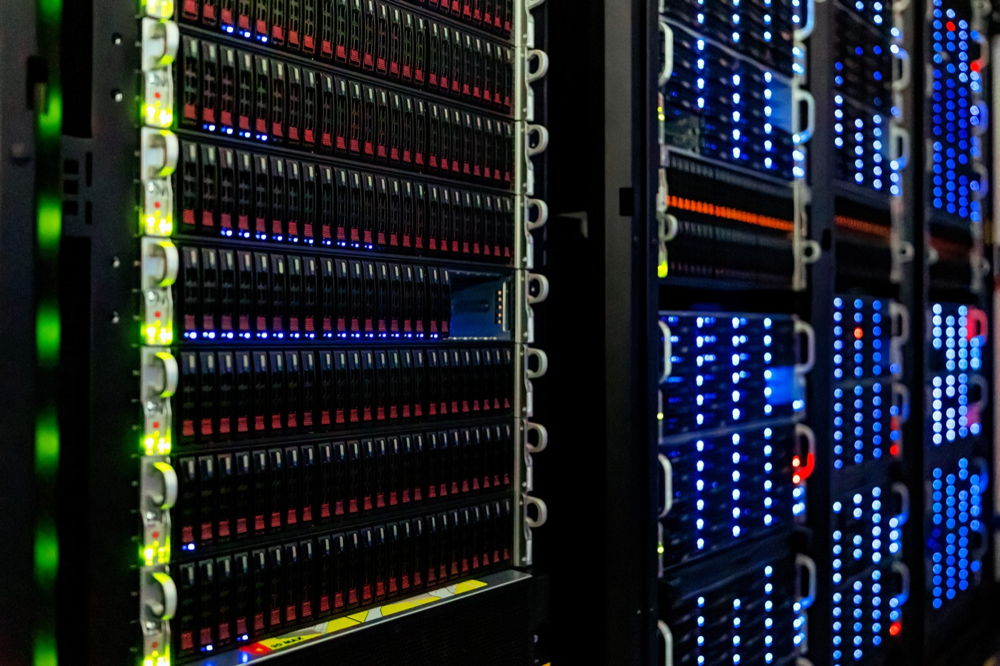

# 버셀 AI 게이트웨이, 공개 모델은 비싼 모델을 밀어내지 않는다

_버셀이 공개한 9월 기록에서 누구나 받아 쓰는 공개 모델이 토큰의 71.5%를 처리했고 지출은 23%를 가져갔다_

## Executive Summary

> [!callout]
> 공개 가중치 모델이 토큰의 71.5%를 처리하고 지출은 23%를 가져갔다. 10월 15일 버셀이 내놓은 AI 게이트웨이 생산 지표 9월분의 제목이다. 보도는 대체로 여기까지 옮겼다. 이 글은 그 두 숫자를 같은 보고서에 함께 실린 다른 수치들과 끝까지 맞춰 본다. 맞춰 보면 "값싼 공개 모델이 비싼 폐쇄 모델을 밀어냈다"는 읽기가 서지 않는다. 같은 보고서가 공개 가중치 지출 증가분의 약 3분의 2는 공개 가중치 평균 단가의 네 배가 넘는 모델들에서 나왔다고 적기 때문이다.

> 숫자가 갈라지는 이유는 진영이 아니라 작업이다. 한 앱 안에서 분류와 추출과 대량 전처리 같은 싼 일은 단가 낮은 모델로 내려가고, 긴 추론과 최종 판정은 프런티어나 비싼 공개 모델로 올라간다. 토큰 수는 전자가 끌고 지출은 후자가 끈다. 9월에 공개 가중치 지출을 늘린 팀의 68%가 폐쇄 가중치 지출도 함께 늘렸다는 수치가 그 증거다. 갈아탄 게 아니라 나눠 보낸 것이다.

> 사실은 여기까지다. 이 표는 버셀 게이트웨이를 지나간 트래픽이고, 지출은 실제 청구액이 아니라 공시 단가로 추정한 값이며, 계정의 대부분이 미국에 청구지를 둔 스타트업이다. 해석은 그다음이다. 모델이 교체 가능한 부품이 되면 남는 질문은 "어느 모델이 가장 좋은가"가 아니라 "이 일을 더 싼 쪽으로 내려보내도 되는가"가 된다. 그 판정은 모델이 해 주지 않는다. 작업마다 정답이 붙은 데이터와, 내려보냈을 때 무엇이 깨지는지 보여 주는 평가셋이 있어야 한다.

<!-- stat-card -->
**71.5% / 23%** — 9월 공개 가중치 모델의 토큰 몫과 지출 몫 — 8월에는 같은 두 축이 56%와 14%였다. 한 묶음이 양과 값에서 전혀 다른 자리에 선다

<!-- stat-card -->
**약 3분의 2** — 공개 가중치 지출 증가분 중 평균 단가 4배 이상 모델의 몫 — 그 증가분의 거의 절반이 Kimi K3 하나다. 비싼 공개 모델이 공개 가중치 지출을 끌었다

<!-- stat-card -->
**2.6%** — 9월 토큰의 거의 절반을 처리한 DeepSeek V4.1 Flash의 지출 몫 — 토큰당 가격이 공개 가중치 평균의 약 5분의 1이다. 같은 묶음 안에서 단가가 두 자릿수 배로 갈린다

<!-- stat-card -->
**68%** — 공개 가중치 지출을 늘리면서 폐쇄 가중치 지출도 함께 늘린 팀의 비율 — 프런티어에 이미 돈을 쓰던 팀의 5분의 2 넘는 수도 8월보다 더 썼다. 올해 들어 가장 높다

## 같은 달, 같은 게이트웨이에서 나온 두 숫자

버셀은 자사 AI 게이트웨이를 지나간 트래픽을 월마다 묶어 생산 지표로 낸다. 게이트웨이는 여러 회사의 모델을 한 창구로 모아 호출해 주는 중개 계층이고, 그 창구를 지나는 호출은 토큰 수와 추정 지출이 동시에 기록된다. 10월 15일에 나온 9월분 보고서의 제목이 이번 글의 출발점이다. 공개 가중치 모델이 토큰의 71.5%를 처리했고, 지출은 23%를 가져갔다.

*▲ 버셀의 공동창업자 겸 CEO 기예르모 라우치. 이 글이 다루는 AI 게이트웨이 생산 지표를 매달 내는 회사의 대표다. | Source: [Wikimedia Commons (CC BY-SA 4.0)](https://commons.wikimedia.org/wiki/File:Guillermo_Rauch_photo.jpg)*

두 숫자가 가리키는 트래픽은 하나인데 세는 대상이 다르다. 토큰 점유는 양을 센다. 모델이 읽고 쓴 토큰이 몇 개였는지다. 지출 점유는 값을 센다. 그 처리에 돈이 얼마나 붙었는지다. 단가가 모델마다 다르니 두 수가 같을 이유가 없고, 실제로 9월에는 세 배 넘게 벌어졌다. 축을 밝히지 않은 "점유율"은 이 둘 중 어느 쪽을 가리키는지 말해 주지 않는다.

두 막대는 같은 트래픽을 다른 잣대로 잰 것이다. 위 막대의 분모는 게이트웨이 전체 토큰이고, 아래 막대의 분모는 공시 단가로 추정한 게이트웨이 전체 지출이다. 서로 더하거나 빼서는 안 되는 두 수다. 출처는 버셀 AI 게이트웨이 생산 지표 2026년 10월 판이다.

한 달치만 보면 둘 중 어느 쪽이 특이한지 알기 어렵다. 버셀이 발표한 달을 모아 보면 토큰 쪽이 먼저 오르고 지출 쪽이 한참 뒤에서 따라오는 모양이 나온다. 아래 표는 버셀이 각 판에서 직접 발표한 값만 옮긴 것이고, 발표하지 않은 칸은 채우지 않았다.

| 달 | 공개 가중치 토큰 몫 | 공개 가중치 지출 몫 | 발표한 판 |
| --- | --- | --- | --- |
| 2025년 12월 | 7% | 미발표 | 9월 판 |
| 2026년 4월 | 판본마다 다름 | 미발표 | 7월 판·9월 판 |
| 2026년 6월 | 29% | 5% | 7월 판·10월 판 |
| 2026년 7월 | 36% | 8.6% | 8월 판 |
| 2026년 8월 | 56% | 14% | 9월 판 |
| 2026년 9월 | 71.5% | 23% | 10월 판 |

버셀이 각 판에서 발표한 값만 옮겼고 보간하지 않았다. 2026년 4월과 5월에 값을 적지 않은 데는 이유가 둘이다. 5월은 공개 가중치 지출을 발표한 판이 없고, 4월 토큰 몫은 7월 판이 "약 10%"와 "11%"로, 9월 판이 "13%"로 적어 같은 달이 판본마다 다른 값으로 돌아다닌다. 어느 값을 골라도 그 달을 기준으로 삼은 계산은 근거를 잃는다. 6월 지출 역시 당대 7월 판은 "4% 미만", 소급한 10월 판은 "5%"로 적었다. 이 표의 6월 칸은 최근 판인 5%를 썼다.

버셀 자신은 9월 지출 몫을 두고 6월의 네 배를 넘었다고 적었다. 10월 판이 쓴 6월 값 5%에 대고 23%를 놓으면 네 배 하고도 조금 더다. 토큰 쪽은 같은 기간에 29%에서 71.5%가 됐으니 두 축 다 올랐다. 다만 오른 폭이 아니라 둘 사이의 간격이 이 글의 주제다. 6월에는 토큰 몫이 지출 몫의 다섯 배를 넘었고, 9월에는 세 배로 좁혀졌다. 간격이 좁혀진 이유가 "비싼 모델이 밀려났기 때문"이 아니라는 것이 2절부터 4절까지의 내용이다.

> [!callout]
> 표를 읽을 때 한 가지를 먼저 접어 두어야 한다. 10월 판은 "공개 가중치 분류가 현재 게이트웨이 모델 목록을 따르며 이전 보고서보다 넓은 정의"라고 적었고, "앞선 달 수치는 방법이 갱신되면 수정될 수 있다"고도 적었다. 56%와 71.5% 사이에는 정의가 넓어지는 과정이 한 번 끼어 있다. 두 값을 빼서 "15.5%p 급등"이라고 쓰면 그 15.5%p 안에 모델 목록이 넓어진 몫이 얼마인지 아무도 모른다. 이 글은 그 뺄셈을 하지 않는다.

대신 다른 쪽으로 확인할 길이 있다. 버셀은 게이트웨이 리더보드의 일별 원자료를 공개 데이터로 열어 두었고, 저작자 표시 조건만 지키면 누구나 받을 수 있다. 공개 가중치 모델을 내놓는 랩 열한 곳의 일별 점유를 받아 월 단위로 다시 더해 보면 8월은 토큰 56.6%에 지출 14.8%, 9월은 토큰 73.0%에 지출 22.9%가 나온다. 발표치와의 차이가 1.5%p 안이다. 앤트로픽의 지출 몫도 같은 방식으로 8월 64.1%, 9월 45.8%가 나와 발표치 63.7%와 43.9% 옆에 떨어진다. 이 글이 아래에서 다루는 숫자들은 보도자료 안에서만 사는 숫자가 아니라 밖에서 되짚어지는 숫자다. 다만 그 되짚기가 어디까지 맞는지에는 경계가 있고, 그 경계는 6절에서 다룬다.

## 공개 가중치는 가격표가 아니다

공개 가중치라는 말은 모델의 가중치 파일을 받아서 직접 돌릴 수 있다는 뜻이다. 라이선스에 관한 사실이지 가격에 관한 사실이 아니다. 그런데 이 말이 기사에 실리면 거의 언제나 "싼 쪽"이라는 뜻으로 읽힌다. 9월 기록은 그 독법이 어디서 깨지는지를 한 묶음 안에서 보여 준다.

버셀이 적은 문장은 이렇다. "가장 싼 모델들이 토큰 증가를 끌고, 비싼 모델들이 지출을 끈다." 이 문장의 주어가 폐쇄 가중치 모델이 아니라는 점이 중요하다. 같은 보고서가 최근 석 달 동안 공개 가중치 지출이 늘어난 몫을 뜯어 보니, 그 증가분의 약 3분의 2가 공개 가중치 평균 단가의 네 배가 넘는 모델들에서 나왔다고 적었다. 선두는 Kimi K3였고, 차트 주석은 그 증가분의 거의 절반이 Kimi K3 한 모델이라고 덧붙였다. 네 배라는 말의 분모는 폐쇄 모델이 아니라 공개 가중치 모델들의 평균 단가다. 같은 묶음이 자기 평균에 대고 네 배로 갈린다.

반대쪽 끝에 DeepSeek V4.1 Flash가 있다. 이 모델 하나가 9월 게이트웨이 전체 토큰의 거의 절반을 처리했고, 지출은 2.6%를 가져갔다. 버셀은 이 모델의 토큰당 가격을 공개 가중치 평균의 약 5분의 1이라고 적었다. 같은 묶음 안에서 한쪽은 평균의 네 배 위에, 다른 쪽은 평균의 5분의 1 아래에 있다. 아래 그림이 그 분포를 다시 그린 것이다.

버셀이 10월 판에 실은 버블 차트를 다시 그린 것이다. 원본을 그대로 옮기지 않았고, 이름이 찍힌 모델과 축의 눈금(0.125배에서 16배)만 버셀 차트에서 가져왔다. 개별 모델의 정확한 좌표는 버셀이 공개하지 않았으므로 이 그림의 점 위치는 버셀 차트가 보여 주는 앞뒤 관계까지만 믿을 수 있다. 버셀 차트에 이름이 함께 찍힌 모델은 Average, DeepSeek V4.1 Flash, Kimi K3, DeepSeek V4 Flash 0731, GLM 5.3 Flash, GLM 5.2, Step 3.7 Flash, GLM 5.3 여덟이다. 이 그림은 그중 Average를 축의 기준선으로 옮기고 나머지 일곱을 원으로 두었다.

배수만으로는 실감이 잘 안 온다. 각 랩이 공개한 가격표를 열어 같은 축끼리 맞대면 이렇다. 입력은 입력끼리, 출력은 출력끼리만 비교한다. 입력과 출력을 하나로 섞어 평균을 내는 순간 그 평균은 버셀의 수치가 아니라 섞은 사람의 수치가 되기 때문이다.

| 모델 | 입력 100만 토큰 | 출력 100만 토큰 |
| --- | --- | --- |
| Kimi K3 (문샷) | $3.00 | $15.00 |
| DeepSeek V4.1 Flash (비피크) | $0.15 | $0.60 |
| GLM 5.3 Flash (Z.ai) | $0.15 | $0.50 |

각 랩의 공식 가격 페이지에서 2026년 10월 18일에 확인한 값이다. 버셀이 지출을 추정할 때 쓰는 단가와 이 값이 같다는 보장은 없으므로, 이 표는 배수의 크기를 가늠하는 용도로만 읽어야 한다. DeepSeek은 시간대에 따라 두 단계 요금을 적용하며 위 값은 비피크 기준이다. 버블 차트에 이름이 있는 다른 모델들의 단가는 교차 확인이 되지 않아 싣지 않았다.

버셀이 공개한 점유율만 가지고도 같은 자리를 되짚을 수 있다. DeepSeek V4.1 Flash가 토큰의 거의 절반을 처리하고 지출의 2.6%를 가져갔다면, 이 모델의 토큰당 가격은 공개 가중치 평균의 6분의 1에서 5분의 1 사이에 떨어진다. 버셀이 본문에 적은 "약 5분의 1"과 같은 자리다. 공개된 두 몫만으로 단가의 배수가 복원되니, 이 보고서의 숫자들은 서로 맞물려 있는 셈이다.

> [!callout]
> 여기서 두 문장을 갈라야 한다. "공개 가중치 모델이 토큰의 71.5%를 처리했다"는 라이선스별 집계다. "값싼 모델이 토큰의 대부분을 처리했다"는 가격대별 집계다. 9월에는 둘이 거의 겹쳐 보이지만 겹치는 이유는 값싼 모델 대부분이 마침 공개 가중치이기 때문이지, 공개 가중치가 곧 값싸기 때문이 아니다. Kimi K3는 공개 가중치이면서 이 표에서 가장 비싼 축에 든다. 라이선스로 가격을 추론하는 문장은 그 자리에서 깨진다.

## 갈아탄 게 아니라 나눠 보냈다

토큰이 싼 쪽으로 몰렸다는 사실만 보면 자연스레 떠오르는 그림이 있다. 비싼 모델을 쓰던 팀이 싼 모델로 옮겨 갔고, 그래서 비싼 쪽의 몫이 줄었다는 그림이다. 9월 기록에는 그 그림과 어긋나는 수치가 하나 박혀 있다. 공개 가중치 모델에 돈을 더 쓴 팀의 68%가 같은 달에 폐쇄 가중치 모델에도 돈을 더 썼다.

방향이 같은 수치가 하나 더 있다. 이미 프런티어 모델에 돈을 쓰고 있던 팀 가운데 8월보다 더 쓴 팀이 5분의 2를 넘었고, 이 비율은 올해 들어 가장 높다. 길게 보면 그림이 더 분명해진다. 2025년 12월과 견주면 프런티어 모델 지출은 열 배가 됐고, 공개 가중치 모델 지출은 일흔 배를 넘겼다. 비율로는 공개 가중치 쪽이 압도적으로 빠르지만, 두 축 모두 같은 방향으로 커졌다는 사실이 먼저다. 한쪽을 버리고 다른 쪽으로 간 게 아니라 양쪽을 함께 늘린 것이다.

> [!callout]
> 버셀은 이 수치에 각주로 조건 하나를 달아 두었다. 어디로 물량이 옮겨 갔다는 서술은 같은 팀들의 월별 증감을 견준 것이지 개별 토큰을 추적한 것이 아니다. 그러니 "토큰이 A에서 B로 이동했다"가 아니라 "줄어든 쪽과 늘어난 쪽이 같은 팀 안에서 함께 나타났다"가 정확한 문장이다. 이 차이가 사소해 보이지만, 앞 문장은 한쪽이 다른 쪽을 밀어냈다는 뜻까지 품고 뒤 문장은 그렇지 않다.

그러면 팀들은 늘어난 모델을 어떻게 쓰고 있나. 버셀은 누적 사용량 구간별로 팀이 거쳐 간 모델 수를 집계했다. 누적 1,000만 토큰을 넘긴 팀은 평균 15개, 1억을 넘긴 팀은 26개, 10억을 넘긴 팀은 42개였다. 2025년 12월부터 2026년 9월까지 열 달 동안의 누적이고 같은 모델의 버전이 다르면 따로 센 값이다. 한 팀이 모델 마흔두 개를 동시에 돌렸다고 읽으면 안 된다. 열 달을 지나며 그만큼 갈아 끼운 수다.

갈아 끼우는 주기는 짧다. 9월 한 달 동안 가장 많이 쓰는 모델을 바꾼 팀이 48.0%였고, 랩 자체를 바꾼 팀이 28.6%였다. 랩 교체율은 이 지수가 집계된 이래 가장 높고 다섯 달 연속 오르는 중이다. 버셀은 이 대목을 한 문장으로 정리했다.

"The model is becoming a replaceable part of a much larger investment."

버셀 AI 게이트웨이 생산 지표 2026년 10월 판. 모델이 훨씬 큰 투자의 교체 가능한 부품이 되어 가고 있다는 뜻이다. 교체율 수치의 조건은 두 달 모두 유료 토큰 1,000만 개 이상을 쓴 팀만 센 것이고, "가장 많이 쓰는"의 기준은 유료 토큰 수다.

*▲ 부품처럼 교체되는 쪽은 모델이지만, 그 부품을 꽂아 돌리는 서버 인프라는 그대로 남는다. | Source: [NOIRLab, Wikimedia Commons (CC BY 4.0)](https://commons.wikimedia.org/wiki/File:NOIRLab_HQ_Server_Racks_(6V6A0395-CC).jpg)*

새 모델이 들어오는 속도도 같은 그림의 일부다. 버셀은 9월에 출시된 모델들이 얼마나 빨리 사람 손에 닿았는지를 따로 집계했다. 도달은 그 모델을 한 번이라도 호출한 유료 팀의 비율이고, 지출 몫은 출시 후 14일 동안 게이트웨이 전체 유료 지출에서 그 모델이 차지한 비율이다. 두 열의 창이 모두 14일이라는 점이 중요하다. 월 단위 수치와 섞으면 같은 모델이 서로 다른 숫자를 갖게 된다.

| 랩 | 모델 | 출시 | 도달 | 창 지출 몫 |
| --- | --- | --- | --- | --- |
| TypeSafe AI | Jev | 9/17 | 35.3% | 0.27% |
| Anthropic | Claude Sonnet 5.5 | 9/28 | 18.1% | 3.21% |
| OpenAI | GPT-6 Luna | 9/22 | 14.9% | 0.88% |
| Google | Gemini 3.8 Flash | 9/2 | 13.2% | 2.21% |
| Anthropic | Claude Opus 5.5 | 9/22 | 13.1% | 11.03% |
| Z.ai | GLM-5.3-Flash | 8/26 | 9.5% | 0.60% |
| DeepSeek | DeepSeek-V4.1-Flash | 9/8 | 8.4% | 4.19% |

버셀 10월 판의 출시 스코어카드에서 도달 순 상위 일곱 행이다. 여기서 뺀 세 행은 8위 GPT-6 Sol(6.9%), 9위 GPT-6 Astra(6.6%), 10위 Claude Fable 5.1(5.8%)이다. 셋 다 도달이 7% 아래라 잘렸는데, 자른 잣대는 도달 하나뿐이고 지출 쪽은 사정이 다르다. 9위 Astra의 창 지출 몫은 4.86%로 위 일곱 행 가운데 Claude Opus 5.5를 뺀 전부보다 크다. 표 아래 본문에서 그 줄을 따로 적은 이유다. 같은 표의 재방문율 열은 이 글이 따로 확인하지 못해 싣지 않았다. 두 수치 열의 창은 모두 출시 후 14일이며, 지출 몫의 분모는 그 14일 동안의 게이트웨이 전체 유료 지출이다. 그래서 DeepSeek V4.1 Flash의 4.19%는 2절에서 쓴 월 전체 기준 2.6%와 다른 수이고, 둘은 서로를 대체하지 못한다.

이 표에서 두 줄이 눈에 걸린다. 하나는 맨 윗줄이다. 도달 1위 Jev는 문장을 만들지 않고 객관식 답만 돌려주는 분류 전용 모델인데, 출시 14일 창에서 지출은 0.27%였고 9월 한 달 전체로는 0.15%였다. 많은 팀이 열어 봤지만 돈은 거의 쓰이지 않았다. 그 모델의 값과 정확도는 페블러스가 [앞선 글](/report/typesafe-jev-classification-cost-collapse/ko/)에서 따로 다뤘다. 다른 하나는 다섯째 줄이다. Claude Opus 5.5는 도달이 13.1%로 중위권인데 창 지출 몫은 11.03%로 표에서 가장 크다. 열어 본 팀 수와 돈이 가는 자리가 따로 논다는 이 표의 성질이 한 줄 안에 들어 있다.

여섯째 줄도 그냥 지나칠 자리가 아니다. GLM-5.3-Flash는 값싼 공개 가중치 모델인데 도달에서 OpenAI와 앤트로픽의 신모델들 바로 아래, DeepSeek의 9월 주력 모델보다 위에 있다. 값싼 공개 모델은 토큰만 많이 먹는 뒷방 부품에 머물지 않는다. 신모델 채택 경쟁의 앞자리에도 선다.

선 밖으로 밀려난 줄도 하나 적어 둔다. 위 표는 도달 순으로 잘랐는데, 도달 9위 GPT-6 Astra는 열어 본 유료 팀이 6.6%에 그치면서 출시 14일 창 동안 게이트웨이 유료 지출의 4.86%를 가져갔다. 그보다 많이 가져간 줄은 표 안에 Claude Opus 5.5 하나뿐이다. 도달로 줄을 세우면 돈이 가장 많이 가는 자리가 어디인지는 보이지 않는다. 이 표가 두 열을 따로 실어야 하는 이유가 잘린 줄에서 한 번 더 확인된 셈이다.

## 점유율이 내려가는데 매출은 올라간다

9월 기록에서 가장 많이 인용된 숫자는 앤트로픽의 것이다. 앤트로픽이 가져간 게이트웨이 지출 몫이 8월 63.7%에서 9월 43.9%로 내려가 처음으로 절반 밑이 됐다. 이 수치를 옮길 때 가장 흔히 깨지는 자리가 축이다. 43.9%는 지출 몫이지 토큰 몫이 아니다. 9월 앤트로픽의 토큰 몫은 어느 판에서도 발표된 적이 없다.

하락은 한 모델 계열에 몰려 있다. 거의 20%p가 빠졌는데 그중 17%p가 Opus 계열에서 나왔다. 버셀은 Opus를 전 버전 합쳐 세면 8월에는 게이트웨이 1달러 중 둘에 하나를 가져갔고 9월에는 거의 셋에 하나로 내려왔다고 적었다. 앤트로픽 전체가 고르게 빠진 것이 아니라 가장 비싼 계열 한 줄이 자리를 내준 모양이다.

두 막대 모두 분모가 게이트웨이 전체 추정 지출이다. 앤트로픽 합계 63.7%와 43.9%는 버셀이 숫자로 발표한 값이고, 그 안의 Opus 칸은 버셀이 문장으로 적은 표현("게이트웨이 1달러 중 둘에 하나", "거의 셋 중 하나")을 옮긴 것이라 소수점까지 정확한 값이 아니다. 회색 칸은 앤트로픽의 나머지 모델들이다.

점유가 내려갔으니 앤트로픽이 손해를 봤다고 읽기 쉽지만, 같은 보고서가 분모 쪽도 적어 두었다. 게이트웨이 전체 추정 지출은 2025년 12월의 약 열세 배가 됐고, 12월과 9월에 모두 활동한 중위 유료 고객은 지출을 두 배 넘게 늘렸다. 분모가 그만큼 커지면 몫이 내려가면서도 금액은 올라갈 수 있다. 토큰당 평균 가격이 12월 대비 47% 내려갔다는 수치까지 겹치면 그림이 더 분명해진다. 단가는 떨어지는데 총액은 늘고 있다.

"A company can spend more with a frontier lab while relying on it for fewer workloads, so the lab gets more money, but a smaller part of the customer's business."

버셀 AI 게이트웨이 생산 지표 2026년 10월 판. 한 회사가 프런티어 랩에 돈을 더 쓰면서도 맡기는 작업 수는 줄일 수 있다고 적은 대목이다. 그러면 랩은 돈을 더 받으면서도 그 고객의 사업에서 차지하는 자리는 작아진다.

*▲ 앤트로픽 공동창업자 겸 CEO 다리오 아모데이. 9월 기록에서 지출 점유가 내려간 쪽은 Opus 계열이지, 앤트로픽이 손해를 본 것은 아니다. | Source: [Wikimedia Commons (CC BY 2.0)](https://commons.wikimedia.org/wiki/File:Dario_Amodei_in_2023_(cropped).jpg)*

### 4.1. 같은 일이 여름에도 한 번 있었다

9월이 처음도 아니다. 앞선 판들을 펼쳐 보면 6월에서 7월 사이에 같은 모양이 한 번 지나갔다. 7월 판은 앤트로픽이 토큰의 32%로 지출의 61%를 가져갔다고 적었고, 8월 판의 같은 자리는 토큰 30%에 지출 65.1%다. 토큰 몫은 2%p 내려갔는데 지출 몫은 4%p 넘게 올랐다. 두 축이 반대로 움직인 달이다. 양이 줄어도 값이 오를 수 있고, 그 반대도 된다. 이 한 쌍을 보고 나면 9월의 43.9%가 돌발 사건이 아니라 몇 달째 같은 일이 되풀이된 결과라는 것이 보인다.

### 4.2. 두 배 값을 받던 모델이 한 달 만에 몫을 잃었다

더 직접적인 증거는 한 달 전 판에 실렸다. 8월에 앤트로픽 Fable 5의 지출 몫이 7월 13.2%에서 4.9%로 내려앉는 동안, Opus 5의 몫은 22.5%로 올랐다. Fable을 돌리던 팀 열에 아홉이 사용량을 줄였다. 버셀의 정리는 Fable의 추가 능력이 두 배 값만큼은 아니었다는 것이었고, 같은 문단에 이 글 전체에서 가장 많이 돌려 읽을 만한 문장이 붙었다.

"Production workloads that justify a frontier model don't always need the most expensive one. They need one that's good enough."

버셀 AI 게이트웨이 생산 지표 2026년 9월 판(8월분). 프런티어 모델이 필요한 작업이라고 해서 늘 가장 비싼 모델이 필요하지는 않다. 충분히 좋은 모델이면 된다.

같은 판에 실린 구글 쪽 기록은 방향이 하나가 아니라는 것을 보여 준다. 5월 이후 구글 랩 전체의 토큰 몫이 30%에서 5%로 내려갔고, 빠진 25%p 가운데 22%p가 Gemini 3 Flash 한 모델에서 나왔다. 흥미로운 것은 그 물량이 간 자리다. 절반가량은 더 싼 모델로 내려갔고, 나머지 절반의 대부분은 더 비싼 모델로 올라갔다. 올라간 쪽을 이끈 것이 Claude Opus 5와 Sonnet 5인데, 각각 Gemini 3 Flash의 아홉 배와 세 배쯤 되는 가격대다. 한 모델에서 빠진 일이 양쪽으로 갈라진 것이다.

> [!callout]
> 한 모델에서 빠진 일이 더 싼 쪽과 더 비싼 쪽으로 반씩 갈라졌다는 사실은 가격 경쟁으로 설명되지 않는다. 가격만 보고 움직였다면 전부 싼 쪽으로 갔어야 한다. 팀들은 그 모델이 하던 일을 뜯어 보고 어떤 것은 더 싸게 보내도 되고 어떤 것은 더 비싸게 보내야 한다고 판정했다. 토큰과 지출이 갈라지는 바로 그 기제가 여기 한 번에 들어 있다.

## 가중치는 열려 있어도 청구서는 호스팅이 끊는다

지금까지 본 분업에는 축이 하나 더 있다. 모델을 만든 곳과 그 모델을 돌려서 돈을 받는 곳이 다르다는 축이다. 가중치가 공개되면 누구나 그 모델을 서버에 올려 호출당 값을 받고 팔 수 있다. 9월 기록은 그 자리에서 돈이 어디로 흘렀는지를 랩별로 갈라 놓았다.

*▲ 가중치가 공개돼도 그 가중치를 얹어 돌리는 하드웨어는 공짜가 아니다. 모델을 공짜로 받아도 서빙하는 쪽의 몫은 남는다. | Source: [극객만(Geekerwan), Wikimedia Commons (CC BY 3.0)](https://commons.wikimedia.org/wiki/File:NVIDIA_H100_(%E6%9E%81%E5%AE%A2%E6%B9%BEGeekerwan)_001.png)*

먼저 랩별로 두 축을 나란히 놓으면 이렇다. 여기서도 왼쪽 열과 오른쪽 열은 분모가 다른 두 지표이므로 가로로만 읽고 세로로 더하지 않는다.

| 랩 | 게이트웨이 토큰 몫 | 게이트웨이 지출 몫 |
| --- | --- | --- |
| DeepSeek | 58% | 6.6% |
| Z.ai (GLM) | 7.2% | 4.5% |
| Moonshot (Kimi) | 3.6% | 13.2% |

세 랩 모두 2026년 9월 기준이며 분모는 각각 게이트웨이 전체 토큰과 게이트웨이 전체 추정 지출이다. DeepSeek과 Moonshot의 두 열이 정확히 반대로 서 있다. 한쪽은 토큰의 과반을 처리하고 지출은 한 자릿수를 가져갔고, 다른 쪽은 토큰이 한 자릿수인데 지출은 두 자릿수다. 2절에서 본 묶음 안쪽의 단가 분산이 랩 단위로도 그대로 나타난다.

그다음이 이 절의 본론이다. 9월에 중국 모델에 쓴 돈의 69.5%가 미국에 본사를 둔 공급자를 거쳤다. 2025년 12월에는 10분의 1에도 못 미쳤다. 미국 경유 2.5달러당 중국 경유 1달러 꼴이다. 아래 그림이 그 돈을 랩별로 가른 것이다.

버셀 10월 판의 상트 다이어그램을 누적 막대로 다시 그린 것이다. 가로축은 전부 지출이며 토큰이 아니다. 랩 축 합계(48.9 + 24.5 + 16.5 + 10.0)와 공급자 축 합계(69.5 + 28.1 + 2.3)가 모두 반올림 오차 안에서 맞아떨어지는 것을 확인했다. 버셀의 각주에 따르면 공급자 소재지는 회사 본사 기준이고 서버가 놓인 자리가 아니다. 그 밖 중국 랩의 "그 밖" 공급자 칸은 0.0%라 막대가 보이지 않는다.

가장 선명한 줄은 DeepSeek이다. 이 랩의 모델이 처리한 토큰 가운데 5분의 4가 넘는 양을 DeepSeek 자신이 서빙했다. 그런데 그 모델들에 쓴 돈 가운데 5분의 2는 미국에 본사를 둔 공급자를 거쳤다. 토큰은 자기가 돌리는데 돈은 상당 부분 남의 계산서로 간다. 자체 서빙이 5분의 4를 넘었으니 미국 공급자가 받은 토큰은 많아야 5분의 1인데, 그 몫이 돈에서는 5분의 2다. 미국 공급자를 거친 토큰의 단가가 나머지 경로를 거친 토큰보다 높다. 그 차이가 어디서 오는지는 보고서가 적지 않았다.

> [!callout]
> 여기서 축을 섞으면 새 오류가 생긴다. Moonshot 모델의 토큰은 열에 아홉을 미국 공급자가 서빙했고 Z.ai 모델은 열에 일곱이 그랬는데, 이 두 수치는 토큰 축이다. 같은 절에 나오는 69.5%는 지출 축이다. 숫자가 비슷한 크기라서 한 문장에 묶으면 같은 근거처럼 보이지만 분모가 서로 다르다. 섞이면 "중국 모델의 90%가 미국을 거친다" 같은, 어느 축에서도 참이 아닌 문장이 만들어진다.

한 팀 안에서도 두 경로가 함께 쓰인다. 9월에 중국 모델 지출을 늘린 팀들의 평균을 보면 지출의 53%가 미국 본사 공급자를, 41%가 중국 본사 공급자를 거쳤다. 공급자를 하나 골라 몰아 주는 게 아니라 같은 모델을 여러 창구로 나눠 부른다. 2절에서 본 모델 단위 분업이 공급자 단위에서도 한 번 더 반복된다.

### 5.1. 수출통제 논의도 호스팅 층을 겨눈다

이 구조가 지금 중요해진 이유가 있다. 2026년 10월 16일 중국은 수출통제 목록에 기술 40건을 추가하자는 안을 내놓았고 그중 23건이 인공지능 관련이라고 레지스터가 전했다. 같은 기사에서 AP는 문샷의 Kimi K3와 알리바바의 Qwen 3.8-Max가 당국이 정한 파라미터 문턱에 들어간다고 봤는데, 공식 발표문 자체는 특정 모델을 지목하지 않았다. 모델 이름은 당국의 발표가 아니라 보도의 해석에서 나왔다.

반대쪽에서도 공개 가중치 모델을 금지하거나 제한하는 논의가 있다. 레지스터의 정리가 이 절의 요지와 정확히 겹친다. 그런 조치는 그 모델을 서빙하는 미국 기업과 그 고객에게 영향을 준다는 것이다. 규제가 어느 쪽에서 오든 먼저 닿는 자리는 가중치 파일이 아니라 그 파일을 올려 두고 호출을 받는 층이다. 같은 기사에 실린 미국외교협회 중국·신흥기술 선임연구원 크리스 맥과이어의 말도 그 층을 가리킨다.

"This introduces significant uncertainty for US businesses that host or rely on Chinese models."

"Particularly given that Chinese AI labs are moving toward licensing the use of open-source models to generate revenue, the Chinese government stating that it has the ability to curtail those licensing agreements at any time should make US businesses more hesitant to rely on those models going forward."

크리스 맥과이어(미국외교협회 중국·신흥기술 선임연구원)가 소셜미디어에 올린 글이며, 레지스터 2026년 10월 17일자 기사를 통해 확인했다. 공식 성명이나 보고서가 아니라 개인 게시물이라는 점을 함께 읽어야 한다.

가중치를 공개하면 모델 자체의 값은 0에 가까워진다. 받아서 돌리면 되기 때문이다. 그러나 그 모델을 안정적으로 돌려 파는 자리의 값은 0이 아니고, 9월 기록은 그 자리에 쌓인 돈의 7할 가까이가 미국 본사 공급자의 매출이라고 말한다. 공개 가중치 모델을 쓰는 일의 위험을 모델 쪽 항목으로만 적어 둔 대장이 있다면, 지금 비어 있는 칸은 그 모델을 어느 회사의 창구로 부르고 있는가다.

## 이 숫자는 대부분 미국 스타트업의 트래픽이다

여기까지 읽고 나면 71.5%라는 수가 업계 전체의 비율처럼 느껴지기 쉽다. 버셀 자신이 그 독법을 막아 두었다. 리더보드 방법론 문서는 이 수치들이 AI 게이트웨이 위의 활동을 다룬 것이며 AI 시장 전체를 대표하지 않는다고 적는다. 이 절은 그 문장이 구체적으로 무엇을 뜻하는지를 수치로 적어 두는 자리다.

- 최근 90일 기준으로 토큰 볼륨의 91.3%가 청구 국가를 미국으로 둔 계정에서 나왔다. 2위 영국이 1.6%이고, 목록에 없는 나라와 소재를 알 수 없는 계정을 합친 나머지가 3.4%다. 청구 국가는 요청이 어디서 왔는지도, 최종 사용자가 어디 있는지도 말해 주지 않는다.
- 같은 창에서 토큰의 65.6%가 스타트업 계정에서 나왔고 대기업은 9.4%다. 이 표가 보여 주는 것은 웹·에이전트 제품을 빠르게 돌리는 팀들의 트래픽에 가깝다.
- 지출은 실제 청구액이 아니라 공시 단가로 추정한 값이다. 할인·약정·선구매·무료 크레딧이 반영되지 않았고, 버셀 자신이 실제 청구서는 다를 수 있다고 적었다.
- 토큰 수에는 입력·출력·추론 토큰에 더해 캐시 읽기와 캐시 쓰기 토큰이 포함된다. 긴 문맥을 반복해 읽는 에이전트 작업은 같은 일을 해도 토큰 수가 크게 부푼다.
- 다른 게이트웨이를 쓰거나 벤더를 직접 부르거나 온프레미스로 모델을 돌리는 사용량은 이 표에 아예 들어오지 않는다.

수치 자체가 판마다 움직이기도 한다. 같은 2026년 4월 공개 가중치 토큰 몫을 7월 판은 "약 10%"와 "11%"로, 9월 판은 "13%"로 적었다. 6월 공개 가중치 지출도 당대 7월 판은 "4% 미만", 소급한 10월 판은 "5%"로 적었다. 둘 다 버셀의 1차 발표이고, 앞선 달 수치가 수정될 수 있다는 각주가 실제로 작동한 사례다. 지난달과 이번 달을 같은 잣대로 재고 있다고 가정하면 안 된다.

1절에서 적은 재현 결과에도 같은 경계가 있다. 공개 원자료를 월 단위로 다시 더했을 때 8월과 9월은 발표치와 1.5%p 안에서 맞았지만, 앞선 달로 갈수록 벌어진다. 2026년 7월은 재구성 45.3%에 발표 36%였고, 2025년 12월은 재구성 14.4%에 발표 7%였다. 설명은 둘 중 하나이거나 둘 다다. 공개 가중치 분류가 넓어지면서 과거 달의 기준이 지금과 달라졌을 수도 있고, 일별 점유를 단순 평균한 이 재구성 방식이 토큰 가중 집계와 어긋났을 수도 있다. 어느 쪽이든 결론은 같다. 과거 달과 이번 달을 한 줄에 놓고 뺄셈을 하면 그 결과가 무엇을 잰 값인지 말할 수 없다.

### 6.1. 한국 팀은 버셀의 집계 방법을 가져오면 된다

한국 팀은 이 표 안에 거의 없다. 토큰의 9할이 미국에 청구지를 둔 계정에서 나왔으니 71.5%를 목표치로 베끼는 일은 틀린 독법이다. 버셀이 한 일은 특별한 분석이 아니다. 토큰과 지출을 각각 따로 센 것뿐이고, 그 정도는 어느 팀이든 자기 트래픽에 대고 할 수 있다.

- 토큰과 지출을 따로 집계한다. 한 장의 대시보드에 두 축을 나란히 두고, 어느 쪽 수치인지 라벨을 반드시 붙인다.
- 작업 종류별로 쪼갠다. 분류·추출·요약·대화·에이전트 궤적처럼 하는 일이 다른 호출을 한 덩어리로 세면 평균만 남고 판단할 자리가 사라진다.
- 모델별 단가를 곱해 작업 1건의 값을 낸다. 토큰 수가 아니라 작업 1건의 값이 예산을 설명하는 단위다.
- 값이 가장 큰 작업부터 더 싼 모델로 내려보낼 수 있는지 평가셋으로 시험한다. 평균 성능이 유지되는지가 아니라 꼬리에서 무엇이 깨지는지를 본다.
- 한 칸을 더 둔다. 모델 이름 옆에 그 모델을 부르는 공급자의 본사 소재지를 적는다. 5절에서 본 대로 규제는 모델이 아니라 그 층에 닿는다.

## 페블러스 관심의 이유

3절의 숫자 하나를 다시 꺼내 놓고 시작한다. 누적 10억 토큰을 넘긴 팀이 열 달 동안 거쳐 간 모델이 평균 42개였고, 9월 한 달에 가장 많이 쓰는 모델을 바꾼 팀이 둘 중 하나에 가까웠다. 이런 시장에서 "어느 모델이 제일 좋은가"는 한 달이면 답이 바뀌는 질문이다. 바뀌지 않는 질문은 다른 쪽에 있다.

### 7.1. 싼 모델에 맡겨도 되는지는 평가셋이 가른다

일을 가격대별로 나눠 보낸다는 말은 실무에서 한 문장으로 줄어든다. 이 일을 더 싼 쪽으로 내려보내도 되는가. 그 판정은 모델이 해 주지 않는다. 작업마다 정답이 붙은 데이터가 있어야 하고, 내려보냈을 때 무엇이 깨지는지 보여 주는 평가셋이 있어야 한다. 데이터클리닉이 데이터셋에 하는 일, 그러니까 품질을 수치로 재고 깨진 자리를 지목하는 일이 그 판정의 전제 그 자체다. 모델을 고르는 작업처럼 보이는 일이 실은 데이터를 갖추는 작업이라는 것이 페블러스가 [작은 모델로 비용을 줄이는 이야기](/report/custom-slm-cost-data-quality/ko/)에서 이미 짚었던 자리다.

### 7.2. 충분히 좋다는 말은 잴 수 있을 때만 안전하다

4절에 인용한 버셀의 문장은 프런티어가 필요한 작업이라고 늘 가장 비싼 모델이 필요한 것은 아니라는 말이었다. 그 판단을 할 수 있었던 건 두 모델을 같은 작업에 걸어 본 팀들이 있었기 때문이다. 내려보내기의 전형적인 실패는 평균이 유지되는데 꼬리 케이스만 깨지는 꼴로 온다. 평균을 보는 계기판으로는 그 꼬리가 보이지 않는다. 모델을 바꾸는 일이 월 단위로 일어나는 시장에서는 모델보다 평가셋이 오래 간다. 공개 가중치 모델 자체의 성능과 그 격차가 어디서 오는지는 페블러스가 [공개 가중치 모델을 다룬 글](/report/nemotron-3-ultra-open-weight-2026-06/ko/)에서 따로 살폈다.

### 7.3. 부품이 바뀌어도 판정 기준은 남는다

버셀의 표현을 빌리면 모델은 훨씬 큰 투자의 교체 가능한 부품이 되어 가고 있다. 남는 것은 그 부품을 고르고 합격과 불합격을 가르는 기준이다. 페블러스가 파는 것은 "어느 모델을 쓸까"가 아니라 "무엇으로 판정할까" 쪽에 있다. AI-Ready Data는 모델을 바꿀 자유의 다른 이름이고, 그 자유는 판정 기준이 자기 손에 있을 때만 생긴다. 토큰을 양과 값 두 축으로 세는 이야기 자체가 낯설다면 페블러스가 [토큰 집계를 다룬 글](/report/china-token-economy-metric-2026-07/ko/)도 함께 읽을 만하다.

6절에 적어 둔 네 단계와 한 칸은 그래서 체크리스트가 아니라 준비물 목록에 가깝다. 토큰과 지출을 따로 세는 일은 하루면 되지만, 작업 1건의 값을 내고 그 작업을 더 싼 모델로 내려보내도 되는지 판정하려면 그 작업의 정답이 손에 있어야 한다. 그 정답을 가진 조직은 다음에 나올 모델이 무엇이든 하루 만에 시험해 볼 수 있고, 갖지 못한 조직은 벤더가 내놓은 성적표를 그대로 믿는 수밖에 없다. 모델이 매달 바뀌는 시장에서 이 차이는 누적된다.

1절부터 6절까지는 버셀이 발표한 수치와 공개 원자료, 레지스터 기사, 각 랩의 공식 가격 페이지에서 확인한 것을 옮긴 것이고, 이 7절은 그 위에 페블러스가 붙인 해석이다. 나눠서 읽어 주시기 바란다. 수치를 옮길 때마다 토큰인지 지출인지, 한 달 전체인지 출시 후 14일인지, 최근 90일인지 열 달 누적인지를 같이 적어 둔 것도 그래서다. 이 보고서에서 축과 창이 빠진 "점유율"은 없다. 긴 글 읽어 주셔서 감사하다.

## 참고문헌

본문 수치의 출처를 성격별로 나눠 적는다. 1번부터 6번까지는 버셀이 월마다 낸 생산 지표 본문이고, 이 글의 수치는 거의 전부 여기서 나왔다. 7번과 8번은 표본 구성과 측정 정의를 적어 둔 방법론 문서이며 공개 원자료를 받는 경로이기도 하다. 9번은 정책·무역 맥락의 유일한 출처다. 10번부터 12번까지는 2절 단가 표를 위해 연 각 랩의 공식 가격 페이지다.

### 1차 — 버셀 AI 게이트웨이 생산 지표

- 1.Vercel, "Open weight takes 71.5% of tokens and 23% of spend" (AI Gateway Production Index, 2026년 10월 15일, 9월분). 저자 Eric Dodds · Christie Lin. [vercel.com](https://vercel.com/blog/ai-gateway-production-index-october-2026) — 이 글의 1차 오라클이다. 71.5%와 23%, 앤트로픽 63.7%에서 43.9%, 공개 가중치 지출 증가분의 3분의 2와 Kimi K3, DeepSeek V4.1 Flash의 토큰 절반과 지출 2.6%, 교체율 48.0%와 28.6%, 누적 모델 수 15·26·42, 중국 모델 지출의 69.5%와 상트 셀 값, 9월 출시 스코어카드가 모두 여기서 나왔다. 측정 각주("About this report")도 같은 페이지에 있다.
- 2.Vercel, "Open-weight models take 56% of token volume, Astra doubles Fable 5.1 spend" (2026년 9월, 8월분). [vercel.com](https://vercel.com/blog/ai-gateway-production-index-september-2026) — 8월 56%와 14%의 유일한 근거이고, 4.2절의 Fable 5에서 Opus 5로의 이동, 구글 랩 토큰 몫 30%에서 5%로의 하락과 그 물량이 양쪽으로 갈린 서술, 그리고 토큰 추적이 아니라 같은 팀의 증감 비교라는 각주가 이 판에 있다.
- 3.Vercel, "DeepSeek overtakes Google on volume, cost per token falls" (2026년 8월 11일, 7월분). [vercel.com](https://vercel.com/blog/deepseek-overtakes-google-on-volume-cost-per-token-falls) — 7월 공개 가중치 토큰 36%와 지출 8.6%, 앤트로픽 지출 65.1%에 토큰 30%가 여기서 나왔다. 이 판의 URL만 월 넘버링 관례를 따르지 않는다.
- 4.Vercel, AI Gateway Production Index — July 2026 (6월분). [vercel.com](https://vercel.com/blog/ai-gateway-production-index-july-2026) — 6월 공개 가중치 토큰 29%와 지출 "4% 미만", 앤트로픽 지출 61%에 토큰 32%, 그리고 4월 토큰 몫을 "약 10%"와 "11%"로 적은 대목이 여기다.
- 5.Vercel, AI Gateway Production Index — June 2026 (5월분). [vercel.com](https://vercel.com/blog/ai-gateway-production-index-june-2026) — 월별 시계열을 발표 수치로 채우기 위해 열었다.
- 6.Vercel, AI Gateway Production Index 첫 판 (2026년 5월). [vercel.com](https://vercel.com/blog/ai-gateway-production-index) — 4월 지출 61%와 토큰 26%가 적힌 판이다.

### 1차 — 방법론과 공개 데이터

- 7.Vercel, "AI Gateway leaderboards — about". [vercel.com](https://vercel.com/ai-gateway/leaderboards/about) — 6절의 표본 구성이 전부 여기서 나왔다. 최근 90일 기준 토큰 볼륨의 미국 91.3%와 영국 1.6%, 스타트업 65.6%와 대기업 9.4%, 국가 판정이 청구 국가라는 정의, 팀의 정의, 그리고 이 수치가 AI 시장 전체를 대표하지 않는다는 선언이 적혀 있다.
- 8.Vercel, AI Gateway leaderboards 문서와 공개 데이터 export. [vercel.com](https://vercel.com/docs/ai-gateway/leaderboards) — 일별 점유 원자료를 저작자 표시 조건으로 공개하는 경로다. 1절과 6절의 재현 수치(8월 토큰 56.6%·지출 14.8%, 9월 토큰 73.0%·지출 22.9%, 앤트로픽 지출 64.1%와 45.8%, 그리고 앞선 달의 어긋남)는 2026년 10월 18일에 받은 자료를 월 단위로 다시 더해 낸 값이다.

### 2차 — 보도

- 9.The Register, "Open-weight models win hearts, minds, and wallets" (2026년 10월 17일). [theregister.com](https://www.theregister.com/ai-and-ml/2026/10/17/open-weight-models-win-hearts-minds-and-wallets/5303704) — 5.1절의 중국 수출통제 제안(기술 40건·AI 관련 23건), AP의 모델 지목이 해석이라는 사실, 미국 쪽 공개 가중치 제한 논의, 게이트웨이가 보지 못하는 사용량, 크리스 맥과이어 인용 두 문장이 모두 이 기사에서 나왔다. 이 기사는 23%를 "4분의 1에 가까운"으로 반올림해 옮겼고, 버셀이 말한 랩(lab)을 공급자(provider)로 바꿔 적은 자리가 있어 이 글은 그 표현을 따르지 않았다.

### 단가 — 각 랩 공식 가격 페이지 (2026년 10월 18일 확인)

- 10.Moonshot AI, Kimi K3 가격 — 입력 100만 토큰 $3.00, 출력 100만 토큰 $15.00. [platform.kimi.ai](https://platform.kimi.ai/docs/pricing)
- 11.DeepSeek, API 가격 — V4.1 Flash 비피크 기준 입력 $0.15, 출력 $0.60. 시간대에 따라 두 단계 요금이 적용된다. [api-docs.deepseek.com](https://api-docs.deepseek.com/quick_start/pricing)
- 12.Z.ai, GLM 가격 — GLM 5.3 Flash 입력 $0.15, 출력 $0.50. 같은 페이지의 GLM 5.3 플래그십 단가는 교차 확인이 되지 않아 본문에 싣지 않았다. [docs.z.ai](https://docs.z.ai/guides/overview/pricing)

### 페블러스 블로그 인접 글

- 13.[TypeSafe의 Jev, 정말 기존 AI보다 수백 배 쌀까?](/report/typesafe-jev-classification-cost-collapse/ko/) — 3절 스코어카드 맨 윗줄의 모델을 값과 정확도 쪽에서 따로 다뤘다.
- 14.[커스텀 SLM 비용 절감 80%를 보증하는 데이터 품질](/report/custom-slm-cost-data-quality/ko/) — 7.1절의 디딤돌이다.
- 15.[미국 최강 오픈웨이트, 그런데 왜 중국에 밀릴까](/report/nemotron-3-ultra-open-weight-2026-06/ko/) — 7.2절에서 참조했다. 이 글이 지출 흐름을 본다면 그 글은 모델 자체를 본다.
- 16.[토큰을 GDP처럼 세는 나라](/report/china-token-economy-metric-2026-07/ko/) — 7.3절에서 참조했다.
